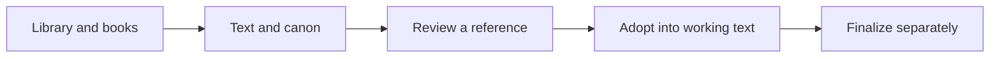

# Quick start

Begin in your library and open a book’s workspace. The website demo and local application use separate data.

## Try the homepage workspace

Open the [homepage demo](/en/#prototype). Every action stays on the homepage. Select **Chronicles of Wuchuan**, or use **Back to library** to switch books.

1. Search by title or author, filter by status, and switch between covers and a list.
2. Select **New book**. Save a planning book even without a title.
3. Open the sample book, edit Chapter 1 and select **Save text**. Switch chapters and return to see the in-page changes.
4. In **Draft review**, request changes with a comment, or inspect evidence and approve the review. Approval does not change the manuscript.
5. Preview and confirm **Adopt an excerpt**, then use **Finalize revision** in the editor for a separate author decision.

## Demo and local software

Refreshing resets all demo state. It accesses no files, models, MCP server or Git repository. Do not use it for the only copy of your writing.

The current macOS source implements a local library, chapters, editing, canon, plot, drama, review and versions. Build a development app using the repository instructions. Distribution signing, notarization and Windows verification are separate.

Continue with [Chapters and writing](writing.md), [Checks and draft review](review.md), or [External agents](agents.md).
