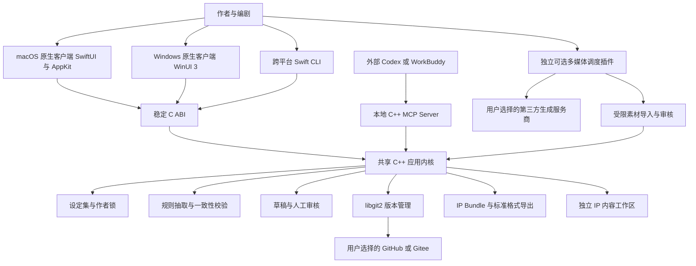
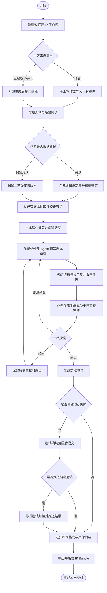
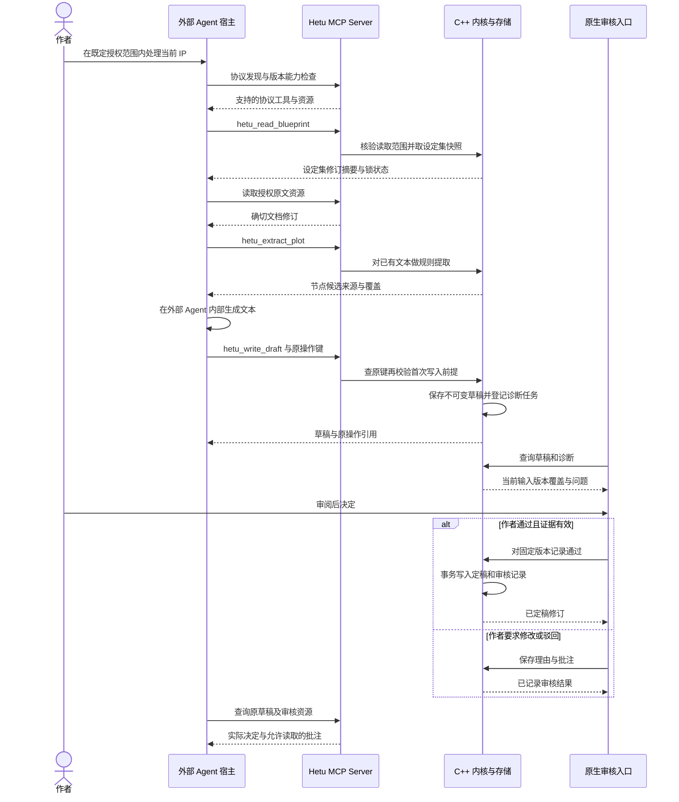
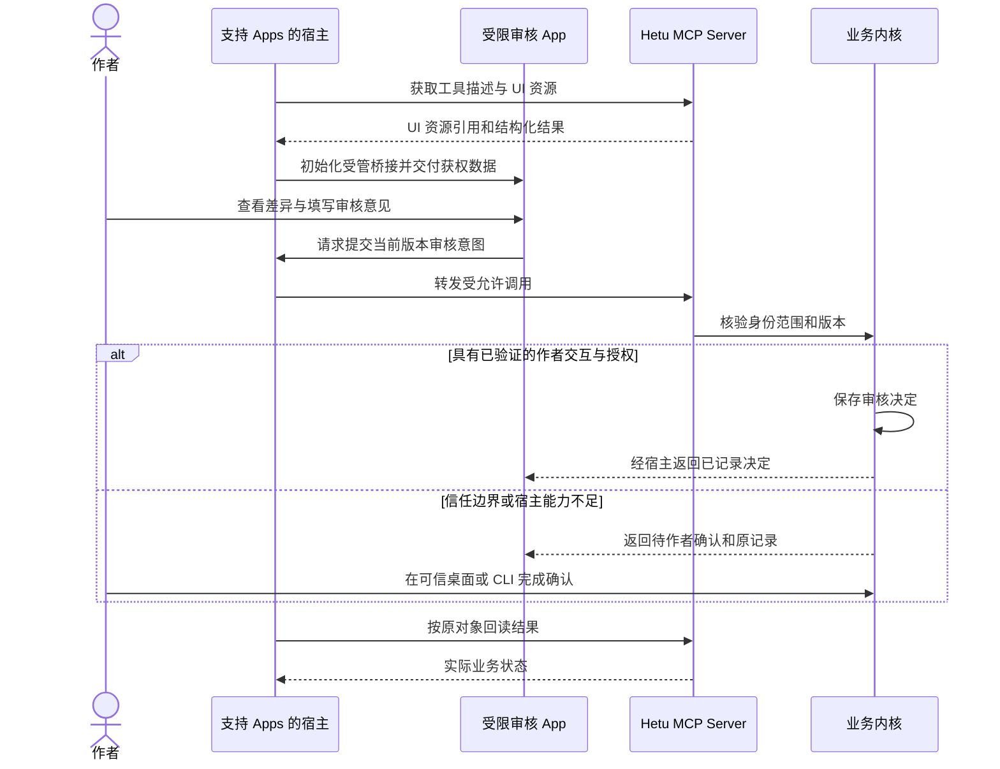
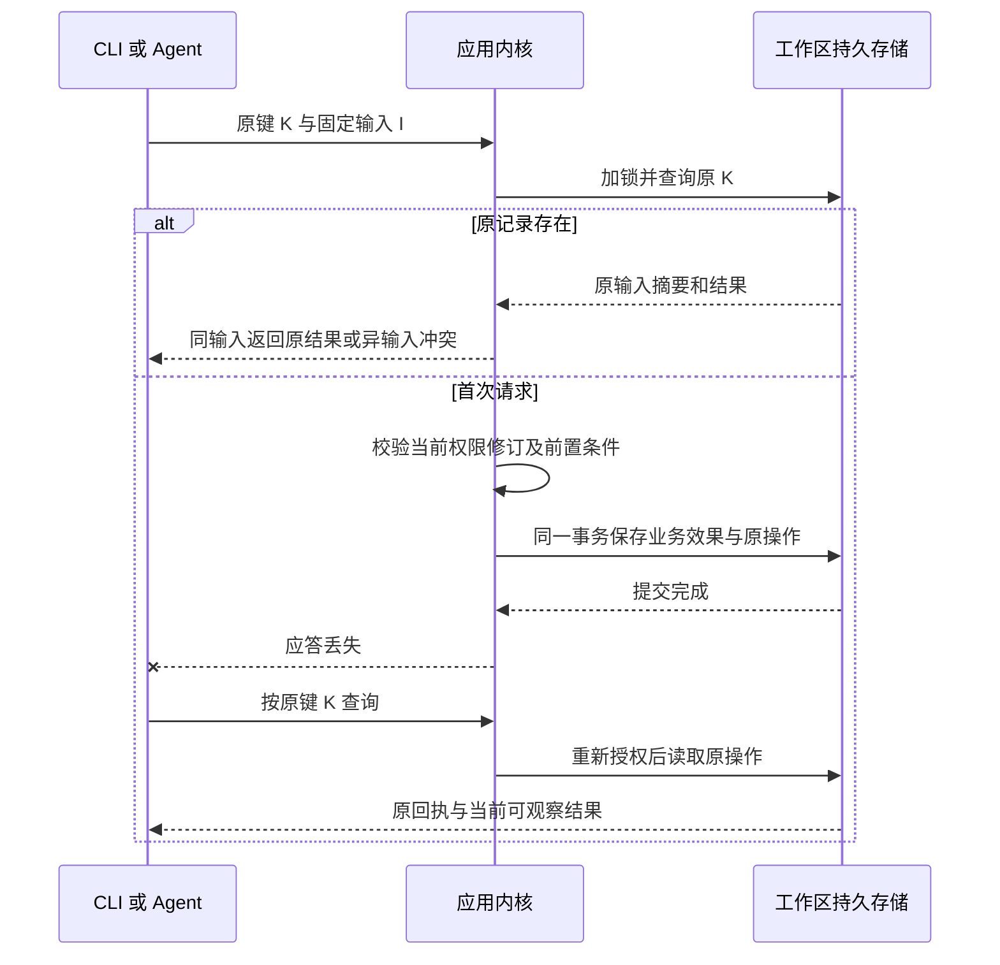
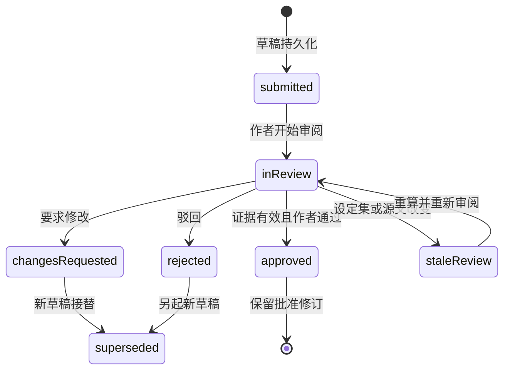
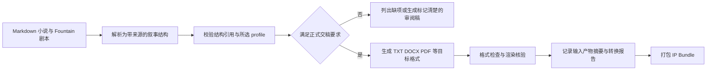
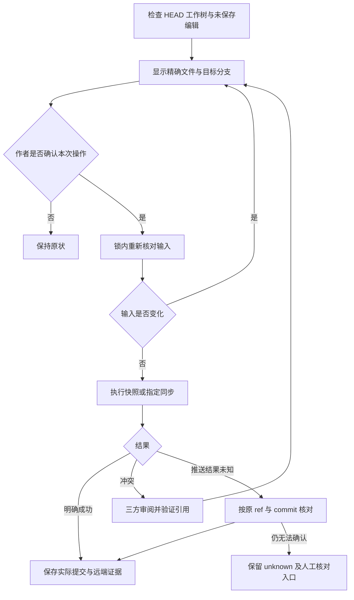

# 业务流程与 MCP 时序

本章描述系统职责、业务流程及成功与异常时序。精确字段以数据与 MCP 合同为准。

## 1. 系统上下文与整体架构

软件源码与内容工作区不同；图中插件为 P2，不是默认安装依赖。Server 可由宿主启动，不依赖 GUI 常驻，也不承诺宿主退出后 stdio 进程仍在运行。

## 2. 用户业务主流程

纯手工路径无需模型、网络或 MCP Apps。驳回回路表示作者可以继续修改，不表示河图自动运行 Agent。

## 3. MCP 调用与草稿审核时序

2026-07-28 协议使用 `server/discover` 与每请求元数据；旧宿主若采用 legacy 初始化需单独适配和验收，不能在同一版本图里混用两套握手。资源变化通知不等于宿主自动继续生成。

## 4. MCP Apps 审核与回退

Apps 关闭不取消业务任务，UI 保存成功不代表宿主已经发起下一轮对话。

## 5. 幂等与应答丢失恢复

## 6. 证据过期与定稿状态

`staleReview` 为审核上下文状态，不是新增 Draft 持久状态；报告版本与草稿生命周期分开。

## 7. 标准格式交付流程

## 8. Git 同步与冲突流程

