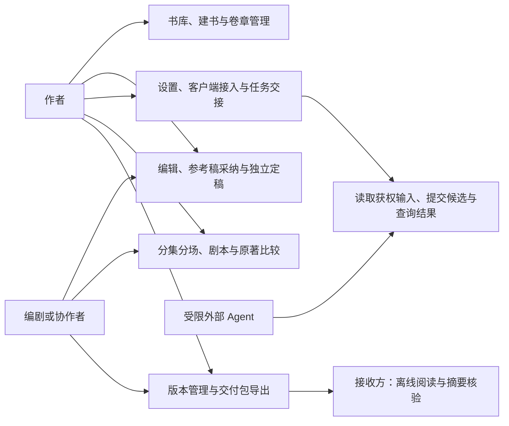

# 用户故事与用例

优先级与范围以[01](01-产品需求PRD.md)为准，正负验收见[19](19-测试策略与验收矩阵.md)，图示见[23](23-业务流程与MCP时序.md)。

## 1. 角色

- 作者／IP 所有者：维护正典、审核与选择交付，使用本机作者身份；不意味着已验证法律版权。
- 编剧／协作者：在自己的工作区编辑与提交，通过 Git 交换修订；V1 无实时团队权限服务。
- 外部 Agent：读取授权内容、提交草稿、提取／检查，不能自批或修改设定集。
- 接收方：阅读交付包和核验版本，不必安装河图。

角色描述工作目标，不等于全局权限角色。协作者在自己的本机以获权作者入口工作，不能据此取得另一台电脑或整座书库的权限；外部宿主、Skills 和 MCP Apps 是参与系统或交互载体，不替代人类作者。

图中按用户目标组织用例族，不把外部 Agent 视为作者角色。具体权限、前置条件及异常流程以下文用例和应用 API 为准。

## 2. 用户故事

| ID | 用户故事 | 需求 | 成功判据 |
| --- | --- | --- | --- |
| US-01 | 作为作者，我希望新建或打开一部作品的自有目录，以便离线持有内容 | FR-01 | 文件结构明确，非空目录不覆盖 |
| US-02 | 作为作者，我希望维护并锁定人设和世界规则，以便衍生内容有共同基准 | FR-02 | 正典可引用，Agent 无法编辑或解锁 |
| US-03 | 作为作者，我希望像普通原生编辑器一样写中文长篇，以免创作被工具打断 | FR-03／16 | IME、撤销、查找、保存与恢复可靠 |
| US-04 | 作为作者，我希望先审阅人物和地点候选，以免自动识别污染设定集 | FR-04 | 候选有原文，重名可消歧，不自动入典 |
| US-05 | 作为编剧，我希望得到已有章节的剧情节点，以便从文本整理结构 | FR-05 | 节点带来源且可校正，不添剧情 |
| US-06 | 作为作者，我希望知道冲突依据和未覆盖范围，以便判断是否需要修改 | FR-06 | 确定、启发式与未知分开，能跳回原文 |
| US-07 | 作为编剧，我希望把确认节点变成分集分场，以便开始改编 | FR-07 | 人物、场景、时序与缺项可见，无自动对白 |
| US-08 | 作为作者，我希望对照原著审阅改编，以免误改正典或丢失来源 | FR-08 | 新增、删减、重排与过期映射可查 |
| US-09 | 作为作者，我希望先把参考内容采纳为写作稿，编辑满意后再确认定稿 | FR-09 | 来源、审核、写作稿和定稿分开，采纳不自动定稿 |
| US-10 | 作为协作者，我希望按分支尝试改编，以便审查差异后合并 | FR-10 | 精确提交、保护脏工作树、冲突可处理 |
| US-11 | 作为作者，我希望选择自己的远端同步，以便控制内容外发 | FR-11 | 凭据安全，单次确认，未知推送可核对 |
| US-12 | 作为工作室，我希望交付一份能核验的 IP 包，以免制片方拿错版本 | FR-12 | 固定输入、定稿状态、材料和摘要完整 |
| US-13 | 作为 Agent 使用者，我希望用现有宿主操作受限工具，以免重复配置生成能力 | FR-13 | 能力发现、草稿、报告和原操作恢复可用 |
| US-14 | 作为作者，我希望在 Agent 内局部选择书名、大纲和封面，再回河图验收 | FR-14 | Apps 选择可回读，缺能力能回原生端，面板不能替作者定稿 |
| US-15 | 作为编剧，我希望组织画面与配乐线索，以便明确材料来源和使用权 | FR-15 | 不强制购买插件，不默认嵌入未知权利素材 |
| US-16 | 作为 Windows／Mac 用户，我希望使用原生工具及同一 CLI 合同 | FR-16／13 | 两端各自完成核心任务与可访问性验收 |
| US-17 | 作为自选供应商用户，我希望独立启用调度插件，以便掌握费用与数据外发 | FR-17 | 核心离线，付费任务按原 ID 恢复 |
| US-18 | 作为作者和制片方，我希望按标准格式交换小说和剧本 | FR-18 | 目标格式可读、转换损失可见、profile 可识别 |
| US-19 | 作为中文作者与英文协作者，我希望使用各自语言操作同一工程 | FR-19 | 双语功能完整，中文写作顺畅，切换语言不改内容与审核证据 |
| US-20 | 作为作者，我希望把小说封面任务交给所选客户端的专用 Skill，并在河图预览选用结果 | FR-20 | 软件只提供 Prompt；外部生成写回固定位置，候选可识别，选用由作者确认 |
| US-21 | 作为作者，我希望在一个书库管理自己的多部独立小说 | FR-21 | 封面和资料可查，卷章与设定独立，切换作品不混用内容或权限 |
| US-22 | 作为首次使用者，我希望从河图选择 AI 客户端并完成扩展接入 | FR-22 | Codex Plugin 与其他宿主的 Skills＋MCP 引导准确，安装、连接和能力分项显示 |
| US-23 | 作为只有一个想法的作者，我希望借外部 Agent 构思书名、简介和大纲后再建书 | FR-23 | 无书名也能保存筹备，候选可按字段选择，作者确认后才创建作品 |
| US-24 | 作为作者，我希望复制当前任务 Prompt 到自己使用的客户端继续对话 | FR-24 | Prompt 可预览，任务和基线固定，河图不代发消息或运行 Agent |
| US-25 | 作为作者，我希望用内置浏览器比较较大的局部成果 | FR-25 | 按需页面配对后访问同一任务，不能越权到整库或定稿 |
| US-26 | 作为作者，我希望按自己的风格直接写作和定稿，需要时再请求外部 AI 改稿 | FR-03／09／24 | 默认编辑可独立完成；改稿返回参考版本，是否使用及如何修改由我决定 |
| US-27 | 作为作者，我希望切换 Agent 或关闭页面后继续原任务 | FR-22／24／25 | 原请求、候选与决定保留，未知生成不自动重复，跨作品不串数据 |
| US-28 | 作为长篇作者，我希望维护分卷和章节顺序，以便调整结构而不丢正文或引用 | FR-03／21 | 改名、移动和重排保持稳定身份，来源、批注和定稿仍可追踪 |
| US-29 | 作为编剧，我希望分别管理同一小说的不同短剧改编方案 | FR-07／08 | 项目、分集、场次和剧本各有身份，重建骨架不覆盖人工方案 |
| US-30 | 作为作者，我希望集中配置阅读排版、界面语言和默认客户端 | FR-16／19／22 | 本机偏好即时生效，保留输入组合、正文内容和任务范围，不改全局配置 |
| US-31 | 作为作者，我希望结束局部交互或撤销外部访问，同时保留已收到的成果 | FR-13／22／25 | 页面、MCP 授权与供应商任务分别处理，撤权后旧键不能越权查询，正文与候选不删除 |
| US-32 | 作为长篇作者，我希望查找本书中的原文并安全替换当前章的内容 | FR-03／19 | 中文和混排命中可准确定位，未索引范围可见，替换可撤销且不改旧定稿 |

## 3. 用例约定

以下“成功”只表示本次用例目标成立；失败后保留原数据、原操作和明确状态。批准、Git、外发及数据删除的确认各自独立，不从一个操作扩大到另一个。

每个用例均给出参与者、关联故事、前置条件、主流程、异常与后置。正负验收按19中关联 FR 执行，贯通旅程单独记录实际平台与制品；用例被列出不表示软件已经通过验收。

跨用例关系：UC-05 可以扩展为 UC-18 或 UC-19 的局部交互，无增强界面时仍成立；UC-17 可以接受来自 UC-05 的参考稿，也能独立处理已有候选；UC-06 不包含 UC-05 或 UC-17 作为必经步骤。UC-07 的推送和 UC-10 的导出均不包含在定稿动作中。图中用例族只作导航，具体依赖以这些前置条件为准。

### 3.1 公共前置、失败保证与结果判断

每次受管读取和写入均重新核验身份及单筹备／单作品范围；写入还固定对象修订、输入和原操作键。清单有 ID、按钮已点击或页面已关闭都不是完成证据。正文保存以 Revision 回执为准，参考稿决定以 ReviewDecision 为准，采纳以 AdoptionRecord 和结果修订为准，定稿以 FinalizationRecord 及当前指针为准，交付以实际包和 manifest 为准。

下列保证适用于全部用例，不在每个异常段重复：失败保留未保存缓冲和既有不可变内容；冲突后展示当前事实，由作者重做选择；结果未知先查询原操作，不换键重发；失去权限后不能凭旧 ID 或原键读历史。只读预览不产生业务副作用，预览之后的任何输入变化均需重新确认。

### 3.2 用例关系与可选路线

| 当前用例 | 条件及后续用例 | 关系与停止位置 |
| --- | --- | --- |
| UC-16 建书筹备 | 作者需要外部辅助时使用 UC-12，封面探索使用 UC-22 | 安装和候选均可跳过，只有作者确认才创建作品 |
| UC-05 外部参考稿 | 作者选择采纳时进入 UC-17；需要局部界面时使用 UC-18／19 | 参考稿保存或审核可以是终点，不强迫采纳 |
| UC-17 局部采纳 | 结果成为当前写作修订，之后可进入 UC-21／06 | 采纳与参考稿审核独立，不包含定稿 |
| UC-21 手工创作 | 对已保存修订执行 UC-06 | 无 Draft、插件和网络同样成立 |
| UC-24 短剧管理 | UC-03／04 整理结构，UC-06 确认剧本 | 节点、骨架、剧本分别有修订，不覆盖另一方案 |
| UC-06 独立定稿 | 作者另外选择 UC-07 版本协作或 UC-10 交付 | 定稿成功即可结束，不隐含提交、联网或外发 |
| UC-09 稿件导入 | 作者校正后进入 UC-21 或 UC-24 | 导入以新的写作修订结束；导出另走 UC-10 |
| UC-18／19 局部交互 | 作者回原生端完成采纳、选用或定稿，结束访问走 UC-27 | 页面选择不是作者最终确认 |

用例表示用户目标，不要求一例对应一个页面或一个 API。相同目标的原生界面与人工 CLI 使用同一应用合同；具体入口权限以[30](30-应用API详细设计.md)为准。

## 4. UC-01 创建并纯手工创作

参与者：作者；关联 US-01／03／16；前置：可写的本地目录，无需网络、账号或 Agent。

主流程：选择空目录 → 预览工作区 → 创建 → 录入设定集 → 新建小说章节 → 中文编辑 → 保存修订 → 关闭重开。

异常：非空目录／权限拒绝时停止创建；保存失败保留缓冲；检测外部改写时显示差异。后置：已保存修订可重新读取，未保存缓冲不被标为定稿。验收：E2E-01 的前半段及 FR-01／03。

## 5. UC-02 候选采纳与设定集锁定

参与者：作者；关联 US-02／04；前置：存在正文与当前设定集。

主流程：扫描所选章节 → 查看人名／地点候选与证据 → 区分同名 → 新建或合并实体 → 校验引用 → 作者锁定。

异常：证据已过期则重新扫描；已锁定时先显式解锁；被引用实体删除须先迁移。后置：设定集递增版本，候选采纳可追溯，Agent 在锁定前后均无写权限。

## 6. UC-03 剧情抽取与节点校正

参与者：作者，受限 Agent 可请求抽取；关联 US-05／06；前置：固定正文修订与设定集读取范围。人工校正、实体消歧和确认由作者执行，不从 Agent 的抽取权限推导作者确认权限。

主流程：选章 → 提取 → 返回人物、动作、对话、场景与候选线索 → 作者消歧／标时间 → 保存节点修订。

异常：说话人未知保留未知；预算耗尽显示部分覆盖；未闭合引号提示人工确认。后置：所有节点有来源，未确认推断不会成为确定正典。

## 7. UC-04 分集骨架与手工剧本

参与者：编剧；关联 US-07／08／18；前置：选定节点修订。

主流程：设分集锚点 → 生成候选场次 → 补内外景／日夜 → 调整顺序 → 创建 Fountain 草稿 → 手工填对白 → 比较原著。

异常：缺少结构字段不猜值；重提取不覆盖已有人工分场；原著变化显示 stale。后置：骨架与正文分别可追踪，改编差异未自动回写原著或设定集。

## 8. UC-05 外部 Agent 草稿闭环

参与者：作者、外部 Agent、MCP；关联 US-13／02／09／24／26；触发：作者主动请求起草、建议或改稿。前置：宿主可用、工作区与读取／草稿权限明确。

主流程：河图选择章节、原文范围、目标及希望保留的表达 → 预览并复制任务 Prompt → 作者在所选客户端对话 → Skill 读取获权设定及原文 → 外部生成并提交固定基线候选 → 河图展示差异与可用诊断 → 作者决定只作参考自行改写、保留、放弃、返工或进入 UC-17 采纳。

异常：超时查询原键；异参数复用同键报冲突；提示注入作为正文；自报“作者批准”无效。后置：原文与未保存缓冲保持，收到候选不抢编辑焦点；没有核心生成调用、自批、设定集改写或 Git 副作用。作者未采纳任何内容也能继续写作和定稿。

## 9. UC-06 作者独立定稿

参与者：作者；关联 US-06／09／26；触发：在已保存正文上选择“确认定稿”。前置：写作稿、当前定稿指针和设定集可核验，待确认内容不含未保存缓冲；正文可以纯手工、导入或包含参考稿采纳记录。

主流程：

1. 软件固定文档当前修订、内容摘要、当前定稿引用及相关设定／规则。
2. 作者查看全文、与上次定稿的差异、来源和确切修订的报告。
3. 作者处理确定性错误；规则允许例外时，记录具体问题的处置；部分覆盖及未知前提记录人工核对范围。
4. 软件展示确认范围，作者明确确认本修订。
5. Core 重新核验作者权限、原操作键、正文、报告、处置与预期定稿 CAS。
6. 同事务保存不可变 FinalizationRecord、定稿指针、原回执与审计，界面展示所确认修订。

异常分支：A1 未保存或 IME 组合未结束，回编辑器处理后重新预览；A2 正文、设定或问题处置已变化，停止并重新检查；A3 数据完整性错误或不允许例外的确定性错误，硬阻断；A4 并发更新了定稿，返回冲突并展示当前记录；A5 回执丢失，按原键查询已提交结果，不另生成决定。

后置：定稿绑定所审阅修订，不创建另一份不同正文。继续编辑保留旧定稿；失败不部分更新指针；不自动 Git、导出、发稿或发送消息。验收：FR-06／09，E2E-01／10；图示见23第12／23～24节。

## 10. UC-07 Git 快照与远端推送

参与者：作者；关联 US-10／11；前置：用户已选择仓库与远端，有独立操作授权。

主流程：保存缓冲 → 选择文件与备注 → 看 diff → 确认快照 → 记录 commit → 预览远端 ref 与外发内容 → 另行确认 push → 核对远端。

异常：保留用户原 index；凭据失败不入日志；非快进不强推；超时先查原 ref。后置：只包含确认内容，不把已发出未知状态说成失败可重发。

## 11. UC-08 分支合并与冲突评审

参与者：协作者；关联 US-10／08；前置：两个已知修订，工作树已处理。

主流程：预览 base／ours／theirs → 显示 Markdown／Fountain 与 JSON 冲突 → 人工选择 → 校验设定集和引用 → 重新检查受影响报告 → 确认完成合并。

异常：同 ID 不同不可变正文视为完整性冲突；锁字段不自动采纳；取消不删除本地改动。后置：冲突解决可解释，过期审核不被移植为当前授权。

## 12. UC-09 标准稿导入与转换

参与者：作者、编剧；关联 US-18／03／07；触发：选择“导入稿件”。前置：作者选择有权使用的稿件、目标作品及期望的内部源格式；不存在未经处理的目标编辑缓冲。

主流程：

1. 固定原文件摘要，识别编码及格式；小说目标为 Markdown，剧本目标为 Fountain。
2. 预览正文、卷章或场次候选、转换损失和解析歧义，不写入正文。
3. 作者校正拆分、标题、卷组及目标；DOCX 修订痕迹明确选择处理策略。
4. 作者确认固定预览，Core 重验原文件、转换选项和目标目录修订。
5. 同事务写入源修订、目录引用、ImportRecord、原操作及审计；展示导入结果和来源。

异常分支：A1 编码或 Fountain 中文结构不确定，保留原文并要求确认；A2 不支持格式或无法表达的结构，阻断或明确列出损失，PDF 不作为无损源格式；A3 源文件或目标在确认后变化，整次停止并重新预览；A4 磁盘失败或回执丢失，按原键恢复，不重复建章。

后置：原文件可追溯，结果为写作修订，不自动定稿或入设定集。输出格式的转换、渲染与离线交付由 UC-10 独立执行。验收：FR-03／18，E2E-05，AC-13；图示见[导入时序](23-业务流程与MCP时序.md#29-小说与剧本导入时序)。

## 13. UC-10 IP Bundle 交付

参与者：作者、接收方；关联 US-12／15／18；触发：选择“导出交付包”。前置：选定作品、内容修订、定稿状态与素材来源可核对；不要求 Git 仓库、Agent 或远端在线。

主流程：

1. 作者选择章节、剧本、骨架、报告和线索，选择交付 profile 及格式。
2. 系统预览固定定稿、来源、缺口与排除项；待审材料只能显式进入有标识的审阅包。
3. 作者确认计划，Core 固定输入清单及原键，不把后来的当前稿混入计划。
4. 从固定修订转换并渲染核验，流式创建临时包及 manifest，作者可以继续编辑。
5. 重新读包核验路径和摘要，发布前重验本次资格；以新文件发布并保存可恢复回执。
6. 作者查看核验结果并自行交付；接收方离线阅读并按 manifest 核对版本。

异常分支：A1 过期或缺失报告按 profile 阻断或明确披露，不标为最新；A2 权利未知默认排除，发布前权利或定稿被撤回则停止并重新选择；A3 摘要损坏、格式不可表达或磁盘满，不覆盖旧包；A4 产物已发布但回执丢失，核对原产物和原键，不重复导出。

后置：包可离线阅读，manifest 定位确切输入及实际产物；不自动上传、发稿或通知接收方，后续编辑不改变历史包。验收：FR-12／15／18，E2E-01／05，AC-16／17；图示见[交付时序](23-业务流程与MCP时序.md#30-固定版本交付与回执时序)。

## 14. UC-11 跨进程冲突与崩溃恢复

参与者：作者与多个受管入口；关联 US-01／03／09／13；前置：同一工作区存在并发请求。

主流程：首写成功 → 第二写冲突 → 事务中断 → 重开查询原操作 → 核对文件摘要 → 恢复或隔离冲突 → 回到作者审阅。

异常：第三方改写不覆盖；未知 push 不重发；缓存损坏可重建，修订损坏保留证据。后置：没有混合定稿或消失的审核历史。

## 15. UC-12 插件安装、接入与退出

参与者：作者、所选 Agent 客户端；关联 US-13／14／22；前置：已安装河图，可无作品；扩展来源及版本明确。

主流程：河图设置选择客户端及表面 → 显示 Codex Plugin 或适配的 Skills＋MCP 引导 → 作者在客户端安装和连接 → 按宿主要求开新会话 → 只读检查实际 Skills、MCP 与 scope → 回河图复制建书或已有作品 Prompt → 读取真实回执。

异常：无 Apps 回退；缺 CLI／MCP 不静默下载安装；安装缓存与源码不一致按实际制品排查；用户勾选完成不伪装检测通过；禁用扩展与撤销范围授权分别处理。后置：卸载不删除作品，未接入不阻断手工创作；兼容声明绑定实际宿主版本。

## 16. UC-13 中英文切换与中文交稿

参与者：中文作者、英文协作者；关联 US-19；前置：已打开工作区，存在未保存编辑和固定修订。

主流程：中文 IME 写作 → 保存修订并核验字数 → 切换英文界面 → 查看同一报告和来源 → 按接收方语言选择交付模板 → 导出并核验内容摘要。

异常：缺翻译采用明确回退；编码歧义先预览；字体缺字阻断正式交稿。后置：切换语言不改变正文、名称、审核与原操作，双语入口功能一致。验收：FR-19 与 E2E-06。

## 17. UC-14 封面 Skill 交接与作者选用

参与者：作者、Codex 或兼容外部 Agent；关联 US-20；前置：已选定小说，图像能力在外部宿主可用。

主流程：作品封面页编辑设计要求 → 查看 Prompt 与外发资料 → 创建不可变任务 → 复制 `$hetu-cover` 调用说明 → 外部生成并写回候选和回执 → 河图核验展示 → 作者选用 → 书库刷新封面。

异常：无图像工具时不伪造结果；半写入等待回执；跨作品或摘要不符拒绝；尺寸不同提示作者；软件关闭期间完成则重开补查。后置：候选、请求和旧封面可追溯，Agent 无选用权限，核心无生成网络请求。验收：FR-20，详细合同见[34](34-小说封面与Agent协作.md)。

## 18. UC-15 多小说书库与作品切换

参与者：作者；关联 US-21；前置：本机登记两部独立小说，可使用不同笔名、设定和目录。

主流程：书库查看封面／状态／字数 → 搜索选定作品 → 编辑该书分卷和章节 → 保存 → 返回书库 → 打开另一作品 → 查看它自己的设定和版本。

异常：目录失效要求重新定位；同名作品以笔名及目录说明区分；第一部未保存编辑按编辑器恢复规则处理；跨作品 Agent 访问拒绝。后置：书库登记不复制作品正典，章节、诊断、封面和授权均保持归属，不要求作品属于同一系列。

## 19. UC-16 从想法到第一本书

参与者：作者、所选外部 Agent 与建书 Skill；关联 US-22／23／24；前置：已打开河图，可没有书名、作品目录或已安装 Agent。

主流程：新建表单输入想法 → 保存独立筹备 → 需要时完成客户端接入 → 预览并复制建书 Prompt → 在客户端对话 → Skill 回传方向、书名、简介及大纲候选 → 河图核验展示 → 作者按字段选择、修改 → 确认目录 → 创建独立作品并关联筹备来源。

异常：取消安装可继续手工；没有结果保留筹备；不同批次候选不互相覆盖；同名或非空目录不覆盖；创建应答未知查原键。后置：只有作者创建操作形成作品，不预建一部虚构书名的小说，不让 Agent 读取其他作品。

## 20. UC-17 AI 参考稿局部采纳

参与者：作者；关联 US-09／24／26；触发：在原生比较界面选择“采纳到写作稿”。前置：参考稿不可变内容、目标与基线均可核验；作者已处理目标编辑缓冲。新章节可没有既有文档，但须预览标题和卷组。

主流程：

1. 软件读取候选、提交基线与当前写作稿，显示三方比较和当前定稿。
2. 作者选择段落、替换范围和自己的修改，核对目标；选择整稿也必须预览。
3. Core 产生固定差异及预览摘要，展示未选内容不会进入正文。
4. 作者确认后提交固定预览、选区、预期目标和原键。
5. Core 在锁内查原键并重验权限、候选内容、UTF-8 范围／quote、目标 CAS 和目录归属。
6. 同事务保存新当前修订、AdoptionRecord、所需章节引用、原回执与审计，保持定稿指针。
7. 编辑器展示结果，作者可以继续改写、撤销或在之后独立定稿。

异常分支：A1 目标已变化，保留作者选择并重新比较，不自动应用旧 patch；A2 选区越界、重叠、quote 不符、候选损坏或目标跨作品，拒绝整次操作；A3 IME 组合未结束或尚有本地修改，先处理编辑缓冲；A4 磁盘满或事务中断，保留原稿并恢复原操作；A5 回执丢失，按原键回读，不创建第二份采纳修订。

后置：未选内容不进入正文，定稿指针不变，来源可追踪；撤销通过后继编辑保留原候选和历史采纳。审核通过、局部选择与采纳分别记录。验收：FR-03／09／24，E2E-02／10；图示见23第11／22／26节。

## 21. UC-18 MCP Apps 局部选择

参与者：作者、支持 Apps 的客户端、MCP App；关联 US-14／23／24；前置：精确宿主版本通过相应 Apps 验收，存在固定候选。

主流程：宿主加载任务 UI → 协商桥接并接收候选 → 作者选择书名、调整大纲意图或比较封面 → 显式保存 → Core 记录 InteractionDecision → Agent 回读该选择 → 根据作者要求继续对话 → 河图展示相同结果。

异常：无 Apps 或桥接失败回原生端；候选修订变化返回冲突；迟到事件不得串任务；关闭面板不取消生成；保存成功不等于 Agent 已续跑。后置：局部选择不创建作品、不改正典、不定稿或自动选封面。

## 22. UC-19 Node.js 局部页面配合

参与者：作者、河图、可达本机的内置浏览器；关联 US-25／27；前置：本任务需要更大视图或宿主缺 Apps，页面运行组件可用。

主流程：作者启动本任务页面 → 软件分配动态回环端口 → 内置浏览器打开 → 原生端确认配对及单任务范围 → 页面读取候选并保存意见 → Core 返回真实修订 → 作者回河图验收 → 停止页面并释放端口。

异常：云端浏览器不能访问回环则回原生端；非授权 Origin、过期会话、跨任务或跨作品访问拒绝；Node.js 缺失不全局安装；服务重启重新配对。后置：无公开隧道、无第二套数据，浏览器不能取得定稿或 Git 权限。

## 23. UC-20 切换客户端并恢复原任务

参与者：作者、两个外部客户端；关联 US-22／24／27；前置：已有任务或结果未知的提交。

主流程：回读原任务和提交 → 核对已有候选 → 在河图改选客户端 → 为同一输入生成适配的调用说明 → 作者复制到新客户端 → 新候选以独立批次提交 → 比较批次来源及结果。

异常：前次付费生成未知不自动重做；改要求须创建新修订；新客户端权限独立授予；重放原提交不增加候选。后置：正文、设定、旧候选与审核保持，切客户端不复制创建作品。

## 24. UC-21 不依赖 AI 的编辑与定稿

参与者：作者；关联 US-03／09／26；前置：离线且无 Agent 扩展的河图。

主流程：创建作品与章节 → 原生中文编辑、查找替换和撤销 → 自动保存可恢复缓冲 → 显式保存修订 → 重开读取修订及恢复未提交缓冲 → 执行检查 → 对保存修订确认定稿 → 继续编辑形成新写作稿 → 查看旧定稿。

可选扩展：作者需要改稿建议时，从当前章节主动进入 UC-05。返回的参考稿独立保留；作者可忽略、参照后自行重写，或经 UC-17 选择性采纳，再继续本用例。该扩展不改变编辑器默认行为或要求每章都使用 AI。

异常：保存冲突或崩溃保留作者缓冲；未保存部分不能被定稿；定稿证据过期要求重新检查。后置：无需 AI 参考稿或对话记录，定稿不依赖插件、网络、Git 或生成账号。

## 25. UC-22 筹备封面转为正式候选

参与者：作者、封面 Skill；关联 US-20／23；前置：存在建书筹备、设计候选和原始请求摘要。

主流程：筹备期复制封面设计 Prompt → 外部 Agent 按筹备范围生成候选 → 河图等比预览 → 作者创建作品 → 明确选择导入哪些候选 → 核验来源与新书资料差异 → 在作品封面页另行选用。

异常：最终书名或笔名不同则提示文字风险；跨筹备混入拒绝；创建取消保留筹备图；导入失败保持当前封面。后置：CoverRequest 与正式 BookCover 均可追溯，筹备图不自动成为封面。

## 26. UC-23 分卷与章节结构调整

参与者：作者；关联 US-03／21／28；前置：已打开作品，卷章目录与目标正文可核验。

主流程：新建卷或章节 → 填写名称及归属 → 保存目录与初始正文 → 拖动或通过键盘重排 → 跨卷移动 → 查看正文、批注、来源及历史定稿仍关联原对象。

异常：同名允许但身份不同；不允许重复 document 引用、跨作品移动或隐式删除章节；并发目录修改先比较；删除非空卷必须先明确章节去向。后置：目录顺序按作者决定，稳定 ID 与原文字节不因排序改变，失败不出现无正文的章节登记。验收：FR-03／21，图示见23第17节。

## 27. UC-24 多短剧项目与分集剧本维护

参与者：作者、编剧；关联 US-07／08／18／29；前置：当前作品及需要改编的原著修订已明确。

主流程：创建独立短剧项目 → 固定原著来源 → 建立并校正分集分场 → 从所选骨架建立剧本文档 → 手工编辑或采纳外部参考稿 → 对比原著 → 独立定稿 → 切换另一项目查看其自身方案。

异常：重复集号不等于同一场次；重建骨架不覆盖人工方案；原著变化标记来源过期；跨项目移动必须明确引用与目标，不能依据相同名称合并。后置：不同改编方案分别管理，小说正文与其他剧本不被连带改写。验收：FR-07／08／18，图示见23第18～19节。

## 28. UC-25 设置与创作上下文保持

参与者：作者；关联 US-19／22／30；前置：书库或作品窗口已打开，可有未保存编辑或输入法组合。

主流程：打开原生设置 → 调整语言、外观、书库布局或正文排版 → 查看只读预览 → 选择默认外部客户端并查看接入状态 → 回到原作品继续编辑。

异常：输入组合期间延后排版更新；缺字体采用平台回退并明确提示；修改默认客户端不改写已交接任务；连接缺失不能标为通过。后置：偏好留在本机，选区、撤销栈、正文摘要与定稿不变，不自动安装扩展、修改全局 Git 或发送 Prompt。验收：FR-16／19／22。

## 29. UC-26 素材导入与线索管理

参与者：作者、编剧；关联 US-15／18／20；前置：当前作品范围明确；可只录入说明，不要求已有媒体或生成账号。

主流程：建立视觉／配乐线索 → 引用固定正文选区或场次 → 可选通过系统文件面板选择媒体 → 预检摘要、类型及限制 → 填写来源与权利声明 → 核对预检结果并导入 → 关联素材与线索 → 查看预览与历史 → 导出时单独选择说明或允许嵌入的媒体。

异常：预检后文件改变则重新选择；不支持类型、越界路径、符号／硬链接及超限文件拒绝；正文变化保留旧引用并标过期；权利未知或已撤回默认排除媒体；导入回执丢失按原键回读，不依赖外部原文件仍存在。

后置：受管媒体原字节、摘要、来源及权利声明可追溯。无媒体线索仍可保存；素材导入不自动成为封面，不默认外发或保证版权。验收：FR-15／18／20，图示见23第25节。

## 30. UC-27 结束交互与撤销访问

参与者：作者、外部宿主、局部页面；关联 US-13／22／25／27／31；前置：存在局部面板、已配对网页或 MCP 范围授权，允许有在途或结果未知的操作。

主流程：作者选择要关闭的面板、页面服务或外部授权 → 查看该动作的具体范围 → 停止页面时撤销会话并释放端口；撤销 MCP 时结束相应范围访问 → 获权作者入口回读在途原操作 → 保留任务、候选、正文和决定 → 后续访问重新核验权限。

异常：权限撤销与事务提交并发，按范围内提交次序确定结果，不把已提交内容回滚；失权客户端不可凭原键查询；供应商任务仍运行时仅说明观察已结束，不声称取消或退款；卸载扩展不删除作品，外部 OS 文件权限需在对应宿主另行处理。

后置：所选交互或授权已结束，完成状态有回执，业务历史可由仍获权作者读取。恢复访问需要重新授权／配对，关闭窗口不成为新的生成请求。验收：FR-13／22／25，图示见23第27节。

## 31. UC-28 中文全文检索与当前章替换

参与者：作者；关联 US-03／19／26／32；触发：打开查找或替换。前置：当前作品已授权；可以存在未保存缓冲，不要求 Agent、网络或完整索引。

主流程：

1. 作者选择当前文档或本作品已保存正文，明确精确匹配或中文分词模式。
2. 系统在当前缓冲或固定修订的检索投影中查询，展示命中、未覆盖范围及来源；索引可以从正文重建。
3. 作者选择命中，系统核验修订、UTF-8 范围和 quote；当前缓冲命中按本机缓冲版本定位。
4. 原稿未变化则定位原文；已经变化则展示历史引文，并让作者选择重查当前稿，保留未保存编辑。
5. 需要替换时，在当前编辑器预览替换范围、确切内容及数量，由作者确认单次或当前章全部替换。
6. 替换更新缓冲并可一次撤销／重做；作者显式保存时按当前基线创建修订，定稿保持原指向。

异常分支：A1 索引未完成或失败，显示部分覆盖及原因，不能声称全书无命中；A2 简繁、大小写、组合字符或分词投影无法无歧义回映原文，不执行替换；A3 IME 组合未完成，延后替换并保留选区；A4 定位、替换或保存时基线变化，保留作者缓冲并重新比较；A5 作者切书后旧查询才返回，丢弃旧上下文投影，不显示另一部作品正文。

后置：查询不写正文，替换仅作用于当前编辑器，撤销不丢来源与历史；不跨书扫描，不自动保存、定稿或批改其他章节。检索与替换交互以[10](10-原生客户端与交互设计.md#4-正文编辑体验)为准，规范化边界以[31](31-国际化与中文体验.md#4-中文输入排版与编辑)为准。验收：FR-03／19，E2E-06／10，AC-18；图示见[检索流程](23-业务流程与MCP时序.md#31-中文检索定位与替换流程)。

## 32. 逐用例追踪与验收索引

本表从用户目标定位业务拥有者、应用合同和可执行场景；用户故事及前置条件由对应 UC 正文维护。合同列指向设计定义，不表示动作已经进入当前构建的能力目录。本机偏好和宿主安装通过平台适配完成，不为凑齐 API 另造远程动作。

| 用例／目标 | 需求 | 核心对象或结果 | 合同与图示 | 验收 |
| --- | --- | --- | --- | --- |
| UC-01 手工建书与创作 | FR-01／03／16 | Workspace、Document、Revision | [作品与正文动作](30-应用API详细设计.md#4-工作区与设定集动作)；23第3／16节 | E2E-01；AC-02 |
| UC-02 设定候选与锁定 | FR-02／04 | Blueprint、证据及锁修订 | [设定动作](30-应用API详细设计.md#4-工作区与设定集动作)；23第20节 | E2E-01；19第2节 |
| UC-03 抽取与校正 | FR-05／06 | PlotRevision、SourceRef、覆盖 | [结构与校验动作](30-应用API详细设计.md#6-抽取骨架对比与校验)；23第19～20节 | E2E-01；19第2.1节 |
| UC-04 骨架与手工剧本 | FR-07／08／18 | Skeleton、Document、结构映射 | [结构与剧本动作](30-应用API详细设计.md#6-抽取骨架对比与校验)；23第18～19节 | E2E-01／05；AC-15 |
| UC-05 外部参考稿闭环 | FR-13／24 | CreativeTask、Draft、ReviewDecision | [草稿动作](30-应用API详细设计.md#5-正文草稿与导入)、[任务动作](30-应用API详细设计.md#17-建书筹备与外部创作任务)；23第7／10节 | E2E-02；AC-03 |
| UC-06 独立定稿 | FR-06／09 | FinalizationRecord、定稿指针 | [定稿动作](30-应用API详细设计.md#7-审核与素材)；23第12／23～24节 | E2E-10；AC-06～07 |
| UC-07 Git 快照及同步 | FR-10／11 | Snapshot、Commit、远端证据 | [Git 动作](30-应用API详细设计.md#8-gitbundle-与恢复)；23第15节 | E2E-04；19第2节 |
| UC-08 合并与冲突评审 | FR-08／10 | 三方冲突、修订与重新校验结果 | [Git 合同](16-Git版本与协作.md)；23第15节 | E2E-04；19第2节 |
| UC-09 稿件导入 | FR-03／18 | ImportRecord、Revision、卷章目录 | [导入动作](30-应用API详细设计.md#5-正文草稿与导入)；23第29节 | E2E-05；AC-13 |
| UC-10 Bundle 交付 | FR-12／15／18 | Bundle、固定输入与 manifest | [交付动作](30-应用API详细设计.md#8-gitbundle-与恢复)；23第14／30节 | E2E-05；AC-16～17 |
| UC-11 并发与崩溃恢复 | FR-01／03／09／13 | Operation、事务与恢复状态 | [恢复合同](07-工作区与持久化设计.md#5-崩溃并发与外部编辑)；23第13／22节 | E2E-03；AC-05／08／17 |
| UC-12 安装与接入 | FR-13／22 | 客户端适配、接入检查、授权范围 | [接入合同](27-Agent与Codex插件集成设计.md)；23第3／5节 | E2E-07；19第2节 |
| UC-13 双语及交稿 | FR-18／19 | 本机 locale、交付 profile | [国际化合同](31-国际化与中文体验.md)；23第14／22节 | E2E-06；AC-10 |
| UC-14 封面选用 | FR-20 | CoverRequest、候选、BookCover | [封面合同](34-小说封面与Agent协作.md)；23第4节 | E2E-07；19第2节 |
| UC-15 多小说书库 | FR-01／21 | Library 登记、Novel、作品身份 | [本机登记合同](07-工作区与持久化设计.md#4-保存与事务)；23第16节 | AC-01 |
| UC-16 从想法建书 | FR-22／23／24 | CreationProject、候选与创建回执 | [筹备与任务动作](30-应用API详细设计.md#17-建书筹备与外部创作任务)；23第4／6节 | E2E-07 |
| UC-17 参考稿局部采纳 | FR-03／09／24 | AdoptionRecord、新 Revision | [采纳动作](30-应用API详细设计.md#7-审核与素材)；23第26节 | E2E-02／10；AC-04～05／08／14 |
| UC-18 Apps 局部选择 | FR-14／24 | InteractionDecision、单任务投影 | [局部选择动作](30-应用API详细设计.md#18-局部选择与页面会话)；23第8节 | E2E-08；AC-09 |
| UC-19 本地浏览器 | FR-25 | 已配对会话、InteractionDecision | [页面会话动作](30-应用API详细设计.md#18-局部选择与页面会话)；23第9节 | E2E-09；AC-09／12 |
| UC-20 切换客户端 | FR-22／24／25 | 原 CreativeTask、独立候选批次 | [任务动作](30-应用API详细设计.md#17-建书筹备与外部创作任务)；23第7／13节 | E2E-02／07；19第2节 |
| UC-21 手工编辑及定稿 | FR-03／09 | 编辑缓冲、Revision、FinalizationRecord | [正文与定稿动作](30-应用API详细设计.md#7-审核与素材)；23第11／22～23节 | E2E-01／10；AC-02／07 |
| UC-22 筹备封面导入 | FR-20／23 | 筹备候选、导入来源、BookCover | [筹备与封面边界](30-应用API详细设计.md#17-建书筹备与外部创作任务)；23第4／6节 | E2E-07；19第2节 |
| UC-23 卷章结构 | FR-03／21 | Novel、稳定卷章引用 | [作品目录动作](30-应用API详细设计.md#小说作品与卷章)；23第17节 | AC-01／14 |
| UC-24 多短剧项目 | FR-07／08／18 | DramaProject、Skeleton、剧本修订 | [改编合同](09-小说与短剧流水线.md)；23第18～19节 | E2E-05；AC-15 |
| UC-25 本机设置 | FR-16／19／22 | 本机偏好、编辑上下文 | [交互与设置合同](10-原生客户端与交互设计.md)；23第22节 | E2E-06；AC-10 |
| UC-26 素材与线索 | FR-15／18／20 | AssetCue、Asset、当前权利声明 | [素材动作](30-应用API详细设计.md#7-审核与素材)；23第25节 | AC-11；19第2.1节 |
| UC-27 退出及撤权 | FR-13／22／25 | 会话撤销、scope 状态、原操作回执 | [访问与撤权合同](18-安全与隐私.md)；23第27节 | E2E-09；AC-12 |
| UC-28 检索及当前章替换 | FR-03／19 | 检索投影、SourceRef、编辑缓冲 | [编辑合同](10-原生客户端与交互设计.md#4-正文编辑体验)；23第31节 | E2E-06／10；AC-18 |

US-17／FR-17 的独立商业插件由[22](22-插件生态开源许可与商业化.md)定义验收，不以核心用例通过替代插件证据。上述核心用例均按 macOS、Windows 和所声明宿主分别记录结果；实施先后以[20](20-实施路线与里程碑.md)为准。

每次验收记录需求与用例 ID、平台／语言／宿主、软件与合同版本、正向／失败／恢复证据及实际结论。设计覆盖不等于实现完成，跳过项和不可用组合不能计为通过。
