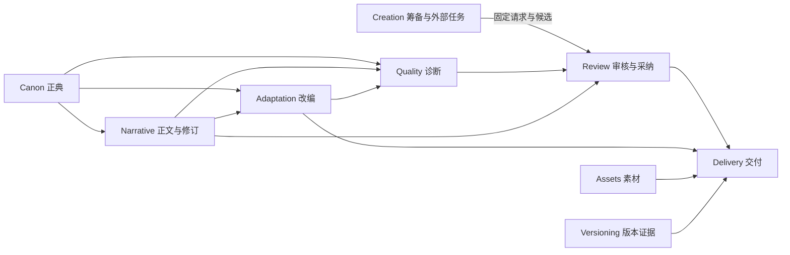

# 领域设计与边界上下文

共同术语与身份见[05](05-领域模型与数据合同.md)，持久字段见[29](29-数据字典与Schema设计.md)，操作见[30](30-应用API详细设计.md)。采用模块化单体，边界上下文不直接对应独立微服务或仓库。

## 1. 通用语言

| 术语 | 唯一含义 |
| --- | --- |
| 作者书库 | 作者登记和查找多部独立作品的本机入口，登记项不自动授予内容访问权限 |
| 小说作品 | 具有独立身份、资料、封面、卷章、设定、素材与版本的创作对象 |
| 作品工作区 | 单部作品的文件、身份与授权范围；作者可持有多个工作区 |
| 分卷／章节 | 小说内部的可选分组与正文单元，编号和顺序独立于稳定身份 |
| 短剧项目 | 独立管理分集、场次、剧本和修订的改编或原创项目；改编时关联固定原著来源 |
| 建书筹备 | 尚未创建正式作品的想法、资料候选和选择记录，允许没有书名 |
| 外部创作任务 | 作者准备、复制到外部客户端、按固定合同接收候选的请求，不是内置 Agent 运行任务 |
| 局部选择 | 对当前候选的偏好、选项和意见，可由 Apps 或网页记录，不等同于采纳或定稿 |
| 封面任务 | 作者确认的设计 Prompt 与输出约定，外部 Skill 提交候选，作者选用才改变当前封面 |
| 设定集／正典 | 作者确认的角色、势力、地点、事件与规则 |
| 正文修订 | 不可变的小说或剧本文本，格式与摘要明确 |
| AI 参考稿 | 外部 Agent 提交的不可变文本候选，不自动进入正式正文 |
| 写作稿 | 作者正在编辑的当前文档修订及未保存缓冲，可包含已采纳参考内容 |
| 采纳 | 作者把选定参考内容应用到写作稿并保存来源的操作，不设置定稿 |
| 剧情节点 | 有原文引用的动作、对话、场景或待确认线索 |
| 骨架 | 已有节点的分集与分场组织，不含系统生成的新对白 |
| 诊断 | 某组固定输入在特定规则下的问题与覆盖 |
| 审核决定 | 作者针对确切输入的通过、驳回或修改要求 |
| 定稿 | 作者独立确认确切正文修订的记录与指针，不等于参考稿通过、Git 提交或平台发稿 |
| 快照 | 用户明确创建的 Git commit，不等于自动保存 |
| 交付包 | 固定内容、格式、来源、状态和摘要的导出产物 |

## 2. 边界上下文

| 上下文 | 拥有事实 | 消费事实 | 禁止承担 |
| --- | --- | --- | --- |
| Library | 本机作品登记项、排序与定位状态 | 作品资料和封面的摘要投影 | 合并不同小说设定、授予整库 Agent 访问 |
| Creation | 建书筹备、任务请求、候选批次和局部选择 | 作者提供的意图及授权输入快照 | 实现 Agent、自动创建作品、赋予整库权限 |
| Workspace | 单部作品身份、格式、包配置、受管根 | OS 目录权限 | 跨目录自动发现作品 |
| Canon | 设定集、正典实体、事实有效期、规则和锁 | 作者确认的建议、源文证据 | 自动采纳 Agent 推断 |
| Narrative | 小说资料与卷章目录、文档、修订、剧本结构与批注 | 设定集实体 ID | 更改正典或自动通过审核 |
| Adaptation | 节点修订、骨架、源映射和改编差异 | 固定正文与设定集快照 | 无来源新剧情、覆盖原著 |
| Quality | 规则执行、报告、覆盖、问题处理记录 | 固定输入与引擎版本 | 对无法证明的语义给确定结论 |
| Review | 参考稿审核、采纳来源、例外与独立定稿 | 报告、候选／正文基线、作者能力 | 运行模型、把采纳自动升级为定稿 |
| Assets | 线索、文件、封面任务、候选及作者选用／权利声明 | 作品资料快照、人物／场次引用 | 保证版权、核心自动调用供应商 |
| Versioning | Git 观察、预览、操作和远端证据 | 已选文件与作者确认 | 将 Git ACL 当产品角色授权 |
| Delivery | 交付选择、profile、manifest 与排除项 | 固定修订和审核证据 | 自动上传或法律认证 |
| Agent Access | 客户端适配、连接范围、工具投影、协议与方法 | 用例合同和本机授权 | 实现模型对话、保存第二套任务或业务状态 |

审计与 Operation Ledger 是跨用例的基础设施能力，不是另一个拥有内容事实的业务平台。

图示主要事实消费链，箭头从事实拥有者指向消费者，表示消费固定事实及引用，不表示源码依赖、远程调用或自动写入。Library 和 Workspace 管理本机登记及范围身份；Agent Access 只适配获权用例，不作为业务事实的上游。组件调用关系见[23第2节](23-业务流程与MCP时序.md#2-内部组件与依赖)。

| 上下游关系 | 交换合同 | 写入边界 |
| --- | --- | --- |
| Workspace／Narrative／Assets → Library | workspace_id 与作品资料／封面投影 | Library 只更新本机登记，不能反写正文或扩大权限 |
| Creation → Narrative／Assets | 作者确认字段、候选引用与来源摘要 | 创建作品或选用封面是新的作者用例，不消费“选择已保存”作为批准 |
| Canon／Narrative → Adaptation／Quality | 固定设定及正文修订、SourceRef | 下游追加节点、骨架或报告，不写回上游 |
| Quality／Narrative → Review | 固定报告、处置摘要、当前写作稿及候选基线 | 参考稿审核、采纳及定稿各有独立事务，不通过事件自动升级 |
| Review → Narrative | 作者采纳结果或独立定稿决定 | Application 协调来源记录与当前／定稿指针，不要求两个领域相互导入存储实现 |
| Narrative／Review／Assets → Delivery | 固定修订、定稿证据、媒体和当前权利 | 冻结交付计划，发布前核验资格；产物不反向更新正文 |

外部协议、文件格式和宿主类型经适配器转换后才能进入上述合同；领域不接收 MCP clientInfo、浏览器会话或 libgit2 句柄作为作者授权。上下文之间不建立各自维护的永久同步副本。

## 3. 聚合与一致性边界

| 聚合根 | 内部对象／值 | 必须保护的不变量 |
| --- | --- | --- |
| CreationProject | 作者意图、选中字段、任务引用与创建关联 | 无作品也能存在；仅作者确认创建；最多关联一个创建结果 |
| CreativeTask | 不可变请求、输入快照、候选提交引用 | 单一 scope；候选只属于固定请求；不修改已交接基线 |
| InteractionDecision | 固定候选选择、意见及修订链 | 选择只对当前获权任务生效，不产生定稿或跨范围权限 |
| Novel | 作品资料、卷章目录、正文引用 | 独立作品身份；卷章顺序与 ID 分离；引用属于本作品 |
| DramaProject | 原著关联、分集分场、剧本引用 | 改编来源固定；小说章节与剧本场次保留各自结构 |
| BookCover | 选用修订、素材引用、裁切与文字叠加、任务来源 | 仅作者选择；候选不自动生效；CAS 与素材完整性一致 |
| Blueprint | Entity、Fact、TimelineEvent、Rule、Lock | ID 唯一、引用有效、事实类型正确；作者写入与锁检查 |
| Document | 元数据、当前／定稿修订指针 | 修订属于本文档；定稿指向有效 FinalizationRecord 确认的修订 |
| Draft | 不可变正文引用、基线、状态 | 返工不改旧正文；目标与基线一致；提交方不能自批 |
| PlotRevision | PlotNode、关系、来源、人工校正 | 来源存在，候选与确认分开，确认边不形成非法环 |
| Skeleton | Episode、Scene、节点映射 | 稳定 ID 与展示顺序分离，来源不丢，未知保留 |
| Report | InputSnapshot、Coverage、Finding | 结果绑定输入和规则；无静默漏扫；问题与执行状态分开 |
| ReviewDecision | 输入快照、作者、批注和例外 | 决定不可改写，输入变化使批准资格过期 |
| AdoptionRecord | 候选范围、目标基线、结果修订与来源 | 采纳和新写作稿同事务；不改变定稿 |
| FinalizationRecord | 正文修订、证据、作者、确认／撤回 | 可无 Draft；绑定实际审阅修订，旧决定不能撤回新定稿 |
| AssetCue／Asset | 叙事引用、媒体摘要、来源声明 | 不把来源声明当版权事实，文件完整可核验 |
| Bundle | 选择、冻结输入、文件 manifest | 包内容与清单一致，默认只含允许的定稿和素材 |

采纳事务读取固定 Draft／候选，协调 Document 新当前修订、AdoptionRecord、Operation 和审计，不隐式新增参考稿审核决定或修改定稿。定稿事务独立协调 FinalizationRecord、Document 定稿指针、证据、Operation 和审计。创建作品则协调固定 CreationProject、独立 Workspace／Novel 及创建关联；不能只保证各文件单独保存就宣称整体一致。

设定集包含角色／规则的修订集合，V1 作为一个有界聚合编辑以保持正典一致。规模测试发现瓶颈后再评估拆分存储，不能为了预想大规模提前引入分布式一致性。

## 4. 值对象与领域策略

- `EntityRef`：类型与稳定 ID；名称是展示，不能作关联键。
- `SourceRef`：文档、修订与原始字节范围；quote 必须对应切片。
- `InputSnapshot`：设定集、正文、节点、骨架、规则及其摘要；用来判断新鲜度。
- `TimeInterval`：故事历法／事件区间；与提交时刻、叙述顺序不同。
- `ExpectedRevision`：调用方见过的修订与摘要，不能由服务端默认成当前最新来绕过 CAS。
- `ActorCapability`：可信入口组装的本次范围与动作，不从正文或普通参数取得。
- `EditScope`：一个文档的固定修订及允许改动的非重叠范围；与参考读取独立，章末或指定位置追加为明确插入点。它允许提出改稿，不授予写作稿保存或定稿权。
- `OperationIdentity`：提供方、身份范围、动作、键和固定输入摘要。
- `DeliveryProfile`：结构必填项、格式、版式、字体许可与验证器版本。

规则检查器只读取不可变上下文；定稿策略检查证据与例外；源映射策略只提出候选匹配；交付策略决定阻断、警告与排除。策略围绕现有变化点保持小型，不设计任意执行 DSL。

## 5. 应用服务与领域服务

应用服务负责权限、原键查询、CAS、事务、任务与事件投影。领域服务负责不依赖 IO 的规则判断、时序图核验、骨架分组和审核资格。基础设施负责文件身份、锁、持久化、Git、凭据和压缩。

例如 `PrepareCreativeTask` 只冻结任务，`SubmitDraft` 只保存参考稿，`AdoptDraft` 更新写作稿并保留来源，`RunValidation` 产生固定报告，`FinalizeDocument` 独立核对并确认正文修订。不要建立一个同时调用模型、解析文本、管理控件并执行 Git 的总服务。

## 6. 领域事件

| 事件 | 触发结果 | 下游行为 |
| --- | --- | --- |
| BlueprintChanged | 新设定集修订已提交 | 相关报告／审核资格标过期，刷新投影 |
| DocumentRevisionSaved | 新正文修订已持久化 | 异步索引，源映射提示更新 |
| DraftSubmitted | 不可变草稿可读 | 运行诊断任务，刷新待审列表 |
| CreativeTaskPrepared | 请求与输入快照已固定 | 生成可复制调用说明，不启动 Agent |
| TaskSubmissionReceived | 候选核验并持久化 | 刷新局部页面和原生列表，不自动采纳 |
| InteractionDecisionSaved | 局部选择已提交 | Agent 可回读，通知不自动续跑 |
| ReviewRecorded | 作者参考稿决定已提交 | 更新待审投影，允许获权 Agent 查询 |
| DraftAdopted | 写作稿与来源记录已提交 | 编辑器刷新当前稿，定稿不变 |
| DocumentFinalized | 作者确认的固定正文修订已记录 | 更新定稿与交付资格，不 Git 或发稿 |
| BundleExported | 包和 manifest 已核验 | 写版本溯源，不自动外发 |
| GitOperationObserved | 实际 commit／ref 或 unknown 已保存 | 刷新版本界面与恢复入口 |

V1 事件是事务后的本地通知及审计记录，不引入消息代理或完整事件溯源框架。事件处理可重入，不能重复执行业务副作用；通知丢失后通过持久事实重建列表，不依赖一条通知证明完成。

封面文件事件触发候选重新核验；`BookCoverSelected` 仅在作者选用事务完成后更新书库缩略图。文件到达和 Agent 的完成声明均不能代替该领域事件。封面合同见[34](34-小说封面与Agent协作.md)。

## 7. 防腐与依赖方向

MCP、AXI、Fountain、OOXML 和 libgit2 类型在各自适配边界转换为领域对象。领域不依赖宿主 clientInfo、插件 manifest、DOCX DOM 或 Git 句柄。平台路径身份由基础设施核验，领域继续使用受管相对引用。

外部模型的置信度、供应商状态或“自检通过”只作来源元数据，不能转换成作者确认或确定性 finding。商业插件结果先导入素材聚合，再经审核和交付策略使用。

## 8. 关键场景推演

设定集变更后，旧草稿仍可读；旧报告的输入与当前正典不一致，作者必须重算／重审。角色改名后，引用 ID 不变，名称展示更新，已有剧本是否同步改名是独立作者操作。源文重排后，旧修订仍支持原报告定位，新结构采用显式迁移。

Git 合并成功不代表领域一致：必须再验 Schema、引用、摘要与审核资格。导出完成不代表版权核验或已经交付接收方。每个上下文只声明自己的可观察结果。
