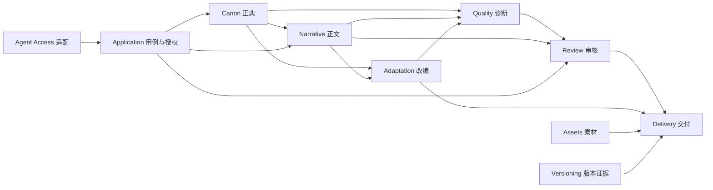

# 领域设计与边界上下文

共同术语与身份见[05](05-领域模型与数据合同.md)，持久字段见[29](29-数据字典与Schema设计.md)，操作见[30](30-应用API详细设计.md)。采用模块化单体，边界上下文不直接对应独立微服务或仓库。

## 1. 通用语言

| 术语 | 唯一含义 |
| --- | --- |
| IP 工作区 | 一个作者可持有的内容根、身份和授权范围 |
| 设定集／正典 | 作者确认的角色、势力、地点、事件与规则 |
| 正文修订 | 不可变的小说或剧本文本，格式与摘要明确 |
| 草稿 | 未因提交成功而成为定稿的候选内容 |
| 剧情节点 | 有原文引用的动作、对话、场景或待确认线索 |
| 骨架 | 已有节点的分集与分场组织，不含系统生成的新对白 |
| 诊断 | 某组固定输入在特定规则下的问题与覆盖 |
| 审核决定 | 作者针对确切输入的通过、驳回或修改要求 |
| 定稿 | 文档指向已批准修订的状态，不等于 Git 已提交 |
| 快照 | 用户明确创建的 Git commit，不等于自动保存 |
| 交付包 | 固定内容、格式、来源、状态和摘要的导出产物 |

## 2. 边界上下文

| 上下文 | 拥有事实 | 消费事实 | 禁止承担 |
| --- | --- | --- | --- |
| Workspace | 项目身份、格式、包配置、受管根 | OS 目录权限 | 跨目录自动发现作者 IP |
| Canon | 设定集、正典实体、事实有效期、规则和锁 | 作者确认的建议、源文证据 | 自动采纳 Agent 推断 |
| Narrative | 文档、修订、章节／剧本结构与批注 | 设定集实体 ID | 更改正典或自动通过审核 |
| Adaptation | 节点修订、骨架、源映射和改编差异 | 固定正文与设定集快照 | 无来源新剧情、覆盖原著 |
| Quality | 规则执行、报告、覆盖、问题处理记录 | 固定输入与引擎版本 | 对无法证明的语义给确定结论 |
| Review | 草稿、决定、例外与定稿资格 | 报告、文档基线、作者能力 | 运行模型、授予 Git 权限 |
| Assets | 线索、文件与来源／权利声明 | 人物／场次引用 | 保证版权、自动调用供应商 |
| Versioning | Git 观察、预览、操作和远端证据 | 已选文件与作者确认 | 将 Git ACL 当产品角色授权 |
| Delivery | 交付选择、profile、manifest 与排除项 | 固定修订和审核证据 | 自动上传或法律认证 |
| Agent Access | 连接范围、工具投影、协议与方法 | 用例合同和本机授权 | 保存第二套业务状态 |

审计与 Operation Ledger 是跨用例的基础设施能力，不是另一个拥有内容事实的业务平台。

箭头表示下游消费上游的固定事实或受控用例，不代表远程调用或自动写入。Workspace 为这些上下文提供共同身份与授权范围。

## 3. 聚合与一致性边界

| 聚合根 | 内部对象／值 | 必须保护的不变量 |
| --- | --- | --- |
| Blueprint | Entity、Fact、TimelineEvent、Rule、Lock | ID 唯一、引用有效、事实类型正确；作者写入与锁检查 |
| Document | 元数据、当前／定稿修订指针 | 修订属于本文档；定稿指向有效批准版本 |
| Draft | 不可变正文引用、基线、状态 | 返工不改旧正文；目标与基线一致；提交方不能自批 |
| PlotRevision | PlotNode、关系、来源、人工校正 | 来源存在，候选与确认分开，确认边不形成非法环 |
| Skeleton | Episode、Scene、节点映射 | 稳定 ID 与展示顺序分离，来源不丢，未知保留 |
| Report | InputSnapshot、Coverage、Finding | 结果绑定输入和规则；无静默漏扫；问题与执行状态分开 |
| ReviewDecision | 输入快照、作者、批注和例外 | 决定不可改写，输入变化使批准资格过期 |
| AssetCue／Asset | 叙事引用、媒体摘要、来源声明 | 不把来源声明当版权事实，文件完整可核验 |
| Bundle | 选择、冻结输入、文件 manifest | 包内容与清单一致，默认只含允许的定稿和素材 |

跨聚合的“通过草稿并更新定稿指针”由 Application 在同一工作区可恢复事务中协调 Draft、Document、ReviewDecision、Operation 和审计；不能只保证各文件单独保存就宣称审批一致。

设定集包含角色／规则的修订集合，V1 作为一个有界聚合编辑以保持正典一致。规模测试发现瓶颈后再评估拆分存储，不能为了预想大规模提前引入分布式一致性。

## 4. 值对象与领域策略

- `EntityRef`：类型与稳定 ID；名称是展示，不能作关联键。
- `SourceRef`：文档、修订与原始字节范围；quote 必须对应切片。
- `InputSnapshot`：设定集、正文、节点、骨架、规则及其摘要；用来判断新鲜度。
- `TimeInterval`：故事历法／事件区间；与提交时刻、叙述顺序不同。
- `ExpectedRevision`：调用方见过的修订与摘要，不能由服务端默认成当前最新来绕过 CAS。
- `ActorCapability`：可信入口组装的本次范围与动作，不从正文或普通参数取得。
- `OperationIdentity`：提供方、身份范围、动作、键和固定输入摘要。
- `DeliveryProfile`：结构必填项、格式、版式、字体许可与验证器版本。

规则检查器只读取不可变上下文；定稿策略检查证据与例外；源映射策略只提出候选匹配；交付策略决定阻断、警告与排除。策略围绕现有变化点保持小型，不设计任意执行 DSL。

## 5. 应用服务与领域服务

应用服务负责权限、原键查询、CAS、事务、任务与事件投影。领域服务负责不依赖 IO 的规则判断、时序图核验、骨架分组和审核资格。基础设施负责文件身份、锁、持久化、Git、凭据和压缩。

例如 `SubmitDraft` 只负责提交和安排诊断，`RunValidation` 产生固定报告，`DecideReview` 在锁内决定并更新定稿。不要建立一个同时解析文本、联网、管理控件并执行 Git 的总服务。

## 6. 领域事件

| 事件 | 触发结果 | 下游行为 |
| --- | --- | --- |
| BlueprintChanged | 新设定集修订已提交 | 相关报告／审核资格标过期，刷新投影 |
| DocumentRevisionSaved | 新正文修订已持久化 | 异步索引，源映射提示更新 |
| DraftSubmitted | 不可变草稿可读 | 运行诊断任务，刷新待审列表 |
| ReviewRecorded | 作者决定已提交 | 更新定稿投影，允许获权 Agent 查询 |
| BundleExported | 包和 manifest 已核验 | 写版本溯源，不自动外发 |
| GitOperationObserved | 实际 commit／ref 或 unknown 已保存 | 刷新版本界面与恢复入口 |

V1 事件是事务后的本地通知及审计记录，不引入消息代理或完整事件溯源框架。事件处理可重入，不能重复执行业务副作用；通知丢失后通过持久事实重建列表，不依赖一条通知证明完成。

## 7. 防腐与依赖方向

MCP、AXI、Fountain、OOXML 和 libgit2 类型在各自适配边界转换为领域对象。领域不依赖宿主 clientInfo、插件 manifest、DOCX DOM 或 Git 句柄。平台路径身份由基础设施核验，领域继续使用受管相对引用。

外部模型的置信度、供应商状态或“自检通过”只作来源元数据，不能转换成作者确认或确定性 finding。商业插件结果先导入素材聚合，再经审核和交付策略使用。

## 8. 关键场景推演

设定集变更后，旧草稿仍可读；旧报告的输入与当前正典不一致，作者必须重算／重审。角色改名后，引用 ID 不变，名称展示更新，已有剧本是否同步改名是独立作者操作。源文重排后，旧修订仍支持原报告定位，新结构采用显式迁移。

Git 合并成功不代表领域一致：必须再验 Schema、引用、摘要与审核资格。导出完成不代表版权核验或已经交付接收方。每个上下文只声明自己的可观察结果。
