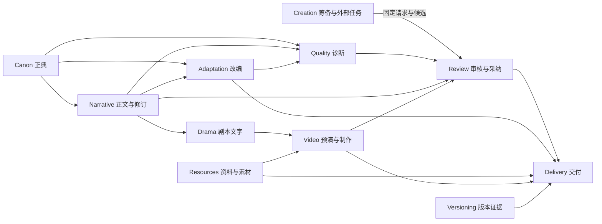
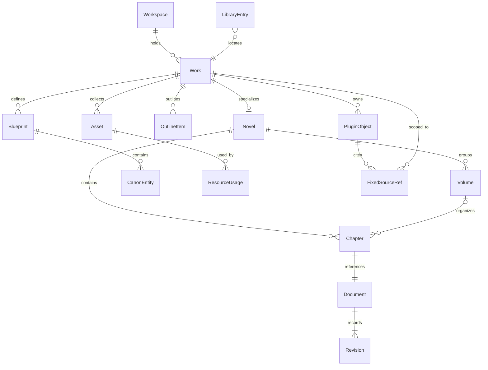
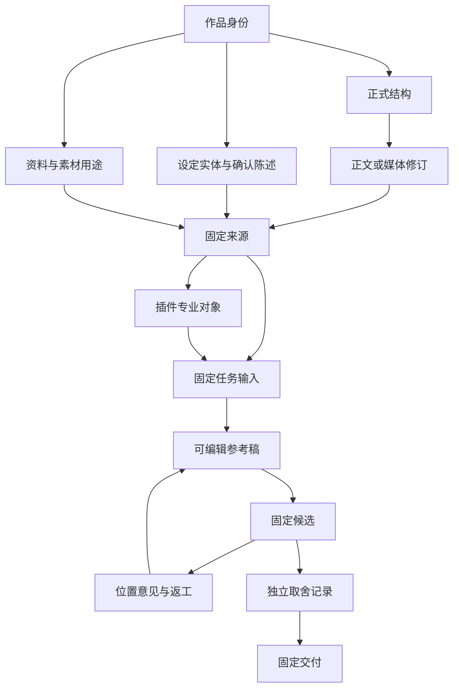

# 领域设计与边界上下文

## 外部会话、Bot与电脑边界

外部会话属于执行接入：提供方拥有推理、认证、模型与历史；河图拥有固定宿主身份、WorkRef、输入代次、投递与恢复记录。工具、计划、思考、表单和助手文本是外部执行资料，正式作品成果仍由原领域Owner保存并回读。

Bot配置聚合持有名称、角色、固定执行配置、WorkRef、生命周期及修订；会话记录固定完整原配置。路径、进程、传输及存储由应用/基础设施持有，领域值不导入Electron或提供方SDK。Bot不复制作品任务、授权、作者决定或费用事实，模板不安装方法，不运行内置规划循环。

电脑观察与动作是独立运行时上下文：OS应用/窗口、短期快照、元素定位、原生交付与接管状态不进入作品Domain。快照元素index只在原引用有效，结构路径不保证跨快照对象身份。动作送达、观察匹配和作品完成具有不同权威；未知原键和窗口围栏不能因重启、换客户端或人工接管静默清除。具体合同见[39](39-Electron与插件优先重构架构.md#436-多引擎bots与电脑接入合同)与[30](30-应用API详细设计.md#外部执行应用入口)。

## 核心准入依据

新增模型须解决持续创作中实际存在的归属或事务问题。参与程度是Agent对目标的判断，不新增持久化意图分类聚合。来源资料、已确认设定、参考方案和作者决定复用各自Owner。

产品定位与任务分流见[01](01-产品需求PRD.md#1-产品定义)。

文稿内容跨章／跨集移动由文稿上下文执行：同一WorkRef中的两篇正式文稿必须格式相同，双端基线、确切原文范围及新修订一次事务提交。机器入口通过固定管理方案执行同一用例；桌面及MCP App只负责完整块捕获、目标选择和回读，不能分别保存两端来模拟移动。移动与恢复保留不可变来源及历史，不将旧批注坐标或作者决定转移到新文稿。

## 默认基础与专业扩展归属

Core拥有正式作品事实、基础结构、固定成果及作者决定。视频基础媒体记录拥有作品、分集、固定asset修订、用途、流与时间基准、声明时长及前版；基础反馈拥有该固定媒体上的原话和区间。专业插件拥有分镜、制作规划、剪辑工程和语义检查，消费这些固定记录，不复制正式正文、素材字节或作者决定。领域责任与随包／可选分发分别判断，见[39](39-Electron与插件优先重构架构.md#无额外插件的基础产品)。

共同术语与身份见[05](05-领域模型与数据合同.md)，持久字段见[29](29-数据字典与Schema设计.md)，操作见[30](30-应用API详细设计.md)。采用模块化单体，边界上下文不直接对应独立微服务或仓库。

本文件也是创作工程本体的唯一语义Owner：定义对象是什么、如何关联、归谁维护及哪些不变量不能破坏；不定义另一套运行时本体数据库。插件开放服务及核心审计见[插件27](plugin/27-开放宿主SDK与核心能力审计.md)。

## 1. 通用语言

| 术语 | 唯一含义 |
| --- | --- |
| 创作库／书库 | 创作库登记独立小说、剧本、视频；书库仅指小说分类，登记不授予内容访问权限 |
| 小说作品 | 具有独立身份、资料、封面、卷章、设定、素材与版本的创作对象 |
| 作品工作区 | 文件、事务与权限边界，可持有多个独立创作对象，不等于小说 |
| 分卷／章节 | 小说内部的可选分组与正文单元，编号和顺序独立于稳定身份 |
| 短剧项目 | 独立管理分集、场次、剧本和修订的改编或原创项目；改编时关联固定原著来源 |
| 创作筹备 | 尚未创建小说、剧本或视频的想法、候选和选择记录，名称可空；建书是小说分支 |
| 视频项目 | 独立拥有镜头、制作资产引用、预演、生成记录、剪辑和成片的创作对象 |
| 关联作品 | 类型化身份与固定来源版本之间的显式关系，不等于共享权限或自动同步 |
| 预演／成片 | 前者回答节奏或空间问题；后者为实际剪辑音画，二者具有独立成果和作者决定 |
| 外部创作任务 | 以稳定身份接续的外部协作，按不可变请求版本与授权处理成果，不是内置 Agent 运行任务 |
| 参考稿工作副本 | 任务内可持续编辑的内容，保存形成工作修订，正式提交形成固定候选 |
| 公开反馈 | 针对确切成果的偏好或修改要求，不等于扩大授权、采纳或定稿 |
| 局部选择 | 对当前候选的偏好、选项和意见，可由 Apps 或网页记录，不等同于采纳或定稿 |
| 封面任务 | 作者确认的设计 Prompt 与输出约定，外部 Skill 提交候选，作者选用才改变当前封面 |
| 设定集／正典 | 作者确认的角色、势力、地点、事件与规则 |
| 正文修订 | 不可变的小说或剧本文本，格式与摘要明确 |
| AI 参考稿 | 外部 Agent 提供的参考文本；区分正在编辑的工作副本与已提交的固定候选，不自动进入正式正文 |
| 写作稿 | 作者正在编辑的当前文档修订及未保存缓冲，可包含已采纳参考内容 |
| 采纳 | 作者把选定参考内容应用到写作稿并保存来源的操作，不设置定稿 |
| 剧情节点 | 有原文引用的动作、对话、场景或待确认线索 |
| 骨架 | 已有节点的分集与分场组织，不含系统生成的新对白 |
| 诊断 | 某组固定输入在特定规则下的问题与覆盖 |
| 审核决定 | 作者针对确切输入的通过、驳回或修改要求 |
| 定稿 | 作者独立确认确切正文修订的记录与指针，不等于参考稿通过、Git 提交或平台发稿 |
| Git 快照 | 用户明确创建的 Git commit，不等于自动保存；API读取投影须另标明固定的对象及版本 |
| 交付包 | 固定内容、格式、来源、状态和摘要的导出产物 |

## 2. 边界上下文

| 上下文 | 拥有事实 | 消费事实 | 禁止承担 |
| --- | --- | --- | --- |
| Library | 三类创作对象的本机登记、排序及定位 | 按类型的资料和成果投影 | 复制正文、强制小说前置或整库授权 |
| Creation | 建书筹备、任务请求版本、工作副本、候选批次、局部选择及公开反馈 | 作者提供的意图及授权输入快照 | 实现 Agent、复制全文会话、自动创建作品、赋予整库权限 |
| Workspace | 工作区身份、格式、包配置与受管根 | OS目录权限和对象归属 | 以同根推定全部对象授权、跨目录自动发现作品 |
| Canon | 设定集、正典实体、事实有效期、规则和锁 | 作者确认的建议、源文证据 | 自动采纳 Agent 推断 |
| Narrative | 小说资料与卷章目录、文档、修订、剧本结构与批注 | 设定集实体 ID | 更改正典或自动通过审核 |
| Adaptation | 节点修订、骨架、源映射和改编差异 | 固定正文与设定集快照 | 无来源新剧情、覆盖原著 |
| Quality | 规则执行、报告、覆盖、问题处理记录 | 固定输入与引擎版本 | 对无法证明的语义给确定结论 |
| Review | 参考稿审核、采纳来源、例外与独立定稿 | 报告、候选／正文基线、作者能力 | 运行模型、把采纳自动升级为定稿 |
| Drama | 剧本项目、分集计划、写作分集、语义场次与改编取舍 | 固定原著、设定及资料 | 以模型片长取代戏剧结构、复制对白真值 |
| Video | 镜头、预演、生成计划及实际结果、剪辑音画、时间映射 | 固定剧本或制作简述、资产及作者意见 | 自主生成循环、写回剧本、发布运营 |
| WorkLinks | 固定来源关系与必要快照的引用 | 类型化对象及修订、明确授权 | 复制可写上游或使关联自动扩权 |
| Resources | 自由资料、设计版本、候选、选用、使用位置、线索及文件来源 | 设定、正文、场次、镜头、任务及文件快照 | 以外貌提案修改正典、Agent自批选用、持有生成循环 |
| Versioning | Git 观察、预览、操作和远端证据 | 已选文件与作者确认 | 将 Git ACL 当产品角色授权 |
| Delivery | 交付选择、profile、manifest 与排除项 | 固定修订和审核证据 | 自动上传或法律认证 |
| Agent Access | 客户端适配、连接范围、工具投影、协议与方法 | 用例合同和本机授权 | 实现模型对话、保存第二套任务或业务状态 |

审计与 Operation Ledger 是跨用例的基础设施能力，不是另一个拥有内容事实的业务平台。

图示主要事实消费链，箭头从事实拥有者指向消费者，表示消费固定事实及引用，不表示源码依赖、远程调用或自动写入。Library 和 Workspace 管理本机登记及范围身份；Agent Access 只适配获权用例，不作为业务事实的上游。组件调用关系见[23第2节](23-业务流程与MCP时序.md#2-内部组件与依赖)。

| 上下游关系 | 交换合同 | 写入边界 |
| --- | --- | --- |
| Workspace／Narrative／Assets → Library | workspace_id 与作品资料／封面投影 | Library 只更新本机登记，不能反写正文或扩大权限 |
| Creation → Narrative／Assets | 作者确认字段、候选引用与来源摘要 | 创建作品或选用封面是新的作者用例，不消费“选择已保存”作为批准 |
| Canon／Narrative → Adaptation／Quality | 固定设定及正文修订、SourceRef | 下游追加节点、骨架或报告，不写回上游 |
| Quality／Narrative → Review | 固定报告、处置摘要、当前写作稿及候选基线 | 参考稿审核、采纳及定稿各有独立事务，不通过事件自动升级 |
| Review → Narrative | 作者采纳结果或独立定稿决定 | Application 协调来源记录与当前／定稿指针，不要求两个领域相互导入存储实现 |
| Narrative／Review／Assets → Delivery | 固定修订、定稿证据、媒体和当前权利 | 冻结交付计划，发布前核验资格；产物不反向更新正文 |

外部协议、文件格式和宿主类型经适配器转换后才能进入上述合同；领域不接收 MCP clientInfo、浏览器会话或 libgit2 句柄作为作者授权。上下文之间不建立各自维护的永久同步副本。

## 3. 聚合与一致性边界

| 聚合根 | 内部对象／值 | 必须保护的不变量 |
| --- | --- | --- |
| CreationProject | 作者意图、选中字段、任务引用与创建关联 | 无作品也能存在；仅作者确认创建；最多关联一个创建结果 |
| CreativeTask | 请求版本链、上下文清单、候选／反馈引用与缺项 | 单一 scope；请求不原地改写；新请求使旧版本停止新写入；反馈不扩权 |
| WorkingCopy | 工作修订、当前头、基线与反馈来源 | 本任务内 CAS 保存；旧内容与已提交候选不变；不能拥有正文／定稿指针 |
| InteractionDecision | 固定候选选择、意见及修订链 | 选择只对当前获权任务生效，不产生定稿或跨范围权限 |
| Novel | 作品资料、卷章目录、正文引用 | 独立作品身份；卷章顺序与 ID 分离；引用属于本作品 |
| DramaProject | 原著关联、分集分场、剧本引用 | 改编来源固定；小说章节与剧本场次保留各自结构 |
| WorkLink | 固定两端、类型、必要快照引用及前版 | 关联不扩权，反向列表由同一关系派生，旧来源不跟随新头 |
| VideoProject／VideoEpisode | 制作依据、分集顺序／成果引用 | 视频独立身份；镜头、片段、分集与模型请求不等同 |
| Previsualization | 固定输入、预演类型、媒体及外部工程 | 白模不冒充真实生成，认可仅适用该预演修订 |
| GenerationSegment | 固定计划、模型模式、调用及结果引用 | 外部副作用不与文件事务混为原子；未知沿原调用查询 |
| EditRevision | 固定片段区间、音画字幕、时间映射与实际渲染 | 历史不可变，区间意见不静默迁移，新版有完整依赖 |
| MediaDecision | 确切媒体、用途、作者及前一决定 | 预演认可、选用和成片确认分别定义，不等于文稿定稿 |
| BookCover | 选用修订、素材引用、裁切与文字叠加、任务来源 | 仅作者选择；候选不自动生效；CAS 与素材完整性一致 |
| Blueprint | Entity、Fact、TimelineEvent、Rule、Lock | ID 唯一、引用有效、事实类型正确；作者写入与锁检查 |
| Document | 元数据、当前／定稿修订指针 | 修订属于本文档；定稿指向有效 FinalizationRecord 确认的修订 |
| Draft | 不可变正文引用、基线、状态 | 返工不改旧正文；目标与基线一致；提交方不能自批 |
| PlotRevision | PlotNode、关系、来源、人工校正 | 来源存在，候选与确认分开，确认边不形成非法环 |
| Skeleton | Episode、Scene、节点映射 | 稳定 ID 与展示顺序分离，来源不丢，未知保留 |
| Report | InputSnapshot、Coverage、Finding | 结果绑定输入和规则；无静默漏扫；问题与执行状态分开 |
| ReviewDecision | 输入快照、作者、批注和例外 | 决定不可改写，输入变化使批准资格过期 |
| AdoptionRecord | 候选范围、目标基线、结果修订与来源 | 采纳和新写作稿同事务；不改变定稿 |
| FinalizationRecord | 正文修订、证据、作者、确认／撤回 | 可无 Draft；绑定实际审阅修订，旧决定不能撤回新定稿 |
| AssetCue／Asset | 叙事引用、媒体摘要、来源声明 | 不把来源声明当版权事实，文件完整可核验 |
| Bundle | 选择、冻结输入、文件 manifest | 包内容与清单一致，默认只含允许的定稿和素材 |

采纳事务读取固定 Draft／候选，协调 Document 新当前修订、AdoptionRecord、Operation 和审计，不隐式新增参考稿审核决定或修改定稿。定稿事务独立协调 FinalizationRecord、Document 定稿指针、证据、Operation 和审计。创建作品则协调固定CreationProject、明确Workspace及Novel／DramaProject／VideoProject的身份和创建关联；不能只保证各文件单独保存就宣称整体一致。

设定集包含角色／规则的修订集合，V1 作为一个有界聚合编辑以保持正典一致。规模测试发现瓶颈后再评估拆分存储，不能为了预想大规模提前引入分布式一致性。

## 4. 值对象与领域策略

- `EntityRef`：类型与稳定 ID；名称是展示，不能作关联键。
- `SourceRef`：文档、修订与原始字节范围；quote 必须对应切片。
- `InputSnapshot`：设定集、正文、节点、骨架、规则及其摘要；用来判断新鲜度。
- `TimeInterval`：故事历法／事件区间；与提交时刻、叙述顺序不同。
- `ExpectedRevision`：调用方见过的修订与摘要，不能由服务端默认成当前最新来绕过 CAS。
- `ActorCapability`：可信入口组装的本次范围与动作，不从正文或普通参数取得。
- `EditScope`：一个文档的固定修订及允许改动的非重叠范围；与参考读取独立，章末或指定位置追加为明确插入点。它允许提出改稿，不授予写作稿保存或定稿权。
- `OperationIdentity`：提供方、身份范围、动作、键和固定输入摘要。
- `DeliveryProfile`：结构必填项、格式、版式、字体许可与验证器版本。

规则检查器只读取不可变上下文；定稿策略检查证据与例外；源映射策略只提出候选匹配；交付策略决定阻断、警告与排除。策略围绕现有变化点保持小型，不设计任意执行 DSL。

## 5. 应用服务与领域服务

应用服务负责权限、原键查询、CAS、事务、任务与事件投影。领域服务负责不依赖 IO 的规则判断、时序图核验、骨架分组和审核资格。基础设施负责文件身份、锁、持久化、Git、凭据和压缩。

例如 `PrepareCreativeTask` 只冻结任务，`SubmitDraft` 只保存参考稿，`AdoptDraft` 更新写作稿并保留来源，`RunValidation` 产生固定报告，`FinalizeDocument` 独立核对并确认正文修订。不要建立一个同时调用模型、解析文本、管理控件并执行 Git 的总服务。

## 6. 领域事件

| 事件 | 触发结果 | 下游行为 |
| --- | --- | --- |
| BlueprintChanged | 新设定集修订已提交 | 相关报告／审核资格标过期，刷新投影 |
| DocumentRevisionSaved | 新正文修订已持久化 | 异步索引，源映射提示更新 |
| DraftSubmitted | 不可变草稿可读 | 运行诊断任务，刷新待审列表 |
| CreativeTaskPrepared | 请求与输入快照已固定 | 生成可复制调用说明，不启动 Agent |
| TaskSubmissionReceived | 候选核验并持久化 | 刷新局部页面和原生列表，不自动采纳 |
| InteractionDecisionSaved | 局部选择已提交 | Agent 可回读；选择本身不启动返工 |
| CreativeRequestRevised | 作者确认的新请求及授权版本已发布 | 旧请求停止新写入，历史结果保留 |
| WorkingRevisionSaved | 参考稿工作修订已持久化 | 更新任务预览，不修改正文或已提交候选 |
| TaskFeedbackSaved | 公开意见与确切成果已绑定 | 显式继续操作可请求宿主消息；无能力提供复制提示词，不自动运行模型 |
| ReviewRecorded | 作者参考稿决定已提交 | 更新待审投影，允许获权 Agent 查询 |
| DraftAdopted | 写作稿与来源记录已提交 | 编辑器刷新当前稿，定稿不变 |
| DocumentFinalized | 作者确认的固定正文修订已记录 | 更新定稿与交付资格，不 Git 或发稿 |
| BundleExported | 包和 manifest 已核验 | 写版本溯源，不自动外发 |
| GitOperationObserved | 实际 commit／ref 或 unknown 已保存 | 刷新版本界面与恢复入口 |

V1 事件是事务后的本地通知及审计记录，不引入消息代理或完整事件溯源框架。事件处理可重入，不能重复执行业务副作用；通知丢失后通过持久事实重建列表，不依赖一条通知证明完成。

封面文件事件触发候选重新核验；`BookCoverSelected` 仅在作者选用事务完成后更新书库缩略图。文件到达和 Agent 的完成声明均不能代替该领域事件。封面合同见[34](34-小说封面与Agent协作.md)。

## 7. 防腐与依赖方向

MCP、AXI、Fountain、OOXML 和 libgit2 类型在各自适配边界转换为领域对象。领域不依赖宿主 clientInfo、插件 manifest、DOCX DOM 或 Git 句柄。平台路径身份由基础设施核验，领域继续使用受管相对引用。

外部模型的置信度、供应商状态或“自检通过”只作来源元数据，不能转换成作者确认或确定性 finding。商业插件结果先导入素材聚合，再经审核和交付策略使用。

## 8. 关键场景推演

设定集变更后，旧草稿仍可读；旧报告的输入与当前正典不一致，作者必须重算／重审。角色改名后，引用 ID 不变，名称展示更新，已有剧本是否同步改名是独立作者操作。源文重排后，旧修订仍支持原报告定位，新结构采用显式迁移。

Git 合并成功不代表领域一致：必须再验 Schema、引用、摘要与审核资格。导出完成不代表版权核验或已经交付接收方。每个上下文只声明自己的可观察结果。

## 9. 原著来源与创作场景

场景编排负责把作者意图转为已有用例，不另建可写的作品事实。SourceMaterial／SourceRights 管固定原著与独立用途声明；Drama 仅引用它们，不复制或推断版权。Resources 管考据和制作参考，普通参考不自动成为改编原著。来源、创作方式、贡献来源和作品类型的边界见[36](36-创作场景与引导流程.md)，字段见[29第21节](29-数据字典与Schema设计.md#21-创作场景与原著材料)。

## 10. 持续协作的一致性边界

稳定入口属于 Agent Access，任务、参考稿和反馈属于 Creation；正式资料归 Resources，作者正文归 Narrative，采纳和定稿归 Review。稳定入口只根据本机私有授权定位任务，不拥有可写的“当前书库”或复制一份任务数据库。上下文目录、检索和 Apps 是这些事实的受限投影。

同任务的普通反馈不改变请求基线。作者扩大读取、改变改稿范围或更新基线时，应用用例协调 CreativeTask 新请求、上下文清单与 TaskGrant 的版本发布；失败恢复前不允许混用新请求和旧授权。单次 WorkingCopy 保存只需协调自身 head、内容、原操作与审计，不把所有任务内容锁进一个大聚合。提交固定已有工作修订和候选引用，后续编辑仍是独立事务。

TaskFeedback 引用实际成果与公开意见，不复制聊天；宿主消息尝试是可失败的外部交接，不能与本机保存假装原子完成。重新接续先查询原任务、成果、反馈和原操作，不因丢失会话重建事实、重复生成或将 Agent 自报进度视为提交回执。完整调用以[30第23节](30-应用API详细设计.md#23-持续协作与任务接续合同)为准。

双入口会话宿主属于入口与应用服务，不新增作品事实领域。外部MCP App与独立桌面共享Creation、Review和Agent Access的既有用例；引擎历史、本机消息尝试与Core任务分别持有身份和生命周期。桌面托管所选引擎的对话及执行，不向引擎交付可信作者权限；换入口不复制领域状态或默认共享聊天，固定绑定见[29第22.1节](29-数据字典与Schema设计.md#221-agent-会话与双入口绑定)。

本轮先支持Codex的GUI与TUI，两者是同一入口应用服务的不同执行表面，不新增Creation子领域或两套CreativeTask。会话、线程占用、投递尝试、终端回放和显示偏好均不是作品本体；作品、固定来源、候选、反馈、采纳及定稿仍由现有领域拥有。Codex生成文本只有经公开业务用例保存并回读后才成为相应参考成果，聊天流或终端屏幕不能自动提升为正文或正典。

## 11. 全软件操作与作者决定的边界

Agent Access 持有明确的作品管理、新建或单任务授权；Creation 继续拥有筹备、参考稿及候选，既有领域仍分别持有作品、目录、设定、资料、版本和交付。外部 Agent 调用这些用例，不通过 GUI 模拟或通用作者句柄扩大权限。

OperationProposal 是应用层协调记录，引用确切领域动作、固定输入、对象基线和影响。它不复制 Novel、Blueprint 或 Document 的可写头，不形成第二套业务状态机。正式写入仍由对应领域用例校验、分配修订并提交事务；批次输入固定，失败保证由对应合同规定，不能假装跨目录原子。

作者审阅完整结果或差异，可信作者会话记录决定；确切执行授权只允许 Core 或获权 Agent 执行被确认的操作。决定与执行主体分别记录，提案中的自然语言、候选选择和公开反馈不构成批准。准备、批准、执行和恢复分别可观察，作者不承担转抄字段或操作内部模型的工作。

页面上下文属于只读交接投影，按当前对象和实际能力生成；新建无需先存在作品任务。GUI、MCP Apps、CLI/MCP 和局部页面共用应用用例，原生端第一职责是可视化 review 和审核，第二职责是手动编辑优化。详细合同见[30第25节](30-应用API详细设计.md#25-全软件联动与操作提案合同)。

## 12. 视频制作与跨对象接续

视频上下文消费固定剧本或制作简述，镜头记录制作表达，不成为可独立修改的对白真值。来源可以为空；需要发展独立剧本时另建并关联，不制造空小说。跨根以获权必要快照接续，变化影响查询列出确实使用该修订的场次、镜头、预演和片段，不自动覆盖下游。

工作流由外部Agent推进，Core仅校验授权、固定计划、状态转换、媒体和事务。预演、生成、剪辑均有固定输入与独立结果，事件只在实际提交后产生：WorkLinked、PrevisualizationReceived、MediaResultReceived、EditRendered、MediaDecisionRecorded。事件刷新投影或标记依赖变化，不自动调用模型、重渲染或批准成片。

Review沿用公开TaskFeedback，增加固定图片区域和媒体区间锚点；作者可沿故事、人物出场、改动和疑点发现细节，也可检查任何未标记位置。人工意见、Agent理解、后续成果及作者决定分别保存。文字定稿、预演认可、资产／片段选用与成片确认独立；交付固定所需媒体和工程，不包括发布运营。具体字段见[29第24节](29-数据字典与Schema设计.md#24-独立创作对象与视频数据)，应用合同见[30第26节](30-应用API详细设计.md#26-独立创作对象与视频用例合同)。

默认视频的MediaDecision由Core拥有，与素材用途选用和专业剪辑工程分开。每个视频分集及媒体用途仅有一个决定头，变更使用前一固定决定CAS；确认新成果保留被替换的旧决定，撤回后保留完整链。作者原话、实际执行身份、操作键及固定预览共同记录，auto允许执行明确决定，不从“继续制作”、文件导出或Agent自评推断认可。当前权利影响交付资格，不改写曾经作出的创作决定；归档阻止新确认，历史与明确撤回仍可读写。

## 插件优先重构的接入边界

插件是能力交付边界，不等于每个插件新增微服务、数据库或正文Owner。TS宿主负责动态注册和界面生命周期，Rust Core负责权限及事务，不把所有UI交互绕经Rust。 目标分工见[39](39-Electron与插件优先重构架构.md)，详细扩展合同见[插件系列](plugin/README.md)，实际进度归38。

## 13. 创作工程本体与插件边界

本体描述创作对象与关系的业务含义。JSON Schema约束结构，领域规则约束归属和状态，固定引用约束具体版本；三者共同成立，不能以自由JSON或关系图代替领域校验。

| 概念 | 身份与关系 | 唯一Owner | 不变量 |
| --- | --- | --- | --- |
| 作品 | WorkRef；属于工作区，登记于创作库 | Works / Narrative / Drama / Video | workspace_id、kind、object_id共同识别；标题不是身份 |
| 正式卷章 | Novel包含零到多个Volume、Chapter；Chapter关联Document | Narrative | 一个章节关联一个正文；重排不变身份、不隐藏正文 |
| 正文与修订 | Document包含不可变Revision及当前头 | Narrative | 保存与改名都使用当前修订CAS；改名保持文本字节，原修订可读 |
| 文稿副本 | 同作品内的新Document及独立目录身份 | Narrative与所属作品 | 固定原文修订和目录基线，逐字复制并保留来源；不复制作者决定、批注、任务或权限 |
| 正式大纲 | book／volume／chapter级条目关联目标 | Narrative | 规划节点不是正式卷章；正式大纲只有宿主一份 |
| 设定实体与事实 | Blueprint包含人物、势力、地点、规则、事件及世界条目 | Canon | 完整作品归属、有效引用及锁；规划卡不自动成为正典 |
| 素材与用途 | Asset／Resource，经Usage关联具体创作位置 | Resources | 物品标签不自动升级成正典类型；文件、描述及选用分别记录 |
| 专业规划 | 插件对象包含专业节点、剧情、关系及伏笔 | 对应插件 | WorkRef、owner_plugin_id及kind共同分区；不复制正式正文 |
| 固定来源 | 来源对象身份＋修订＋sha256 | 来源Owner | 引用历史不跟随新头；相同实体ID不表示同一作品设定 |
| 作者决定 | 固定候选、正文、媒体或交付的选择 | Review及具体业务Owner | 保存、采纳、定稿和交付各有含义，不互相自动升级 |
| 操作结果 | operation_key绑定确切输入及回执 | Core事务基础设施 | 同键异输入冲突；未知结果先回读 |

图中Work、FixedSourceRef等为语义概念，不要求每个概念对应新增JSON文件或SQL表。物理格式归29和contracts；插件对象content内部的专业实体由插件自有Schema解释。

核心准入采用三个问题：是否属于多种创作工具共同需要的作品事实；是否需要统一身份、修订或跨插件一致性；现有对象与关系是否已经能表达。前两项成立且现有模型确有缺口时才扩充核心。伏笔方法、节奏评分、规划画布和行业模板留在插件；跨插件复用需求形成真实用例后再评估通用合同。

分层依赖固定为入口适配→应用用例→领域及存储，插件运行宿主通过公开SDK接入应用用例。Cordis只拥有注册与释放，不拥有作品语义；React只拥有视图与恢复稿。不得让Core依赖插件模块，也不得让插件从宿主源码导入私有领域服务。

### 13.1 小说的三种结构

小说同时存在写作结构、故事结构和工作结构，三者通过固定引用关联。

| 结构 | 回答的问题 | 事实归属 | 不作的推断 |
| --- | --- | --- | --- |
| 写作结构 | 正式有哪些卷章、顺序、正文和大纲 | Narrative | 有规划节点不表示已经建章；卷章顺序不等于故事时间 |
| 故事结构 | 谁在何时何地做了什么、哪些设定已确认 | Canon；正文中的陈述仍归Document | 人物说法、Agent推断和作者确认不是同等事实 |
| 工作结构 | 正在规划什么、有哪些候选、意见与未完成步骤 | Creation、Review及专业插件 | 任务成功不表示内容已采纳；停止请求不表示外部执行已停止 |

正式目录使用稳定章ID与正文ID，支持无分卷及同名章。规划可包含未建章、备选章及废弃分支；映射正式章节时保存目标身份与固定来源，不按标题自动合并。故事网络可展示人物、地点、物品及线索，但图节点不必成为新的宿主实体类型。

### 13.2 实体、事实与证据

实体表示持续身份，属性或关系表示关于实体的陈述，证据说明陈述来自哪里。名字改变不产生新人物；同名不合并人物。人物关系、所在地点、掌握知识及持有物可能随故事时间变化；叙述顺序、故事时间和文件修订时间分别解释。

作者确认的设定进入Canon；抽取结果、传闻、角色认知及分析先保持其来源和待确认语义。缺少信息表示未知，不推断为不存在、冲突或已获确认。特殊世界观、非线性叙事及写作方法由已有设定与插件专业结构表达，形成共享一致性需求后才扩充核心字段。

本体是业务语义合同，不建设通用知识图谱引擎、任意关系执行语言或自动推理平台。现行物理类型及能否表达时间约束以[06](06-设定集与规则规范.md)、[29](29-数据字典与Schema设计.md)及Schema为准；概念论述不冒充已发布字段。

### 13.3 来源、状态与删除

固定引用回答“用了哪一份”，当前性回答“是否还有新版”，作者决定回答“是否接受”。旧来源仍有效可读不表示它仍是最新；读取失败不表示没有新版。小说资料修订固定资料与目录，正文须逐章固定DocumentRevision；`novels.snapshot`不能被解释成任意历史时刻的整书正文。

归档只改变活动展示，不改身份或消灭引用。解除关联不删除来源，停用插件不删除专业对象，移除创作库登记不删除作品文件。物理删除和跨作品影响按所属业务的明确用例处理，不能用通用对象删除绕过。

## 14. 核心准入与用例论证

“核心小”指事实与规则各有一个Owner，不指作者能力少。按以下判定保留必要的创作深度，避免核心演变为专业工具集合。

| 能力 | 核心承担 | 插件承担 | 判定依据 |
| --- | --- | --- | --- |
| 身份、正文、目录与正式大纲 | 固定事实、修订与原子用例 | 专业组织与展示 | 各工具必须指向同一部作品 |
| 设定、素材、用途和固定来源 | 唯一身份、引用核验、业务规则 | 考据方法、人物卡、专业属性展示 | 重复存储会产生互相矛盾的事实 |
| 候选、意见、采纳、定稿与恢复 | 确切目标、决定及事务 | 专业比较与返工方法 | 需跨入口保持一致且可追溯 |
| 目录统计、导航和通用导出 | 可复用读取或系统服务 | 专业统计解释和导出版式 | 不要求插件重建正文解析与文件通道 |
| 伏笔、节奏、关系布局、导演台 | 提供专业对象及来源基础设施 | 专业Schema、算法、动作和视图 | 可独立迭代，无需改变正式作品定义 |
| Agent编排、提示方法与模型选择 | 提供确定性机器用例 | Skills及外部Agent或适配插件 | 理解与生成不属于宿主自主循环 |

以下用例用于反证边界是否成立；执行证据归20/38及插件08，不在本文维护通过状态。

| 用例 | 必须成立的结果 | 验证入口 |
| --- | --- | --- |
| 两个插件分别规划和分析同一章 | 正式正文与标题只有一个头；规划目标和实际字数分开 | `novels.snapshot`、`documents.get`及插件动作 |
| Codex与人工同时修改 | 旧CAS失败，保留本地输入；比较后形成新意图 | CLI/MCP、GUI及原操作回读 |
| 详情保存后接入中断 | 已保存详情可恢复；旧方案继续读取原固定附件 | 插件两步操作记录与历史读取 |
| 规划新增、重排、归档章节 | 不自动创建、删除或覆盖正式章节 | 专业对象与正式目录分别回读 |
| 小说改编后原著更新 | 剧本保留旧依据，显式决定是否更新 | WorkLinks与固定Document来源 |
| 插件停用、换包、卸载 | 旧运行失效，成果仍可通用读取／导出 | 安装状态、稳定发现及扩展对象入口 |
| 会话接入新插件 | 同一河图连接重新发现可用能力，无需安装Codex插件 | 稳定`plugins.capabilities/invoke` |

维护规则与变更分类统一见[24](24-文档治理架构决策与风险.md#7-核心领域与本体维护合同)。只有新用例证明现有语义无法保持一致时，才新增核心概念；名称相似、界面相似或插件数量增加不构成准入理由。

## 15. Agent First 的本体核心

本体核心回答“作品中是什么、彼此是什么关系、哪一版是依据、谁作出了什么决定”。它不等于 Rust 中的全部代码，也不以页面、菜单、工具或模型名称划分。领域服务实现这些语义；CAS、锁、事务与幂等负责可靠执行，不是创作实体。

| 概念族 | 核心语义及关系 | 专业扩展边界 |
| --- | --- | --- |
| 创作归属 | Workspace承载WorkRef；LibraryEntry定位作品；Novel、DramaProject、VideoProject可以独立存在 | 题材、平台标签和专业工作面不产生另一套作品身份 |
| 写作结构 | 小说卷章、剧本分集及场次、视频基础分集与媒体，明确从属与顺序 | 故事节拍、规划卡、人物弧线和分镜不是正式目录；专业节点引用正式对象 |
| 内容与版本 | Document、Revision、正式大纲及固定媒体保存实际创作内容和不可变历史 | 插件分析、摘要、可视化及编辑装饰均不能成为第二份正文头 |
| 设定与陈述 | 设定实体具有稳定身份；Fact、Rule、TimelineEvent表达已确认的陈述、约束与时序 | 角色说法、抽取候选、Agent推断和评分保留来源与不确定性，不因被引用而入典 |
| 材料与使用 | Resource、Asset及Usage区分资料、真实文件、固定版本和使用位置 | 人物卡模板、参考分类、专业属性与素材推荐属于插件或方法 |
| 协作与成果 | CreativeTask固定目标和输入；WorkingCopy连续修订；Candidate固定交付；TaskFeedback指向确切成果 | Agent聊天、提示词和运行进度不是作品事实；专业检查由原Owner出具 |
| 取舍与交付 | ReviewDecision、AdoptionRecord、FinalizationRecord及媒体决定分别记录选择；Bundle固定实际交付 | 自动执行、提交成功、检查通过和作者认可具有不同含义，不相互替代 |

作品身份、内容身份和来源关系跨工具共享；专业对象仍由专业Owner解释。“核心可读取专业对象”不表示核心能判断其文学质量，“可调用专业动作”不表示Agent可以伪造作者决定。

图示表示业务关联，不表示每个箭头都会自动执行；采纳后的正式内容产生新修订，旧候选、来源和决定保留。字段与基数仍由29及具体Schema拥有，不据本图新增通用实体表。

### 15.1 从竞品功能到领域归属

| 外部功能或需求 | 河图归属 | 核心提供的共同基础 |
| --- | --- | --- |
| 书名、简介、总纲、章纲、人物资料 | 正式结果归作品资料／大纲／Canon；起草与调整方法归Skills和Agent | 固定读写、候选、修订、来源与结果回读 |
| 续写、扩写、润色、黄金开篇、名字生成 | Skills和外部Agent；确有独立专业数据时才形成插件 | 固定选区、参考稿、差异、反馈及采纳；不为每种提示词新增Core动作 |
| 拆书、人物弧线、伏笔、节奏、专业审稿 | 专业插件及其方法 | 固定原文、专业对象、问题引用、受管执行及历史成果 |
| AI纠错、文风分析及改编建议 | 专业检查归插件，修改方法归Skills；实际改稿仍走共同文稿用例 | 证据锚点、明确覆盖、候选补丁和作者取舍 |
| 章节目录、版本、自动保存、导入导出 | 共享应用用例与随包基础工作面 | 单一正式目录、修订、事务、恢复和交付 |
| 字体、字号、主题、缩放、资料侧栏、选区浮条 | 宿主及共享工作台组件；专业菜单由贡献注册 | 本机偏好、固定目标和命令分发；显示设置不改变创作内容 |
| 技能搜索、分类、最近使用和任务推荐 | 宿主发现投影；方法归Skills；选择由Agent或作者完成 | 真实安装状态、版本、可用能力与原Owner说明 |

借鉴依据及观察限制见[研究14](research/14-编辑阅读与全局体验研究.md#11-写作产品调研与agent-first取舍)。以上是归属规则，不承诺外部产品中的全部功能逐项复制，也不将插件待实现的专业能力标为宿主已实现。

### 15.2 操作执行与创作取舍

统一执行模式由[27](27-Agent与Codex插件集成设计.md#统一执行模式)拥有。auto在明确当前工作区内执行操作，confirm在写入前集中确认固定变更；二者都保留对象范围、真实Agent身份、固定输入和原操作。引用用于定位和溯源，不在默认旅程中形成逐章、逐任务审批。

“将三章调整为两章”是可执行目标；“这个版本很好”须结合对话与确切目标记录为真实取舍，不能从自动模式推断。保存参考稿不自动采纳，采纳不自动定稿，定稿不自动Git提交或发布。作者已明确作出相应决定时由Agent沿同一用例执行，无需要求作者回桌面再次点击。插件停用、切换引擎和关闭窗口均不删除这些记录。

## 任务接续边界

接续记录属于创作任务协作上下文，只组织外部Agent的阶段、固定成果、阅读覆盖和待办；不拥有正文、设定、专业插件规划、作者决定或费用事实。说明区分观察、计算、假设、推断、建议和问题；假设先记录可核对的prediction，再依据固定来源、工作稿或公开反馈记录支持或反驳。handoff记录简短成果状态与已知陷阱，不建立第二套专业事实或研究台。Core验证引用、版本、范围与事务，引用存在不证明结论正确；Skills指导何时保存及如何解释，不保存隐式思维过程，也不内置Agent循环。

任务执行尝试属于共享执行边界的操作记录，与业务幂等回执分开。记录只包含确切任务、动作、输入摘要、起止状态、耗时和恢复引用；不持有正文、模型对话、凭据或作者决定。记录写入失败不能把已完成事务改成未执行，开始后未观察到终态的尝试保持unknown，不能因超时或进程退出自动重发。任务评估从固定交付、专业Owner检查和真实作者决定读取事实；说明中的done／supported不具有验收权威。
