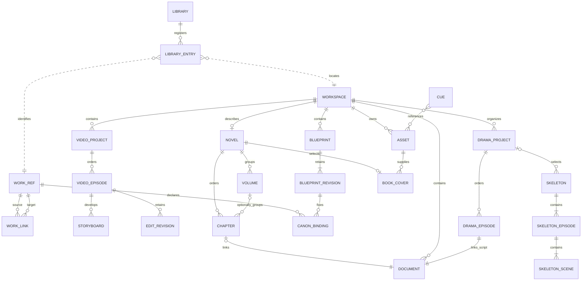
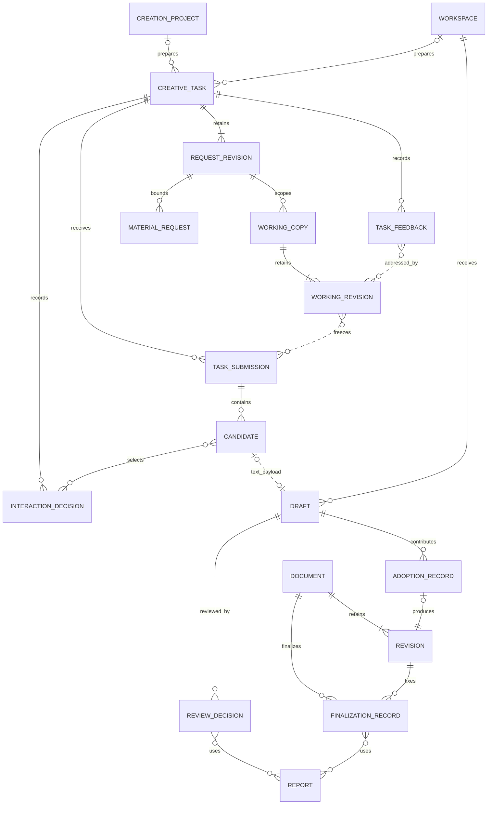
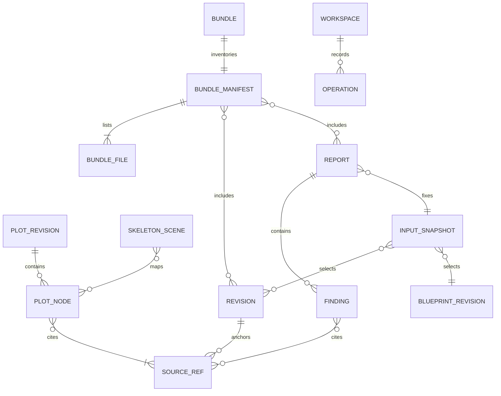
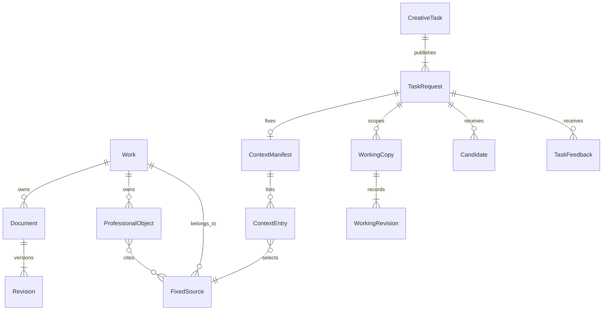

# 数据字典与 Schema 设计

## 字段与定位边界

本次定位调整不增加Schema字段。现实考据、探索稿和确认设定的区别由已有对象、来源、修订及决定承载；不足之处以真实用例提出合同变更，不以新文案虚构已实现状态。

产品定位与任务分流见[01](01-产品需求PRD.md#1-产品定义)。

本体分类不另造统一对象存储；创作事实、专业对象、任务引用、本机偏好及可重建投影各自按本章所属合同保存。语义与准入归[28](28-领域设计与边界上下文.md#15-agent-first-的本体核心)。

跨文稿移动记录保存在`.hetu/document-moves/<move_id>.json`，包含确切WorkRef、来源及目标的移动前后document_id／revision_id／sha256、原来源字节范围、引句摘要和原操作键；新目标另外记录`target_created`及目录或项目的前后修订摘要。`move_ref`固定move_id与整条记录摘要。正文继续属于原不可变修订，不在记录中另存全文。恢复只消费记录内的前后修订；已有目标或新目标的当前基线任一变化均整体拒绝，新目标撤销时从目录移除并归档目标，历史文件保留。不接受调用方提交任意回滚正文。该记录不是作者采纳或定稿，批注、任务及历史决定仍指向原修订。

## 本机设置第五版

本机设置存储`schema_version=5`，由`local_settings`唯一拥有。`preferences.reading_profiles.novel/screenplay`分别保存完整的`font_family`、`font_name`、`font_size`、`line_height`、`paragraph_spacing`、`line_width`及`first_line_indent`；`document_theme`为跟随／清纸／暖纸／夜墨，`focus_paragraph`、`typewriter_scroll`及`smart_pairs`是独立开关。`preferences.agent_session`保存独立会话偏好，默认值唯一来自`contracts/agent-session-defaults.json`。具体枚举、长度和数值约束以`contracts/actions.json`为准，不将字体、滚动或主题写入作品。

`preferences.execution_mode` 只接受 `auto|confirm`，新安装与首次补入执行策略的旧设置默认 `auto`，已有显式选择保持。执行策略与阅读档案同属本机设置，只有这一份事实源；CLI、MCP 和 Skills 读取实际值，不缓存另一套默认。第一、二版先补齐执行策略，第三版补入完整会话偏好并到第五版；第四版只新增`terminal_focus_on_hover=false`，保留其他会话偏好、策略修订、关联及安装记录。迁移固定原字节到`migrations/v<原版本>/settings.json`，与新设置原子提交；推进设置修订使旧CAS过期，重开不重复迁移。未知版本、缺字段、非法值或不同迁移原件均拒绝并保留原文件。

更新档案使用字段级深合并，只改变本次明确字段，不替换另一类型或未指定字段；相同字段仍受整体修订CAS约束。修订1公开入口的旧字体／字号／额外行距／缩进字段在边界转为小说档案，读取投影按需计算旧字段，不持久化第二份值；旧字段与同次新档案字段混用时拒绝，避免优先级不明。

旧存储迁移先校验完整原记录，原字节写入固定迁移备份，并与新设置通过同一可恢复事务提交。旧字号继续按px，小说行高以旧阅读视图为基线，采用`1.35+line_spacing/font_size`，原880px行宽转为相应字形宽度；剧本按原独立样式迁移。迁移推进本机设置修订，使未执行的旧基线方案明确过期；已执行回执和原操作仍保留。未知Schema不写入，格式错误不以默认值覆盖；旧Core拒绝新存储，不逆向降级。旧编辑器被底层固定1.4倍行高覆盖的表现作为缺陷修正；阅读与编辑共用迁移后的同一档案，不为保留这一差异双写偏好。

## 默认基础产品与视频审阅数据

`contracts/baseline.json`拥有随包作品类型、核心动作和工作面要求，不属于作品数据或插件安装状态。视频基础合同由 `contracts/schemas/video-review.schema.json` 拥有：媒体记录固定work_ref、video_episode_id、asset_ref、purpose、stream_index、time_base、duration_ticks和previous_media_ref；区间采用同一流时基的半开区间start_tick至end_tick。时长与流信息标为提交方声明，Core不从文件签名推定解码或观看成功。

媒体及意见是不可变版本化记录，保存使用共同事务和原操作键。列表使用固定集合摘要游标，新增内容后拒绝拼接旧分页。意见保存不改变正式选用、预演认可或成片决定。基础文件交付保留固定资产摘要、完整字节及用途，不包含未声明的专业工程。归属见[28](28-领域设计与边界上下文.md#默认基础与专业扩展归属)。

基础媒体决定保存在`packages/video/decisions/<decision_id>/revisions/<revision>.json`，复用版本化摘要链和共同事务；`head.json`属于该链，`packages/video/decision-slots/<video_episode_id>/<purpose>.json`仅指向本分集用途的当前固定决定。`decision_ref={decision_id,revision,sha256}`，不可跨作品、分集或用途使用。记录包含`schema_version,workspace_id,decision_id,revision,previous_sha256,created_at,updated_at,actor_ref,work_ref,video_episode_id,purpose,media_ref,decision,author_statement,previous_ref`，`decision=confirmed|withdrawn`；`previous_ref`为空仅适用于第一条确认，撤回必须精确匹配当前已确认的媒体。预览固定请求、媒体及分集修订和前一决定，保存再次核对。媒体读取与交付分别呈现所选固定媒体和当前决定的关系，不改旧媒体记录中的历史`adoption`字段，也不声称视频已经解码或被观看。历史分页绑定确切槽位及当前头，头变化拒绝旧游标。


本章定义字段语义与约束；`contracts/schemas/` 负责已发布的机器校验合同，两者变更须同步评审。现有格式基线为 `1.0.0`，新增记录独立版本化；采纳与定稿拆分涉及的接口不得沿用旧语义版本。设计结构不自动成为运行时可接收字段，调用以能力目录公布的精确 Schema 为准。

## 1. 类型、公用字段与存储选择

正文为 UTF-8 Markdown／Fountain，元数据为 JSON。普通文件与可恢复清单是业务权威；SQLite 如使用只保存可重建索引，不设计必须部署的数据库服务。关联采用带类型的 ID 与修订引用，不使用文件名作外键。

| 类型 | 定义 |
| --- | --- |
| ID | 非空类型前缀 UUID，稳定且不可按名称重算 |
| Revision | 大于零的整数修订，或独立不可变 revision ID |
| Digest | 文件原始字节 SHA-256，64 位小写十六进制 |
| Instant | UTC RFC 3339；业务时序不用此值代替 |
| RelativePath | 闭合受管根内 `/` 相对路径，另经原生身份检查 |
| NullableRef | 明确未知时用 null，不能用空字符串或随意默认实体 |

每种记录均声明自身 `schema_version` 与类型对应 ID。未知必需字段、非法枚举、重复 ID、无效引用与未来不支持版本均有明确错误；读未来格式不得丢字段后写回。

## 2. 项目配置 WorkspaceConfig

| 字段 | 类型／必需 | 约束 |
| --- | --- | --- |
| `schema_version` | string，必需 | 初始1.0.0 |
| `workspace_id` | ID，必需 | 移动目录不改变，复制为新项目需显式分配新 ID |
| `title` | string，必需 | 工作区创建时的名称；小说当前书名由 Novel.metadata.title 维护 |
| `locale` | string，必需 | 作品默认语言，默认 zh-CN，可为 en；与应用界面偏好独立 |
| `blueprint_path` | RelativePath，必需 | V1固定 shared/blueprint.json |
| `work_type` | 已发布工作区入口类型 | 旧合同novel／drama按原版本读取；三类独立入口使用24节WorkRef，不用此单值表示根内全部对象 |
| `novel_path` | RelativePath，可选 | 小说作品固定 packages/novel/novel.json；原创短剧不创建空小说记录；旧作品由作者显式初始化 |
| `packages` | enum[]，必需 | novel、drama、music-cue、visual-prompt，唯一 |

凭据、系统授权、最近路径和作者批准秘密不属于此配置。

### 作品时间 WorkspaceProperties

`.hetu/workspace-properties.json` 保存 `schema_version=1.0.0, workspace_id, created_at, updated_at`，由 `workspaces.get/list` 的 `data.properties` 返回，不增加 WorkspaceConfig 字段或改变配置摘要。两个时间为 UTC RFC 3339 或 `null`；已知时更新时间不得早于创建时间。创建时间固定；更新时间表示成功持久化的作品业务变更，包括正文、任务、审核及交付等，不等同于正文编辑时间。旧作品只恢复可核对的原始记录，未知不使用打开时间或文件系统时间代填。

文档属性分别读取 Document.created_at、当前 Revision.created_at 和当前定稿引用对应记录的 created_at。作品资料、剧本项目、分集、资料及素材使用自身记录的 created_at／updated_at；分集和素材的资料更新不冒充正文保存或素材原始拍摄时间。本机书库缓存作品时间，lastOpenedAt 独立维护；旧书库缺缓存字段仍可读取。

### 小说 Novel 与卷章目录

机器合同见 [Novel Schema](../contracts/schemas/novel.schema.json)。Novel 包含 `schema_version, workspace_id, novel_id, revision, previous_sha256, metadata, volumes, chapters, created_at, updated_at`。`metadata` 保存书名、笔名、简介、类型、正文语言标签和创作状态；书名不能只含空白。分卷与章节数组分别规定显示顺序，章节使用稳定 `chapter_id` 与 `document_id` 绑定，`volume_id=null` 表示未分卷。

当前记录、摘要和不可变历史修订须一致。目录必须覆盖本作品全部小说章节，引用不能重复，不能指向大纲、剧本、虚拟草稿或其他作品。目录编辑只调整顺序、卷名和分卷归属，不能借重排隐藏章节或更换正文绑定。资料与目录共用 `expected={revision,sha256}`，所有写动作均保留原操作回执。

## 3. Blueprint 及正典实体

Blueprint 必需字段：`schema_version, blueprint_id, revision, lock, characters, factions, locations, timeline, world, rules`；实体集合可为空，引用不能悬空。

| 对象 | 字段与语义 | 校验 |
| --- | --- | --- |
| Lock | `locked:bool, changed_at:Instant, actor_ref:ID, reason?:string` | 可信作者入口变更，不能由 Agent 输入身份 |
| Character | `character_id, name, aliases[], description, traits[], facts[], archived` | 名称非空；别名歧义保留；性格文字只作 advisory |
| Faction | `faction_id, name, description, relations[], archived` | 关系目标存在、类型明确 |
| Location | `location_id, name, aliases[], parent_ref?, interior_exterior, description, archived` | 父子无环；未知内外景明确 unknown |
| Fact | `fact_id, subject_ref, predicate, value, valid_from, valid_to?, source_refs[]` | subject_ref 与所属角色一致；有效期为事件引用，包含起点、不含终点 |
| TimelineEvent | `event_id, title, time_anchor?, before_refs[], after_refs[], source_refs[]` | 先后不能成环；无绝对日期也可用相对边 |
| WorldEntry | `entry_id, title, description, source_refs[]` | 纯文字说明不自动可执行 |
| Rule | `rule_id, revision, type, scope, severity, parameters, rationale, exception_policy` | 类型／参数闭合，例外政策明确 |

`interior_exterior` 与日夜枚举按09；`predicate` 采用版本化允许表，例如身份、归属、生存状态等，不执行任意表达式。`traits` 不能被自动当成“所有行为必须符合”的确定规则。

可执行字段与边界见[设定集规范](06-设定集与规则规范.md)。时间锚采用 `calendar:string, tick:integer`，整数刻度与修订不超过 JSON 安全整数范围；刻度允许负数，不是系统时间戳。明确事实允许的谓词为 identity、primary_faction、life_state、age，其值类型与规则参数由 [Blueprint Schema](../contracts/schemas/blueprint.schema.json) 闭合定义。

## 4. Document、Revision 与 Annotation

| 对象 | 必需字段 | 可选字段／约束 |
| --- | --- | --- |
| Document | `document_id, kind, title, source_format, current_revision_id, created_at` | `approved_revision_id, finalization_ref, last_adoption_ref, last_finalization_ref, order, synopsis, language_tag, structure_origin`；当前与定稿可不同，定稿指针仅由独立定稿用例设置 |
| Revision | `revision_id, document_id, source_format, content_path, sha256, size_bytes, created_at, actor_ref` | `parent_revision_id, import_record_ref, origin_kind, contribution_refs`；来源与定稿分开，内容不可变 |
| Annotation | `annotation_id, source_ref, author_ref, body, created_at, state` | `resolved_at, resolution_ref`；引用固定修订 |
| ImportRecord | `import_id, source_format, source_digest, parser_version, losses[], result_refs` | 原文件附件、作者确认、编码与 profile |

`kind` 至少区分 novel_chapter、novel_outline、drama_script、adaptation_note；source_format 为 markdown／fountain。中文章节号与集号是 order／展示元数据，不作为 document ID。正文路径由服务端构造，调用方不能指定任意磁盘路径。

公开`documents.get`结果的顶层`work_ref`为派生只读投影：小说文稿沿当前小说身份，剧本文稿沿已核验的分集与项目关系解析；没有作品归属或仅为草稿虚拟证据时为`null`。它不属于持久Document，不写入旧记录或改变修订摘要；固定历史正文仍返回同一不可变修订。会话成果核对该投影、文稿身份、修订及摘要，不能假设`document.work_ref`存在或通过名称推断归属。

## 5. Draft 与审核

| 对象 | 必需字段 | 条件／说明 |
| --- | --- | --- |
| Draft | `draft_id, revision, package, source_format, content_path, content_sha256, size_bytes, state, actor_ref, created_at, blueprint_revision, blueprint_sha256, language_tag` | 更新既有文档须有 target_document_id／base_revision_id；新文档须有 title；正文上限 1 MiB |
| Draft evidence | `evidence_document_id, evidence_revision_id` | 只读虚拟文档身份，指向同一份草稿内容；不在正式正文列表中 |
| Draft submission | `schema_version, draft` | 冻结提交属性；状态、状态修订、最近决定与批准／接替指针单独维护 |
| Draft lineage | `parent_draft_id?` | 新稿关联返工来源，不能形成环 |
| ReviewDecision | `schema_version, review_id, draft_id, draft_revision, decision, reviewer_ref, decided_at, input_snapshot, report_refs, comments, private_comments, coverage_acknowledgement, exceptions, previous_review_id, previous_review_sha256` | 记录不可改写，撤回新增决定；Agent 读取投影移除 private_comments；历史合同的 approval_target 仅作历史解释，不进入新参考稿决定 |
| ReviewReportRef | `report_id, sha256, dispositions_sha256` | 同时固定报告原字节与处置投影，防止使用旧审核屏确认新的处置 |
| ReviewException | `report_id, finding_id, disposition` | 内核从已核实报告提取具体作者处置；不接受调用方注入例外列表 |

Draft 的 `revision` 仅用于状态／元数据 CAS，正文提交后不可变；内容变更产生新 draft ID。参考稿 `decision` 为 approved／rejected／changes_requested／withdrawn；approved 表示通过参考稿审核，withdrawn 撤回这次参考稿决定，均不自动更新正文定稿。兼容读取历史决定时按记录的原合同解释，不改写历史语义。

对象任务及作者稿提交新增可选 `blueprint_ref={kind,work_ref,blueprint_id,revision,sha256}`，固定所属作品的设定，且与 `blueprint_revision,blueprint_sha256` 一致。旧稿缺少该引用时按原根设定解释；读取、诊断和过期计算不能将它改绑到新设定。人物图的关联也核对作品和设定身份，不以同名实体或相同数字修订推定归属。

审核报告引用必须可解析，InputSnapshot 的当前性由策略计算，不把一个可编辑的 `is_fresh=true` 持久字段当事实。

ReviewSnapshot 包含 `draft_id, draft_revision, content_sha256, submission_sha256, blueprint_revision, blueprint_sha256, current_blueprint_revision, target, skeleton`。`target` 为 null 或固定目标／基线摘要、当前修订及当前定稿指针；`skeleton` 为 null 或固定骨架引用、当前骨架修订与来源状态。决定时完整值相等校验，通过参考稿审核额外要求输入未过期；决定不产生正文修订。之后采纳或手工编辑使目标变化时，保留原决定及其证据，重新计算它对当前稿的适用性，不把历史决定移植为新正文的定稿授权。

固定提交凭据、状态摘要与决定摘要链均在受管读取时核验；这些摘要用于发现意外改写，不宣称抵抗可重写整个工作区的本地同级权限攻击。已发布的输入格式见[提交](../contracts/schemas/draft-submit-input.schema.json)、[开始审核](../contracts/schemas/review-begin-input.schema.json)、[草稿检查](../contracts/schemas/review-validate-input.schema.json)与[审核决定](../contracts/schemas/review-decide-input.schema.json)；新版采纳／定稿分别使用独立动作与合同修订，不把旧审核格式当成新定稿输入。

### 5.1 采纳与独立定稿记录

生命周期输入、引用和预览结构由[文档生命周期 Schema](../contracts/schemas/document-lifecycle.schema.json)定义。以下是持久记录的字段语义，预览和决定的调用顺序见[30第7节](30-应用API详细设计.md#7-审核与素材)。

| 对象 | 字段 | 不变量 |
| --- | --- | --- |
| DocumentRef | `document_id,revision_id,sha256` | 引用本篇确切修订及内容原始字节 |
| DraftRef | `draft_id,revision,sha256` | 状态修订和内容摘要同时固定，不能仅以 draft ID 采纳 |
| LifecycleRef | `adoption_id或finalization_id,sha256` | 关联记录身份和记录原始字节摘要，两个 ID 字段互斥 |
| 生命周期共同字段 | `schema_version,workspace_id,document_id,document_ref,previous,actor_ref,created_at` 及本类型 ID | schema_version=1.0.0；previous 首项为 null，后继引用同类型上一条记录 |
| AdoptionRecord | 共同字段、`adoption_id,draft_ref,base_revision_id,selected_ranges,input_snapshot` | document_ref 指采纳结果；新文档的 base_revision_id=null；选区引用固定候选及目标，不设置定稿 |
| FinalizationRecord：确认 | 共同字段、`finalization_id,decision,expected_finalization_ref,input_snapshot,report_refs,comments,coverage_acknowledgement` | decision=confirmed；document_ref 是实际审阅修订，不能由参考稿审核替代 |
| FinalizationRecord：撤回 | 共同字段、`finalization_id,decision,expected_finalization_ref,comments` | decision=withdrawn；document_ref 保留被撤回定稿的修订；不要求伪造新的诊断快照 |

`Document.last_adoption_ref` 与 `last_finalization_ref` 定位各自完整历史；`finalization_ref` 只表示当前有效确认。确认时 approved_revision_id 与该确认的 document_ref.revision_id 一致；撤回后清除 approved_revision_id 和 finalization_ref，last_finalization_ref 仍指向新增的撤回记录。普通保存和采纳均保留已有定稿指针。

`Revision.contribution_refs` 引用实际采纳记录。采纳后的手工保存继承这些修订级来源，不能据此计算逐字符“AI 百分比”；新增采纳追加引用，不改写旧记录。记录文件位于相应文档的 adoptions／finalizations 目录，摘要索引位于 `.hetu/adoptions/` 和 `.hetu/finalizations/`；两者与新正文或指针、原操作及审计共同提交。

参考稿决定采用 schema_version=2.0.0，独立于生命周期记录版本；读取旧审核记录按其原始版本解释。历史读取同时核验 workspace、document 归属、前驱链、摘要索引和被引用正文，缺失、循环或篡改都不能回退成“没有历史”。单条记录和历史结果均受16 MiB输出预算约束，历史链最多1000条，超限明确返回错误，不静默截断。

## 6. Plot、Skeleton 与映射

| 对象 | 字段 |
| --- | --- |
| PlotRevision | `plot_revision_id, parent_plot_revision_id?, blueprint_revision, blueprint_sha256, source_revisions[], engine_version, options, nodes[], edges[], coverage, created_at, actor_ref` |
| PlotNode | `node_id, kind, source_refs[], entity_refs[], entity_candidates[], location_ref, location_candidates[], time_ref, speaker_ref, speaker_candidates[], time_of_day, unresolved_names[], verification, extraction_method, missing_prerequisites[], annotation?` |
| PlotAnnotation | `context, facts[], capabilities[]`；事实为 `subject_ref, predicate, value`，绑定节点原文；语境未知不能当事实 |
| PlotEdge | `edge_id, from_node_id, to_node_id, relation, verification, source_refs[]` |
| Skeleton | `schema_version, skeleton_id, revision, previous_sha256, plot_revision_id, plot_sha256, blueprint_revision, blueprint_sha256, source_revisions[], engine_version, build_options, status, episodes[], created_at, actor_ref` |
| SkeletonEpisode | `episode_id, episode_number, title, scenes[]`；骨架规划身份；空标题为 `""` |
| SkeletonScene | `scene_id, scene_number, title, location_ref, interior_exterior, time_of_day, character_refs[], adaptation_note, plot_node_refs[], source_refs[], missing_fields[], dialogue, shot_description`；仅骨架规划 |
| AdaptationComparison | `schema_version, comparison_id, skeleton_ref, source_revisions[], status, items[], created_at, actor_ref` |

对话／镜头占位在新骨架为空；剧本内容保存在 Fountain 修订，不将两份可独立编辑的对白同时存入骨架和正文。对比记录中的变化引用精确源、目标对象和范围。

骨架 [Schema](../contracts/schemas/drama-skeleton.schema.json) 限定稳定 ID、枚举、引用和空对白占位；来源由节点映射派生，不能由结构编辑请求任意改写。`previous_sha256` 在首修订为 `null`，其余指向上一修订实际字节摘要。`missing_fields` 为 `location|interior_exterior|time_of_day|characters|source_mapping|author_review`；它与继承输入覆盖的 `status` 分开。

差异报告 [Schema](../contracts/schemas/drama-comparison.schema.json) 中每项包含 `kind, scene_id, plot_node_refs[], source_refs[], details`。`scene_id` 无对应场次时为 `null`；`unmapped` 的 `details.source_range` 是固定原文 UTF-8 范围，`stale_source` 记录原始／所选修订。`details.fields` 只列结构差异，不宣称检测出文学语义变化。报告读取重新核验固定证据与结构对比结果，当前性另外计算。

结构剧本映射遵循 [ScriptMapping Schema](../contracts/schemas/drama-script-mapping.schema.json)：`schema_version, renderer_version, document_id, revision_id, content_sha256, skeleton_ref, language_tag, title, coverage_status, scenes[]`。每个场次记录 `episode_id, scene_id, episode_number, scene_number, byte_start, byte_end, quote`；字节范围绑定初始 Fountain 修订。`Document.structure_origin={mapping_path, mapping_sha256, revision_id}` 与独立摘要索引一致，正文保存新修订时保留该初始来源。骨架、初稿与映射经过重新计算核验，不把历史范围当作当前正文的自动映射。

## 7. 诊断与覆盖

Report 字段为 `schema_version, report_id, input_snapshot, rule_set_version, engine_build, options, status, coverage, findings[], created_at, actor_ref`。每条 Finding 有稳定 ID、规则及修订、severity、certainty、message_key、来源、设定集引用、证据及缺失前提，以及固定的 `disposition=open` 和例外策略。完整机器合同见 [Report Schema](../contracts/schemas/validation-report.schema.json)。

Coverage 字段为 `requested_refs, scanned_ranges, scanned_bytes, unparsed_ranges, plot_coverage, enabled_rules, executed_rules, evaluations, counts, budget_stop`。逐单元结论为 `passed|finding|unknown|not_applicable`；规则尚未执行的部分由预算终止及覆盖范围说明。`status=complete` 不代表全文没有问题；`stale` 根据当前依赖计算。

DispositionRecord 包含 `schema_version, report_id, finding_id, revision, expected_inputs, disposition, reason, actor_ref, created_at, previous_sha256`。首次 `previous_sha256=null`，后续指向上条记录原始字节摘要。记录位于 `packages/drama/reports/dispositions/`，`.hetu/finding-dispositions/` 保存当前修订与摘要投影。处置只作用于固定 finding 和证据，不能修改报告或设定规则；更新需当前处置修订 CAS。

## 8. 线索、媒体与交付

| 对象 | 字段／说明 |
| --- | --- |
| Cue | `schema_version, cue_id, revision, previous_sha256, kind, title, description, narrative_refs[], asset_refs[], archived, created_at, updated_at, actor_ref`；kind为music／visual；2.0记录另必需不可变`work_ref`，全部正文与素材引用核验同作品 |
| Asset | `schema_version, asset_id, revision, previous_sha256, kind, title, original_filename, blob, source, rights_status, redistribution_allowed, rights_statement, created_at, updated_at, actor_ref`；2.0记录另必需不可变`work_ref`；未归属1.0记录保留历史语义 |
| Provenance | `source_uri?, provider_task_ref?, creator_statement?, safe_parameters?`；均为声明，清理私密 URL |
| DeliveryProfile | `profile_id, version, target_formats[], required_fields[], layout, font_policy, validator_refs[]` |
| BundleManifest | `schema_version, bundle_id, profile, created_at, workspace_id, inputs, files, provenance, coverage, warnings, exclusions` |

包内文件清单不列自身 manifest，归档外的 ZIP 摘要由操作回执记录。权利 unknown 与格式缺项不是文件完整性错误，但必须按 profile 明确阻断／排除／作者审阅策略。

素材与线索采用共同 [Media Schema](../contracts/schemas/media.schema.json)，其 `$defs` 同时提供持久记录和各动作输入合同。`blob={path,sha256,size_bytes,media_type,validation}` 不可随元数据修订改变；`source={source_type,creator_statement,source_uri?}` 只保存脱敏的来源声明。`asset_refs` 每项为 `{asset_id,revision,sha256}`，绑定素材元数据修订；正文关联遵循 SourceRef。首次 `previous_sha256=null`，后续指向上条修订的原始字节摘要。元数据读写重新校验 Schema、归属、路径与摘要，素材单项读取额外流式核对媒体原字节。

素材和线索列表返回摘要投影及 `next_cursor`，不批量加载媒体。列表的 `media_verified=false` 表明未在本次列表查询重新读完媒体；单项核验成功为 true。`delivery_eligible` 只表达权利声明是否允许默认嵌入，不替代导出时完整性核验。线索读取返回固定记录、`stale_sources` 以及关联素材的 `metadata_stale` 和当前权利状态，保留旧引用并要求作者核对。

字幕资产采用`schema_version=3.0.0,kind=caption,blob.media_type=text/vtt,blob.validation=utf8_webvtt`，必须有不可变`work_ref`；WebVTT原字节不超过1MiB，完整UTF-8、文件头及控制字符核验不等于专业字幕解析或音画对齐。旧1.0／2.0素材与music／visual线索保持原义，不能将旧记录改成字幕。

视频成果带字幕时采用`schema_version=2.0.0,caption_tracks[]`，每轨为`id,label,language,asset_ref,source_object_ref?`，最多16轨且ID唯一。`asset_ref`固定同作品的WebVTT资产；可选专业来源为`owner_plugin_id,object_id,revision,sha256`，只核验保留记录及摘要，不把来源声明当作字幕对声证明。新增或更换字幕创建新成果，旧成果、旧字幕及位置意见不改写。字幕字节按既有`hetu.assets.read_blob`读取；专业原工程及SRT／ASS仍归原插件。

## 9. 操作、审计与本机授权

Operation 保存 `operation_id, scope_id, actor_scope, action, key, input_digest, accepted_at, state, result_ref, external_observation?`。索引唯一键包含提供方、范围、主体、动作和键；同键异输入拒绝。AXI operation 投影为 `id, key, input_digest, recover_action`，不暴露本机内部索引布局。

Audit 保存操作与目标引用、前后摘要、允许参数、时间、结果及前事件摘要；无 Token、Cookie 或整段正文副本。本机 AuthorApproval 保存一次性批准范围、输入摘要、有效期、可信会话和消费状态，放 OS 用户应用数据目录；它不是可 Git 同步的审计事件。

固定 Git 快照使用 [GitSnapshot Schema](../contracts/schemas/git-snapshot.schema.json)，字段为 `schema_version, snapshot_id, workspace_id, repository_instance, head, selection, excluded_changes, message, author, timestamp`。`head` 固定完整本地引用与可空父 commit；`selection` 按相对路径严格排序，每项记录 `path, before_oid, after_sha256, after_oid, mode, size_bytes`。删除项的 after 字段为 null；仅允许普通文件的 100644／100755 模式。`timestamp` 为提交使用的 UTC Unix 秒，与其他记录的 RFC 3339 系统时间表示分开。

快照原始字节位于 `.hetu/git/snapshots/`，SHA-256 绑定批准；该目录不随 Git 同步。本机批准记录包含 `schema_version, snapshot_id, snapshot_sha256, repository_instance, actor_ref, approved_at, expires_at`，保存在工作区以外的 OS 应用数据中，不能作为 Agent 业务参数传入。`repository_instance` 由 workspace ID 与工作区、Git 目录的设备／inode 生成摘要；批准有效期 15 分钟，不跨仓库实例沿用。

`.hetu/git/executions/` 保存原键绑定的 `input_digest, snapshot_sha256, snapshot_id, actor_scope, result, published`；result 保留完整原 AXI 回执与操作 ID。恢复必须重新核验实际 Git 对象和引用，published 只作本机进度记录，不作提交已发布的唯一证据。快照、执行日志、操作回执和本机审计均不纳入 Git 版本树；文档、历史修订、审核决定与来源索引保持可版本化。

## 10. 索引与查询

可重建索引至少覆盖文档／修订、设定集实体名称与别名、来源引用、待审草稿、finding 与素材引用。分页游标绑定 workspace、身份范围、查询摘要和快照修订，变更筛选或范围后旧游标无效。

搜索返回授权范围内的摘要和明确继续入口，不能静默截断。归档实体默认隐藏但引用可解析。正文、审核和 operations 是源数据，不能作为索引清理目标。

## 11. 一致性、迁移与数据生命周期

结构校验之后再做引用、摘要、时间与业务校验。聚合多文件更新按07执行事务；外部手工编辑先检测，再导入新修订或隔离冲突。原始不可变文件损坏不能靠改摘要恢复为“可信”。

格式升级需要版本化迁移、预演、备份、引用与摘要重验；未知主版本只读。物理删除先列被引用对象及导出影响，作者确认后执行，仍被在途／unknown 操作或交付引用的记录受保护。V1 不提供自动清除整部作品或审核历史的后台任务。

## 12. 实体关系

### 12.1 作品组织与内容归属



创作库登记与作品内容是两种持久范围，一条登记准确定位一个WorkRef，多个登记可以指向同一根。WorkLink的两端具有固定版本，图中的引用不授予读取或修改权限。CanonBinding 明确对象使用的设定及固定修订，不因同根而共享正典；原著事实与目标的改编例外分别拥有，见第24节。既有单设定工作区保持原文件和身份，不从图中的目标基数推定已发布多设定存储。未初始化小说资料的既有工作区可暂缺 Novel；已初始化的小说目录覆盖本作品全部小说章节。未分卷章节的 `volume_id=null`，正文保存在 Document／Revision，Chapter 和 Volume 不再保存一份文本。

桌面位置登记的`works`缓存`work_ref,title,author_name?,genre?,status?,archived?,chapter_count?,created_at?,updated_at?`，由桌面实际读取后更新；不保存另一份正文。MCP创作库仅投影这些展示字段，内部根路径不外发；`authorized`及可用`management_ref`按当前客户端重新核验，不写回目录。分页游标绑定本次目录和授权摘要，变化时重新读取；旧登记只有身份和名称仍可展示，缺精确作品引用的旧新建授权不能扩为整个工作区授权。

DramaProject 组织写作分集，骨架是可选规划；独立剧本可由作者显式编入分集。写作分集与骨架规划分别拥有身份，通过固定修订映射关联，不以集号、场号或名称识别。BookCover 关系指当前选用投影，历史选用和候选仍单独保留。对外部作品的原著引用必须按显式导入及映射规则处理，不能从关系图推导跨工作区读取权限。

### 12.2 候选、来源、审核与定稿



关系图表达领域关联，不要求建立同名数据库表。CreativeTask 的 scope 二选一，不能同时属于筹备和作品；两个可选父关系共同受该不变量约束，不能解释为两者都可空。直接通过草稿工具提交的 Draft 可以没有 CreativeTask；文本任务候选可关联 Draft，非文本候选不因此变成正文。

一次文本 AdoptionRecord 对应一个 Draft 和一个新结果 Revision，Revision 可能完全来自手工或导入而没有采纳记录；多次采纳形成多条记录及后继修订。ReviewDecision 对报告和源文使用固定修订，Document 的定稿指针仅引用本篇确切修订及有效 FinalizationRecord；纯手工 Revision 可直接定稿，不要求经过 Candidate、Draft 或 AdoptionRecord。报告在审核与定稿中分别固定输入，不能沿用候选报告替代采纳后正文报告。

### 12.3 诊断证据与交付溯源



InputSnapshot 保存的是带修订及摘要的固定引用，不是指向“最新内容”的动态查询。SourceRef 固定原始 UTF-8 范围，报告中没有问题时允许零个 Finding；正文问题提供源文定位，结构或设定问题通过设定引用及 evidence 说明依据，不能伪造一段正文。交付包的 manifest 列出所选修订、报告及实际文件，操作回执固定产物摘要；Operation 与本机恢复日志不自动成为交付材料。

## 13. SourceRef 结构合同

```json
{
  "$schema": "https://json-schema.org/draft/2020-12/schema",
  "title": "HetuSourceRef",
  "type": "object",
  "additionalProperties": false,
  "required": ["document_id", "revision_id", "byte_start", "byte_end", "quote"],
  "properties": {
    "document_id": {"type": "string", "pattern": "^doc_[0-9a-f-]{36}$"},
    "revision_id": {"type": "string", "pattern": "^rev_[0-9a-f-]{36}$"},
    "byte_start": {"type": "integer", "minimum": 0},
    "byte_end": {"type": "integer", "minimum": 0},
    "quote": {"type": "string"}
  }
}
```

Schema 负责结构，领域校验进一步要求 ID 符合 UUID 格式、修订归属正确、起止范围有序且不越界、UTF-8 边界完整、quote 与原始字节切片一致。仅通过结构校验不构成来源有效。

## 14. 持久记录与副本规则

| 内容 | 存放位置 | 写入／修复方式 |
| --- | --- | --- |
| 设定集与配置 | shared 与工作区根 | 作者 CAS 变更；外部编辑进入差异审阅 |
| 文档正文与修订 | 对应 packages 的 documents 目录 | 新修订追加，指针事务更新 |
| 草稿、审核与报告 | 对应包与 `.hetu` 受管记录 | 不可变内容，状态变化保留审计 |
| operations 与恢复日志 | `.hetu` 操作及事务目录 | 与业务效果协调提交，按原操作恢复 |
| 搜索及列表索引 | `.hetu` 可重建缓存 | 从权威记录重建，不反向覆盖正文 |
| 个人语言偏好与授权 | OS 用户应用数据 | 不进入工作区、Git 或 Bundle |

目录精确规则以[07](07-工作区与持久化设计.md)为准。备份恢复必须同时重验配置、正文摘要、引用、审核和原操作记录，不能只恢复索引或只复制当前正文指针。

## 15. 小说封面任务与选用

封面请求和外部结果分别使用 [CoverRequest Schema](../contracts/schemas/cover-request.schema.json) 与 [CoverResult Schema](../contracts/schemas/cover-result.schema.json)。[BookCover Schema](../contracts/schemas/book-cover.schema.json) 闭合定义选用记录、来源、展示参数和七个作者动作的输入。字段语义、固定目录与图像限额以[34](34-小说封面与Agent协作.md)为唯一专项来源。

任务中的作品资料为本次设计快照，`request_sha256` 绑定原请求文件字节。结果中的路径、尺寸、摘要和生成器名称为不可信输入，读取时独立核验；作者封面引用仅由选用事务写入。书库缩略图是可重建缓存，不充当媒体原件、审核决定或版权凭证。

BookCover 以 `revision,previous_sha256` 形成不可变历史，选用以当前修订和摘要 CAS。`source_ref` 按手工图片、外部候选、已有素材三种闭合结构保存来源，不携带外部绝对路径。原件及来源声明保留；`presentation` 只决定裁切与书名／笔名叠加。书库缓存包含预览字节与叠加文字，打开作品后由受管记录重建，封面损坏不阻止正文打开。

## 16. 建书筹备、外部任务与候选

| 对象 | 必需字段 | 语义与约束 |
| --- | --- | --- |
| ScopeRef | `kind, id` | kind 为 creation_project 或 workspace，二选一；ID 和会话实际授权一致 |
| CreationProject | `schema_version, project_id, revision, previous_sha256, brief, selected_fields, task_refs, created_workspace_ref, created_at, updated_at` | brief 可从一句话开始；选中字段可为空；created_workspace_ref 初始 null，只有作者创建回执可绑定 |
| CreationProject.work_profile | `work_type, drama_mode, language_tag` | 筹备表单保存的创作选择；novel 的 drama_mode 为 null，drama 为 original／adaptation；正文语言为 zh-CN／en，与界面语言独立；缺省历史记录不改写历史摘要 |
| CreativeTaskRequest | `schema_version, task_id, scope_ref, request_revision, previous_sha256, task_kind, brief, input_refs, input_snapshot, context_manifest_ref?, client_adapter, skill_ref, prompt, prompt_language, output_contract, edit_scope, created_at` | 1.1.0必含 context_manifest_ref，input_snapshot.sources 保存固定修订目录；1.0.0保留原内联字节；非改稿任务的 edit_scope 为 null |
| EditScope | `document_id, revision_id, ranges` | 单文档；1～16个 UTF-8 半开范围及 quote，不重叠；空范围为指定插入点，整章也显式列范围 |
| OutputContract | `artifact_types, candidate_limit, text_byte_limit, image_byte_limit, submission_mode, relative_inbox, revision_requires_patches` | 文本／图片可用 MCP、CLI 或固定 inbox，资料任务使用 MCP／CLI；旧请求保留原方式；路径由任务身份推导，数量和预算在复制前可见 |
| TaskObservation | `schema_version, task_id, scope_ref, revision, previous_sha256, state, copied_at, submission_refs, last_decision_ref, closed_reason, created_at, updated_at` | 持久修订及摘要链；复制不证明已发送，状态不代表 Agent 正在运行 |
| TaskSubmission | `schema_version, submission_id, task_ref, request_sha256, candidates, complete, missing_items, provenance, received_at` | 一批已核验的外部结果；不足为 partial_result，不能伪造成功；同键同输入返回同批 |
| Candidate | `candidate_id, kind, relative_path, sha256, size_bytes, language_tag, source_refs` | kind 区分 concept、title、synopsis、outline、text、image；改稿保留 patches；可带 draft_ref，图片带实际宽高、类型与解码证据 |
| InteractionDecision | `schema_version, decision_id, task_ref, candidate_refs, comment, actor_ref, effect, created_at, previous_decision_ref` | effect 固定 preference_only；CAS 在输入 expected 中，不冒充作者批准 |

局部视图的 `image_previews[]` 是临时读取投影，不持久化为新的候选或封面：每项包含 `candidate_id,media_type,base64,width,height`，只关联当前批次中已核验的图片，使用最长边512像素以内的等比 JPEG，不放大小图，透明部分以白底预览。原始候选、来源摘要和正式封面选择保持独立。
| ClientAdapterPreference | `adapter_id, user_confirmed_setup, last_capability_check` | 仅本机偏好；用户确认与技术检测分别保存，检查带时间、版本和范围 |

`task_kind` 为 book_concept、book_profile、outline、cover、chapter_draft、revision、drama_draft 或 resource_organize。资料整理任务的固定范围与直接维护修订合同见[35](35-资料素材与短剧制作资产.md)。内部“任务已关闭”只结束河图洛书跟踪，不声明外部取消或退款。`client_adapter` 与 Skill／插件版本是本次交接记录，不授予工具权限或保证模型身份。

TaskSubmission 的文件清单由 Agent 最后原子提交，内核核验实际字节、固定请求、范围和路径后登记。任一候选非法则该批不登记，不静默裁剪；合法但明确缺项的批次可按 partial_result 保存。一个任务允许多个明确批次，候选 ID 不由标题、数组位置或文件修改时间生成。

工作副本允许任务内连续编辑，与提交后不可改的 Candidate／Draft 分开。旧提交的 request_sha256 固定原请求，不因任务 head 更新而重写。字段扩展及请求版本链见第22节；已发布 Schema 按其自身版本解释，不能向旧输入偷偷附加设计字段。

改稿 Candidate 的 `patches` 每项为 `byte_start, byte_end, quote, replacement`，范围相对于任务固定原文。内核合成独立参考版本，范围外字节保持，不写作者 Document。任务持久化及输入的机器合同见[creative-task.schema.json](../contracts/schemas/creative-task.schema.json)；参考读取、修改范围与采纳权限分别核验，不能从文件路径或候选来源推导授权。

建书候选的 `selected_fields` 每字段记录作者最终值及可空 candidate_ref，手工值无需伪造 AI 来源。创建后的作品保存选定来源快照，不能永久依赖用户应用数据目录的绝对路径。筹备转作品不会改变旧请求 scope。

`work_profile` 随筹备 CAS 保存，并在任务 `input_snapshot.scope_context` 中固定；修改创作选择需重新预览任务。创建作品的类型、改编方式及正文语言必须与已保存选择一致，创建来源快照保留该选择；切换界面语言不改变它。

## 17. 采纳、来源与独立定稿

采纳和定稿记录、指针及摘要链的字段统一见[第5.1节](#51-采纳与独立定稿记录)，关联关系见[第12.2节](#122-候选来源审核与定稿)，作者决策策略见[15](15-人工审核与审计.md)。Revision 的 origin_kind 表达本次内容来源，contribution_refs 保留实际采纳记录的固定引用；二者不能被审核状态或定稿指针替代。

定稿输入不要求 draft_id，允许零个或多个 AdoptionRecord。`report_refs` 和处置摘要绑定确切正文、设定及规则，例外从已核实记录提取。`expected_finalization_ref` 是 null 或当前定稿 ID 与摘要，用于防止双窗口覆盖。

`approval_target` 仅保留在采用历史合同的审核记录中；新参考稿决定不包含该字段，也不承担正文创建或定稿。正文当前指针、定稿指针与来源记录分开维护。撤回记录保留原正文引用，只能撤回仍由该记录持有的定稿指针；不删除历史或清空当前写作稿。兼容策略见[15](15-人工审核与审计.md)。

## 18. 局部交互会话

宿主提及URI为可丢弃的来源定位。SceneRange由`work_ref, document_id, revision_id, sha256, byte_start, byte_end`组成，offset相对场次起点且处于UTF-8边界；范围须是该固定原稿中的完整场次。分集与场次序号、显示名和当前目录均不参与身份。PluginObject引用使用`work_ref, owner_plugin_id, object_id, revision, sha256`；VideoEpisode使用固定分集修订，VideoMedia使用原media_ref，当前作者认可状态独立查询。字段及校验规则以[公开动作](../contracts/actions.json)与[视频合同](../contracts/schemas/video-review.schema.json)为准，不新增持久来源表或授权记录。

BrowserSession 在本机授权存储或内存保存 `session_id, task_ref, scope_ref, allowed_actions, issued_at, expires_at, revoked_at` 及受保护会话材料。配对状态为 pending／paired／expired／revoked。UI 可见的 session_id 和配对请求 ID 不是访问凭据。

会话只允许任务投影、候选预览、选择和意见，不能扩展为所有作品访问或定稿能力。Cookie／IPC 凭据不进入任务 JSON、普通结果、URL、Prompt、Git 或 Bundle。资源及页面版本独立记录；切换任务清空旧数据，迟到结果按任务与修订校验。


## 19. 短剧项目、写作分集与制作结构

以下结构属于独立领域记录，发布时须提供精确机器 Schema，不能把骨架 Schema 的 Episode 重命名后直接充当写作分集。

| 对象 | 字段 | 不变量 |
| --- | --- | --- |
| DramaProject | `schema_version, project_id, revision, previous_sha256, title, mode, source_refs, episode_refs, skeleton_refs, production_brief, archived, created_at, updated_at` | mode=original／adaptation；原创允许空来源；episode_refs 有序且唯一，拥有项目内唯一集序 |
| DramaEpisode | `schema_version, episode_id, project_id, revision, previous_sha256, title, plan, document_id, archived, created_at, updated_at` | document_id 唯一绑定本工作区 Fountain 剧本；plan 为作者计划文字，不复制剧本内容或集号 |
| ScriptSemanticIndex | `document_ref, parser_version, elements, scenes, diagnostics` | document_ref 固定正文修订和摘要；每元素为 type、UTF-8 半开范围；缓存可重建 |
| ScriptScene | `scene_id, episode_id, document_ref, source_range, marker, mapping_refs` | scene_id 与兼容源文标记一致；缺标记的候选不按序号取得旧身份 |
| PlanMapping | `mapping_id, revision, skeleton_ref, episode_ref, scene_mappings, previous_sha256` | 同时固定规划与写作来源；失效映射保留历史，不自动迁移旧字节范围 |
| Storyboard | `storyboard_id, revision, scene_ref, shots, previous_sha256` | 既有记录保留；新制作分镜由Video持有，固定剧本／简述与资产，不保存第二份可编辑对白，见24节 |
| GenerationSegment | `segment_id, revision, shot_refs, model_profile_ref, input_refs, prompt, output_refs, previous_sha256` | 既有记录保留；新制作计划及实际结果归Video，片段与镜头多对多，不自动选用或确认成片，见24节 |

跨项目编入剧本必须显式复制独立分集及来源映射，不让一个文档同时由两个项目拥有。既有独立剧本通过作者编入动作取得分集身份，保留原文及历史。重排和归档检查目录 CAS，操作回执与项目、分集、文档更新共同提交。关联字段 `drama_project_id` 如作投影只能由所属分集推导，不作为第二个可写事实。

## 20. 资料、设计、候选与使用

共同可变头记录包含 `schema_version, workspace_id, revision, previous_sha256, created_at, updated_at, actor_ref`。首次 previous_sha256=null，后继固定前次原始字节；固定引用均带对象 ID、revision 和 sha256。归属、文件、来源、事实与授权按类型校验，不能只靠通用 JSON 结构接受任意关联。

| 对象 | 字段 | 语义 |
| --- | --- | --- |
| ResourceItem | 共同字段、`resource_id, work_ref?, project_id, category, title, body, entity_refs, tags, state, owner_task_id, source_notes` | 2.0.0 固定不可变 work_ref；1.0.0 保持未归属历史含义，project_id=null 不授予整根读取权；分类为 character／location／prop／research／artwork／media；state=draft／adopted／archived；正文笔记可为空但名称非空 |
| AssetDesign | 共同字段、`design_id, resource_ref, label, description, invariants, changes, scope_refs, reference_inputs, state` | invariants 为带事实依据的固定项，changes 为作者设计选择或待确认提案；采用修订不能被 Agent 原地改写 |
| MediaAsset | 既有 Asset 字段及可扩展文件类型合同 | 拥有字节、解码状态与权利；封面仍引用同一媒体实现，不重复保存“当前封面” |
| AssetCandidate | `schema_version, candidate_id, design_ref, task_ref, file_refs, provenance, created_at, actor_ref` | 不可变文件组；内容变化产生新候选并关联返工来源，旧候选不覆盖 |
| AssetFileRef | `asset_ref, role, view_label, group_order, layer_info` | role=render／base／layer／mask／markup／text／source／audio／video；layer_info 仅在图层任务有值，保存位置、尺寸、顺序与可选混合信息，不承诺无损复原 |
| AssetSelection | `schema_version, selection_id, purpose, target_ref, candidate_ref, decision, previous, actor_ref, created_at` | decision=selected／withdrawn；只由作者写入；previous 固定前次决定及摘要，选用槽按用途与目标唯一 |
| ResourceUsage | 共同字段、`usage_id, resource_ref, design_ref, candidate_ref, target_ref, role, archived` | target_ref 为固定章节／场次／分镜等类型引用；可只关联文字资料，design_ref 与 candidate_ref 可空 |
| ReferenceInput | `asset_ref, role, region, transform, source_ref` | role 区分 identity／costume／style／composition／pose／palette／edit_base／mask／markup；原图像素坐标和模型归一化坐标分开 |
| ModelProfile | `profile_id, revision, provider, model_id, channel, capabilities, limits, official_sources, verified_on` | 模型、产品通道和提供方分别保存；不含 Key 或可执行请求模板；未知能力不得默认支持 |

实际生成来源保存在候选 provenance，包含调用方声明的供应商、精确模型、通道、任务引用、安全参数及输入摘要；作者之后切换模型不改历史来源。字节校验、解码、能力资料核验与生成模型身份各是不同证据。

资料当前性按依赖图计算：分别返回源文、设定、设计、参考和选用变化；归档或权利撤回不删除旧引用。跨作品导入生成新 ID、独立字节或已核验本地副本及固定原始来源映射；不得保留必须访问另一个本机目录的外键。封面选用沿用 BookCover，通用选用不产生第二个封面头。

既有 `entity_refs` 以 `blueprint_revision,blueprint_sha256` 固定设定历史，再以 `kind,entity_id` 定位实体。资料显示和缓存必须核对摘要及修订，不能按数字修订缓存不同作品的设定。跨修订判断同一实体还须核对解析后的 blueprint_id；改名不丢失身份，同根其他作品的同号实体也不被合并。旧关联不随当前作品或最新名称重新解释。

Agent 的可修改范围由服务器发出的任务授权决定：明确对象集合、字段、输入引用、预算与有效期。它可建立或维护获权的资料草稿、设计草稿及候选，不能更新已采用资料、作者选用、设定或正式正文。超出范围通过提案提交；请求中的 actor_ref、state 或 task_id 不构成权限。文件提交采用任务受管 inbox 与最后提交的文件清单，不接受任意本机路径。

有归属资料的实体引用另带同作品 `work_ref,blueprint_id`，按确切设定解析，不回退根设定。创建由作者明确作品或从任务推导，更新不能改变或清除归属；旧记录不自动迁移。未提供作品身份的保留入口沿用1.0.0；旧任务不能自行增加作品范围，新作品旅程使用显式作品身份。使用记录的资料与正文必须同作品，旧使用记录不能借更新转移作品。

## 21. 创作场景与原著材料

已发布工作区的`work_type=novel|drama`按原合同解释；新设计的对象类型`WorkRef.kind=novel|drama|video`决定独立创作入口，同根可登记多个对象。既有缺省作品由实际小说资料和项目记录识别，不从题名猜类型，不修改旧配置和历史摘要。项目 `mode=original|adaptation` 表达故事来源方式；稿件贡献来源与著作权声明继续独立。导入意图为 `novel_manuscript|drama_script|adaptation_source|reference`，不持久化成新的作品类型。

| 对象 | 字段与含义 | 不变量 |
| --- | --- | --- |
| SourceMaterial | `source_id, workspace_id, revision, previous_sha256, title, author_statement, source_kind, source_version, file_refs, text_document_ref, original_work_ref, rights_ref, created_at, updated_at, actor_ref` | 固定原文件与只读原文；source_kind 区分自有作品、授权作品、公版依据及待确认；普通参考资料不自动成为原著 |
| SourceRights | `rights_id, source_id, revision, previous_sha256, basis, statement, evidence_refs, adaptation_scope, agent_disclosure_scope, redistribution_scope, valid_from, valid_until, territories, actor_ref, created_at` | 三种用途分别为 allowed／denied／unconfirmed 及具体范围；附件为证明声明，不当作软件验证法律事实 |
| ProjectSourceRef | `source_id, revision, sha256, role, selected_ranges` | role=original／continuation_basis／reference；固定原文范围及来源版本，不消费动态“最新原著” |
| ImportIntent | `purpose, destination_ref, source_file_refs, structure_choices, rights_draft` | 提交前固定用途、目标、原文件摘要与结构；来源待确认允许保存，不自动扩大外发权限 |
| CreationFormDraft | `form_id, scenario, fields, source_choices, last_preview_ref, pending_operation_ref` | 本机表单缓冲，不授予 Agent 权限，不作为作品已创建的证据 |

同工作区自有小说改编可引用固定 DocumentRef，无需复制正文；独立剧本显式导入来源快照并保存原始来源声明，不依赖外部作品路径。SourceMaterial 不能以小说 Chapter 伪装创建；其原始内容只读，纠错或新版本通过新修订与映射提案管理。

改编项目可先保存无来源分集计划，来源缺项由依赖计算；有来源引用时必须可解析并核对摘要。授权当前性与内容当前性分别计算，旧 SourceRights 不能绕过当前撤回。期限缺省为未声明，不推断永久授权；`unconfirmed` 不是 denied，也不能被当作 allowed。具体外发与交付动作在执行前重新检查所选材料及当前声明。

## 22. 持续协作、上下文与反馈

本节拥有新增字段语义，动作与预算由[30第23节](30-应用API详细设计.md#23-持续协作与任务接续合同)维护；目录和导入事务由[07](07-工作区与持久化设计.md)维护。机器 Schema 以明确合同修订发布，旧记录按原版本读取，不把设计字段注入旧文件后重算摘要。

| 对象 | 字段 | 不变量 |
| --- | --- | --- |
| TaskLocator | `scope_ref,task_id` | 稳定定位，无目录或秘密；不构成授权 |
| RequestRef | `task_id,request_revision,sha256` | 确切不可变请求；TaskRef 组合 scope_ref 与 RequestRef |
| CreativeTaskHead | `task_id,scope_ref,revision,current_request_ref,observation_ref,previous_sha256` | 由 Core 分配，指向同一任务的请求；更新使用 CAS，不维护全局 activeTask |
| ContextManifest | `schema_version,manifest_id,scope_ref,task_id,request_revision,entries` | 请求通过 `{manifest_id,sha256}` 引用固定清单；清单不反向包含请求摘要，避免循环摘要；条目仅含作者批准的具体对象／集合快照 |
| ContextEntry | `context_id,kind,fixed_ref,sha256,allowed_ranges,title,size_bytes,summary_ref,source_kind` | 固定原文修订；allowed_ranges=null 表示该明确对象的全文只读；summary_ref 可空，非空必须注明作者、规则或 Agent 来源和覆盖；摘要不代替原文 |
| MaterialRequest | `material_request_id,task_ref,revision,requested_material,purpose,requested_ranges,state,resolution_ref,previous_sha256` | state 为 pending／provided／declined；provided 引用新请求及实际材料，不由 Agent 自授权限 |
| WorkingCopy | `working_copy_id,task_ref,request_sha256,artifact_kind,source_format,title,current_revision_ref,current_revision_sha256,base_refs,parent_ref,created_at` | 本任务参考内容；parent_ref 可空，非空为固定来源；不拥有正式 Document、定稿或已采用 Resource 的头 |
| WorkingRevision | `working_revision_id,working_copy_id,parent_revision_ref,previous_sha256,content_ref,sha256,size_bytes,feedback_refs,actor_ref,created_at,patches?` | 内容不可变，head 可推进；revision 类型保存合法 patches，普通稿保存 Markdown／Fountain；固定请求不得偷换 |
| WorkingCopyRef | `working_copy_id,working_revision_id,sha256` | 绑定确切工作修订及内容摘要；保存的 expected 使用该完整引用，不能仅传副本 ID 或“最新” |
| TaskSubmission 扩展 | `working_copy_refs,feedback_refs` | 可空；非空引用确切已保存修订，提交后原字节和来源不随工作副本变化 |
| TaskFeedback | `feedback_id,task_ref,request_sha256,sequence,previous_ref,target_refs,intent,public_comment,selected_refs,interaction_decision_ref,origin,created_at` | sequence 递增；目标是确切候选、工作修订或本任务清单中的文本来源；候选／工作修订可带range，context目标必须带range，固定UTF-8半开范围及原句，单项最多16 KiB；intent 为 preference／request_changes；只表达意见，不产生采纳或授权；私密批注不进入投影 |
| FeedbackHandling | `feedback_ref,result_refs,reported_at,reporter_ref` | 由实际保存成果引用推导或记录 Agent 声明；不等于作者认可，未满足可继续返工 |
| TaskGrant | `grant_id,grant_revision,principal_ref,task_ref,allowed_actions,object_refs,editable_fields,context_manifest_ref,limits,expires_at,revoked_at` | 本机私有授权；可信作者入口创建，不进 Prompt／Git／Bundle；已知 ID 不能换取权限 |
| CheckoutRecord | `checkout_id,task_ref,working_copy_ref,base_sha256,relative_path,state,expires_at` | 本机临时检出记录，不是作品事实；导入后才能得到受管新修订，过期后不能写回 |
| ContinuationReceipt | `feedback_ref,session_ref,delivery_state,observed_at,result_ref` | 本机消息尝试记录，delivery_state 为 not_requested／requested／accepted／rejected／unknown；无聊天或凭据，不代表 Agent running |

TaskFeedback整份成果意见继续写1.0.0，带文本range或context目标的位置意见写1.1.0；读取按原记录版本核验，1.0.0不接受位置字段。旧记录不补写、不重算摘要。

图片候选目标可带`image_region={x,y,width,height}`，均为原图整数像素：原点为左上角，宽高为正，完整矩形必须落在固定候选的实际解码宽高内。目标仍使用原`candidate_ref`固定任务、批次与图片身份，不能同时带文本`range`，也不能用于文字候选或工作稿。含图片区域的反馈写1.2.0；1.0.0／1.1.0不接受该字段。缩略图、界面缩放、换主题或收到新批次均不重算已保存坐标，也不裁切或修改原图。

`feedback_list_input`的可选`candidate_ref`只筛选本任务固定候选，验证原批次、原候选归属，保留原意见sequence而不重新编号；筛选进入游标身份。可选`result_path`、`offset`、`max_bytes`及`expected_result_sha256`复用原JSON分页语义。显式展开返回`feedback_page`和`feedback_page_sha256`；摘要固定本次逻辑意见页及其返稿引用。字段分页参数不参与原意见列表游标身份，列表或返稿变化仍使旧游标或摘要失效；长原句和多目标意见可完整读取，不以截断引文冒充全部历史。

可选`feedback_ref`读取本任务的确切公开意见，核验原摘要、归属及前序；不存在或摘要不符时失败，不退回最新意见。与`candidate_ref`同时使用时取交集，筛选参与游标身份并保留原sequence。会话来源核对可以仅展开`/feedback/0/feedback_ref`，避免为验证一个固定引用传输整段原句和全部历史。

TaskGrant、CheckoutRecord 和 ContinuationReceipt 留在本机私有存储或会话中；作品可持有请求、公开反馈、工作修订及候选来源。不同主体的私密注释不因反馈共享而变为公开；origin 区分可信原生操作、局部交互会话及调用方声明，不能把自动化点击升级为作者批准。

请求版本链追加而不改旧记录。普通返工追加 TaskFeedback 与 WorkingRevision；补充上下文／变更基线由作者生成新请求及授权版本。新请求发布后旧工作副本只读；显式创建后继副本保留 parent_ref。旧提交、历史反馈与原操作仍引用原请求，持有当前权限的作者始终能查看；失权 Agent 不凭旧引用读取。

`creative-task.schema.json` 的1.0.0记录以 task_ref 加 request_sha256 共同固定请求；稳定 MCP／CLI 业务输入携带合并后的完整 task_ref。两种表示必须核验一致，不能省略请求摘要。WorkingCopy 的 `base_refs` 在创建输入和持久化记录中、候选的 `source_refs` 在提交记录中均最多100项，且每项必须属于固定任务的 `input_refs`；来源数量不扩大作品授权。工作副本头的记录摘要由任务状态锚定，current_revision_sha256 固定当前修订记录，previous_sha256 串联不可变历史；WorkingCopyRef 的 sha256 固定内容字节。

任务`get_input.detail`可取`review`：固定请求和批次身份、候选元数据、来源目录、意见头及作者选择保留；Prompt、候选正文／大段patch、来源正文及完整设定按需读取。投影显式标记正文读取动作与省略的最新意见，不改原持久记录或摘要。`submission_ref`始终对应本次选择的确切批次，旧批次不能误用当前头。候选正文沿原`creative_tasks.read_candidate`的UTF-8分页回读，页摘要及总字节与原候选核对；历史工作修订核对用原`working_copies.get detail:summary`。

`working_get_input`增加`detail:page`，返回固定`working_copy_ref`、当前头、任务归属及`content_page`，避免正文分页重复传输全部历史。`detail:summary`继续返回不含正文的修订及历史；可沿`result_path/offset/max_bytes/expected_result_sha256`读取`working_page/working_page_sha256`字段投影，摘要绑定同次逻辑结果，当前头变化时拒绝混拼。工作稿与提交候选共用分页位置模型，选区仍绑定原WorkingCopyRef；不复制工作稿或产生新持久化类型。任务目录的`working_copy_count`由原任务状态计算，仅用于定位已有保存稿。

`get_input`及`interaction_get_input`可用`result_path/offset/max_bytes/expected_result_sha256`分段读取同一审阅投影，返回`task_page/task_page_sha256`。摘要绑定完整逻辑投影，期间任务、意见或决定变化时拒绝拼接。界面投影重组上限4 MiB，覆盖同批受管图片预览；候选正文仍逐页读取。未指定detail且原任务读取超过32 KiB时，`interactions.get`自动改用`review`，明确请求`full`仍保留完整读取语义。

请求记录1.1.0通过 context_manifest_ref 固定目录摘要；ContextRef 为 `{context_id,sha256}`，必须在该请求已授权清单中解析。原文从固定 DocumentRef／设定集修订回读并重验摘要，不在任务中复制整书。目录、范围和请求的字节身份相互核验；读取不会改旧任务或跟随正文当前头。正文片段的 SourceRef 保持既有字段，内容摘要单列为 sha256，不往既有 SourceRef 偷加字段。

任务只读资料引用为 `{kind:"resource",work_ref,resource_id,revision,sha256}`，必须属于任务的确切作品并固定不可变资料修订。`sha256` 固定整条资料记录，`size_bytes` 计量该修订的 Markdown body；两者不能混作正文摘要。上下文目录标为 `source_kind:resource`，读取和检索返回固定资料引用及 body 的 UTF-8 字节选区。工作副本 `base_refs` 与候选 `source_refs` 只能沿用任务输入中的资料引用。资料引用不授予修改权；资料修改仍要求独立 `resource_organize` 和 `resource_scope`。改编摘录归下游资料，来源说明保留上游固定身份、读取范围和许可依据；不由下游授权自动读取上游，也不据此声称已实现完整来源授权子系统。

工作副本、正式候选和作者正文具有不同身份。一个工作修订可用于多个明确批次，但每批 submission_id 与原键独立；采纳仍经 Draft／AdoptionRecord 形成正文新修订。缓存、检出文件、外部完成声明及对话文本均不能成为另一份正文或设定真值。

### 22.1 Agent 会话与双入口绑定

本节定义双入口会话宿主的本机记录语义；它不是作品领域事实，也不向已有任务记录补字段后重算历史摘要。会话适配器合同归[39第4.3节](39-Electron与插件优先重构架构.md#43-agent-会话宿主)。当前 Codex 桌面实现将版本化 WorkRef 放入消息上下文；精确 `management_ref` 留在宿主的稳定 CLI／MCP 连接目录，通过子进程环境传递给机器入口，不写入 Prompt、会话持久投影、作品或普通日志；引擎工作目录使用本机私有会话沙箱。

| 本机记录 | 必需语义 | 不变量 |
| --- | --- | --- |
| 会话绑定 | 本机会话身份、入口、引擎及版本、引擎thread/session引用、能力声明、连接代次 | 引擎引用不是task_id，不证明作品授权；同一引擎会话只有一个受管写入者 |
| 任务绑定 | 会话引用、精确WorkRef／task_ref／请求摘要、客户端主体及本机授权引用 | 每次业务调用重验权限；切换作品或入口不修改旧绑定，不向日志、Prompt或深链接输出授权材料 |
| 消息尝试 | 本机消息身份、会话与连接代次、目标任务、投递回执、关联轮次、发送时草稿修订 | 投递前持久记录；未发送、已写入、已受理、执行结束分别可观察，未知不自动重发；旧回执只能消费对应草稿修订 |
| 待答请求 | 引擎请求身份、所属会话／轮次／连接代次、请求类型、状态与答复回执 | 引擎拥有请求及有效期，宿主保存投影；引擎工具审批不替代Core作者决定，旧连接的请求不可回答新会话 |
| 执行表面 | `gui`／`tui`、实际Codex版本、配置归属、账号身份引用及对应恢复能力 | 同一会话只有一个当前输入表面；默认表面偏好不修改运行中的绑定 |
| 线程占用 | 会话、配置归属与thread ID、owner代次、进程身份及活性、取得／释放状态 | 进程间协调；PID复用和崩溃遗留单独核验，未知不强行接管；不能锁住外部非受管进程 |
| 受管引擎生命周期 | 桌面与守护进程私有IPC、原进程组／子树、启动许可及退出阶段 | 进程组身份先写原占用再启动引擎；父连接断开只清理自身组，确认退出后才沿原线程重建；不保存另一份业务或聊天事实 |
| 表面切换记录 | 原／目标表面、原线程、切换原键、轮次边界、输入权释放、只读观察／回退引擎退出、连接结果及代次 | 冻结投递后交接；非当前TUI只读保留原生草稿；失败保留原会话；新线程必须标为新建并保留接续来源 |
| PTY运行投影 | 受管进程引用、cols／rows、连接状态、退出结果、有限scrollback及回放标识 | 终端输出和回放不证明消息受理、线程恢复或Core保存；不作为作品事实 |
| 本机会话内线程投影 | 当前thread ID及`threads`中的历史thread ID、消息、工具、名称、未发送草稿与固定引用 | 仅同一WorkRef内原生新建／恢复；成功响应、占用与私有存储先完成再交输入权。线程历史不扩展作品权限，也不加载其他本机会话或外部线程 |
| 会话草稿与阅读位置 | 会话ID、未发送文本、草稿修订、固定来源标签、消息锚点／终端视口 | 每次修改推进本机草稿修订；历史回读不清除新草稿，发送受理只消费原修订。切换作品不丢草稿、不将旧附件带入新会话；秘密授权不进入标签 |
| 会话成果回读投影 | 原工具／轮次、Core动作、固定成果引用、回读状态、标题与导航目标 | 仅从受管河图MCP真实回执提取，使用当前Codex精确授权重新读取；不信聊天末句，不复制领域头。失败、旧版与未支持回读分别显示；投影不持久化成作品事实 |
| 会话外观偏好 | 独立GUI字体／字号／代码字号／宽度／对比度、跟随终端；TUI字体／行高／光标／历史／渲染与行为 | 归共享local_settings；与文稿排版、窗口缩放及执行策略分离；字段默认和范围见10 |

新增各行是本轮目标数据语义，不能据此推定安装版已输出对应字段。实现时进入已有本机设置或会话存储的版本化Schema，不向作品本体新增聊天实体，不让Skills直接改私有记录。会话外观偏好与默认表面沿同一设置修订CAS更新，缺省采用10的默认值；保留既有显式字体和字号，非法值有可见修复结果。迁移只执行一次并可沿原键恢复，不清理引擎认证、旧会话或作品。

现有本机会话记录保存可选安全整数`input_generation`与`request_generation`，分别作为输入和待答请求代次的高水位。新进程、执行端及输入表面交接前先推进并原子保存，再公开新代次或启动引擎；重启不从零复用旧值。旧记录缺字段时保留原线程和内容，用本机时点起始的新代次迁入，不改历史消息或作品摘要；非法或溢出拒绝继续。进程内协议连接代次仍与这两个对外代次分离。

原生`/new`、`/resume`及分叉改变thread身份时也属于输入权交接。进入交接即冻结输入、草稿与其他表面切换，先推进并保存高水位，再核对目标线程及其占用，保存双方投影后公布目标可输入状态；不能仅在重建PTY或切换GUI时推进。接管失败恢复原线程和独立草稿，已失效代次保持失效并落盘，不通过回退计数恢复旧页面。相同线程的只读恢复不因名称或重复响应另推进代次。

Codex认证状态只来自公开`account/read`，有效渠道只从`config/read`取必要的非凭据投影。`requiresOpenaiAuth=false`且无账号表示使用渠道自身配置，不强制ChatGPT登录。私有会话可保存带随机盐的配置目录、渠道及可识别账号摘要；账号稳定标识优先，接口仅提供类型时不能宣称核验了同一账号。摘要不进入renderer、Prompt或作品；不保存邮箱、原账号对象、完整配置及任何凭据。旧会话首次建立摘要只固定本次观察，不能补证历史账号。恢复及新投递前核对，变化或读取失败保留原线程与草稿并阻止新投递；原账号／配置恢复后沿原线程继续，不静默绑定新身份。登录委托引擎公开流程，浏览器地址和login ID仅在内存中使用。

消息尝试的投递状态区分 `prepared`、`written`、`accepted`、`rejected`、`unknown`；`written`只表示本机传输写入，不能按超时推为拒绝或可重发。轮次终态与Core保存结果另行关联，原键由业务Owner核验。停止请求区分请求中、引擎确认、进程退出与业务待恢复，不能用一个ready布尔值覆盖全部含义。TUI缺乏结构化消息回执时保留不可观察状态，不从屏幕文字补写accepted。

会话记录和经作者选择保留的对话留在本机私有存储，不进入作品Git、Bundle或普通支持日志；凭据由引擎或独立私密存储持有。作品只保存既有任务、工作修订、候选、公开反馈、作者决定与原操作。`management_ref` 不进入 Prompt 或会话投影；宿主为受管子进程设置私有 `HETU_COLLABORATION_DIR`，稳定 MCP 通过该连接目录发现当前客户端已有授权，Agent 只使用 WorkRef 选择当前作品。会话摘要不能成为另一份正文、设定或决定真值；作者显式公开的接续说明仍按既有任务接续合同保存。

外部MCP App未必能获取宿主引擎会话标识，应允许其缺失；只能记录真实可观察的消息和面板回执，不能猜测线程、读取私有聊天或由打开面板推断执行中。跨入口恢复以Core固定事实为准，同引擎历史恢复还需独立验证版本、权限和会话归属。

## 23. 页面交接与操作提案

本节定义[30第25节](30-应用API详细设计.md#25-全软件联动与操作提案合同)的数据语义。实际发布时为对应记录分配 Schema 版本并登记动作合同；未进入能力目录的设计字段不得由 Skill 直接写入受管文件。

| 记录 | 必需语义字段 | 不变量 |
| --- | --- | --- |
| PageContext | `view_kind,scope_ref?,object_refs,fixed_refs,task_refs,proposal_refs,operation_refs,capability_revision` | 明确对象及当前已保存版本；无作品可为空范围；不包含整书、私密批注或凭据；不构成授权 |
| AgentHandoff | `context_ref,client_adapter,intent,allowed_capabilities,missing_requirements,resume_refs,prompt_language` | 由实际用例和授权投影，完整提示词按需生成；复制记录不代表已发送或执行 |
| WorkspaceGrant／CreationGrant | `grant_id,revision,principal_ref,scope_ref,allowed_use_cases,object_constraints,limits,expires_at,revoked_at` | 本机私有；分别限定已选作品或明确新建范围；不能因知道目录取得权限，不替代单任务授权 |
| OperationProposal | `proposal_id,scope_ref,action,contract_revision,input,input_sha256,expected_refs,effects,source_refs,initiator_ref,required_decisions,created_at` | 内容不可变；输入由对应领域 Schema 校验；影响由 Core 计算，不能信任 Agent 自报；秘密字段不进入普通提案 |
| ProposalState | `proposal_ref,revision,decision_ref?,operation_ref?,result_ref?,previous_sha256` | 状态引用已准备、待审、拒绝、获权、执行结果或过期原因；由实际决定与操作推导，不另造正文状态 |
| AuthorDecisionRef | `decision_id,proposal_ref,proposal_sha256,decision,actor_ref,recorded_at` | 决定由可信确认通道记录；对话、模型声明和模拟点击不能生成合法批准 |
| ExecutionGrant | `grant_id,proposal_ref,proposal_sha256,action,principal_ref,scope_ref,limits,expires_at,revoked_at` | 本机窄授权；固定单次操作，输入、目标或基线改变使其失效；不暴露通用作者身份 |

提案所需的大文本、图片和来源以确切引用表示，避免复制整本书；机器读取这些引用仍受原授权和预算限制。OperationProposal 的创建、作者决定和执行分别有原键及摘要，执行只推进对应领域事实；重放不重复执行，未知状态先查询原操作。

公开投影只含作者允许公开的提案内容、决定状态与领域结果。凭据、批准材料和执行能力留在本机私有存储；审计分别记录发起者、确认者和执行者。页面更新只采用已提交结果，未保存编辑缓冲有独立本机身份，不被自动覆盖或误作固定原文。

## 24. 独立创作对象与视频数据

本节定义目标语义，不宣称这些字段已经进入现有Schema。实现须发布各自机器合同、版本及兼容策略；不将新字段写入旧记录后重算摘要。已有Novel、DramaProject、Document、CreativeTask及路径保持，新增登记投影复用原身份，授权另行核验。

视频项目与分集当前发布字段以`contracts/schemas/work.schema.json`为准。分集元数据维护固定`project_ref`与分集`expected`修订／摘要，只修改`title,brief,archived`，不替换分集身份或专业制作成果。重排提交完整、不重复的`video_episode_id`序列，顺序只由项目拥有；分集历史仍可读取，历史项目组合不冒充所有子对象在同一时点的快照。专业制作对象由插件维护，不能将本节目标表直接当已发布输入。

| 对象 | 必需语义字段 | 不变量 |
| --- | --- | --- |
| WorkRef | `workspace_id,kind,object_id` | kind为novel／drama／video；指向明确类型，名称和目录不作身份；不构成授权 |
| CanonBinding | `work_ref,blueprint_ref,source_ref?,role` | 明确对象自身设定或固定参考；同根不推定共享，改编例外由目标拥有；旧单设定工作区保留原文件及ID |
| WorkCanon | `schema_version,workspace_id,owner_id,work_ref,revision,previous_sha256,blueprint,created_at,updated_at,actor_ref` | 剧本／视频自身设定的唯一可变头与不可变修订；内部 Blueprint 保持原 Schema，修订与外层一致，身份不可更换 |
| WorkRevisionRef | `work_ref,revision_ref,sha256` | 固定所属对象的资料／计划修订；正文和媒体另用各自精确引用，不能只用“最新” |
| LibraryEntry扩展 | `work_ref,location_ref,metadata_projection,last_opened_at` | 本机投影，旧workspace登记解析原对象并去重；不复制正文或权限 |
| WorkActivity | `work_ref,updated_at` | 从实际事务更新对象的活动时间；不使用打开时间或文件系统时间，排除Git内容快照；正文或分集更新不改变同根其他对象及历史修订时间 |
| WorkLink | `link_id,revision,source_ref,target_ref,relation,source_title?,target_title?,archived,source_snapshot_ref?,previous_sha256` | relation区分改编原著／制作依据／参考／续作；两端固定修订和摘要，身份不替换；标题取自对应固定资料；反向关联由同一关系派生，解除和恢复保留旧修订 |
| SourceSnapshot | `snapshot_id,origin_ref,files,rights_ref,sha256` | 跨根保存获权必要内容，可离线读；不是可写同步副本，不包含本机秘密或任意绝对路径 |
| VideoProject | `video_project_id,workspace_id,revision,title,brief_ref,source_links,episode_refs,language_tag,previous_sha256` | 独立项目；source_links可空，直接从简述／分镜／素材开始；不要求空小说或剧本 |
| VideoEpisode | `video_episode_id,video_project_id,revision,title,source_refs,storyboard_refs,previs_refs,edit_refs` | 顺序由项目唯一持有；剧本集和视频集分别拥有身份，映射显式且可非一对一 |
| Shot／Storyboard | `shot_id,storyboard_id,revision,source_refs,action_ref,asset_usages,timing_intent` | 镜头按叙事组织；时间为估计或实际分别标记，不以模型请求限制决定戏剧结构 |
| Previsualization | `previs_id,revision,kind,input_snapshot,artifact_refs,project_files,tool_version` | kind为animatic／whitebox；实际可播视频及可接续工程，明确临时声音和代理；不当作真实生成 |
| GenerationSegment | `segment_id,revision,video_episode_ref,shot_refs,input_snapshot,model_profile_ref,mode,prompt_ref,reference_roles,output_spec,budget_ref` | 固定输入、素材顺序与职责、画幅／时长／声音；与镜头多对多；不保存凭据 |
| GenerationInvocation | `invocation_id,plan_ref,operation_ref,provider_task_ref,state,result_refs,cost_receipt_ref?` | pending_decision／submitting／running／succeeded／failed／cancelled／unknown；状态由实际回执驱动，未知先查询原调用 |
| MediaArtifact | `artifact_id,sha256,size_bytes,media_type,relative_path,streams,provenance,rights_ref` | 实际不可变文件，流信息含真实时长／时基／画幅／音轨；技术检查与内容观看结果分开 |
| EditRevision | `edit_id,edit_revision_id,parent_ref,video_episode_ref,source_ranges,tracks,project_files,render_refs,time_mappings,sha256` | 固定剪辑工程、视频／声音／字幕依赖与实际渲染；旧版不可变，不成为桌面多轨制作台 |
| MediaTimeRange | `artifact_ref,stream_id,time_base,start,end` | 时间基准为有理数，半开区间；校验真实流与范围，不以浮点秒或假设帧率代替 |
| EditTimeMapping | `source_range,output_range,transform_ref` | 固定片段到具体成片版本；明确裁切、变速及重复使用，不承诺任意特效可逆定位 |
| MediaDecision | `decision_id,target_ref,purpose,decision,actor_ref,previous_ref,created_at` | purpose区分预演认可、媒体用途选用、成片确认；明确确认／撤回，不更新文稿定稿 |
| FeedbackAnchor | `target_ref,kind,range_or_region?,related_refs` | 文字为UTF-8范围；图片区域按原图像素坐标；媒体为实际流时间范围；整体意见可无局部范围 |
| InspectionCoverage | `inspection_id,target_refs,method,checked_ranges,excluded_ranges,findings,observer_ref` | 记录实际全文／全片／区间／抽帧覆盖；解码通过不等于内容看过，未检查处不得标无问题 |

AssetDesign与AssetSelection继续拥有资料设计和用途选用，MediaArtifact只拥有原字节与流信息，不创建第二个当前人物图或封面头。MediaDecision用于制作成果；同一用途不同时由两套选用头维护。TaskFeedback沿用原身份，只按新版本扩展媒体锚点，不复制一套视频意见库。

关联读取投影的 `related_status` 为 available／requires_authorization／unavailable；后两者的 `related_has_newer_revision` 为 null，不能伪报 false。固定标题属于关系元数据，旧记录缺标题时只在获权后读取确切历史，不拿当前名称冒充固定资料。`link_ref={link_id,revision,sha256}` 用于 CAS；get 的 current_link_ref 与所查看历史分别返回。`source_snapshot_ref` 属于跨根来源合同，不能仅凭 WorkRevisionRef 推定正文或媒体快照已经存在。

稳定入口的 related_management_ref 是本次请求的另一端授权，不属于 WorkLink 或来源快照。服务分别打开两个精确授权范围，核对固定版本与摘要后返回资料投影；不持久化或回显另一端授权，也不将两个范围合并为共享会话。

同根多个对象共享工作区锁与事务机制，但必须核验具体目标和对象访问范围。跨根关系及快照按原操作可恢复，不宣称跨文件系统原子。删除或迁移列出所拥有内容、其他引用、在途及unknown调用；单项目删除不删除共享媒体或同根其他对象。历史定稿、成片确认和Bundle始终指向原输入，不因上游更新改写。

## 25. 会话导入授权数据

以下字段与已发布的 `hetu.import_authorizations.*` 动作及 Core 实现对应。记录由 Core 保存在 `.hetu/import-authorizations/<authorization_id>.json`，不由 Skill 写入；固定摘要使用规范化 JSON，仅覆盖不可变的 `fixed`，进度由事务持有。

| 记录部分 | 字段 | 不变量 |
| --- | --- | --- |
| 引用 | `authorization_id, sha256` | `import_authorization_ref` 必须完整回传；不以名称、当前作品或路径替代 |
| 固定范围 | `fixed.work_ref, plan, binding, initial_expected, base_volumes, base_chapters` | 精确小说、完整目录、实际管理连接及原目录；同客户端与授权修订继续有效时才可执行 |
| 固定审计 | `fixed.authorization_note, confirmation_channel, host, created_at, expires_at` | channel 为 `agent_conversation`，登记真实用户指令；期限为登记后86400秒，不自动延期或重授 |
| 计划 | `source_name, source_sha256, reading_sha256, reading_characters, language_tag, volumes, units` | 原文件与阅读表示分别固定；Unicode 范围从0连续覆盖全文，重复标题及章号保留 |
| 顺序项 | `index, start, end, title, volume_id, content_sha256` | 每篇固定标题、分卷与UTF-8字节摘要；只允许导入下一组连续项 |
| 进度 | `state, next_index, volumes_ready, expected, imported` | state 为 active／revoked／complete；游标等于已导入唯一文稿标识数量，expected 为下一次执行的目录基线 |

批次提交同时保存文稿修订、原字节、来源报告、目录、方案执行结果和授权进度。最后一批先校验拼接后阅读文本的整书摘要，再提交完成状态；失败不产生部分章节或提前游标。撤销与过期只阻断后续操作，已导入成果与原回执保留；已执行方案重放只返回原结果。授权登记不表示作品版权确认、正文定稿或AI候选采纳。

## 插件优先重构的接入边界

插件专业依据使用`owner_plugin_id`、`object_id`、`revision`和`sha256`固定同作品的上游专业修订；WorkRef由当前受管上下文绑定。公开对象读取可显式选择Owner和固定修订，写入仍归当前插件，不能借引用修改其他插件对象。该引用由消费插件保存，不增加第二套正文SourceRef或统一专业数据库；摘要、Owner与实际作品须逐项核验。

新增插件实体、复合身份、ERD、权威文件与派生索引的设计由插件08拥有；首期JSON标题投影合同归插件20第25节，SQLite DDL用于后续规模评估。现有WorkRef和SourceRef保持原义。新字段在实现并验证后进入contracts，不提前改变旧Schema语义。目标分工见[39](39-Electron与插件优先重构架构.md)，详细扩展合同见[插件系列](plugin/README.md)，实际进度归38。

## 26. 会话决定与本机操作回执

| 记录 | 不可变绑定 | 状态与持久化 |
| --- | --- | --- |
| 管理方案fixed | 领域input、原management_binding、差异、基线、SHA和期限 | state以revision作CAS，记录conversation_decision；执行与正式领域写入同事务 |
| conversation_decision | channel、authorization_note、原管理绑定、proposal_sha256、decision、recorded_by／at | 登记者为Agent，不冒充作者；登记本身不执行 |
| 文稿快照决定 | snapshot_id、SHA、仓库实例、客户端／授权修订、真实指令 | 独立私密授权Store；900秒期限，原键回读不延长决定 |
| 模型设置回执 | 客户端、原键、输入摘要、旧设置SHA和真实指令 | 与connection.json同事务；回执仅含非敏感设置与新摘要，密钥不进入回执 |
| 插件安装状态 | 包快照路径／SHA、显式启用选择、依赖状态、操作回执 | 同一PluginInstallations Owner；进程锁、CAS、原键与原输入摘要；GUI不能覆盖另一入口的新状态 |
| 插件会话授权 | WorkRef、插件ID／SHA、类型Schema、objects权限及原管理绑定 | 作品外私密Store；原管理授权撤销／重授后旧授权不可复活 |

机器可读功能地图为生成投影，不保存作品状态、授权、凭据或第二份领域事实。字段与当前实现以 `contracts/capability-map.json` 指向的原动作Schema为准。

插件核心格式与演进规则由[插件21](plugin/21-核心格式与动态能力发现.md#2-最小核心格式)索引。河图包、专业修订、本机安装和当前获权能力分别建模；外部Agent接入包不参与河图专业插件身份。安装状态不随作品交付，能力摘要只固定当前合同投影，不代替作品修订、授权或作者决定。

## 开放宿主上下文与小说投影

开放插件上下文为`plugin_id, package_sha256, work_ref, types`，由运行宿主装配；不增加权威数据库或插件授权记录。类型是专业对象的Schema声明。物理持久化仍复用现有Core修订和文件事务，见插件20及27。

`hetu.novels.snapshot`返回`work_ref, fixed_ref, volumes, documents, document_count, word_count, counting_unit, statistics_sha256`。documents逐项包含document_id、title、volume_id、固定source_ref与word_count。计数为非空白Unicode标量，包含标点及单个emoji标量，不宣称等于平台计费字数。revision仅固定小说资料／目录修订；正文来源逐章固定实际读取修订，旧资料修订不代表整书历史正文快照。

`hetu.documents.rename`不修改正文字节，建立新文稿修订作为CAS边界，返回相同内容摘要和新的revision_id。历史revision当前不包含独立标题快照，因此文稿历史不能据此声称可恢复历次标题；标题变更由操作及当前文档记录。未来若需要标题历史，必须扩充版本化记录合同，不能在插件私建一份历史。

`hetu.documents.duplicate`固定`work_ref`、`source_ref`（document_id、revision_id、sha256）、目录`expected`（revision、sha256）、副本`title`和`operation_key`。来源必须是该作品当前正式文稿，正文头和目录基线均核验；新文稿的`copy_source_ref`记录原WorkRef及固定文稿引用。小说在原章节后插入新chapter_id并保留volume_id；剧本在原分集后插入新episode_id并保留plan。新文稿拥有独立初始修订，复制来源不是采纳或定稿记录；新文稿、目录和原操作回执同事务落盘。

## 固定媒体分块的数据合同

插件的固定媒体读取沿当前WorkRef与asset来源核验，Schema唯一Owner为 `contracts/extensions/actions.json`。分块返回原文件摘要、分块摘要、实际字节数和下一偏移；资产记录摘要与文件摘要各有原义，不互换。字段及边界见[插件27](plugin/27-开放宿主SDK与核心能力审计.md#固定媒体字节的公共读取)，专业声音与书稿数据仍由对应插件拥有。

## 机器接续与有界读取

creative-task.schema.json维护任务接续记录及输入；记录包含schema_version、task_ref、revision、previous_sha256、checkpoint和updated_at，固定内容摘要作为expected返回。checkpoint保存阶段、步骤、来源阅读范围、工作稿引用、反馈引用、未知问题和下一步，不保存模型思维过程或凭据。来源覆盖区分返回字节与Agent声明理解；statement类型区分observation、derivation、hypothesis、inference、proposal与question，不将说明升级为作者事实。observation与derivation必须关联至少一个固定来源、工作稿或公开反馈；hypothesis包含prediction及testing／supported／refuted／abandoned状态，supported与refuted必须有引用。每条说明的working_copy_refs与feedback_refs可选，存在时逐项核验同任务固定修订。可选handoff保存summary及pitfalls，下一步继续使用next_actions。旧记录保持可读，新增字段仅按运行版Schema使用；16KiB总预算、CAS及历史不可覆盖规则保持。

动作发现与运行诊断字段由actions.json拥有；error.resolution可携带input与retry策略。operations.get按原操作键、动作和输入摘要回读，可选择JSON pointer和有界片段；分页引用保留原操作及输入摘要，不能跨授权或跟随当前头。

目录query按动作名与用途进行文字筛选，前置条件由同一动作合同和路由元数据派生，readiness在没有业务上下文时明确未核验。目录摘要绑定随包合同及授权变体，筛选摘要另绑定query、action与group；摘要发现不要求构造全部动作Schema。共同方法资源由Skills唯一源生成，包含路径、版本、内容摘要与UTF-8大小；读取只接受目录中公布的资源，不读取任意本机文件。

任务执行记录独立版本化，使用稳定attempt_id和固定task_ref，状态区分started、succeeded、partial、pending、blocked、failed、cancelled、unknown；只保存规范动作、输入摘要、可恢复原操作、错误码和时间，不保存任意参数或错误正文。接续说明的稳定标识不因数组位置或文字改写变化，支持与反证分别关联固定引用；未决问题保留状态、消解依据与原专业Owner引用。新增结构可选，旧记录保持可读。

执行记录使用phase区分started／finished，status另记实际结果；未观察终态的started按unknown读取，原操作可证明已经提交。查询绑定客户端当前授权摘要，最多返回50项、扫描200项；成员游标不冒充异步终态快照。原操作只保存摘要索引，Agent不能提交自报执行记录。

专业只读来源plugin_object固定work_ref、owner_plugin_id、object_id、revision及sha256，任务准备时核验同作品归属；读取按确切对象投影，不扩大TaskRef权限。creative_tasks.assess分别返回delivery、professional、author_decision，不产生总质量通过值。交付声明随所选候选的原提交批次读取；跨批次选择按各批次合并未完成项，只有所有所选批次均声明完成时才返回agent_reported_complete=true，显式空候选不借用最新声明。小说审校适配读取其已发布novel_review合同，报告固定候选的六域覆盖、未检查、反证及错误目标；其他Owner明确unsupported_owner。reported_pass只表示Owner声明，语义正确性仍未由宿主核实。

statement_id和issue_id使用稳定UUID标识；已有标识和新结构不能被旧客户端裁掉。supporting／contradicting逐项核验任务内固定来源、工作稿或公开反馈，同一依据不同时列入两边。任务问题resolved须有消解依据；专业问题以referred、owner_context_ref及原生owner_item_id引用任务固定的原Owner与具体问题；小说审校适配核验原问题存在，专业状态仍由原Owner维护。result_provenance由actions.json声明，通过MCP的_meta.provenance传递，不授予指令权或业务权限。

固定设定实体超过单次预算时，task_context.read以原context_ref、section和entity_id携带result_path读取字段目录，再以offset和max_bytes读取字段片段；整份设定及实体摘要保持。字段读取不跟随当前设定，文本来源拒绝实体字段参数。MCP预算失败返回同一固定实体的字段读取参数，不要求无限提高传输预算。

### 第一方MCP工作台视图桥接

完整工作台使用独立App视图会话：宿主从工具结果私有元数据获得会话引用，桥接只接受固定方法、参数数组及可选参数位置，不接收任意Core动作、作者模式或工作区路径。JSON的`null`与可选参数`undefined`分别传递，避免读取恢复稿被误解为清空。该私有表现协议不进入普通Agent领域动作目录；作品身份、CAS、固定决定与恢复仍由共享应用用例和Core执行。

## 27. 类型化上下文与能力呈现

本节复用现有WorkRef、领域固定引用、ContextManifest、WorkingCopyRef和TaskFeedback，不新增平行的“AI资料库”。界面选择器和Agent工具对同一Owner读取，选中状态、搜索词和面板宽度属于本机呈现。

| 界面分类 | 解析后的权威数据 | 固定与隔离规则 |
| --- | --- | --- |
| 作品资料与标签 | 当前类型作品的资料修订 | 标签保留原维度与来源；不把营销分类变成Canon事实 |
| 总纲、卷纲、章纲 | 正式大纲所属文稿／条目修订 | 正式大纲与插件规划分别标明；不存在的章纲不从正文猜写 |
| 人物与设定 | 当前作品绑定的设定集修订及实体标识 | 实体字段按原Schema读取；未知、候选和确认不混合 |
| 章节与分集 | 当前WorkRef中的目录和DocumentRevision | 名称仅用于显示；原文选区使用UTF-8字节边界和确切引句 |
| 资料与素材 | 固定Resource修订或Asset引用及用途 | 图片描述不等于图像字节；文件接收、解码及选用分开 |
| 参考稿与意见 | WorkingCopyRef、固定Candidate及TaskFeedback引用 | 参考稿和正文分别显示；私密意见不默认附给Agent |
| 专业规划与检查 | owner_plugin_id、专业对象固定修订及来源 | 自有Schema解释专业字段；停用后保留通用固定对象读取／导出 |

选择器只显示当前实际可读对象和覆盖状态；空集合、加载失败、不支持及读取不完整分别表达。摘要记录来源与覆盖，检索命中不是完整阅读证明。任务发布固定ContextManifest后，后续读取必须使用该请求的ContextRef及摘要；选择器中的“当前版本”不能在读取过程中静默跟随新头。

未保存缓冲不创建虚构Revision。作者可先保存后引用，或使用已有明确支持的固定快照合同；没有该合同则说明需要保存。坐标从DOM或编辑器位置转换为原文UTF-8范围，Emoji、中文标点、组合输入和折叠块不能改变引用含义。

能力列表来源为运行时发现：包身份、版本和摘要由安装Owner提供，动作的effect、Schema和恢复方式由能力Owner提供，方法文件由方法Owner提供。推荐、收藏、最近使用可保存本机偏好，不能改变实际安装、启用和兼容状态；不把文字匹配结果记录为Agent判断，不为每个写作方法生成一个同义Core动作。

本节是已有合同的组合规则。若某来源当前没有可公开读取的固定引用，能力发现须说明缺口；先扩展原Owner合同及正负测试，再启用对应分类，禁止通过自由JSON或直接读内部文件补齐。

正式大纲的任务来源为`{kind:"outline",work_ref,outline_id,revision,sha256}`。revision和sha256固定原大纲集合的不可变记录，outline_id选择该记录中的确切条目；不得用同名章纲或当前正文反推条目身份。任务快照的size_bytes计量所选条目的text，source_format为markdown，ContextRef的摘要仍固定集合记录。分块读取及检索选区沿所选条目的UTF-8字节返回，修改大纲当前头不改变旧任务和旧消息。数据继续由现有大纲记录及历史拥有，不新增会话副本或第二套大纲表。

设定来源可在完整work_ref、blueprint_id、revision及sha256上附加entity_ref，固定一个按原Schema主键查到的实体。任务目录的size_bytes只计该实体，读取默认返回它并标注entity覆盖；指定另一实体或分类拒绝，不能通过同名或某个普通字段值代替主键。未附entity_ref的历史整份设定引用保持原覆盖。专业SDK复用同一outline与单实体来源，来源核验、保存依据和读取分别沿原Owner执行。

### 27.1 固定上下文与协作成果关系

会话场次使用`page="drama.scenes"`，`object_ref`固定`document_id,revision_id,sha256,scene_range`；`scene_range`为原稿Owner提供的完整场次UTF-8字节范围。宿主回读原场次投影后保存精简`document_scene`固定引用，不复制全文、标题或生成持久场次身份，也不改变既有骨架`scene`引用的含义。视频使用`page="video.sources"`，选择分集时固定`video_episode_id,revision,sha256`，选择媒体时固定原`media_ref`。原视频handoff核验作品及固定记录，只有相应`video_episode`／`video_media`进入会话引用；作品资料的新修订与后来的作者决定不改变该来源。上述为宿主引用投影，原事实仍归文稿和视频Owner。



图中FixedSource表示各Owner已有的固定引用，不新增通用来源表。TaskRequest与ContextManifest的可选关系保留旧请求内联合同；新请求按实际Schema固定目录。Candidate可以固定已保存工作修订或按原合同接收内联候选；反馈目标另由TaskFeedback的精确引用约束，不能由本图推断所有意见都针对当前正文。


### 终端会话创建配置

会话投影增加client（shell／codex／claude-code／gemini／opencode）、capabilities.chat与launch选项。创建配置包含client、surface、title、model和reasoning_effort；模型值和推理档位只接受实际发现集合。旧Codex记录缺client时保持codex，原session_id、thread_id、输入代次和恢复规则不变；新原生终端使用独立terminal身份。原生PTY重开属于新进程，不能把旧屏幕回放标为原生模型线程恢复。


### 终端业务投影

作品选择使用已有WorkRef和创作库登记，不向SessionLaunch增加任意workspace_path或cwd。会话范围固定后不能原地换作品。非Codex回执文件仅保存AgentTool公开投影，记录本会话真实tools/call的ID、名称、完成状态与脱敏结果，限定条数与字节预算；management_ref、Token和密码不入投影。该文件不构成领域数据库或保存权威，成果展示必须重新验证归属、固定修订及摘要。

存储空间复用本机设置方案，新增storage_cleanup类型，固定profile身份、候选相对路径、文件身份／大小／SHA-256和选择摘要。只认宿主固定缓存目录与removed会话，拒绝链接、硬链接、待恢复投递及有草稿记录。执行结果逐文件持久化，已完成项不再次删除新文件，丢回执沿原方案和执行键恢复。
