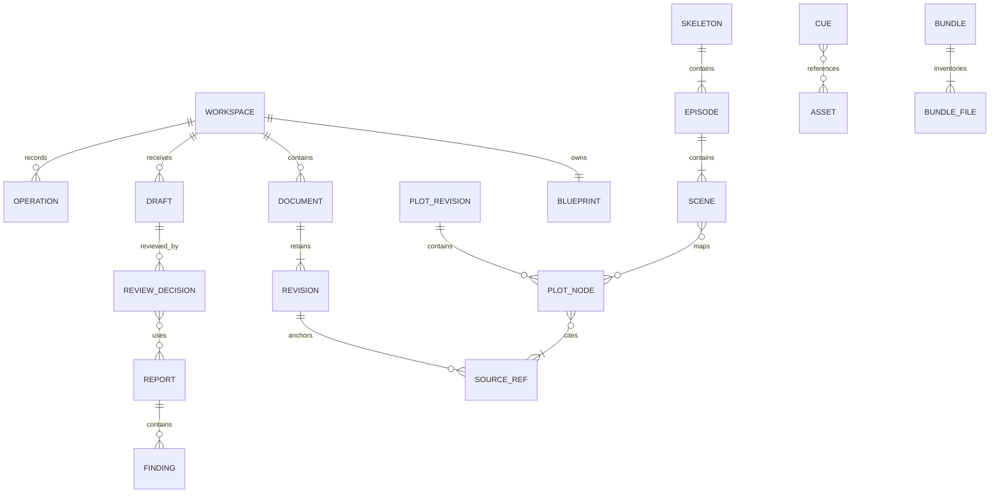

# 数据字典与 Schema 设计

持久化格式版本为 `1.0.0`。本章定义字段语义与约束；`contracts/schemas/` 负责机器校验合同，两者变更必须同步评审。

## 1. 类型、公用字段与存储选择

正文为 UTF-8 Markdown／Fountain，元数据为 JSON。普通文件与可恢复清单是业务权威；SQLite 如使用只保存可重建索引，不设计必须部署的数据库服务。关联采用带类型的 ID 与修订引用，不使用文件名作外键。

| 类型 | 定义 |
| --- | --- |
| ID | 非空类型前缀 UUID，稳定且不可按名称重算 |
| Revision | 大于零的整数修订，或独立不可变 revision ID |
| Digest | 文件原始字节 SHA-256，64 位小写十六进制 |
| Instant | UTC RFC 3339；业务时序不用此值代替 |
| RelativePath | 闭合受管根内 `/` 相对路径，另经原生身份检查 |
| NullableRef | 明确未知时用 null，不能用空字符串或随意默认实体 |

每种记录均声明自身 `schema_version` 与类型对应 ID。未知必需字段、非法枚举、重复 ID、无效引用与未来不支持版本均有明确错误；读未来格式不得丢字段后写回。

## 2. 项目配置 WorkspaceConfig

| 字段 | 类型／必需 | 约束 |
| --- | --- | --- |
| `schema_version` | string，必需 | 初始1.0.0 |
| `workspace_id` | ID，必需 | 移动目录不改变，复制为新项目需显式分配新 ID |
| `title` | string，必需 | 用户显示名，与路径无关 |
| `locale` | string，必需 | 作品默认语言，默认 zh-CN，可为 en；与应用界面偏好独立 |
| `blueprint_path` | RelativePath，必需 | V1固定 shared/blueprint.json |
| `packages` | enum[]，必需 | novel、drama、music-cue、visual-prompt，唯一 |

凭据、系统授权、最近路径和作者批准秘密不属于此配置。

## 3. Blueprint 及正典实体

Blueprint 必需字段：`schema_version, blueprint_id, revision, lock, characters, factions, locations, timeline, world, rules`；实体集合可为空，引用不能悬空。

| 对象 | 字段与语义 | 校验 |
| --- | --- | --- |
| Lock | `locked:bool, changed_at:Instant, actor_ref:ID, reason?:string` | 可信作者入口变更，不能由 Agent 输入身份 |
| Character | `character_id, name, aliases[], description, traits[], facts[], archived` | 名称非空；别名歧义保留；性格文字只作 advisory |
| Faction | `faction_id, name, description, relations[], archived` | 关系目标存在、类型明确 |
| Location | `location_id, name, aliases[], parent_ref?, interior_exterior, description, archived` | 父子无环；未知内外景明确 unknown |
| Fact | `fact_id, subject_ref, predicate, value, valid_from?, valid_to?, source_refs[]` | value 类型匹配谓词，区间与时间锚有效 |
| TimelineEvent | `event_id, title, time_anchor?, before_refs[], after_refs[], source_refs[]` | 先后不能成环；无绝对日期也可用相对边 |
| WorldEntry | `entry_id, title, description, source_refs[]` | 纯文字说明不自动可执行 |
| Rule | `rule_id, revision, type, scope, severity, parameters, rationale, exception_policy` | 类型／参数闭合，例外政策明确 |

`interior_exterior` 与日夜枚举按09；`predicate` 采用版本化允许表，例如身份、归属、生存状态等，不执行任意表达式。`traits` 不能被自动当成“所有行为必须符合”的确定规则。

## 4. Document、Revision 与 Annotation

| 对象 | 必需字段 | 可选字段／约束 |
| --- | --- | --- |
| Document | `document_id, kind, title, source_format, current_revision_id, created_at` | `approved_revision_id, order, synopsis, language_tag`；当前与定稿可不同 |
| Revision | `revision_id, document_id, source_format, content_path, sha256, size_bytes, created_at, actor_ref` | `parent_revision_id, import_record_ref`；内容不可变 |
| Annotation | `annotation_id, source_ref, author_ref, body, created_at, state` | `resolved_at, resolution_ref`；引用固定修订 |
| ImportRecord | `import_id, source_format, source_digest, parser_version, losses[], result_refs` | 原文件附件、作者确认、编码与 profile |

`kind` 至少区分 novel_chapter、novel_outline、drama_script、adaptation_note；source_format 为 markdown／fountain。中文章节号与集号是 order／展示元数据，不作为 document ID。正文路径由服务端构造，调用方不能指定任意磁盘路径。

## 5. Draft 与审核

| 对象 | 必需字段 | 条件／说明 |
| --- | --- | --- |
| Draft | `draft_id, revision, package, source_format, content_path, content_sha256, state, actor_ref, created_at, blueprint_revision` | 更新既有文档须有 target_document_id／base_revision_id；新文档须有 title |
| Draft lineage | `parent_draft_id?` | 新稿关联返工来源，不能形成环 |
| ReviewDecision | `review_id, draft_id, draft_revision, decision, reviewer_ref, decided_at, input_snapshot, report_refs, comments, exceptions` | 记录不可改写，撤回新增决定 |
| ReviewException | `rule_id, finding_id, input_digest, reason, reviewer_ref` | 只适用于该证据，不能绕过完整性错误 |

Draft 的 `revision` 仅用于状态／元数据 CAS，正文提交后不可变；内容变更产生新 draft ID。`decision` 为 approved／rejected／changes_requested／withdrawn，决定与 Draft 状态分开；withdrawn 不代表删掉历史批准。

审核报告引用必须可解析，InputSnapshot 的当前性由策略计算，不把一个可编辑的 `is_fresh=true` 持久字段当事实。

## 6. Plot、Skeleton 与映射

| 对象 | 字段 |
| --- | --- |
| PlotRevision | `plot_revision_id, blueprint_revision, source_revisions[], engine_version, nodes[], edges[], coverage` |
| PlotNode | `node_id, kind, source_refs[], entity_refs[], location_ref?, time_ref?, verification, extraction_method, missing_prerequisites[]` |
| PlotEdge | `edge_id, from_node_id, to_node_id, relation, verification, source_refs[]` |
| Skeleton | `skeleton_id, revision, blueprint_revision, plot_revision_id, episodes[], created_at` |
| Episode | `episode_id, episode_number, title?, scenes[]` |
| Scene | `scene_id, scene_number, location_ref?, interior_exterior, time_of_day, character_refs[], plot_node_refs[], source_refs[], missing_fields[]` |
| AdaptationComparison | `comparison_id, source_snapshot, target_snapshot, changes[], unmapped_refs[], coverage` |

对话／镜头占位在新骨架为空；剧本内容保存在 Fountain 修订，不将两份可独立编辑的对白同时存入骨架和正文。对比记录中的变化引用精确源、目标对象和范围。

## 7. 诊断与覆盖

Report 字段为 `report_id, input_snapshot, rule_set_version, engine_build, status, coverage, findings[], created_at`。每条 Finding 有稳定 ID、规则及修订、severity、certainty、message_key、来源、设定集引用、证据及缺失前提。问题处理另记处置记录，不篡改原诊断证据。

Coverage 字段至少包括 `requested_refs, scanned_refs, scanned_bytes, enabled_rules, executed_rules, skipped[], unparsed_ranges[], budget_stop`。`status=complete` 不能代替 coverage 或“没有问题”；`stale` 根据当前依赖计算。

## 8. 线索、媒体与交付

| 对象 | 字段／说明 |
| --- | --- |
| Cue | `cue_id, revision, kind, narrative_refs[], description, asset_refs[]`；kind为music／visual |
| Asset | `asset_id, path, sha256, size_bytes, media_type, source_type, rights_status, created_at` |
| Provenance | `source_uri?, provider_task_ref?, creator_statement?, safe_parameters?`；均为声明，清理私密 URL |
| DeliveryProfile | `profile_id, version, target_formats[], required_fields[], layout, font_policy, validator_refs[]` |
| BundleManifest | `schema_version, bundle_id, profile, created_at, workspace_id, inputs, files, provenance, coverage, warnings, exclusions` |

包内文件清单不列自身 manifest，归档外的 ZIP 摘要由操作回执记录。权利 unknown 与格式缺项不是文件完整性错误，但必须按 profile 明确阻断／排除／作者审阅策略。

## 9. 操作、审计与本机授权

Operation 保存 `operation_id, scope_id, actor_scope, action, key, input_digest, accepted_at, state, result_ref, external_observation?`。索引唯一键包含提供方、范围、主体、动作和键；同键异输入拒绝。AXI operation 投影为 `id, key, input_digest, recover_action`，不暴露本机内部索引布局。

Audit 保存操作与目标引用、前后摘要、允许参数、时间、结果及前事件摘要；无 Token、Cookie 或整段正文副本。本机 AuthorApproval 保存一次性批准范围、输入摘要、有效期、可信会话和消费状态，放 OS 用户应用数据目录；它不是可 Git 同步的审计事件。

## 10. 索引与查询

可重建索引至少覆盖文档／修订、设定集实体名称与别名、来源引用、待审草稿、finding 与素材引用。分页游标绑定 workspace、身份范围、查询摘要和快照修订，变更筛选或范围后旧游标无效。

搜索返回授权范围内的摘要和明确继续入口，不能静默截断。归档实体默认隐藏但引用可解析。正文、审核和 operations 是源数据，不能作为索引清理目标。

## 11. 一致性、迁移与数据生命周期

结构校验之后再做引用、摘要、时间与业务校验。聚合多文件更新按07执行事务；外部手工编辑先检测，再导入新修订或隔离冲突。原始不可变文件损坏不能靠改摘要恢复为“可信”。

格式升级需要版本化迁移、预演、备份、引用与摘要重验；未知主版本只读。物理删除先列被引用对象及导出影响，作者确认后执行，仍被在途／unknown 操作或交付引用的记录受保护。V1 不提供自动清除整部作品或审核历史的后台任务。

## 12. 实体关系



关系图表达领域关联，不要求建立同名数据库表。ReviewDecision 对报告和源文使用固定修订，Document 的定稿指针只指向属于该文档的批准修订。

## 13. SourceRef 结构合同

```json
{
  "$schema": "https://json-schema.org/draft/2020-12/schema",
  "title": "HetuSourceRef",
  "type": "object",
  "additionalProperties": false,
  "required": ["document_id", "revision_id", "byte_start", "byte_end", "quote"],
  "properties": {
    "document_id": {"type": "string", "pattern": "^doc_[0-9a-f-]{36}$"},
    "revision_id": {"type": "string", "pattern": "^rev_[0-9a-f-]{36}$"},
    "byte_start": {"type": "integer", "minimum": 0},
    "byte_end": {"type": "integer", "minimum": 0},
    "quote": {"type": "string"}
  }
}
```

Schema 负责结构，领域校验进一步要求 ID 符合 UUID 格式、修订归属正确、起止范围有序且不越界、UTF-8 边界完整、quote 与原始字节切片一致。仅通过结构校验不构成来源有效。

## 14. 持久记录与副本规则

| 内容 | 存放位置 | 写入／修复方式 |
| --- | --- | --- |
| 设定集与配置 | shared 与工作区根 | 作者 CAS 变更；外部编辑进入差异审阅 |
| 文档正文与修订 | 对应 packages 的 documents 目录 | 新修订追加，指针事务更新 |
| 草稿、审核与报告 | 对应包与 `.hetu` 受管记录 | 不可变内容，状态变化保留审计 |
| operations 与恢复日志 | `.hetu` 操作及事务目录 | 与业务效果协调提交，按原操作恢复 |
| 搜索及列表索引 | `.hetu` 可重建缓存 | 从权威记录重建，不反向覆盖正文 |
| 个人语言偏好与授权 | OS 用户应用数据 | 不进入工作区、Git 或 Bundle |

目录精确规则以[07](07-工作区与持久化设计.md)为准。备份恢复必须同时重验配置、正文摘要、引用、审核和原操作记录，不能只恢复索引或只复制当前正文指针。
