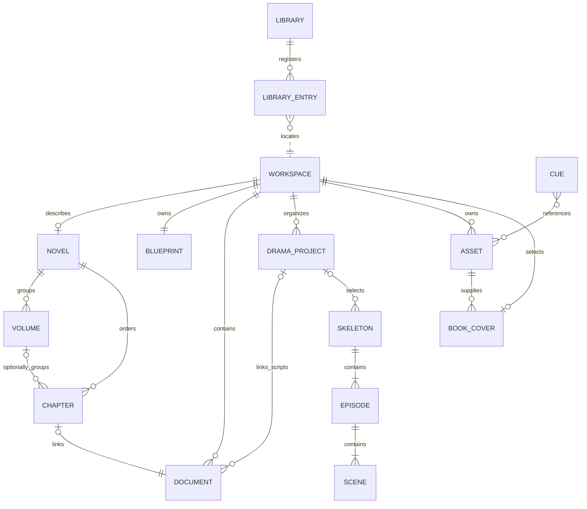
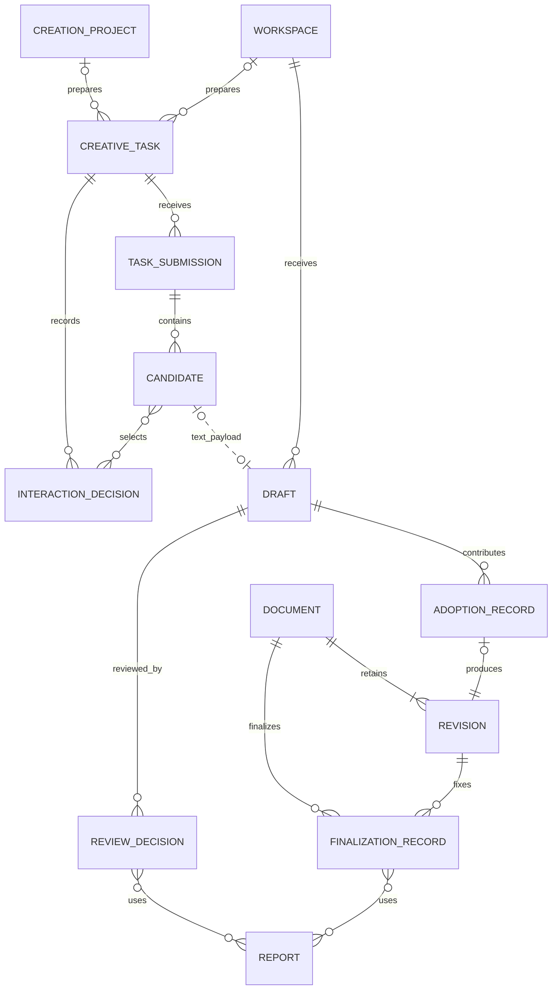
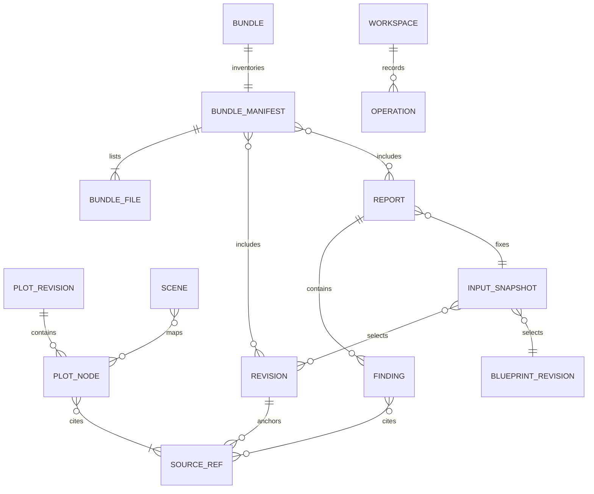

# 数据字典与 Schema 设计

本章定义字段语义与约束；`contracts/schemas/` 负责已发布的机器校验合同，两者变更须同步评审。现有格式基线为 `1.0.0`，新增记录独立版本化；采纳与定稿拆分涉及的接口不得沿用旧语义版本。设计结构不自动成为运行时可接收字段，调用以能力目录公布的精确 Schema 为准。

## 1. 类型、公用字段与存储选择

正文为 UTF-8 Markdown／Fountain，元数据为 JSON。普通文件与可恢复清单是业务权威；SQLite 如使用只保存可重建索引，不设计必须部署的数据库服务。关联采用带类型的 ID 与修订引用，不使用文件名作外键。

| 类型 | 定义 |
| --- | --- |
| ID | 非空类型前缀 UUID，稳定且不可按名称重算 |
| Revision | 大于零的整数修订，或独立不可变 revision ID |
| Digest | 文件原始字节 SHA-256，64 位小写十六进制 |
| Instant | UTC RFC 3339；业务时序不用此值代替 |
| RelativePath | 闭合受管根内 `/` 相对路径，另经原生身份检查 |
| NullableRef | 明确未知时用 null，不能用空字符串或随意默认实体 |

每种记录均声明自身 `schema_version` 与类型对应 ID。未知必需字段、非法枚举、重复 ID、无效引用与未来不支持版本均有明确错误；读未来格式不得丢字段后写回。

## 2. 项目配置 WorkspaceConfig

| 字段 | 类型／必需 | 约束 |
| --- | --- | --- |
| `schema_version` | string，必需 | 初始1.0.0 |
| `workspace_id` | ID，必需 | 移动目录不改变，复制为新项目需显式分配新 ID |
| `title` | string，必需 | 工作区创建时的名称；小说当前书名由 Novel.metadata.title 维护 |
| `locale` | string，必需 | 作品默认语言，默认 zh-CN，可为 en；与应用界面偏好独立 |
| `blueprint_path` | RelativePath，必需 | V1固定 shared/blueprint.json |
| `novel_path` | RelativePath，新作品必需 | 固定 packages/novel/novel.json；旧作品由作者显式初始化小说目录 |
| `packages` | enum[]，必需 | novel、drama、music-cue、visual-prompt，唯一 |

凭据、系统授权、最近路径和作者批准秘密不属于此配置。

### 小说 Novel 与卷章目录

机器合同见 [Novel Schema](../contracts/schemas/novel.schema.json)。Novel 包含 `schema_version, workspace_id, novel_id, revision, previous_sha256, metadata, volumes, chapters, created_at, updated_at`。`metadata` 保存书名、笔名、简介、类型、正文语言标签和创作状态；书名不能只含空白。分卷与章节数组分别规定显示顺序，章节使用稳定 `chapter_id` 与 `document_id` 绑定，`volume_id=null` 表示未分卷。

当前记录、摘要和不可变历史修订须一致。目录必须覆盖本作品全部小说章节，引用不能重复，不能指向大纲、剧本、虚拟草稿或其他作品。目录编辑只调整顺序、卷名和分卷归属，不能借重排隐藏章节或更换正文绑定。资料与目录共用 `expected={revision,sha256}`，所有写动作均保留原操作回执。

## 3. Blueprint 及正典实体

Blueprint 必需字段：`schema_version, blueprint_id, revision, lock, characters, factions, locations, timeline, world, rules`；实体集合可为空，引用不能悬空。

| 对象 | 字段与语义 | 校验 |
| --- | --- | --- |
| Lock | `locked:bool, changed_at:Instant, actor_ref:ID, reason?:string` | 可信作者入口变更，不能由 Agent 输入身份 |
| Character | `character_id, name, aliases[], description, traits[], facts[], archived` | 名称非空；别名歧义保留；性格文字只作 advisory |
| Faction | `faction_id, name, description, relations[], archived` | 关系目标存在、类型明确 |
| Location | `location_id, name, aliases[], parent_ref?, interior_exterior, description, archived` | 父子无环；未知内外景明确 unknown |
| Fact | `fact_id, subject_ref, predicate, value, valid_from, valid_to?, source_refs[]` | subject_ref 与所属角色一致；有效期为事件引用，包含起点、不含终点 |
| TimelineEvent | `event_id, title, time_anchor?, before_refs[], after_refs[], source_refs[]` | 先后不能成环；无绝对日期也可用相对边 |
| WorldEntry | `entry_id, title, description, source_refs[]` | 纯文字说明不自动可执行 |
| Rule | `rule_id, revision, type, scope, severity, parameters, rationale, exception_policy` | 类型／参数闭合，例外政策明确 |

`interior_exterior` 与日夜枚举按09；`predicate` 采用版本化允许表，例如身份、归属、生存状态等，不执行任意表达式。`traits` 不能被自动当成“所有行为必须符合”的确定规则。

可执行字段与边界见[设定集规范](06-设定集与规则规范.md)。时间锚采用 `calendar:string, tick:integer`，整数刻度与修订不超过 JSON 安全整数范围；刻度允许负数，不是系统时间戳。明确事实允许的谓词为 identity、primary_faction、life_state、age，其值类型与规则参数由 [Blueprint Schema](../contracts/schemas/blueprint.schema.json) 闭合定义。

## 4. Document、Revision 与 Annotation

| 对象 | 必需字段 | 可选字段／约束 |
| --- | --- | --- |
| Document | `document_id, kind, title, source_format, current_revision_id, created_at` | `approved_revision_id, finalization_ref, last_adoption_ref, last_finalization_ref, order, synopsis, language_tag, structure_origin`；当前与定稿可不同，定稿指针仅由独立定稿用例设置 |
| Revision | `revision_id, document_id, source_format, content_path, sha256, size_bytes, created_at, actor_ref` | `parent_revision_id, import_record_ref, origin_kind, contribution_refs`；来源与定稿分开，内容不可变 |
| Annotation | `annotation_id, source_ref, author_ref, body, created_at, state` | `resolved_at, resolution_ref`；引用固定修订 |
| ImportRecord | `import_id, source_format, source_digest, parser_version, losses[], result_refs` | 原文件附件、作者确认、编码与 profile |

`kind` 至少区分 novel_chapter、novel_outline、drama_script、adaptation_note；source_format 为 markdown／fountain。中文章节号与集号是 order／展示元数据，不作为 document ID。正文路径由服务端构造，调用方不能指定任意磁盘路径。

## 5. Draft 与审核

| 对象 | 必需字段 | 条件／说明 |
| --- | --- | --- |
| Draft | `draft_id, revision, package, source_format, content_path, content_sha256, size_bytes, state, actor_ref, created_at, blueprint_revision, blueprint_sha256, language_tag` | 更新既有文档须有 target_document_id／base_revision_id；新文档须有 title；正文上限 1 MiB |
| Draft evidence | `evidence_document_id, evidence_revision_id` | 只读虚拟文档身份，指向同一份草稿内容；不在正式正文列表中 |
| Draft submission | `schema_version, draft` | 冻结提交属性；状态、状态修订、最近决定与批准／接替指针单独维护 |
| Draft lineage | `parent_draft_id?` | 新稿关联返工来源，不能形成环 |
| ReviewDecision | `schema_version, review_id, draft_id, draft_revision, decision, reviewer_ref, decided_at, input_snapshot, report_refs, comments, private_comments, coverage_acknowledgement, exceptions, previous_review_id, previous_review_sha256` | 记录不可改写，撤回新增决定；Agent 读取投影移除 private_comments；历史合同的 approval_target 仅作历史解释，不进入新参考稿决定 |
| ReviewReportRef | `report_id, sha256, dispositions_sha256` | 同时固定报告原字节与处置投影，防止使用旧审核屏确认新的处置 |
| ReviewException | `report_id, finding_id, disposition` | 内核从已核实报告提取具体作者处置；不接受调用方注入例外列表 |

Draft 的 `revision` 仅用于状态／元数据 CAS，正文提交后不可变；内容变更产生新 draft ID。参考稿 `decision` 为 approved／rejected／changes_requested／withdrawn；approved 表示通过参考稿审核，withdrawn 撤回这次参考稿决定，均不自动更新正文定稿。兼容读取历史决定时按记录的原合同解释，不改写历史语义。

审核报告引用必须可解析，InputSnapshot 的当前性由策略计算，不把一个可编辑的 `is_fresh=true` 持久字段当事实。

ReviewSnapshot 包含 `draft_id, draft_revision, content_sha256, submission_sha256, blueprint_revision, blueprint_sha256, current_blueprint_revision, target, skeleton`。`target` 为 null 或固定目标／基线摘要、当前修订及当前定稿指针；`skeleton` 为 null 或固定骨架引用、当前骨架修订与来源状态。决定时完整值相等校验，通过参考稿审核额外要求输入未过期；决定不产生正文修订。之后采纳或手工编辑使目标变化时，保留原决定及其证据，重新计算它对当前稿的适用性，不把历史决定移植为新正文的定稿授权。

固定提交凭据、状态摘要与决定摘要链均在受管读取时核验；这些摘要用于发现意外改写，不宣称抵抗可重写整个工作区的本地同级权限攻击。已发布的输入格式见[提交](../contracts/schemas/draft-submit-input.schema.json)、[开始审核](../contracts/schemas/review-begin-input.schema.json)、[草稿检查](../contracts/schemas/review-validate-input.schema.json)与[审核决定](../contracts/schemas/review-decide-input.schema.json)；新版采纳／定稿分别使用独立动作与合同修订，不把旧审核格式当成新定稿输入。

### 5.1 采纳与独立定稿记录

生命周期输入、引用和预览结构由[文档生命周期 Schema](../contracts/schemas/document-lifecycle.schema.json)定义。以下是持久记录的字段语义，预览和决定的调用顺序见[30第7节](30-应用API详细设计.md#7-审核与素材)。

| 对象 | 字段 | 不变量 |
| --- | --- | --- |
| DocumentRef | `document_id,revision_id,sha256` | 引用本篇确切修订及内容原始字节 |
| DraftRef | `draft_id,revision,sha256` | 状态修订和内容摘要同时固定，不能仅以 draft ID 采纳 |
| LifecycleRef | `adoption_id或finalization_id,sha256` | 关联记录身份和记录原始字节摘要，两个 ID 字段互斥 |
| 生命周期共同字段 | `schema_version,workspace_id,document_id,document_ref,previous,actor_ref,created_at` 及本类型 ID | schema_version=1.0.0；previous 首项为 null，后继引用同类型上一条记录 |
| AdoptionRecord | 共同字段、`adoption_id,draft_ref,base_revision_id,selected_ranges,input_snapshot` | document_ref 指采纳结果；新文档的 base_revision_id=null；选区引用固定候选及目标，不设置定稿 |
| FinalizationRecord：确认 | 共同字段、`finalization_id,decision,expected_finalization_ref,input_snapshot,report_refs,comments,coverage_acknowledgement` | decision=confirmed；document_ref 是实际审阅修订，不能由参考稿审核替代 |
| FinalizationRecord：撤回 | 共同字段、`finalization_id,decision,expected_finalization_ref,comments` | decision=withdrawn；document_ref 保留被撤回定稿的修订；不要求伪造新的诊断快照 |

`Document.last_adoption_ref` 与 `last_finalization_ref` 定位各自完整历史；`finalization_ref` 只表示当前有效确认。确认时 approved_revision_id 与该确认的 document_ref.revision_id 一致；撤回后清除 approved_revision_id 和 finalization_ref，last_finalization_ref 仍指向新增的撤回记录。普通保存和采纳均保留已有定稿指针。

`Revision.contribution_refs` 引用实际采纳记录。采纳后的手工保存继承这些修订级来源，不能据此计算逐字符“AI 百分比”；新增采纳追加引用，不改写旧记录。记录文件位于相应文档的 adoptions／finalizations 目录，摘要索引位于 `.hetu/adoptions/` 和 `.hetu/finalizations/`；两者与新正文或指针、原操作及审计共同提交。

参考稿决定采用 schema_version=2.0.0，独立于生命周期记录版本；读取旧审核记录按其原始版本解释。历史读取同时核验 workspace、document 归属、前驱链、摘要索引和被引用正文，缺失、循环或篡改都不能回退成“没有历史”。单条记录和历史结果均受16 MiB输出预算约束，历史链最多1000条，超限明确返回错误，不静默截断。

## 6. Plot、Skeleton 与映射

| 对象 | 字段 |
| --- | --- |
| PlotRevision | `plot_revision_id, parent_plot_revision_id?, blueprint_revision, blueprint_sha256, source_revisions[], engine_version, options, nodes[], edges[], coverage, created_at, actor_ref` |
| PlotNode | `node_id, kind, source_refs[], entity_refs[], entity_candidates[], location_ref, location_candidates[], time_ref, speaker_ref, speaker_candidates[], time_of_day, unresolved_names[], verification, extraction_method, missing_prerequisites[], annotation?` |
| PlotAnnotation | `context, facts[], capabilities[]`；事实为 `subject_ref, predicate, value`，绑定节点原文；语境未知不能当事实 |
| PlotEdge | `edge_id, from_node_id, to_node_id, relation, verification, source_refs[]` |
| Skeleton | `schema_version, skeleton_id, revision, previous_sha256, plot_revision_id, plot_sha256, blueprint_revision, blueprint_sha256, source_revisions[], engine_version, build_options, status, episodes[], created_at, actor_ref` |
| Episode | `episode_id, episode_number, title, scenes[]`；空标题为 `""` |
| Scene | `scene_id, scene_number, title, location_ref, interior_exterior, time_of_day, character_refs[], adaptation_note, plot_node_refs[], source_refs[], missing_fields[], dialogue, shot_description` |
| AdaptationComparison | `schema_version, comparison_id, skeleton_ref, source_revisions[], status, items[], created_at, actor_ref` |

对话／镜头占位在新骨架为空；剧本内容保存在 Fountain 修订，不将两份可独立编辑的对白同时存入骨架和正文。对比记录中的变化引用精确源、目标对象和范围。

骨架 [Schema](../contracts/schemas/drama-skeleton.schema.json) 限定稳定 ID、枚举、引用和空对白占位；来源由节点映射派生，不能由结构编辑请求任意改写。`previous_sha256` 在首修订为 `null`，其余指向上一修订实际字节摘要。`missing_fields` 为 `location|interior_exterior|time_of_day|characters|source_mapping|author_review`；它与继承输入覆盖的 `status` 分开。

差异报告 [Schema](../contracts/schemas/drama-comparison.schema.json) 中每项包含 `kind, scene_id, plot_node_refs[], source_refs[], details`。`scene_id` 无对应场次时为 `null`；`unmapped` 的 `details.source_range` 是固定原文 UTF-8 范围，`stale_source` 记录原始／所选修订。`details.fields` 只列结构差异，不宣称检测出文学语义变化。报告读取重新核验固定证据与结构对比结果，当前性另外计算。

结构剧本映射遵循 [ScriptMapping Schema](../contracts/schemas/drama-script-mapping.schema.json)：`schema_version, renderer_version, document_id, revision_id, content_sha256, skeleton_ref, language_tag, title, coverage_status, scenes[]`。每个场次记录 `episode_id, scene_id, episode_number, scene_number, byte_start, byte_end, quote`；字节范围绑定初始 Fountain 修订。`Document.structure_origin={mapping_path, mapping_sha256, revision_id}` 与独立摘要索引一致，正文保存新修订时保留该初始来源。骨架、初稿与映射经过重新计算核验，不把历史范围当作当前正文的自动映射。

## 7. 诊断与覆盖

Report 字段为 `schema_version, report_id, input_snapshot, rule_set_version, engine_build, options, status, coverage, findings[], created_at, actor_ref`。每条 Finding 有稳定 ID、规则及修订、severity、certainty、message_key、来源、设定集引用、证据及缺失前提，以及固定的 `disposition=open` 和例外策略。完整机器合同见 [Report Schema](../contracts/schemas/validation-report.schema.json)。

Coverage 字段为 `requested_refs, scanned_ranges, scanned_bytes, unparsed_ranges, plot_coverage, enabled_rules, executed_rules, evaluations, counts, budget_stop`。逐单元结论为 `passed|finding|unknown|not_applicable`；规则尚未执行的部分由预算终止及覆盖范围说明。`status=complete` 不代表全文没有问题；`stale` 根据当前依赖计算。

DispositionRecord 包含 `schema_version, report_id, finding_id, revision, expected_inputs, disposition, reason, actor_ref, created_at, previous_sha256`。首次 `previous_sha256=null`，后续指向上条记录原始字节摘要。记录位于 `packages/drama/reports/dispositions/`，`.hetu/finding-dispositions/` 保存当前修订与摘要投影。处置只作用于固定 finding 和证据，不能修改报告或设定规则；更新需当前处置修订 CAS。

## 8. 线索、媒体与交付

| 对象 | 字段／说明 |
| --- | --- |
| Cue | `schema_version, cue_id, revision, previous_sha256, kind, title, description, narrative_refs[], asset_refs[], archived, created_at, updated_at, actor_ref`；kind为music／visual |
| Asset | `schema_version, asset_id, revision, previous_sha256, kind, title, original_filename, blob, source, rights_status, redistribution_allowed, rights_statement, created_at, updated_at, actor_ref` |
| Provenance | `source_uri?, provider_task_ref?, creator_statement?, safe_parameters?`；均为声明，清理私密 URL |
| DeliveryProfile | `profile_id, version, target_formats[], required_fields[], layout, font_policy, validator_refs[]` |
| BundleManifest | `schema_version, bundle_id, profile, created_at, workspace_id, inputs, files, provenance, coverage, warnings, exclusions` |

包内文件清单不列自身 manifest，归档外的 ZIP 摘要由操作回执记录。权利 unknown 与格式缺项不是文件完整性错误，但必须按 profile 明确阻断／排除／作者审阅策略。

素材与线索采用共同 [Media Schema](../contracts/schemas/media.schema.json)，其 `$defs` 同时提供持久记录和各动作输入合同。`blob={path,sha256,size_bytes,media_type,validation}` 不可随元数据修订改变；`source={source_type,creator_statement,source_uri?}` 只保存脱敏的来源声明。`asset_refs` 每项为 `{asset_id,revision,sha256}`，绑定素材元数据修订；正文关联遵循 SourceRef。首次 `previous_sha256=null`，后续指向上条修订的原始字节摘要。元数据读写重新校验 Schema、归属、路径与摘要，素材单项读取额外流式核对媒体原字节。

素材和线索列表返回摘要投影及 `next_cursor`，不批量加载媒体。列表的 `media_verified=false` 表明未在本次列表查询重新读完媒体；单项核验成功为 true。`delivery_eligible` 只表达权利声明是否允许默认嵌入，不替代导出时完整性核验。线索读取返回固定记录、`stale_sources` 以及关联素材的 `metadata_stale` 和当前权利状态，保留旧引用并要求作者核对。

## 9. 操作、审计与本机授权

Operation 保存 `operation_id, scope_id, actor_scope, action, key, input_digest, accepted_at, state, result_ref, external_observation?`。索引唯一键包含提供方、范围、主体、动作和键；同键异输入拒绝。AXI operation 投影为 `id, key, input_digest, recover_action`，不暴露本机内部索引布局。

Audit 保存操作与目标引用、前后摘要、允许参数、时间、结果及前事件摘要；无 Token、Cookie 或整段正文副本。本机 AuthorApproval 保存一次性批准范围、输入摘要、有效期、可信会话和消费状态，放 OS 用户应用数据目录；它不是可 Git 同步的审计事件。

固定 Git 快照使用 [GitSnapshot Schema](../contracts/schemas/git-snapshot.schema.json)，字段为 `schema_version, snapshot_id, workspace_id, repository_instance, head, selection, excluded_changes, message, author, timestamp`。`head` 固定完整本地引用与可空父 commit；`selection` 按相对路径严格排序，每项记录 `path, before_oid, after_sha256, after_oid, mode, size_bytes`。删除项的 after 字段为 null；仅允许普通文件的 100644／100755 模式。`timestamp` 为提交使用的 UTC Unix 秒，与其他记录的 RFC 3339 系统时间表示分开。

快照原始字节位于 `.hetu/git/snapshots/`，SHA-256 绑定批准；该目录不随 Git 同步。本机批准记录包含 `schema_version, snapshot_id, snapshot_sha256, repository_instance, actor_ref, approved_at, expires_at`，保存在工作区以外的 OS 应用数据中，不能作为 Agent 业务参数传入。`repository_instance` 由 workspace ID 与工作区、Git 目录的设备／inode 生成摘要；批准有效期 15 分钟，不跨仓库实例沿用。

`.hetu/git/executions/` 保存原键绑定的 `input_digest, snapshot_sha256, snapshot_id, actor_scope, result, published`；result 保留完整原 AXI 回执与操作 ID。恢复必须重新核验实际 Git 对象和引用，published 只作本机进度记录，不作提交已发布的唯一证据。快照、执行日志、操作回执和本机审计均不纳入 Git 版本树；文档、历史修订、审核决定与来源索引保持可版本化。

## 10. 索引与查询

可重建索引至少覆盖文档／修订、设定集实体名称与别名、来源引用、待审草稿、finding 与素材引用。分页游标绑定 workspace、身份范围、查询摘要和快照修订，变更筛选或范围后旧游标无效。

搜索返回授权范围内的摘要和明确继续入口，不能静默截断。归档实体默认隐藏但引用可解析。正文、审核和 operations 是源数据，不能作为索引清理目标。

## 11. 一致性、迁移与数据生命周期

结构校验之后再做引用、摘要、时间与业务校验。聚合多文件更新按07执行事务；外部手工编辑先检测，再导入新修订或隔离冲突。原始不可变文件损坏不能靠改摘要恢复为“可信”。

格式升级需要版本化迁移、预演、备份、引用与摘要重验；未知主版本只读。物理删除先列被引用对象及导出影响，作者确认后执行，仍被在途／unknown 操作或交付引用的记录受保护。V1 不提供自动清除整部作品或审核历史的后台任务。

## 12. 实体关系

### 12.1 作品组织与内容归属



书库登记与作品内容是两种持久范围，关联只提供目录定位，不授予内容权限。未初始化小说资料的既有工作区可暂缺 Novel；已初始化的小说目录覆盖本作品全部小说章节。未分卷章节的 `volume_id=null`，正文保存在 Document／Revision，Chapter 和 Volume 不再保存一份文本。

DramaProject 选择具体骨架和剧本形成改编方案；单独的骨架／剧本可以在尚未组织进项目时存在。分集和场次属于所选骨架修订，不以集号、场号或名称识别。BookCover 关系指当前选用投影，历史选用和候选仍单独保留。对外部作品的原著引用必须按显式导入及映射规则处理，不能从关系图推导跨工作区读取权限。

### 12.2 候选、来源、审核与定稿



关系图表达领域关联，不要求建立同名数据库表。CreativeTask 的 scope 二选一，不能同时属于筹备和作品；两个可选父关系共同受该不变量约束，不能解释为两者都可空。直接通过草稿工具提交的 Draft 可以没有 CreativeTask；文本任务候选可关联 Draft，非文本候选不因此变成正文。

一次文本 AdoptionRecord 对应一个 Draft 和一个新结果 Revision，Revision 可能完全来自手工或导入而没有采纳记录；多次采纳形成多条记录及后继修订。ReviewDecision 对报告和源文使用固定修订，Document 的定稿指针仅引用本篇确切修订及有效 FinalizationRecord；纯手工 Revision 可直接定稿，不要求经过 Candidate、Draft 或 AdoptionRecord。报告在审核与定稿中分别固定输入，不能沿用候选报告替代采纳后正文报告。

### 12.3 诊断证据与交付溯源



InputSnapshot 保存的是带修订及摘要的固定引用，不是指向“最新内容”的动态查询。SourceRef 固定原始 UTF-8 范围，报告中没有问题时允许零个 Finding；正文问题提供源文定位，结构或设定问题通过设定引用及 evidence 说明依据，不能伪造一段正文。交付包的 manifest 列出所选修订、报告及实际文件，操作回执固定产物摘要；Operation 与本机恢复日志不自动成为交付材料。

## 13. SourceRef 结构合同

```json
{
  "$schema": "https://json-schema.org/draft/2020-12/schema",
  "title": "HetuSourceRef",
  "type": "object",
  "additionalProperties": false,
  "required": ["document_id", "revision_id", "byte_start", "byte_end", "quote"],
  "properties": {
    "document_id": {"type": "string", "pattern": "^doc_[0-9a-f-]{36}$"},
    "revision_id": {"type": "string", "pattern": "^rev_[0-9a-f-]{36}$"},
    "byte_start": {"type": "integer", "minimum": 0},
    "byte_end": {"type": "integer", "minimum": 0},
    "quote": {"type": "string"}
  }
}
```

Schema 负责结构，领域校验进一步要求 ID 符合 UUID 格式、修订归属正确、起止范围有序且不越界、UTF-8 边界完整、quote 与原始字节切片一致。仅通过结构校验不构成来源有效。

## 14. 持久记录与副本规则

| 内容 | 存放位置 | 写入／修复方式 |
| --- | --- | --- |
| 设定集与配置 | shared 与工作区根 | 作者 CAS 变更；外部编辑进入差异审阅 |
| 文档正文与修订 | 对应 packages 的 documents 目录 | 新修订追加，指针事务更新 |
| 草稿、审核与报告 | 对应包与 `.hetu` 受管记录 | 不可变内容，状态变化保留审计 |
| operations 与恢复日志 | `.hetu` 操作及事务目录 | 与业务效果协调提交，按原操作恢复 |
| 搜索及列表索引 | `.hetu` 可重建缓存 | 从权威记录重建，不反向覆盖正文 |
| 个人语言偏好与授权 | OS 用户应用数据 | 不进入工作区、Git 或 Bundle |

目录精确规则以[07](07-工作区与持久化设计.md)为准。备份恢复必须同时重验配置、正文摘要、引用、审核和原操作记录，不能只恢复索引或只复制当前正文指针。

## 15. 小说封面任务与选用

封面请求和外部结果分别使用 [CoverRequest Schema](../contracts/schemas/cover-request.schema.json) 与 [CoverResult Schema](../contracts/schemas/cover-result.schema.json)。[BookCover Schema](../contracts/schemas/book-cover.schema.json) 闭合定义选用记录、来源、展示参数和七个作者动作的输入。字段语义、固定目录与图像限额以[34](34-小说封面与Agent协作.md)为唯一专项来源。

任务中的作品资料为本次设计快照，`request_sha256` 绑定原请求文件字节。结果中的路径、尺寸、摘要和生成器名称为不可信输入，读取时独立核验；作者封面引用仅由选用事务写入。书库缩略图是可重建缓存，不充当媒体原件、审核决定或版权凭证。

BookCover 以 `revision,previous_sha256` 形成不可变历史，选用以当前修订和摘要 CAS。`source_ref` 按手工图片、外部候选、已有素材三种闭合结构保存来源，不携带外部绝对路径。原件及来源声明保留；`presentation` 只决定裁切与书名／笔名叠加。书库缓存包含预览字节与叠加文字，打开作品后由受管记录重建，封面损坏不阻止正文打开。

## 16. 建书筹备、外部任务与候选

| 对象 | 必需字段 | 语义与约束 |
| --- | --- | --- |
| ScopeRef | `kind, id` | kind 为 creation_project 或 workspace，二选一；ID 和会话实际授权一致 |
| CreationProject | `schema_version, project_id, revision, previous_sha256, brief, selected_fields, task_refs, created_workspace_ref, created_at, updated_at` | brief 可从一句话开始；选中字段可为空；created_workspace_ref 初始 null，只有作者创建回执可绑定 |
| CreativeTaskRequest | `schema_version, task_id, scope_ref, request_revision, previous_sha256, task_kind, brief, input_refs, input_snapshot, client_adapter, skill_ref, prompt, prompt_language, output_contract, edit_scope, created_at` | 请求不可变，scope 和来源固定；不得从当前最新正文静默补上下文；非改稿任务的 edit_scope 为 null |
| EditScope | `document_id, revision_id, ranges` | 单文档；1～16个 UTF-8 半开范围及 quote，不重叠；空范围为指定插入点，整章也显式列范围 |
| OutputContract | `artifact_types, candidate_limit, text_byte_limit, image_byte_limit, submission_mode, relative_inbox, revision_requires_patches` | 提交方式为 MCP 或固定 inbox；路径由任务身份推导，数量和预算在复制前可见 |
| TaskObservation | `schema_version, task_id, scope_ref, revision, previous_sha256, state, copied_at, submission_refs, last_decision_ref, closed_reason, created_at, updated_at` | 持久修订及摘要链；复制不证明已发送，状态不代表 Agent 正在运行 |
| TaskSubmission | `schema_version, submission_id, task_ref, request_sha256, candidates, complete, missing_items, provenance, received_at` | 一批已核验的外部结果；不足为 partial_result，不能伪造成功；同键同输入返回同批 |
| Candidate | `candidate_id, kind, relative_path, sha256, size_bytes, language_tag, source_refs` | kind 区分 concept、title、synopsis、outline、text、image；改稿保留 patches；可带 draft_ref，图片带实际宽高、类型与解码证据 |
| InteractionDecision | `schema_version, decision_id, task_ref, candidate_refs, comment, actor_ref, effect, created_at, previous_decision_ref` | effect 固定 preference_only；CAS 在输入 expected 中，不冒充作者批准 |

局部视图的 `image_previews[]` 是临时读取投影，不持久化为新的候选或封面：每项包含 `candidate_id,media_type,base64,width,height`，只关联当前批次中已核验的图片，使用最长边512像素以内的等比 JPEG，不放大小图，透明部分以白底预览。原始候选、来源摘要和正式封面选择保持独立。
| ClientAdapterPreference | `adapter_id, user_confirmed_setup, last_capability_check` | 仅本机偏好；用户确认与技术检测分别保存，检查带时间、版本和范围 |

`task_kind` 为 book_concept、book_profile、outline、cover、chapter_draft、revision 或 drama_draft。内部“任务已关闭”只结束河图洛书跟踪，不声明外部取消或退款。`client_adapter` 与 Skill／插件版本是本次交接记录，不授予工具权限或保证模型身份。

TaskSubmission 的文件清单由 Agent 最后原子提交，内核核验实际字节、固定请求、范围和路径后登记。任一候选非法则该批不登记，不静默裁剪；合法但明确缺项的批次可按 partial_result 保存。一个任务允许多个明确批次，候选 ID 不由标题、数组位置或文件修改时间生成。

改稿 Candidate 的 `patches` 每项为 `byte_start, byte_end, quote, replacement`，范围相对于任务固定原文。内核合成独立参考版本，范围外字节保持，不写作者 Document。任务持久化及输入的机器合同见[creative-task.schema.json](../contracts/schemas/creative-task.schema.json)；参考读取、修改范围与采纳权限分别核验，不能从文件路径或候选来源推导授权。

建书候选的 `selected_fields` 每字段记录作者最终值及可空 candidate_ref，手工值无需伪造 AI 来源。创建后的作品保存选定来源快照，不能永久依赖用户应用数据目录的绝对路径。筹备转作品不会改变旧请求 scope。

## 17. 采纳、来源与独立定稿

采纳和定稿记录、指针及摘要链的字段统一见[第5.1节](#51-采纳与独立定稿记录)，关联关系见[第12.2节](#122-候选来源审核与定稿)，作者决策策略见[15](15-人工审核与审计.md)。Revision 的 origin_kind 表达本次内容来源，contribution_refs 保留实际采纳记录的固定引用；二者不能被审核状态或定稿指针替代。

定稿输入不要求 draft_id，允许零个或多个 AdoptionRecord。`report_refs` 和处置摘要绑定确切正文、设定及规则，例外从已核实记录提取。`expected_finalization_ref` 是 null 或当前定稿 ID 与摘要，用于防止双窗口覆盖。

`approval_target` 仅保留在采用历史合同的审核记录中；新参考稿决定不包含该字段，也不承担正文创建或定稿。正文当前指针、定稿指针与来源记录分开维护。撤回记录保留原正文引用，只能撤回仍由该记录持有的定稿指针；不删除历史或清空当前写作稿。兼容策略见[15](15-人工审核与审计.md)。

## 18. 局部交互会话

BrowserSession 在本机授权存储或内存保存 `session_id, task_ref, scope_ref, allowed_actions, issued_at, expires_at, revoked_at` 及受保护会话材料。配对状态为 pending／paired／expired／revoked。UI 可见的 session_id 和配对请求 ID 不是访问凭据。

会话只允许任务投影、候选预览、选择和意见，不能扩展为所有作品访问或定稿能力。Cookie／IPC 凭据不进入任务 JSON、普通结果、URL、Prompt、Git 或 Bundle。资源及页面版本独立记录；切换任务清空旧数据，迟到结果按任务与修订校验。
