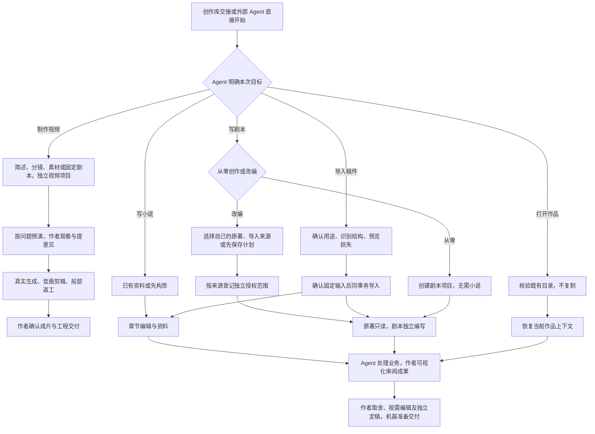

# 创作场景与引导流程

## 起点由目标决定

先判断当前Agent、原文件是否足够；随后才判断是否需要河图只读、探索或持续创作能力。不将这些选择变成首次启动问卷。允许书名、大纲和设定未定，从最小片段逐渐形成作品。

产品定位与任务分流见[01](01-产品需求PRD.md#1-产品定义)。

本章定义作者从初次打开到创建、导入、继续创作和交付的场景适配。需求见[01](01-产品需求PRD.md)，工作台结构见[10](10-原生客户端与交互设计.md)，资料见[35](35-资料素材与短剧制作资产.md)。场景规则由桌面贡献工作面、CLI、MCP和Skills共用，官网不能用同一演示冒充全部场景已经实现。

默认由外部 Agent 完成资料填写和业务操作，作者在桌面端审阅成果、差异与必要决定，再按需手动编辑。以下必要输入是机器用例需要的信息，由 Agent 从对话、已有获权资料或作者选择中整理；不表示要求作者在软件里填写表单。每个场景均可从 CLI/MCP 发起和恢复，页面负责交接与 review，不要求先通过 GUI 创建任务。

## 1. 四个独立维度

| 维度 | 例子 | 不能混淆的概念 |
| --- | --- | --- |
| 作品类型 | 小说、剧本、视频 | 导入不是作品类型，AI 协作也不是作品类型 |
| 创作方式 | 从零开始、继续已有成果、改编来源 | 自己写出的改编剧本仍有原著来源，不等于原创故事 |
| 来源 | 自己的小说、获授权原著、公版原著、已有剧本、参考资料 | 来源文件可读取不代表拥有改编或再分发权限 |
| 权利声明 | 自有、获授权、公版依据、待确认 | 软件登记声明，不认证版权，不从文件名或提供方推断授权 |

“原创剧本”在创建界面表示不改编既有原著的故事；“改编剧本”同样可以由编剧独立撰写。作者手写、外部 Agent 参考及导入是内容贡献来源，保存在修订和采纳记录，不决定作品类型或权利状态。

源码Monorepo管软件工程；创作库登记独立小说、剧本和视频；工作区持有文件和事务，可同根含多个对象。小说可以关联多套剧本，剧本可以关联多个视频，来源关系不成为强制父子层级。独立接稿的编剧可直接建立剧本作品，导入授权小说作为原著材料，无需虚构一部由自己创作的小说。

## 2. 场景适配矩阵

| 场景 | 入口与必要输入 | 首次进入 | 可选配套 |
| --- | --- | --- | --- |
| 原创新小说 | 写小说；书名或先保存构思 | 作品资料、可选卷章与空白正文 | 外部 Agent 构思、封面、大纲、资料；均非建书前置 |
| 继续自己的小说 | 导入已有稿件，或打开河图作品 | 结构预览后进入章节编辑，保持原文及来源 | 补充笔名、简介、封面、设定与历史来源 |
| 原创剧本 | 写剧本，从零开始 | 项目、分集计划及空白 Fountain 剧本 | 人物、场景、道具、参考稿、分镜与制作交接 |
| 改编自己的小说 | 小说中“新建改编项目”，或剧本作品选择自己的原著 | 固定原著阅读与分集剧本并列 | 节点抽取、骨架、原著对照、改编说明与独立项目设定 |
| 改编获授权小说 | 写剧本，选择小说改编，登记来源与授权声明 | 原著材料只读、分集计划和剧本写作区 | 授权证明附件、期限／地域／用途、允许外发范围 |
| 改编公版作品 | 写剧本，小说改编，登记版本及公版依据 | 固定版本原文及改编项目 | 版本差异、翻译／校注本各自权利、考据 |
| 继续已有剧本 | 导入 Fountain／支持的交换格式，或打开河图作品 | 分集、场次、格式损失与待确认映射 | 关联既有原著、制作资产、历史定稿证明或重新定稿 |
| 批量已有卷章／分集 | 导入已有稿件，明确每个文件的类型与顺序 | 目录和正文联合预览后进入所选文档 | 手工修正标题、分卷／分集、编码及重复项 |
| 原创视频 | 对话中的简述、已有分镜或素材，保存明确制作目标 | 独立视频项目与当前已有成果，不建空小说或空剧本 | 分镜、资产、动态分镜或白模、生成、音画及交付 |
| 根据剧本制作视频 | 固定剧本修订及必要来源／资产权限 | 分集及镜头／预演视图，保留回到剧本的入口 | 一套剧本关联多种视频版本，修改不自动传播 |
| 继续已有视频 | 明确媒体、剪辑工程及依赖和来源 | 实际媒体和可恢复工程，缺项准确提示 | 素材整理、补镜、声音字幕、局部返工及固定交付 |
| 只有想法或部分资料 | Agent 保存独立筹备，不强制完整标题 | 构思、资料、候选与操作提案 | 作者取舍后机器执行明确获权的新建操作 |
| 仅整理资料或制作资产 | 打开已有作品的资料与素材 | 文字资料或制作资产视图 | 外部图片设计、分镜／白模工程、模型交接，不强迫先写完整正文 |

首批剧本以分集短剧为重点；单集项目可用于不分集的剧本写作，不由此宣称已支持全部舞台、广播、影视行业格式。导入格式与交付 profile 以[25](25-小说与剧本标准格式.md)和当前能力目录为准。

## 3. 初次引导

初次打开提供“交给 AI 开始”及简短的小说、剧本、视频、已有成果示例，沿用所选客户端或就地选择。接入检查与筹备可在无作品状态完成；不要求作者先填书名、简介或目标表单。手动创建、导入和打开作品作为可选入口，未使用 Agent 仍可创作；远端仓库与账号不是本机功能前置。已有用户优先看到待审成果、最近作品及继续入口，设置始终可达。

```text
河图洛书

开始创作                           [ 交给 Codex 开始 ]
例如：构思小说、筹备剧本、用已有素材制作短剧

待审成果                           [ 查看全部 ]
第一章参考稿     2个版本       简介调整方案

创作库      全部  小说  剧本  视频 [ 打开已有项目 ]
雾港听潮     小说       最近编辑时间
渡口旧事     剧本       最近编辑时间
渡口旧事制作 视频       最近编辑时间

[ 手动创建或导入 ]                               [ 设置 ]
```

主操作交接当前状态与实际机器入口，作者在外部 Agent 表达目标；无任务时使用筹备入口，不显示虚构 task_id。首屏不堆叠授权、模型参数、工程目录或协议说明。使用系统常规控件和可识别图标；完整键盘操作及屏幕阅读顺序与视觉顺序一致。

作品类型、原创／改编选择及正文语言随筹备保存。重开筹备恢复原选择；切换界面语言不改变正文语言。外部协作任务固定这些选择，修改后重新预览提示词；创建回执与所确认的筹备一致。

## 4. 创建小说

Agent 收集想法，讨论或沿用作品名称，填写笔名、题材、简介和大纲，提出明确保存方案；非必要资料可以后补。没有书名时直接保存筹备，不生成“未命名小说”并自动占用正式目录。机器创建接口只作用于明确的新目录，不能覆盖已有作品；新建范围和读取既有作品的权限分开。

“构思书名”“整理简介”“设计封面”等具体入口放在成果旁，沿用已选客户端与已有筹备。收到候选只更新待审成果，不覆盖作者已有取舍或未保存内容；作者提出意见后沿同一筹备继续，不重新填表或创建任务。

Agent 准备完整创建输入，Core 预览书名、保存位置和将创建的内容；需要作者决定时只展示该方案供审阅。获得本次明确执行授权后由机器创建、回读身份并准备首个任务，界面显示同一结果。取消或返回保留筹备；失败显示可恢复状态，未知结果按原操作查询，不能重新分配目录或重复建书。

## 5. 创建剧本与改编项目

Agent 先区分“从零写剧本”或“小说改编”，再按需要整理来源及权利声明。不将“原创小说、原创剧本、授权小说＋原创剧本”做成互斥领域枚举，否则无法表达自己的小说改编、公版原著、已有剧本和多个来源。界面展示已准备方案，字段由 Agent 填写。

```text
剧本创建方案                          [ 继续交给 Codex ]

项目       渡口旧事
创作方式   小说改编
原著       《雾港听潮》固定版本
权利声明   自有；声明及依据按实际提供内容登记
保存位置   Agent 提出的明确新目录

将创建     独立剧本项目，不改原著，不预建空小说
                           [ 要求调整 ] [ 确认本次操作 ]
```

从小说工作台新建改编时默认关联当前小说，但仍明确选择所用章节或定稿版本；不自动外发原著。直接建剧本不显示笔名、小说卷章或“先抽取剧情”的必填步骤。分集数量、时长、题材及画幅可以稍后填写，不为表单完整性预建大量空集。

一个项目可引用多个明确来源，引用类型区分原著、续作依据与普通参考；普通参考不自动成为改编原著。项目需要改编来源但作者尚未准备文件时，可先保存筹备和分集计划，显示来源待补充；正式关联来源前不伪造已核验映射。

## 6. 原著材料与授权范围

原著材料包括固定原文件、解析后的只读文本修订、作者／出处、版本、摘要及独立权利声明。作者自己小说的同工作区改编可直接固定已有正文修订，不重复复制正文；独立剧本工作区显式导入来源快照，移走原目录后仍能查看。

权利声明记录自有／获授权／公版依据／待确认、声明者、说明、可选依据附件、改编用途、允许对 Agent 外发范围、是否允许随交付包再分发原著，以及可选期限和地域。多个权利维度分别记录，不把“能改编”当成“可把整本原著交付或上传任意服务”。公版原作不自动免除现代翻译、插画或校注版本的独立权利。

导入与本地阅读不要求证明版权，创作稿可以继续编辑。权利待确认只在相关来源、外发预览和交付检查处提示，不阻断进入作品；作者可暂不附原著交付。最终对外动作依声明和 profile 核对具体材料，缺项只影响相关项目和材料，不封锁其他作品。

授权变更保留新修订、前次依据及审计；撤回后不得用旧声明绕过新外发限制。已交付包保持原 manifest，软件显示后续状态，不声称能远程收回接收方副本。原著变化产生新源修订与映射提案，不覆盖旧源、剧本或选用记录。

## 7. 导入已有稿件

Agent 根据作者目标及获权文件准备用途：“作为小说正文”“作为分集剧本”“作为改编原著”“作为参考资料”，并填充顺序、标题及映射。系统按文件签名和内容提出识别候选，作者只审阅结构、来源和损失，必要时给意见；不能把每个 TXT 当小说章节、每个 DOCX 当剧本或每个图片当封面。获权导入由机器执行，不要求人再填写同一向导。

| 步骤 | 预览内容 | 失败与恢复 |
| --- | --- | --- |
| 选择文件 | 当前支持格式与单批限制 | 未支持格式保留明确原因，不重命名扩展名冒充支持 |
| 识别与解析 | 编码、段落、标题、章节／分集／场次、重复项 | GB18030／UTF-8 冲突、乱码和格式损失逐项可见 |
| 确定用途 | 正文、剧本、原著或资料；目标作品／项目 | 选项不授予读取其他作品的权限 |
| 组织结构 | 目录顺序、分卷／分集、标题及未识别范围 | 结构候选可手工修正，不以序号替代稳定 ID |
| 核对来源 | 原文件信息、固定版本、必要的权利声明 | 文件可读不推断授权；未知状态允许保存为待确认 |
| 确认导入 | 固定摘要、转换损失、目标及新增内容 | 源文件或目录变化使预览失效，整批不部分公开 |
| 进入创作 | 当前章节／分集及导入报告入口 | 保留原文件、损失与来源；导入不自动定稿 |

“打开河图作品”只核验和定位既有目录，不复制为新作；“导入稿件”创建新内容；“复制为新作品”是独立明确操作并重新分配身份。三种行为在按钮、确认页和帮助中分别命名。

## 8. 进入作品后的布局

小说默认卷章和正文，剧本默认分集、场次及可读剧本，视频默认当前分集的分镜／预演／片段／成片。三者工作面独立，关联可往返，不将视频挂在小说导航下。作者先看实际成果，计划和属性按需展开；具体四份ASCII及共享布局见[37](37-创作库与小说剧本视频设计.md)。文字保留手动编辑，视频以播放、比较及意见为主；所有页面都有精确Agent交接，不提供必须由人操作的节点画布、三维台或多轨台。

```text
小说                               剧本
+---------+-------------------+     +---------+-------------------+
| 资料    | 章节标题          |     | 项目    | 第1集 标题        |
| 分卷    |                   |     | 分集    | 场景 / 动作       |
| 章节    | 中文正文          |     | 场次    | 人物 / 对白       |
|         |                   |     |         |                   |
+---------+-------------------+     +---------+-------------------+
| 历史  参考稿  相关资料      |     | 原著对照  参考稿  制作资产|
+----------------------------+     +----------------------------+
```

候选回传不抢焦点或替换未保存缓冲。缺封面、缺授权附件、未安装 Agent、写锁、模型不可用和索引未完成都有局部状态，不阻断阅读与手工创作。表单默认值来自明确上下文，切换类型或来源时先保留已填字段，不静默删除作者输入。

## 9. 状态、双语与可访问性

每个入口有首次、已有数据、加载、空、只读、部分成功、冲突、失败及未知结果状态。错误放在相关字段或操作旁，保留输入并给出重试／恢复入口；返回恢复原选区与滚动。导入可取消尚未提交的解析，事务已提交后通过原操作回读结果，不用取消 UI 冒充业务回滚。

中文优先，英文完整覆盖。小说称“卷、章”，剧本称“集、场”，视频称“分镜、预演、片段、成片”；“来源待补充”“授权待确认”“未保存”“参考稿”“定稿”分别显示。界面只在有实际信息差异时解释，不用中点分隔、英文装饰眉题或反复教育作者理解底层工程术语。Radix 色阶、0.5px边框、字号与动效按[32](32-品牌视觉与原型规范.md)执行。

AI 协作引导恢复同一筹备、作品、任务或操作提案。Apps 和配对页面按实际授权处理候选与意见；修改来源授权、采用正式资料、选用资产、采纳正文和定稿保留各自的作者决定。Agent 准备完整输入，可信通道呈现必要确认，机器继续执行。手动入口仍可用，不因跳过 AI 协作失去功能。

### 9.1 各场景的外部协作

| 当前场景 | 交给 Agent 的起点 | 持续成果与作者决定 |
| --- | --- | --- |
| 原创小说筹备 | 想法、偏好及已选方向，可无书名 | Agent 填好方向／书名／简介／大纲，作者取舍；机器执行获权创建，新作品权限明确交接 |
| 已有小说写作 | 固定设定、获权章纲及原文片段 | 连续参考稿；原文改稿只交允许范围的补丁，采纳和定稿分别确认 |
| 原创剧本 | 故事方向、人物及分集目标，无原著也可开始 | 分集计划、Fountain 参考稿及资料草案，不要求骨架或剧情抽取 |
| 小说改编 | 固定原著、独立用途权限、改编目标及可选骨架 | 改编方案、原文映射和剧本候选，改动不回写原著 |
| 资料与素材设计 | 获权资料、用途及参考版本 | 连续设计草案、不可变文件候选、公开反馈，作者采用或选用 |
| 视频制作 | 固定简述或剧本、必要资产及已有成果 | Agent组织预演、真实片段及音画剪辑；作者提区间意见并独立确认成片，不自批或未知重发 |
| 导入后继续 | 导入记录、已保存稿件及本次目标 | 不重新创建整部作品，不默认整书外发；按对应小说／剧本方法接续 |

所有场景复用一次接入、精确任务引用、按需上下文、参考稿保存与反馈接续。普通讨论不重复创建任务；补资料或改变范围由作者发布请求版本。修改意见、消息受理、后续成果及正式作者决定分别展示，详细合同见[27](27-Agent与Codex插件集成设计.md)。

## 10. 场景决策与验收



故事、用例与断言见[26](26-用户故事与用例.md)和[19](19-测试策略与验收矩阵.md)。默认验收从外部 Agent 经 Skill + CLI/MCP 完成引导→筹备→创建／导入→结构管理→参考稿→反馈返工→作者审阅→获权执行→交付；作者手动编辑与界面验收另行验证。不能用预先填好的表单、作者测试驱动或 Computer Use 点击补齐机器链路。授权声明只验证范围、版本与策略执行，不声称已完成法律鉴定。

## 11. 创建与导入视频

作者只需表达制作意图，Agent整理名称、已有简述／分镜／素材、所需来源及保存方案。分辨率、模型、镜头数和全套资产不作为首次创建必填项；先展示可理解的项目和当前成果，不要求空小说或空剧本。需要发展剧本时另建独立对象并固定关联。已有剧本进入制作时明确所选修订和必要资产，不默认外发整部作品。

视频导入按实际媒体与外部工程识别：固定源文件及依赖清单、检查画幅／时长／音轨，明确可读取和可恢复程度；不把视频当文字章节，也不执行工程内脚本或隐式下载。仅有视频而缺工程仍可查看和反馈，恢复编辑所缺依赖局部提示。未知格式保留明确原因，不用改后缀冒充兼容。

进入视频后按已有成果落到分镜、预演、片段或成片，可连续播放，意见绑定确切版本与区间。预演临时声音、真实片段和正式剪辑分别标记；由Agent推进生成、剪辑和返工，作者负责观感、创意与最终取舍。验收覆盖独立原创视频、固定剧本制作和已有媒体继续三个分支。
