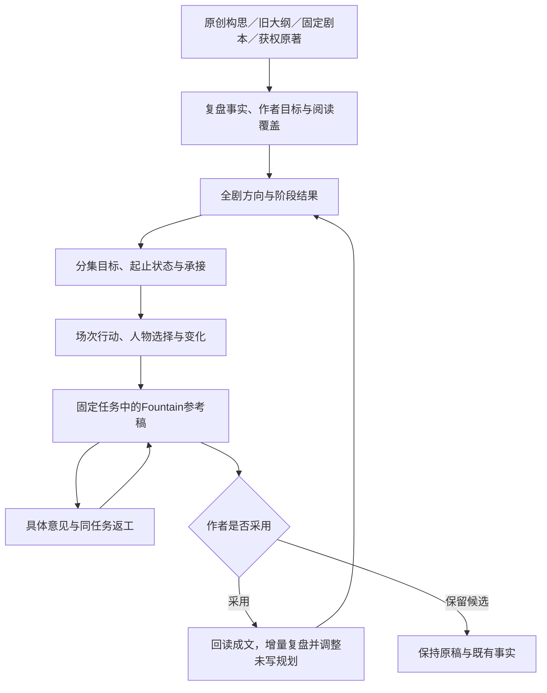

# 创作库与小说、剧本、视频设计

## 独立作品与渐进结构

作品入口保留小说、剧本和视频；核心场景聚焦小说／剧本持续返工，专业制作按需展开。已有作品打开即可阅读，探索不强制建立空章节或上游项目；关联记住固定来源和改编选择。

产品定位与任务分流见[01](01-产品需求PRD.md#1-产品定义)。

## 默认基础旅程与专业增强

三类作品的基础工作面随应用提供，不要求作者安装额外创作插件。小说具备资料、卷章、大纲、设定、参考稿、意见、采纳和文稿交付；剧本具备独立项目、分集、场次、正文、来源对照和返工；视频具备项目与分集、固定素材成果接收与播放、历史版本、区间意见及基本文件交付。分层与装配由[39](39-Electron与插件优先重构架构.md#无额外插件的基础产品)拥有，实际完成范围由38和20记录。

视频的预演、片段与成片可以由外部工具制作后导入。基础媒体记录固定分集、素材修订、用途、流与有理数时基、时长和前版；接收不表示选用或确认成片。区间意见绑定该固定记录，后续版本不继承旧坐标。基础交付只导出明确选择的固定文件及清单，不声称包含专业插件拥有的完整剪辑工程。

人物弧线、伏笔网络、专项审校、复杂改编规划、分镜制作、预演和剪辑工程由专业插件增强。停用插件后，基础创作和既有正文、媒体、意见及历史继续可用；固定专业对象保持中性读取与导出。

本章定义三个创作入口、关联方式、插件工作面、人工审阅与短剧成片交付。产品范围见[01](01-产品需求PRD.md)，领域与数据见[28](28-领域设计与边界上下文.md)、[29](29-数据字典与Schema设计.md)，流程与时序见[23](23-业务流程与MCP时序.md)，研究依据见[短剧预演与视频协作](research/13-短剧预演视频与人工审阅研究.md)。

## 1. 创作对象独立，来源明确关联

本章布局是任务与内容层级示意。新桌面由Electron/TS宿主按当前WorkRef、套件、贡献和权限组合；小说、剧本、视频及专业工具通过贡献接入，不把这些布局固化为宿主页面路由。保留业务语义，UI/UX完整还原作者确认的Mac工作台，专业插件沿相同布局接入，技术分工见[39](39-Electron与插件优先重构架构.md)。

软件从“创作库”进入。小说、剧本、视频各自具有稳定身份、资料、修订、待审成果、访问范围和交付选择；作者可以从任意类型开始，也可以让外部 Agent 从一段想法筹备，不必先选择完整制作流程。

```text
创作库
 ├─ 小说：《持械入宋》
 │   卷章、正文、大纲、小说设定、封面、相关资料
 ├─ 剧本：《持械入宋》短剧版
 │   剧集方案、分集、场次、剧本、改编取舍
 └─ 视频：《持械入宋》第一季制作
     镜头、制作资产、预演、生成片段、剪辑、声音、字幕、成片

小说固定修订 ──改编来源──→ 剧本固定修订 ──制作依据──→ 视频
原创剧本 ───────────────────────────────────────────→ 视频
创意简述 / 已有分镜 / 已有素材 ─────────────────────→ 视频

一种常用创作路径不构成强制父子层级。
```

- 一部小说可对应多套剧本，一套剧本可对应多个视频项目；关联不是独占所有权。
- 原创剧本不创建空小说；视频项目不要求先创建空小说或空剧本。需要完善戏剧内容时，Agent 在项目内准备制作方案，必要时再创建并关联独立剧本。
- 视频中的镜头说明与制作安排不成为另一份可编辑的剧本真值。改写所关联剧本先提交到其原任务并经作者采用；视频可以保存有明确来源的制作调整。
- 同一受管工作区可以保存多个关联对象；也可分目录持有。文件、身份与授权分别处理，不因同根或有链接而获得其他对象权限。
- 创作库是本机登记与检索入口，不拥有另一份正文或制作状态。系列分组可选，不强制同 IP，不推断同名人物属于同一设定。同根对象的设定归属也须明确：引用自身设定或固定获权来源，改编例外由目标拥有，不自动共用根目录中的唯一正典。

## 2. 默认入口与导航

创作库默认展示最近处理的各类项目，筛选为“全部、小说、剧本、视频”。只有小说筛选下可以称“书库”。全局提供搜索、新建、打开已有项目和设置；一个主要开始入口按所选客户端显示“交给 Codex 开始”等名称。

作者在外部 Agent 中表达目标，Agent 从对话整理类型、资料和保存方案。新建页面展示完整结果供比较与必要决定，不把类型、版权、模型、集数等做成首次启动的长问卷。手动入口仍可用。

选择或切换作品只建立当前作品上下文，并固定进入“作品资料”。作品资料先承载已有资料、结构摘要、协作状态和目录入口；完整卷章、分集或成果列表由当前作品侧栏直接进入，作者明确选择后才进入小说正文、剧本分集或视频成果。关闭正文或分集的最后一个文稿回到作品资料，切换到另一部作品也回到新作品资料。

```text
河图洛书                                                设置
────────────────────────────────────────────────────────────
创作库                   全部  小说  剧本  视频       搜索
                                                   新建
待审：第一集返工版、人物造型候选                    查看全部

最近创作
类型   名称                        最近更新       当前成果
小说   持械入宋                    …              原著章节
剧本   持械入宋 短剧版              …              第一集参考稿
视频   持械入宋 第一季制作          …              第一集预演

交给 Codex 开始                  打开已有项目
```

待审列表仅聚合作者本机已登记、已获读取权限的投影；不能借全局视图授予 Agent 整库权限。没有待审内容时省略该区，不制造待办数字或空卡。

小说封面、剧本标题页、视频海报／实际帧使用各自展示方式，保留比例。列表是混合类型的稳定基础视图，可切换图览；不将所有项目都画成书籍封面，不用空白占位图冒充媒体成果。

## 3. 三种工作界面

### 导航层级

入口按创作者当前处理的范围展开，不把全局管理、项目功能和内容目录排列在同一层。

| 层级 | 解决的问题 | 入口与展开方式 |
| --- | --- | --- |
| 全局创作库 | 打开哪部创作 | 全部／小说／剧本／视频筛选、搜索、新建和设置；不呈现具体模型参数或分集列表 |
| 当前项目 | 先核对哪部作品 | 作品资料作为默认工作面；资料、结构摘要、协作状态和目录入口集中呈现，完整内容目录留在当前作品侧栏，项目名称与返回入口持续可见 |
| 内容目录 | 阅读或观看哪一部分 | 从作品资料或项目导航明确进入小说正文、剧本分集或视频成果；小说按卷→章，剧本按集→场，视频按集→分镜／预演／片段／成片 |
| 当前成果 | 如何核对和表达意见 | 阅读／原著对照／版本比较是内容模式；选区或播放区间意见就近出现，不另外跳入制作后台 |
| 按需检查器 | 需要核对哪些依据 | 人物出场、资料、来源、参数、历史和生成记录按需展开；更深细节保持返回定位 |

项目导航固定按“作品资料 → 创作资料 → 协作与审核 → 正文／分集／成果 → 版本与交付 → 本机与扩展”排列，次级功能渐进展开。一个页面只保留与当前目标有关的主要操作；新建项目不与新建章、集、场混用。窄窗口先收起检查器和次级目录，不能把全部层级压成一排图标。关联往返保留来源项目和位置，不能静默切换到同根的另一个对象。

层级不等于并排栏。小说和剧本将项目功能与卷章／分集目录整合到同一侧栏，分别在项目层和当前作品层呈现；当前作品以目录／任务／附件／查找四段切换面板。正文获得连续工作面，目录继续由当前作品的同一组件与固定引用提供。侧栏可拖动调宽、拖窄收起并在展开时恢复宽度；层级、面板与宽度变化不重建正文或丢弃未保存稿。窄窗展开侧栏后选择稿件即收起，不新增第二条目录或复制选中状态。具体布局由[10共同基准](10-原生客户端与交互设计.md#工作台共同布局基准)维护。

打开关联作品后，窗口顶栏提供一处返回入口，指向本次离开的确切作品；连续查看多个关联可逐次返回。返回恢复原功能页、已选章节／分集及正在查看的固定关联版本，关联历史不跳到最新。失败的打开或返回保留当前对象与返回路径；从创作库另开作品则开始独立导航。导航记录只属于当前窗口，不改变关联、作者稿或 Agent 授权。

```text
创作库                                         全局
  └─ 当前小说 / 当前剧本 / 当前视频              项目
      ├─ 作品资料                                  默认工作面
      ├─ 创作资料 / 协作与审核                    资料与协作
      ├─ 正文 / 分集剧本 / 视频审阅                主要工作
      │   └─ 卷 → 章 / 集 → 场 / 集 → 成果       内容目录
      │       └─ 阅读或播放 / 对照 / 比较         当前成果模式
      │           └─ 选区意见 / 区间意见         就近表达意图
      ├─ 审核
      ├─ 关联作品
      ├─ 创作资料（展开）
      │   ├─ 设定集 → 人物 / 地点 / 规则
      │   └─ 资料与素材 → 分类 → 详情
      ├─ 版本与交付（展开）
      │   ├─ 版本
      │   └─ 交付
      └─ 检查工具（展开）
          ├─ 剧情节点
          └─ 一致性检查

属性、来源、模型记录进入当前对象的检查器或详情，不增加全局导航层。
```

收起某层不改变当前对象、内容或作者缓冲。通过搜索、关联或反馈直接进入深层页面时，展开对应导航组并标明当前位置；返回后恢复原层级和位置。分组不是额外审批步骤，也不要求作者逐层点击才能把当前对象交给 Codex。每个层级的交接都使用自身的精确引用，不因导航展开而扩大授权。

创作库已有作品时，首屏直接呈现作品列表及筛选，接入帮助保留为次级入口。窗口内返回项目保留各自选中的分集，不借用同根其他项目的位置；窄窗口选定目录项后收起浮层，让内容重新占据主要视野。协作详情先展示成果与修改意见，完整要求、连接和技术信息按需查看。

### 3.1 小说

主要任务是阅读、比较和继续写作。小说工作面与剧本一样铺满剩余宽高，章节标题、状态与工具同排，取消纸张卡片及内层滚动；文字保留中文长文的阅读宽度、卷章顺序和输入体验，工作面边缘统一滚动。不常驻右侧检查器。选区工具、原文高亮和边缘浮标承接[就地批注](10-原生客户端与交互设计.md#4-正文编辑体验)；文稿信息、比较、定稿及图片从操作入口按需浮出，相关设定仍按当前对象展开。

```text
持械入宋                                       已保存  让 Codex 处理
──────────────────────────────────────────────────────────────────
返回创作库     卷章目录（可收起）    第十二章       参考稿 / 作者稿
小说资料                            ┌───────────────────────────┐
正文           第一卷               │                           │
审核             第十一章           │     中文正文阅读与编辑    │
关联作品         第十二章           │                           │
                 第十三章           │                           │
▸ 创作资料                          └───────────────────────────┘
▸ 版本与交付                        选中时：提意见、比较
▸ 检查工具                          依据、历史按需展开
```

关联剧本和视频以独立对象显示，进入后切换到对应工作界面，并保留返回入口。不会为了看小说而出现视频模型、分镜表或渲染进度。

### 3.2 剧本

主要任务是理解戏剧发展、场次、人物行动与对白。默认先读成果，分集计划和属性次级展开；已有参考稿时不能因为作者稿为空而显示空白编辑器。

```text
持械入宋 短剧版                              参考稿  让 Codex 处理
──────────────────────────────────────────────────────────────────
返回创作库     分集目录（可收起）    第1集   剧本 / 对照 / 比较
分集剧本       第1集                ┌───────────────────────────┐
审核             第1场              │ 场次标题                  │
关联作品         第2场              │ 行动                      │
               第2集                │ 人物与对白                │
▸ 创作资料                          │                           │
▸ 版本与交付                        └───────────────────────────┘
▸ 检查工具                          本次改动、相关出场按需核对
                                    选区提意见
```

原著对照、剧本、版本比较共用主要区域的模式切换；较宽窗口可并排，较窄窗口逐侧查看，保持定位。无需一直显示三栏全文。场次标明内外景、地点、日夜及人物，不能用模型请求参数代替剧本结构。

分集目录只显示一次集名，选择后显示当前固定稿中的场次定位。阅读与编辑采用[10的剧本排版规则](10-原生客户端与交互设计.md)，集名、稿件版本、状态与显示操作合并在紧凑页头，标题页和来源按需展开；正文铺满工作区并在工作区边缘统一滚动，不使用卡片内滚动。正文不显示`@`、强制场景前缀或场号井号等交换语法。显示转换不保存为新稿，不改变Agent提交的原文字节、来源和历史。

#### 全剧推进与数据分层

剧本工作从已有状态开始：原创构思、只有旧大纲、已有分集正文和小说改编分别处理。已有内容先固定修订并复盘，区分已发生剧情、作者旧意、未采用候选与未来提案；原著目录或自动提取不能代替语义阅读，保留已读及未读范围。



宿主拥有作品、分集目录及正文身份、固定任务、设定与来源、修订、意见、采纳、定稿和交付；专业插件拥有全剧／阶段／分集／场次规划、人物弧线、关系与伏笔及多套备选。插件引用宿主固定对象，不另存一份可独立采用的正文真值。Skill组织复盘与创作方法，通过实际发现的CLI／MCP操作两层；方法描述不能代替数据合同或已实现能力。

项目说明和分集`plan`可以承载文字计划，不能据此推导专业索引、关系网络或整套历史快照。改编骨架属于固定剧情与原著映射，原创不强制建立骨架。骨架规划分集`episode_id`、写作分集`depisode_id`、正文`document_id`保持各自身份，集号与标题只作展示。初始结构剧本的字节映射不能静默套用后续正文。字段及动作分别归29、30，流程入口见[剧本Skill](../tools/hetu-skills/base/skills/hetu-drama/SKILL.md)，实现差距归20，验收归19。

### 3.3 视频

主要任务是看懂方案、观看预演、核对真实音画和审阅成片。阶段与成果分别显示，不把任务进度当作可播放视频。

```text
持械入宋 第一季制作                            本次更新  查看意见
──────────────────────────────────────────────────────────────────
返回创作库     分集目录（可收起）    第1集   分镜 / 预演 / 片段 / 成片
视频审阅       第1集                ┌───────────────────────────┐
审核           第2集                │                           │
关联作品       第3集                │ 当前版本实际画面与播放器  │
                                    │                           │
▸ 创作资料                          └───────────────────────────┘
▸ 版本与交付                        播放位置、区间、提意见
▸ 检查工具                          对应剧本、原素材按需展开

意见：“这段先听见脚步，再切到门口。”              复制给 Codex
```

“分镜”按故事顺序呈现镜头和必要文字；“预演”播放动态分镜或白模；“片段”核对实际生成结果；“成片”观看剪辑版本。缺成果时只显示当前缺项和准确交接入口，不放假播放器或无关图片。作者可一次性连续审片，不必逐段点过才能看全片。

桌面不提供必须由人操作的节点画布、三维布景台、模型生成表单或多轨剪辑台。作者表达“这里多停一下”“先听见声音再切画面”，由 Codex 修改外部工程与剪辑后回传；作者手动编辑剧本仍独立可用。

#### 全季制作与专业能力

从构思、固定剧本、分镜、已有片段或旧工程分别进入。先盘点已有内容、实际观看范围、依赖及原提供方任务，再按全季→分集／场次→分镜／资产→按需预演→代表性生成→剪辑音画→审阅返工→工程交付推进；作者只要某阶段成果时停在对应交付，不自动付费生成或发布。

宿主拥有视频作品身份、分集元数据与唯一顺序、设定、受管素材、来源、固定修订及共享机器入口。专业插件拥有全季制作计划、分镜、预演／生成记录、剪辑工程与时间映射、媒体反馈及专业交付；外部工具完成实际制作，不把制作任务状态当作可播放成果。通用文字／图片计划不能直接承担视频调用。反馈、预演认可、片段选用、成片确认和剧本定稿分别核验实际合同与作者决定。

分集改名、说明、归档及重排不改变媒体身份或上游剧本，历史保留；同名分集与当前集号不作关联键。未知生成先查原任务，局部返工只重做受影响范围；对白改写回剧本、空间问题回预演、字幕问题回字幕层。技术解码、完整内容观看与作者认可分别取证，全季完成须逐集核对，不能由一集样片推断。方法见[视频Skill](../tools/hetu-skills/base/skills/hetu-video/SKILL.md)，实现与缺口归20，VID旅程验收归19。

### 3.4 共享布局规则

- 层级固定为全局创作库、当前对象、当前章节／分集／成果；内部字段或目录不作为一级导航。
- 默认保留内容区和一处导航，检查器需要时展开；窗口变窄先折叠检查器与次级目录，不压缩主要阅读或观看区域。
- 小说、剧本使用适合长文的居中阅读区域；视频按实际画幅等比呈现，竖屏不拉宽、横屏不裁掉信息。白模中表达身份的代理颜色和媒体内容保持原样。
- Radix Colors 用于界面语义，0.5px 边框，字号优先20／14／12三档；正文行距、对齐及留白按中文阅读调整。禁用装饰眉题、中点分隔和大段解释文案。
- 对象名称、固定版本、参考／采用状态和必要保存信息持续可见；来源、参数、路径及完整错误在需要时展开。
- 新成果到达就地提示，不替换未保存正文、抢焦点或跳走播放位置。版本切换使旧版意见保持绑定旧版。

## 4. 关联作品与变更影响

关联具有类型和固定两端：改编原著、制作剧本、参考、续作依据。小说到剧本、剧本到视频分别保存来源版本和映射，反向列表从同一关系派生，不能各维护可编辑链接。

关联页分为列表和固定版本详情。列表呈现作品名称、关系与需要关注的状态，选中后再看两端固定版本、作品资料和历史；已解除关系通过列表菜单按需显示。历史切换位于详情的版本菜单，返回保留列表；“打开当前版本”是导航，不自动更新依据。详情中的“让 AI 处理”携带确切关联身份、版本和摘要，由 Codex 整理变更方案。

更新依据保持两端作品身份，使用者确认新的来源与目标版本后产生关联新修订。解除与恢复同样追加修订，不移除旧任务、采纳、定稿或交付；管理权属于使用此依据的作品，来源方无权替下游决定。无法读取另一端时，关系仍可查看，明确区分缺少权限、读取失败和已有新版，不能把失败显示成没有变化。

Codex 已分别获得两端作品授权时，可在关联详情读取中携带另一端的 related_management_ref。稳定入口只读取本次关联确切另一端的固定资料，不合并授权、不写入关系记录，也不能据此改动两端。未提供、已撤销、对象错误和资料损坏分别按真实权限与读取结果处理。

作品资料的固定版本仅覆盖该资料及目录记录，不能替代章节、设定或媒体的固定引用。界面以“固定版本资料”标明范围，全文依据通过对应来源及内容引用查看。

同根关联可固定原有修订；跨工作区通过获权操作保存必要的来源快照与原始身份，关闭或移走来源目录后仍能查看本次制作依据。快照不是可写同步副本；正文、设定或素材的新版本由 Agent 准备更新方案，作者决定后再推进依赖。

更新只标记确实依赖该版本的内容。修改小说章节不直接改剧本，修改剧本不直接重做视频。界面列出相关场次、镜头、预演或生成片段，保留前后版本与来源；语义上的动机、表演和节奏影响由 Codex 提建议，不能包装成 Core 的确定推导。

同一工作区有多个创作对象时，删除一个对象不得把整个根目录移入废纸篓。删除项目先核对其所有权、内部内容和被引用位置，采用可恢复的对象删除或归档；删除整个工作区是另一个明确动作，列出全部受影响项目并确认。书库登记移除、项目删除和工作区删除不能复用含糊的“删除作品”语义。

## 5. 全生命周期及预演

```text
原创构思 / 小说原著 / 已有剧本 / 已有素材
                    │
                    ▼
          剧集开发与分集剧本
      人物目标、冲突、行动、揭示与兑现
                    │
                    ▼
      镜头设计 + 实际所需人物／场景／道具
                    │
                    ▼
     动态分镜 ──复杂空间或调度──→ 白模预演
                    │                  │
                    └───────┬──────────┘
                            ▼
                 作者观看、提意见、调整
                            │
                            ▼
       固定素材与 Prompt + 模型模式 + 费用范围
                            │
                            ▼
              代表性真实生成 → 分组制作
                            │
                            ▼
          剪辑、对白、声音、字幕与实际渲染
                            │
                            ▼
            连续审片 + 细节核对 + 局部返工
                            │
                            ▼
           作者确认成片版本与完整工程交付
```

作者可以从已有成果进入中间阶段；关联缺项不阻止阅读。阶段不是强制表单顺序，Codex 根据现有材料组织制作。发布、投放及发布后的运营不属于本轮生命周期。

| 待验证问题 | 优先材料 | 不能据此证明 |
| --- | --- | --- |
| 人物动机、因果、对白和改编取舍 | 剧本与固定原著对照 | 最终镜头表演和真实时长 |
| 揭示时机、切镜、停顿和音画配合 | 动态分镜与临时声音 | 最终演员、口型和质感 |
| 路径、遮挡、视线、争抢和复杂运镜 | 外部工具生成的白模预演 | 视频模型将严格复现所有几何和动作 |
| 身份保持、表演、动作可实现性与质感 | 少量有代表性的真实生成 | 整集全部片段都能一次成功 |
| 整集节奏、字幕、声音和连续性 | 实际剪辑音画 | 高流量或高留存的效果保证 |

普通对白可使用动态分镜，复杂调度再做白模。Codex 通过外部工具的机器接口建模、编排、渲染和回传；河图接收可播放预演和可继续编辑的外部工程，不要求作者操作三维工具。临时声音与最终声音分别标示。

白模参考负责运动、空间、摄影和时序；场景图负责环境外观；人物造型图负责身份、服装和细节。Prompt 明确职责，代理颜色、白底、白模几何和识别标签不成为最终画面要求。优先复用已认可资产，按需要补图，不强制每场生成全套新素材。

## 6. 连续体验与细节发现

审阅先让作者连贯阅读或观看，意见、疑点和诊断按需展开。作者随时可在未标记的位置暂停、放大、记意见，也可直接向 Codex 提问。AI 的筛选不能限制作者可见内容。

| 发现路径 | 展示形式 |
| --- | --- |
| 按故事连续看 | 完整正文／场次／预演／成片，保留前后文及声音 |
| 沿人物或事物看 | 按故事顺序列实际出场，核对身份、造型、伤势、持物、位置和知情范围 |
| 沿本次改动看 | 文字差异、同区域图片对照、对应视频区间和受影响前后段 |
| 沿具体疑点看 | 原始证据、Codex 的判断、作者意见与实际覆盖，随时返回完整内容 |

“所有出场”须按真实引用和分页覆盖说明，不以少量抽帧冒充完整核对。Core 可确定引用失效、缺文件、摘要不符、范围越界等问题；性格、节奏、动机和观感由 Codex 分析、作者判断。没有疑点不显示“整部作品无问题”。

## 7. 创作意图与反馈接续

作者直接在 Codex 表达目标，或在河图选中位置写一句意见。界面自动固定对象、版本和位置，不要求填 Schema、找文件或手工录入时间码。

沿用 TaskFeedback、CreativeTask、WorkingCopy 和固定候选：文字锚点为固定修订的 UTF-8 范围；图片为原图坐标区域；音视频为固定媒体与流时间基准中的时点／区间；跨场次意见同时引用多处。整体风格意见可以绑定整集或人物，不强制画局部框。

作者原话保留，Codex 可提出可纠正的理解及修改方案。一次局部偏好不自动升级成全局规则；扩大修改、读取或费用范围需明确授权。未保存正文不自动外发，旧版意见不按相似内容迁移到新版本。

MCP Apps 可在实际支持宿主中展示局部观看与比较，显式请求当前对话继续；缺能力时复制同一反馈引用。桌面、Apps 和本地页面使用同一事实。意见保存、消息受理、实际返稿和作者验收分别显示，不把保存当作已经唤醒 Agent。

## 8. 视频生成与音画组织

视频项目拥有镜头、预演、生成片段计划和剪辑版本。剧本文字仍由剧本或其固定来源拥有。一个镜头可以由多个生成片段完成，一个片段可包含多个镜头，二者多对多；分集不按模型单次时长机械切割。

每次生成固定模型与模式能力、素材顺序及职责、Prompt、画幅、时长策略、声音设置、费用范围、授权与输入摘要。Seedance 2.5 与 flash 分别描述，其他模型依据实际输入和模式适配，不假定支持相同功能或价格。

外部 Agent 调用已选的视频工具或受支持适配器，登记原计划、提供方任务引用、实际配置和结果。河图只执行明确调用与确定性核验，不承担自主导演循环。状态包含待必要决定、提交中、运行中、成功、失败、取消和结果未知；中断先查询原调用，不换键重复付费。

视频接收检查实际文件摘要、解码、画幅、时长、音轨和来源，内容核对另记实际观看范围。API 成功、可下载、几张抽帧和完整解码均不能单独证明人物、表演、动作或声音正确。

Codex 使用外部音画工具组织剪辑、对白／配音、音效、配乐、字幕和混音，河图展示实际渲染结果及可追溯片段。字幕按真实音轨对齐并核对文字；临时声音不冒充正式配音，不擅自克隆真人声音。剪辑保存源片段区间、成片时间与必要变换，旧区间意见不直接套到新版。

修改剧情回剧本，修改空间回预演，外观问题核对资产与生成输入，声音／字幕问题优先处理对应音轨或字幕。只重做受影响内容，保留有效素材、历史版本、原费用记录和作者决定。

## 9. 创作与制作交付

小说交付选择章节、设定与资料；剧本交付选择剧本文本、原著映射与必要制作资料；视频交付选择成片、字幕／音轨、采用素材、分镜、预演、可编辑外部工程、生成输入及来源。三类 profile 复用交付事务和 manifest，不要求每次打包全部关联作品。

预演认可、资产选用、片段选用、剧本定稿、成片版本确认和交付确认分别记录。视频确认不将小说或剧本自动定稿；采用参考结果不等于确认成片。正式交付的内容与所确认版本一致，审阅包明确区分。

交付保持相对路径、素材依赖和必要编辑信息，排除密钥、临时签名链接、本机路径、授权秘密与默认不选的失败大文件。可完整播放和继续编辑由真实验收证明，不以成功压缩代替可用性。

## 10. 实施与验证

先修复现有分集成果的可达、阅读与返工入口，保留已导入作品及其来源；随后建立三类独立入口和固定关联，再用一集贯穿资产、预演、真实生成、剪辑、作者反馈与交付。贯穿切片可用后推广全剧，避免批量积累无法审阅的产物。

设计、公开能力与制品证据分开管理：本轮工作包和跟进状态见[38](38-创作工作台重构执行计划.md)，实现基线与历史证据见[20](20-实施路线与里程碑.md)，真实 CLI/MCP、作者决定、原生界面、付费模型、媒体检查与工程交付分别按[19](19-测试策略与验收矩阵.md)验收。设计表和示意图不成为当前工具目录或已实现能力的证明。
