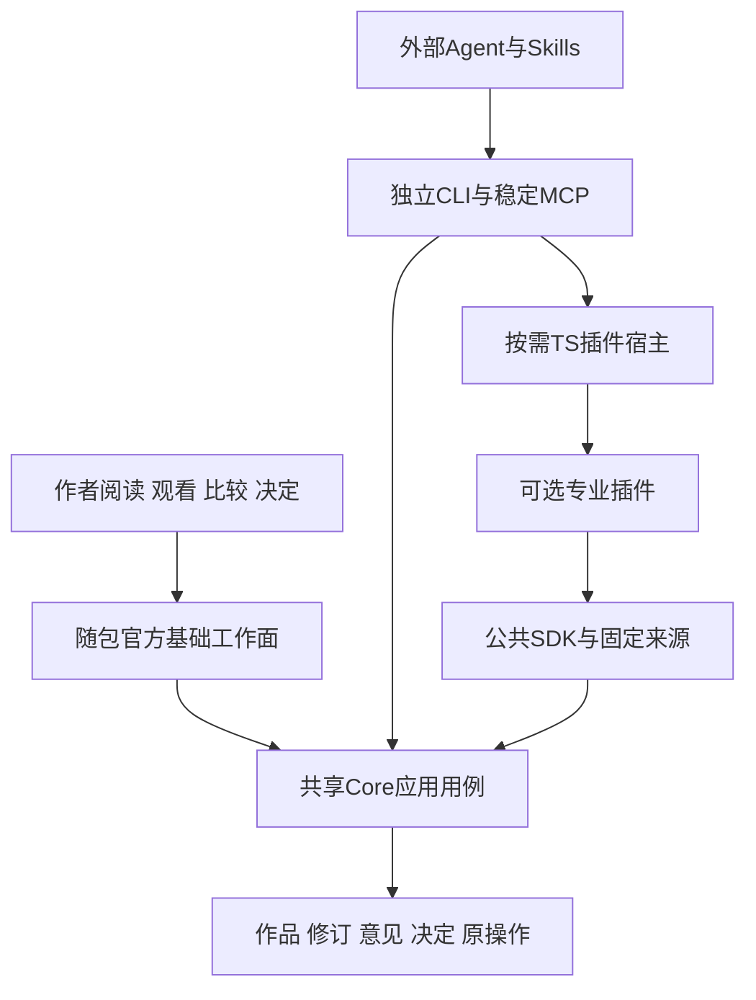
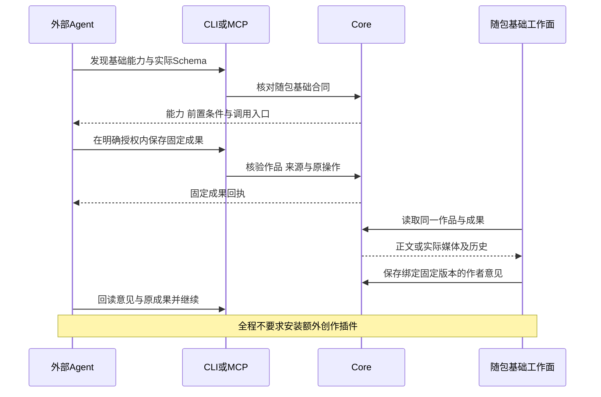
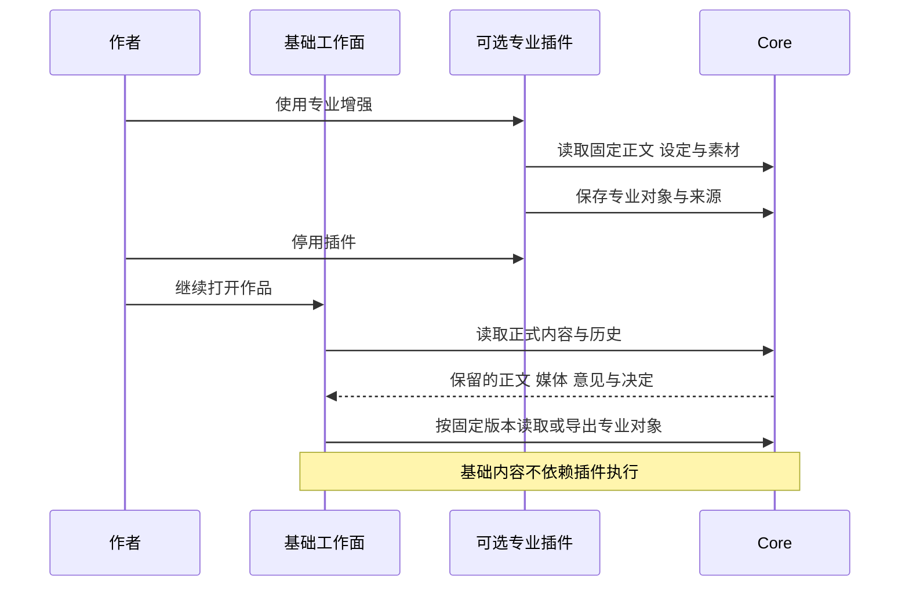
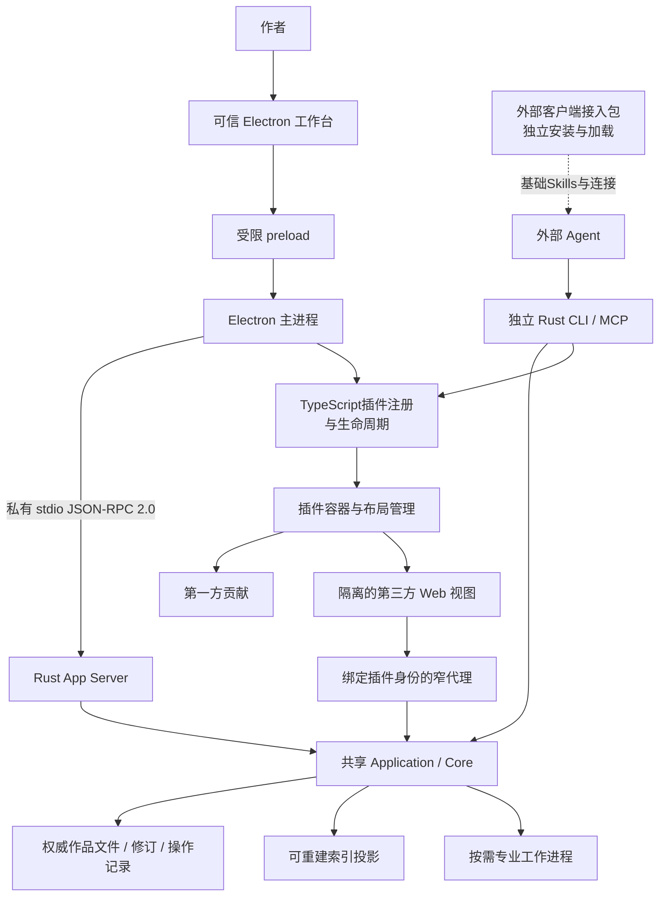
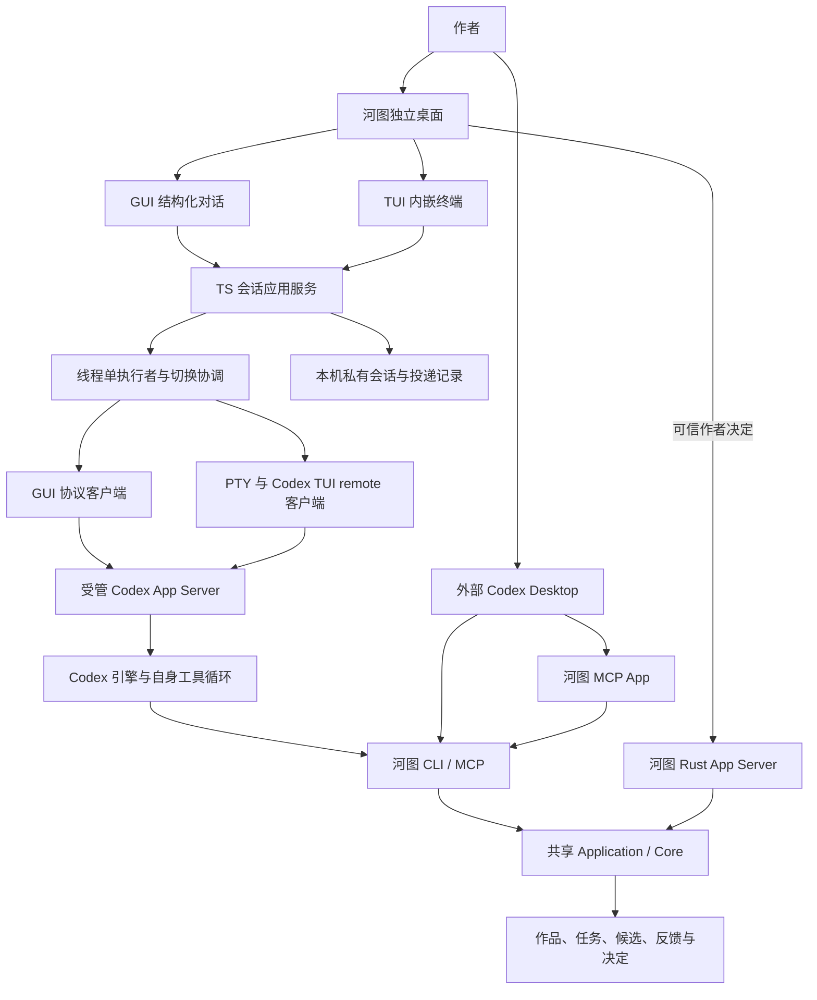
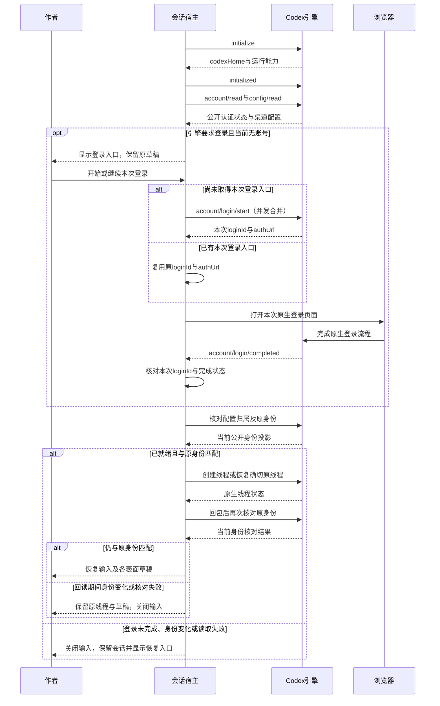
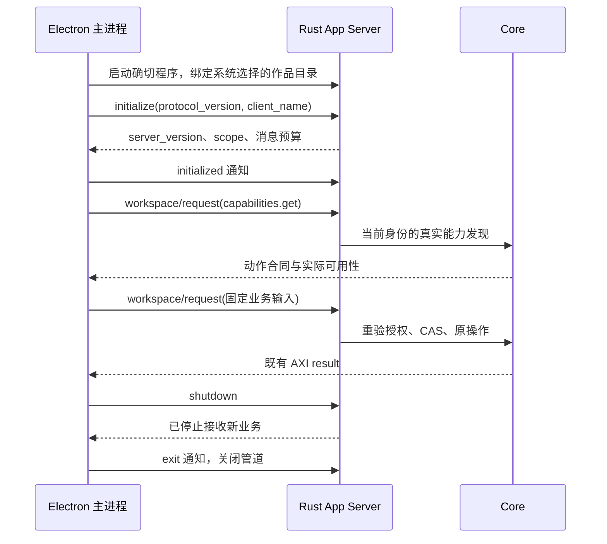
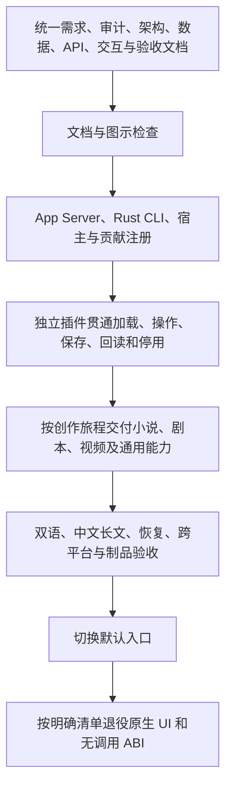
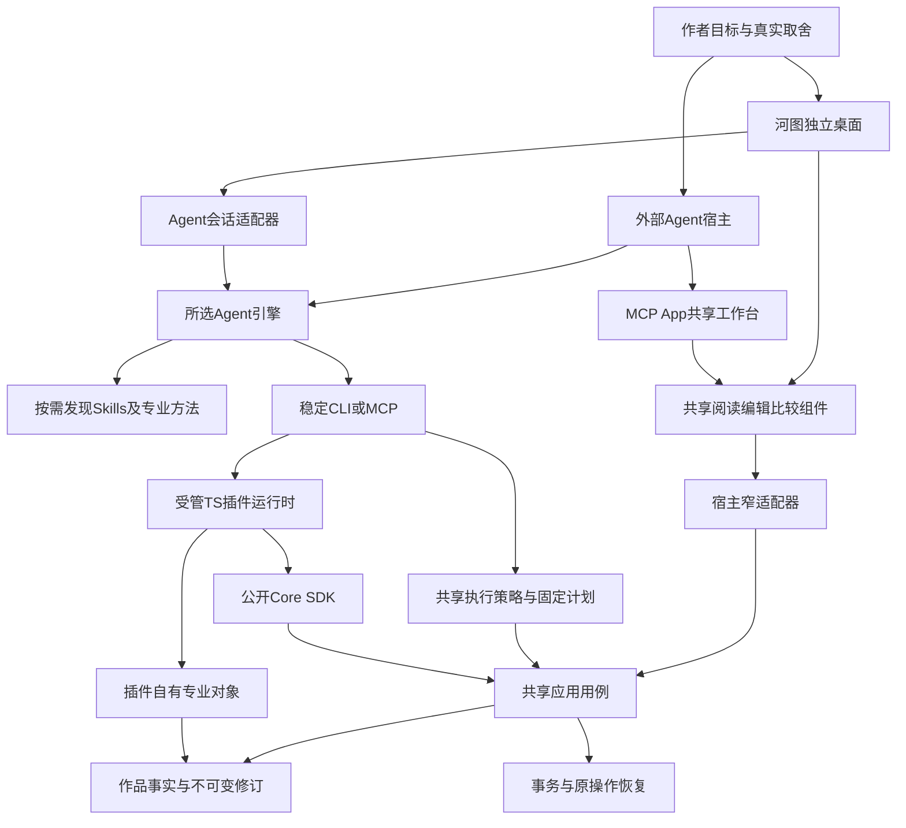

# Electron 与插件优先重构架构

## 业务优先于会话宿主

外部Agent和可选内嵌终端共享机器能力，桌面呈现作品与成果。终端、聊天和布局属于适配层，不承担领域事实或内置规划循环；无Agent时本地阅读编辑独立可用。

产品定位与任务分流见[01](01-产品需求PRD.md#1-产品定义)。

阅读位置属于可信工作台的本机视图状态，由桌面和MCP App共用的TypeScript持久层按精确WorkRef保存。仅存章节选择、固定修订身份、单字来源锚点及视口偏移；不保存正文、授权或文稿缩放。并发保存按字段合并并使用本机跨进程锁，当前窗口不订阅另一窗口的滚动。未保存缓冲不覆盖已保存修订的位置，旧身份或无法核实的锚点不套用到新稿；损坏记录保留并提示，不静默覆写。

本机字体目录由共同Node宿主按需读取平台字体目录的SFNT名称元数据，只返回去重字体家族名与覆盖状态，不返回文件路径或字体文件，不复制系统字体进入制品。枚举、搜索和中文／英文样句在同一控件呈现；浏览器仍独立检查所选名称能否产生字形，缺字沿统一CJK回退链。请求有文件、目录、读取字节与时间预算，失败可重试；普通Agent和专业插件不获得整机字体枚举入口。

界面大小由Electron当前工作台的WebContents缩放实现，文稿缩放仍独立应用于正文档案。设置窗口使用独立可信Origin，避免同源缩放把另一窗口一起改变；插件工作面随所在工作台缩放，布局坐标从CSS像素换算到原生窗口尺寸。MCP App保留宿主的界面缩放和快捷键，仅提供实际可用的宿主提示，不伪造全局窗口能力。

共享表现层拥有有效主题解析、文稿档案计算、排版控制、文字命令及位置度量；Rust本机设置拥有非敏感偏好、Schema迁移、CAS和原操作。文稿内容、权限和作者决定继续由原用例持有。Electron和MCP App消费同一React及计算模块，宿主只适配环境、窗口、字体目录与通知；不以另建编辑器或复制CSS实现入口一致。

偏好通知携带 `settings_revision`，旧修订不得覆盖新值。私有 `settings/preferences` 只返回本机偏好与修订，不携带套件目录。可见工作台以有界间隔读取这一小型快照，隐藏或拆除时暂停；保存仍沿原CAS与恢复记录，不由同步通知发起写入。正文统计在独立Worker中分批执行；受限宿主采用同一分批算法让出主线程，过期请求取消。Worker代码固定于随包模块，CSP只允许必要Blob Worker，不加载外部脚本或执行作者内容。

正文格式投影使用共享的CommonMark语法树，只呈现已支持的标题、强调、引用、分隔和代码语义。每个可见文本片段携带原文UTF-16范围，选区与意见再校验同一原文并转换为UTF-8；链接、图片及HTML不触发网络或执行，未支持结构保留原稿。编辑命令只向既有CodeMirror提交最小插入／删除，独立撤销，不重写整段换行；菜单、键盘和剧本元素控制复用同一命令。显示投影与正文保存、授权和作者决定分离，仍由既有应用用例交付。纯文本粘贴只由作者的明确菜单操作读取宿主剪贴板，私有App通道与桌面通道共用1MiB字节预算；异步回执核对原编辑器、文档与选区，目标变化即拒绝插入。剪贴板能力不进入普通Agent或插件SDK。

查找统一使用可见文本投影及原稿范围映射，编辑原稿模式按原稿查询。字面、大小写、西文整词、中文分词与正则分别声明；正则只在可终止Worker执行，超时中止不阻塞编辑。替换先固定原稿与确切匹配，遇到隐藏格式边界要求原稿核对；应用前重新核对当前缓冲，全部替换为单一撤销事务，不保存或定稿。本作品查询通过既有文档目录／读取用例逐篇固定修订，显示实际读取、失败与显示预算，跳转前核对当前修订，不能以本地索引或标题冒充正文事实。

决策日期：2026-11-16。本文拥有桌面重构目标、进程通信、插件宿主边界与原生退役条件；产品、领域和应用动作分别由01、28、30拥有，插件包与生态详细合同由[插件系列](plugin/README.md)拥有。实际进度归38，测试结果归20；本文中的目标接口不代表已发布能力。

公开插件接入遵循[开放宿主SDK](plugin/27-开放宿主SDK与核心能力审计.md)：安装启用后直接使用核心服务，业务规则与原操作恢复继续生效。历史插件授权字段不作为新插件接入前置。

## 1. 已采纳的决定

### 无额外插件的基础产品

安装河图后，无需额外安装或启用创作插件，即可使用小说、剧本和视频的基础旅程。基础能力以作者能完成的目标划定，不以动作数量或代码所在语言划定。Core持有作品事实和业务不变量，官方基础模块随应用装配并使用贡献注册；可选专业插件独立安装。外部Agent方法的安装与河图创作插件安装分别处理。

| 层 | 随包基础责任 | 可选增强 |
| --- | --- | --- |
| 共享Core | 作品、正式结构、正文、设定、素材、来源、修订、任务、反馈、作者决定、事务与恢复 | 不持有具体插件的专业判断 |
| 官方基础模块 | 小说阅读编辑、大纲与目录、剧本分集正文、视频分集成果与固定区间意见、比较、基本交付及AI交接 | 模块化不要求作者单独安装，缺包属于发行完整性错误 |
| 专业插件 | 复用公开核心和固定对象 | 人物弧线、伏笔、专业审校、分镜、预演、剪辑工程和供应商适配 |
| Skills与所选Agent | 发现实际能力，准备、执行、回读及返工；可在外部客户端或桌面会话宿主中工作 | 方法不扩大权限，Core不自建Agent推理循环 |

基础模块不是用户插件目录中的隐式安装。基础模块清单随Core和桌面构建核对，独立CLI/MCP不依赖Electron或插件目录；插件损坏只影响对应增强。默认基础能力、可选插件增强及停用后的读取导出分别验收。基础清单的健康检查只证明合同和装配，不能代替业务或创作品质验收。

基础视频及关联字幕导出共用`VideoReview`的固定文件应用用例：Core交付预览核对固定成果、关联及当前权利，可信宿主在同一只读流上校验字节与完整摘要，保存前再次核对原预览并原子替换目标。字幕只允许预览内明确匹配的固定轨，不提供任意素材导出或路径写入口。播放器与MCP工作台复用同一语言选择及保存流程；专业解析、转码和工程归原插件Owner。







采用Electron＋TypeScript/React工作台、TypeScript插件宿主、Rust App Server、JSON-RPC 2.0私有stdio、独立CLI/MCP和受管Chromium插件视图。插件采用DSH风格JavaScript/TypeScript＋React，不使用Rust插件ABI。河图同时提供外部宿主MCP App与独立桌面Agent对话；会话宿主复用作者选择的独立引擎，Core保持作品与确定性业务边界，不自建通用推理循环。

采用Cordis作为TS运行时的依赖注入、服务组合与生命周期基础，河图SDK及作品格式保持独立；来源固定、可替换边界和DSH兼容准入见[插件26](plugin/26-Cordis采用与DSH兼容边界.md)。该决定不表示当前自有注册实现已完成迁移，也不表示DSH插件自动兼容，实施状态归38。

Swift原生客户端及专属桥接、构建和测试已退役，历史证据保留原版本范围。Electron复用Rust Core与作品格式，不双写、不另建作品数据库。作者确认的Mac工作台是UI/UX还原基准；布局、视觉层级、导航、阅读编辑及审核恢复分别对照，原有机器授权边界保持。

先完成本系列及所有受影响规范的一致性更新和设计检查，再继续开发。采用插件优先的纵向用例：宿主发现一个独立能力包，经授权加载、操作、保存、CLI/MCP 回读，并在停用后仍能读取和导出成果。仅做出 Electron 窗口或复刻一组原生页面，不构成重构完成。

## 2. 重新审视现有实现

可复用基础包括作品身份、固定来源、Core事务、CAS、原键恢复、作者决定和外部Agent协作合同。重构前审计发现静态能力目录、固定领域包集合、硬编码View路由，以及第三方加载、插件身份和贡献撤销的缺口。当前设计采用TS贡献宿主与稳定机器入口解决这些问题；可选第一方专业插件按独立安装生命周期验收，随包基础模块按应用装配验收。审计背景与当前源码差距分别见[插件19](plugin/19-现有架构审计与插件优先重构.md)，实际验收范围以主38为准。

这些缺口说明更换桌面壳只是必要基础之一。不能把所有旧页面移成 React 组件后继续在 App 中增加 if/else，也不能把任意 JavaScript 注入作者页面称为插件 SDK。

## 3. 目标职责

| 层 | 拥有的责任 | 边界 |
| --- | --- | --- |
| 最小工作台宿主 | 创作库、当前作品上下文、贡献发现、布局、返回定位、任务/恢复状态、Agent对话和可信决定界面 | 不理解每个插件的全部业务字段，不将对话文本作为作品事实 |
| Agent会话宿主 | 适配器注册、受管引擎进程、消息及流事件、审批转交、取消和会话恢复 | 不持有通用作者权限，不替代引擎推理或Core事务 |
| TypeScript插件宿主 | 包加载、依赖、贡献注册、插槽、事件和清理；按需Node后端运行时 | 不在Rust中实现组件注册和前端交互，不获得通用作者句柄 |
| 第一方创作能力 | 小说、剧本、视频审阅、设定、版本、交付等工作面及领域适配 | 按共同贡献合同注册，不凭第一方身份绕过权限 |
| 第三方插件 | 专业数据类型、动作、渲染器、方法或外部工具适配 | 只访问当前授权的对象、动作和数据投影 |
| Rust Application/Core | 身份、授权、修订、来源、事务、操作恢复、采纳和定稿 | 不依赖 React、Electron、A2UI 或某个插件市场 |
| 外部 Agent | 理解目标、选择方法、规划、生成、获权执行和返工 | CLI/MCP 独立工作，不依赖 GUI 点击 |
| 专业工具进程 | TS插件显式适配Python、Blender等工具，执行确切计算与原任务查询 | 无自主规划循环；进程分离不等于 OS 沙箱 |

“能力插件化”不要求立即把所有领域源码拆为独立 crate。先让第一方工作面通过公共贡献合同交付，用两个独立插件验证边界；仅在所有权、发布或依赖确需独立时拆分实现。

## 4. 系统与进程架构



图中的 Scoped 是插件授权边界，不能直接复用作者 `workspace/request` 通道。普通网页使用系统浏览器，不提供桌面任意网页导航或业务桥接。Core 在各入口进程复用同一代码，文件锁、CAS 与持久操作协调并发；不要求中央后台常驻。当前入口与权限子集见[插件20](plugin/20-首期可执行合同与开发入口.md)。

### 4.1 运行单元

| 单元 | 启动者 | 权限与生命周期 |
| --- | --- | --- |
| Electron 主进程 | 操作系统／作者 | 窗口、系统选择器、已绑定作品和受管子进程；不执行模型循环 |
| 可信 renderer | 主进程 | 无 Node；preload 仅暴露明确的桌面用例 |
| Rust App Server | 主进程 | 启动时绑定明确作品；私有管道，无监听端口、无通用远程作者接口 |
| 插件 renderer | TS宿主按当前工作面创建 | 固定包摘要、贡献、WorkRef、授权和会话代次；销毁即撤销桥接 |
| CLI／MCP | 调用方／外部宿主 | 基础能力直接用Rust Core；TS插件动作按需启动同一Node插件运行时，均不依赖GUI |
| Agent引擎进程 | 桌面会话宿主按作者选择启动 | 独立客户端身份、精确作品／任务授权及引擎自己的沙箱；不继承作者workspace/request能力 |

`packages/workbench-ui`维护不含宿主权限的React表现组件和Web样式，由Electron与MCP App共同装配。数据投影、资源URL与操作回调由宿主适配器提供；品牌、封面和山水资产来自同一原文件，MCP静态页面内联固定字节。共享界面不依赖运行中的桌面进程，不转发可信作者IPC，不改变Core的授权和决定边界。

正式设定详情与任务来源审阅共用只读实体组件、依据展示、领域翻译及样式。组件只消费当前已返回的实体和名称解析，不加载未附加对象；来源范围、目录及字段分页由原任务上下文适配，Core继续核对固定修订及实体边界。长实体的本机临时重组与展开状态属于视图缓存，不另存设定事实或创建任务。

### 4.2 河图插件与外部Agent接入

河图专业插件安装在河图，TS宿主拥有其包、依赖、贡献和热插拔。外部Agent使用稳定CLI／MCP的安装发现、获权能力发现与调用入口，不为每个河图插件新增Codex插件或MCP连接。接入包中的基础Skills与客户端配置单独管理，其加载机制不能成为河图插件热插拔的前置条件。

同一机器连接通过 `hetu.plugins.inspect` 读取新安装包，通过 `hetu.plugin_access.capabilities/invoke` 获取实时Schema并按固定包及能力摘要调用；每次重验活动状态、WorkRef和精确授权。停用或升级撤销旧授权，重新启用不复活旧引用。模型按需查询才获知新能力，宿主不声称后台变化已自动进入对话上下文。格式、时序及覆盖用例由[插件21](plugin/21-核心格式与动态能力发现.md)拥有。

### 4.3 Agent 会话宿主

协作入口共用 Application/Core，产品旅程归[27第1.1节](27-Agent与Codex插件集成设计.md#11-双入口协作)。桌面默认使用多引擎工作区，创建面板发现本机引擎及其PTY、结构化GUI和模型能力；Codex保留共享App Server的TUI／GUI和线程恢复。Claude流式协议、ACP和Pi RPC按实际能力进入同一会话工作面；外部MCP App保留独立宿主身份。完整接入范围与分层见下节，运行验证归38与20。



#### 4.3.1 分层与复用

| 层 | 本轮责任 | 边界 |
| --- | --- | --- |
| 共享会话表现 | 消息、Markdown、工具时间线、待答请求、成果链接、输入与排版设置 | 消费有类型投影；不启动进程、不调用任意 Shell、不持有作品授权 |
| TS 会话应用服务 | 会话目录、上下文固定、发送记录、线程占用、切换、取消、恢复和能力投影 | 适配器只实现引擎协议，不复制任务或作品事实 |
| Codex GUI 适配器 | 连接受管App Server，握手、thread、turn、增量事件与引擎请求答复 | 与TUI共用引擎；仅当前输入owner可发送或答复；河图Rust App Server仍为独立业务入口 |
| Codex TUI 适配器 | 受管PTY内用Codex CLI的remote模式连接同一App Server，管理尺寸、输入、输出及退出 | 客户端退出与共享引擎停止分离；不把ANSI解析当成业务回执 |
| Core 与独立 CLI/MCP | 范围路由、auto／confirm、事务、CAS、原操作与确定性作者决定 | 不依赖聊天视图、PTY 或运行中的桌面窗口 |
| 本机设置与私有会话存储 | 前者保存偏好；后者保存消息投影、引擎引用及运行状态 | 不在 React localStorage、插件或作品目录复制第二套权威记录 |

renderer 仅使用窄 preload；主进程拥有进程、路径核验和连接生命周期。GUI/TUI 共用客户端主体、公开 WorkRef、固定任务和方法加载机制；启动时注入随包 `hetu-mcp` 与私有协作目录。目录通过可信Rust App Server的 `collaboration/directory` 读取Core实际默认值或本次环境覆盖，不在TS复制平台路径，不向 Prompt、renderer 消息或普通日志输出 `management_ref`。工作目录使用本机私有会话沙箱，不将作品根目录当 Codex 的 `cwd`。原生进程仍受操作系统和实际引擎沙箱限制，逻辑范围不能宣称阻止同用户任意磁盘访问。

会话模块按真实责任从现有 `apps/desktop/src/main/agent-session.ts` 拆分：会话服务、协议适配、PTY生命周期、占用协调及私有存储；renderer的聊天与终端分别消费这些投影。共享排版和设置组件放在既有 `packages/workbench-ui`，作品专有的上下文和成果路由留在桌面应用层。原生CLI共用PTY进程和记录管理，Codex协议桥单独负责线程与双表面；已有结构化协议通过会话端口注册驱动，提供方启动差异留在适配器，不复制作品用例。

#### 4.3.2 Codex 协议与运行能力

本轮首选同一受管 Codex App Server、多客户端表面：GUI 是协议客户端，TUI 用 `codex --remote <endpoint>` 及明确线程的恢复命令连接同一服务。macOS／Linux 使用私有目录内的 Unix socket，不复用全局 daemon；Windows 的本机受认证 transport 单独验收，采用回环 WebSocket 时令牌只经私密文件和指定进程环境交付，不进入命令参数、日志或作品。源版本不支持共享连接时才使用独立进程恢复路径，不为兼容自动启用公网监听。

GUI 按 `initialize` → `initialized` → `thread/start` 或 `thread/resume` → `turn/start` 消费消息与完成通知。`turn/interrupt` 的请求返回与最终 `turn/completed` 分开处理；只有核验原轮次终态后才解除“正在停止”。TUI 使用安装版 Codex CLI 的 remote 启动／恢复命令和明确 thread ID，通过 argv 启动，不拼接 Shell 字符串、不用 `--last` 猜测、不自动安装或升级全局 CLI。

PTY客户端经私有WebSocket协议桥连接受管App Server。桥接透传原生消息，以`thread/start`、`thread/resume`、`thread/fork`的成功响应核对实际线程；新线程取得配置归属＋thread ID占用、保存旧投影并订阅新线程后才转交响应，不能通过ANSI文字猜测线程。原生新建／恢复不改变当前WorkRef；线程列表只投影本机会话已登记的线程，直接请求其他线程也拒绝。运行中、待答及unknown状态禁止切换；旧线程消息、草稿与固定引用分别保存。桥接不修改原生斜杠命令和键位，也不把终端回放当成投递确认。

能力按实际版本分别核验：模型目录、推理强度、工具事件、审批、追加、排队、图像、历史读取、压缩、分叉及双向恢复。适配器声明的每项能力必须有实现，运行时只能收窄。支持 `turn/steer` 时可追加，未支持时保留本机待发送内容；排队必须在上次轮次结果可核对后显式投递。未知结果不得通过新 turn 或新线程“重试”。TUI 的原生斜杠命令和键位由 Codex 拥有，宿主不得为模拟 GUI 行为截断命令。

认证、模型账号与会话历史归 Codex；河图只使用允许的认证流程和状态接口，不读取或复制凭据。两种表面核验相同可执行文件、版本、配置归属及当前账号；账号或配置变化时暂停恢复，不将不匹配的线程接入。外部 Codex Desktop 的账号和线程不可通过本机文件推测或自动接管。

宿主在初始化确认`codexHome`后，经`account/read`与`config/read`核对原引擎状态；创建／恢复线程、发送、答复待答及终端变更请求前复核。线程回包后、更新历史与就绪状态前再次核对身份，防止延后的回包解除认证失败；线程占用使用初始化确认的配置归属。私有记录仅保存逐会话随机盐与配置归属、渠道、可识别账号的摘要，不保存完整配置、邮箱、账号ID、登录URL或凭据，也不向renderer暴露身份绑定。订阅变化及密钥轮换不等于换账号；无OpenAI账号且引擎声明`requiresOpenaiAuth=false`的独立渠道正常接入。API Key模式缺少稳定账号标识时，只能核对协议可见的类型及渠道，不声称证明密钥背后的同一账号。

必需登录时停止线程创建与输入，保留原会话和双方草稿。登录委托`account/login/start`的原生浏览器流程，同一进行中的登录合并；重新打开页面复用原URL，不再创建登录。仅匹配本次`loginId`的成功通知接续原线程；失败、未知回执、账号／渠道变化或读取失败分别提示恢复路径，不自动换账号、创建替代线程或重发模型轮次。初始化前的认证通知不提前绑定配置；核对期间再收到变化则重读，结束后重新核对输入代次及表面。旧轮次完成通知不能解除认证失败，恢复原配置并明确重连后才恢复投递。



#### 4.3.3 单执行者与界面切换

单执行者指同线程只有一个可提交输入或答复审批的受管控制端；GUI与TUI可以连接同一引擎观察状态，但不能同时驱动。按 Codex 配置归属及 thread ID 建立本机进程间占用记录，并包含会话 ID、执行表面、owner 代次、服务与客户端进程身份及活性。不能只依赖 PID 或 renderer 中的布尔值；进程已退出、进程复用及崩溃遗留须分别核验。它只约束河图受管执行端，不承诺阻止外部任意 Codex 进程；发现外部占用或无法核对时不强行接管。

桌面受管App Server由窄职责的Node生命周期守护进程启动，守护进程与桌面使用私有IPC。先创建受管进程组并将其身份写入原会话／线程占用，再允许守护进程启动引擎，避免桌面在启动窗口崩溃后出现无记录的引擎。IPC断开、桌面退出或原引擎结束时，只结束该守护进程拥有的组；有界SIGTERM宽限后仍有可运行成员才SIGKILL。守护进程作为进程组存活成员，清理期间组标识不会被另一个进程组复用；不按旧磁盘PID主动终止不明进程。Windows按受管子进程树采用独立实现和实测，不由Unix组验收推定通过。引擎仍拥有推理与历史，守护进程只管理生命周期和原stdio，不保存聊天或作品事实。

共享引擎的切换流程固定为：保存宿主已知的未发送草稿与固定引用 → 冻结新投递 → 查询原轮次／原操作与待答请求 → 等待本轮结束，或作者选择停止后核验终态 → 解除旧表面的输入与审批控制 → 转移占用 → 目标表面连接同一服务和确切thread，核验历史与能力 → 发布新owner代次。共享App Server保持运行，不因换界面重启模型；切换期间不跨端答复旧审批。TUI在切到GUI后保留客户端与原生未发送稿，私有桥只放行明确的只读协议请求，拒绝模型投递、控制请求及审批答复；回到TUI复用该客户端，禁止两个控制端同时驱动。GUI／TUI的草稿分别保存，不把一端草稿自动发送到另一端。原生输入框尚无公开文本读取协议，进程退出不能声称恢复未知的原生输入；宿主已知请求与GUI草稿仍私有持久化。中途失败保留原记录和成果。窗口关闭、进程停止和引擎停止是不同动作；外部付费任务不因界面切换自动撤销。

共享连接、审批归属、客户端断开副作用及恢复能力必须用安装版 Codex 在 GUI→TUI、TUI→GUI 两个方向实测。独立进程回退路径则必须先核验旧引擎及其后代退出，再恢复原线程；不允许两引擎同时写。无法恢复时保留原会话和原任务，明确提供继续原表面或用固定成果及公开接续说明新建会话；新线程保留来源关系，不冒充同线程恢复。终端 scrollback 只恢复可见输出，不证明 Codex 已连接或恢复执行。

#### 4.3.4 业务模式、审批与可靠性

`preferences.execution_mode` 仍是唯一业务执行策略，默认 auto。受管连接在当前工作区获得相应业务范围，精确引用用于定位、路由及恢复，不逐作品／逐任务重复审批；confirm 将本次固定业务写入集中确认。引擎请求答复不生成作者采纳、定稿或费用决定，修改模式也不释放旧线程占用。

Codex 沙箱、审批字段及受支持值按安装版核验。选择能在私有沙箱中调用河图机器入口的最小能力配置；auto 不等于 `danger-full-access`，不复制 Orca 的 Full Access 默认。受管河图MCP连接设置 `default_tools_approval_mode=approve`，只取消这一连接的重复工具审批；Core仍执行auto／confirm、范围及作者决定，其他MCP和Shell不随之提权。已由 Core 核验的固定业务不额外叠加河图审批；确需引擎审批的其他工具保留引擎语义并就地说明。GUI 和 TUI 展示同一有效策略与能力限制，切换不静默提权；限制无法支持完整业务时形成可见缺口，不能用全机无限权限掩盖。

原生TUI新建或分叉线程时，私有桥为本次请求明确设置私有会话cwd、`workspace-write`和`on-request`，不继承全局配置中的更宽默认。恢复已有remote任务遵循其原合同；安装版Codex拒绝在remote resume命令行附加权限覆盖，不能靠重复启动或放开沙箱绕过。此约束不修改用户全局Codex配置。

发送前持久记录消息尝试和固定上下文，分别保存未发送、已写入、已受理／拒绝、未知、轮次终态及 Core 保存回执。迟到事件按会话、线程、轮次、连接代次及 owner 代次核验。取消失败或超时保留“停止待核对”，不吞错误后标为就绪。恢复先查原会话、Core 原操作和供应方任务，不重复发送生成或付费请求。会话数据归[29第22.1节](29-数据字典与Schema设计.md#221-agent-会话与双入口绑定)。

成果投影只展开已成功的已知执行回执层级，统一执行及插件分派保留内层动作和状态，不从任意嵌套文本推断保存。文稿、资料、参考稿、交付包、视频及专业对象分别沿原Core用例回读固定作品、身份、修订及摘要；同一批工具产生的多个成果使用各自固定引用，不因同一tool ID互相覆盖。视频导航固定分集与媒体引用，不能跳到本集最新视频；专业对象沿原Owner读取固定历史，停用或卸载不触发代码，也不把保存视为采纳。摘要缺失、读取失败、撤权或版本不符保留待核对，不自动重发写入。

切换作品只改变当前可见工作面，不改写既有会话绑定；未发送内容按原会话隔离保存，旧待答请求不出现在新作品。已绑定作品的对话可继续后台运行，界面明确归属；新目标在新会话或明确的固定上下文中开始。会话日志不进入作品 Git/Bundle，作品事实只由 Core 保存。

#### 4.3.5 参考与验收归属

Orca 用作本轮会话布局、消息呈现、输入、字体、宽度、滚动和设置分组的复刻参考；不移植多工作树、远程、多账号托管或其业务权限默认。源码证据归[研究14](research/14-编辑阅读与全局体验研究.md#12-orca-会话与设置源码研究)，视觉与交互参数归[10](10-原生客户端与交互设计.md#codex-会话工作面与设置)。复用代码时保留 MIT 许可及所需声明，品牌资产继续用河图自身资源。

官方参考：[Codex App Server](https://learn.chatgpt.com/docs/app-server)、[Codex CLI reference](https://developers.openai.com/codex/cli/reference)。2026-11-23本机Codex 0.171.0的help已核实TUI的 `--remote`、`resume --remote` 与App Server的 `--listen unix://PATH` 参数；它们证明可用接入形态，尚不证明共享连接、双向切换或业务旅程通过。文档与安装版支持分开核对，不从最新线上文档推定旧 CLI 支持。实现状态归[38双入口工作包](38-创作工作台重构执行计划.md#双入口协作工作包)，真实证据归20，门禁归[19第17节](19-测试策略与验收矩阵.md#17-双入口-agent-协作验收)。

#### 4.3.6 多引擎、Bots与电脑接入合同

桌面启动不依赖继承到的系统PATH。引擎发现通过有界异步登录Shell探测读取PATH及配套的`__MISE_DIFF`，忽略启动提示等非目标输出；保留Shell命令顺序，再追加继承路径、用户`.local/bin`与Bun目录、Homebrew、已安装NVM目录及随包Node兜底。并发探测共用结果，刷新引擎目录时重新读取；失败或超时保留继承路径和已知目录。只为引擎子进程组装环境，不修改系统设置或全局PATH，不回读Shell内其他变量。显式指定的入口无效时直接报错，保留原会话和草稿。

提供方单一目录为 `contracts/external-ai/providers.json`。目录描述命令、别名、原生启动参数及已知结构化协议；安装发现只检查可执行入口，结构化启动还须通过版本门槛与真实握手。Shell及没有结构化协议的CLI使用真实PTY，不从ANSI输出推断模型、线程或工具成功。不同提供方拥有独立账户、存储和原生会话；恢复固定原路径及身份，失败不创建替代会话。Codex沿既有共享服务合同，其余GUI/TUI只在原协议可核验的空闲边界切换，否则保留原表面并提供独立会话入口。

普通PTY固定原存储选择器、模型参数与Hermes profile；同一标签启动新进程不等于恢复原生线程，`restore`缺少原身份或适配时明确拒绝。Claude Agent Teams使用原生in-process模式；Orca的多窗格/tmux桥属于其宿主实现。外部GUI通过公开结构化协议接入，普通第三方窗口经电脑适配观察与操作；没有嵌入接口时不能把启动进程描述为嵌入工作台。

| 接入单元 | 应用责任 | 权威与恢复 |
| --- | --- | --- |
| 外部会话 | 注册驱动、启动准备、模型/命令发现、工具/思考/计划投影、原问题/表单与停止 | 提供方拥有推理、认证及历史；河图保存输入代次、固定路径和原投递记录 |
| 无窗口会话宿主 | 与桌面共用会话类；私密回环连接、单执行者、原键派发及分页读取 | CLI/MCP退出不等于PTY退出；恢复先核对原进程，不按旧PID强杀 |
| Bot配置与会话 | 名称、角色、固定WorkRef、提供方/模式/模型、生命周期及独立会话 | 配置CAS与会话派发分开；角色说明不授予权限；旧配置保留原会话和停止入口 |
| 电脑观察 | 实际权限、应用/窗口、可访问性树、截图/OCR、冻结查询和有界等待 | OS内容是数据；短期引用固定客户端、会话、摘要及TTL，不进入作品 |
| 电脑动作 | 重新核对原窗口/元素、定向输入、独立观察、接管与原键查询 | 派发前持久化；未知窗口围栏跨客户端生效；送达、匹配与业务完成分开 |

电脑快照回读当前输入控制状态。桌面保存原电脑session_id及目标，关闭重开后从同一接管会话获取新观察；恢复前后旧观察均不能派发动作。该本机记录不保存截图像素、不授予窗口或作品权限。MCP树超出传输预算时保留原快照引用，明确省略范围，并按原引用逐元素查询，不重新执行电脑动作。

稳定机器入口分别为 `hetu.sessions.request`、`hetu.bots.request` 和 `hetu.computer.request`，参数与恢复见[30](30-应用API详细设计.md)。它们由共享应用服务装配，不依赖运行中的Electron窗口，不新增通用模型循环。桌面通过同一用例读取配置、观察和原回执，renderer不持有机器连接Secret。原生helper归平台适配，Rust只处理Schema、预算、持久记录和确定性规则；不恢复已退役的SwiftUI客户端。

Bot成果适配经公开Bot会话读取核对原配置、范围及代次，再复用普通会话的Core成果核验与领域审阅导航。原协议工具来源及MCP中继回执分开投影，完整回执按条控制预算；界面不按会话文字推断保存，也不向普通会话管理器交接Bot身份。

引擎工具审批、本机auto/confirm、系统权限、作品资格和作者采纳/定稿分别核验。共享设置策略锁覆盖实际派发；缺少可信confirm决定通道时失败关闭，不能由Agent自报批准。未连接的提供方、未发现的模型、缺helper的平台及未核验的恢复能力准确报告限制。接口、模型生成、作品回读、视觉与安装按19独立验收；参考证据归[研究14](research/14-编辑阅读与全局体验研究.md)。

## 5. JSON-RPC 的准确口径

JSON-RPC 标准版本为 **2.0**。本文不定义“JSON-RPC 2.1”。Codex 本地源码提交 `69231e119bfca0b14453515e97d99688ce1c47c9` 的 `codex-rs/app-server-protocol/src/rpc.rs` 明确说明省略 `jsonrpc` 字段，其业务 v1/v2 也不是 JSON-RPC 版本。河图借鉴进程分工、初始化和有类型合同，采用带 `"jsonrpc":"2.0"` 的标准信封，不宣称与 Codex wire 协议兼容。

独立管理桌面协议、逐动作 `contract_revision`、领域 Schema、插件 Host API、A2UI 协议和软件版本。stdio 使用 UTF-8 NDJSON，每行一个完整消息；首期请求和响应各上限8MiB、批量上限32条。大媒体通过受管固定引用打开，只读句柄留在Rust；可信桌面预览按最多512KiB分块传输，不将完整媒体内联进单帧。私有`media/open/read/close`及临时媒体协议遵循[插件20第19节](plugin/20-首期可执行合同与开发入口.md#19-可信媒体预览传输)，不向插件或机器管理连接开放原文件下载。预算变更需随协议版本和正负测试更新。

### 5.1 初始化与关闭



初始化前不执行业务；已关闭连接不重新激活。首期 `workspace/request` 仅给可信主进程，业务通知不执行写入。`initialize` 不接受 `mode/actor/approved` 或任意路径。业务错误留在 AXI result；解析、未知方法、版本和通道错误放在 JSON-RPC error。JSON-RPC id 关联传输，Core operation_key 关联持久业务，两者不可替代。

下例为传输设计样例；合成ID不是可执行作品引用，动作修订仍须能力发现：

```json
{
  "jsonrpc": "2.0",
  "id": "desktop-7",
  "method": "workspace/request",
  "params": {
    "action": "hetu.documents.get",
    "contract_revision": "1",
    "input": {"document_id": "doc_11111111-1111-4111-8111-111111111111"}
  }
}
```

### 5.2 超时与恢复

超时、窗口关闭和子进程退出不证明业务未提交，不自动换键重发。主进程在写请求前保存固定输入、原操作键、基线、作品及窗口身份到本机恢复区；新进程沿原动作和原键查询／重放。过期回调不得更新新 WorkRef 的视图。编辑缓冲与待恢复请求是两种状态，恢复成功不覆盖后续未保存输入。

长操作按现有任务合同接续。新增进度事件、取消与双向请求前先发布相应合同和退出语义；不因选择 JSON-RPC 就假定已有这些能力。

## 6. 插件怎样渲染

| 方式 | 实现方式 | 适用范围 |
| --- | --- | --- |
| 固定组件 | 预编译 Web 组件＋版本化数据绑定 | 中文正文、Fountain、列表、差异、审核和播放器 |
| 独立 Web 视图包 | 预构建 HTML/CSS/JS，隔离 WebContentsView 或经过验收的 sandbox iframe | 关系图、二维画布、导演台、三维和专业编辑 |
| 声明式组合 | A2UI Renderer＋获准组件目录＋绑定动作 | 动态选择、比较、表单和任务工作面 |
| 自由成果 | 固定 Markdown、HTML、图片、媒体及工程引用 | 当前作品的特殊分析、表达与交付 |
| Python／专业工具 | 受管独立执行，返回标准成果与工程 | 绘图、计算、Blender、FFmpeg 等；不是在 renderer 内执行 Python |

A2UI 描述组合，不替代插件代码、专业组件、作品数据或授权。固定组件和增量更新可以节省生成与等待；Token 成本下降后，持久作品、操作合同与反馈接续仍是产品价值。协议不适合的表达继续使用自由成果，不穷举所有 UI。

插件视图、自由 HTML 成果和可信作者页使用不同的会话及桥接策略。普通网页由系统浏览器打开，不装配河图业务 preload。所有 Web 内容默认 `contextIsolation:true`、`nodeIntegration:false`、`sandbox:true`、`webSecurity:true`；这些设置需要与来源校验、导航、CSP、权限及安装合同共同验证。不能将任意页面和第一方 React 组件一起放入作者全权限执行环境。

## 7. 工作面贡献与新的交互模型

插件标准栈为JavaScript/TypeScript＋React；贡献注册、依赖、插槽、effect和组件state在TS/Web层实现。拖拽、缩放、排序预览和渲染增量不逐次跨Rust；涉及作品读取、固定保存、外部副作用与作者决定时才调用受限SDK。Rust只暴露语言无关的业务合同。Cordis由宿主内部适配，普通插件依赖河图SDK；作品不持久化框架对象，不引入DSH的Agent模块。兼容适配按具体服务、版本与包验收，不把采用框架写成全生态兼容。

宿主提供稳定的区域与有限布局原语：项目上下文、内容导航、主工作面、辅助工作面、检查器、就近反馈、任务状态。插件以稳定贡献ID声明适用对象、视图入口、动作和无障碍替代；注册返回清理句柄。侧栏和命令入口根据当前 WorkRef、套件选择、实际可用性与权限生成，不按插件数量平铺。

作者默认看到阅读、观看、比较与意见。画布、白模、时间线均可按需使用，Agent 用相同动作组织复杂状态；不要求作者先学节点或三维操作。Agent 可以准备布局提案，可信宿主验证贡献ID、范围和资源预算；布局变化不授予作品权限，也不允许生成任意 preload 或主进程脚本。

第一方小说套件先贡献卷章导航、正文阅读／编辑和差异；剧本套件贡献分集／场次和来源对照；视频套件贡献成果目录、播放和区间反馈。共享作者决定面固定成果及差异，插件提供提案和专业预览；插件内的“已批准”字段不能形成作者授权。

10/37中的任务层级和成果语义继续有效。Electron完整还原作者确认的Mac工作台布局、菜单、正文排版和交互，具体尺寸及验收见10和19；贡献模型组织扩展能力，避免把插件与全部高级操作平铺到主导航。

## 8. 数据、数据库与 API

动态贡献描述由TS宿主验证和注册；Rust应用层核验调用方绑定、范围及受管事务。二者不复制领域规则，不建立每个点击都经过TS→Rust→TS的回路。CLI/MCP对插件动作使用同一TS运行时和能力清单，不能另写一套Rust版插件逻辑。

权威目录、事务、修订和来源继续由07／29拥有，插件模型见[插件08](plugin/08-领域模型与数据设计.md)。首期检索采用可重建JSON标题投影，SQLite DDL用于后续规模评估，现行范围归[插件20第25节](plugin/20-首期可执行合同与开发入口.md#25-插件成果检索与派生索引)；Chromium profile、localStorage、React state不能成为作品事实。插件安装与本机偏好位于用户配置区，不把私有凭据、运行授权或可执行安装路径写入作品。

插件数据以 `WorkRef＋plugin_id＋object_type＋object_id` 隔离，保留 Schema、不可变修订及摘要；正文、设定、剧本或媒体的已有Owner不改变。插件通过Owner公开动作修改已有对象；专有对象由受管插件数据用例保存，不能直接写任意路径。读取他人插件对象也需声明依赖并核验本次范围。

插件管理、贡献发现、受限动作调用和对象事务的拟议动作见[插件09](plugin/09-应用API与机器协作合同.md)。GUI、CLI/MCP 与 SDK 复用这些用例，实际未登记的动作返回 unavailable；不能以插件拥有按钮代替机器入口。

CLI 的目标实现采用 Rust 薄入口，直接复用 Core／CollaborationHub；Swift CLI及原生C ABI桥接已退役，公开命令、JSON、退出码、授权和未知恢复继续由Rust入口核验。基础CLI/MCP不依赖Electron、桌面App Server或系统Node；需要TS后端贡献时，按需使用功能制品中随附且已验证的独立Node运行时，不以Electron窗口作为服务。纯视图插件不启动后端，外部Python等仅在明确工具需求下调用。不存在全局当前作品。Electron不链接Core动态库，所有桌面业务进入受限App Server。

## 9. 平台与选型约束

macOS 与 Windows 共用工作台、插件 Web 包及 Rust 协议，分别构建系统制品。macOS 目标14+ arm64，Windows目标11 x64；共用 Chromium不证明字体、输入法、GPU、编解码器、路径锁或系统权限已对齐。Windows 不新增平行 WinUI 产品路线，平台差异由窄适配承担，具体见11／12。

编辑器必须验证中文 IME、撤销／重做、选区、UTF-8 来源定位、大文稿和崩溃恢复，再冻结具体库。不能用普通 textarea 的可运行示例代替专业编辑器验收。Electron／前端／SDK的精确依赖由对应锁文件冻结，打包、签名、许可和更新责任见21，不凭外部工程版本声明河图已兼容。

## 10. 开发与退役顺序



具体工作包及状态只在[38](38-创作工作台重构执行计划.md)维护。开发期间使用隔离作品副本核对新旧入口，共用正式格式但不对真实作者稿件执行未经授权的修改。出现数据迁移时独立预演、备份和确认，不能以重建作品使兼容测试通过。

原生退役须同时具备：全部P0业务及权限用例、独立机器入口、插件完整生命周期、中文编辑、反馈及原操作恢复、标准交付、目标平台安装、性能与无障碍证据；已保存引用与历史决定保持有效。退役删除另外列明调用方、制品和文件，经明确授权执行。保留源码历史不等于继续维护两套完整产品。

## 11. 文档归属与完成检查

| 范围 | 必须反映的决定 |
| --- | --- |
| 01／02／03／04／24 | 产品需求、技术决定、进程、源码布局与 ADR |
| 10／11／12／31／32／37 | 插件优先的工作面、平台适配、中文及双语体验；原生仅作对照 |
| 05～09／15～18／25／28／29 | 保留数据与业务不变量，明确插件Owner、隔离、标准导出和恢复 |
| 13／14／23／27／30 | 标准 JSON-RPC 2.0、作者与插件通道分离、独立 CLI/MCP 与真实能力发现 |
| 19／20／21／38 | 验收门禁、实现证据、构建制品、文档先行及退役工作包 |
| 22／26／33～36／插件系列 | 创作生态分类、用例、渲染与开发者闭环，官网不伪造实现 |

研究快照、CHANGELOG和历史验收不改写为新架构证据；保留其原版本和范围。文件名中保留“原生”仅为链接兼容，其正文明确目标与对照身份，不另维护冲突的主路线。

## 12. 参考来源与适用边界

| 来源 | 采用的内容 | 未采用的推导 |
| --- | --- | --- |
| [JSON-RPC 2.0](https://www.jsonrpc.org/specification) | 请求、响应、通知、ID和错误层次 | 不把业务版本称为JSON-RPC 2.1 |
| [Electron安全建议](https://www.electronjs.org/docs/latest/tutorial/security)、[WebContentsView](https://www.electronjs.org/docs/latest/api/web-contents-view)、[contextBridge](https://www.electronjs.org/docs/latest/api/context-bridge) | 浏览器视图、会话与受限桥接机制 | 不把默认配置或子进程当完整沙箱证明 |
| Codex固定源码提交，见第5节 | App Server、协议与入口分工 | 不复制Agent业务和权限模型 |
| Lime现役源码，证据见[插件17](plugin/17-原生宿主与插件渲染技术方案.md) | Electron＋Rust接线、WebContentsView及布局生命周期 | 不照搬其业务会话与账号策略，不将Lime机制当河图验收；河图会话宿主按第4.3节实现 |
| DSH／Pi／A2UI，见[插件02](plugin/02-产品与生态调研.md) | 贡献、生命周期、按需方法与声明式渲染 | 收录数量不等于成熟创作插件数量 |

## 插件派生声音预览

专业字幕通过既有`save_artifact`保存SRT、WebVTT与ASS文本文件，主进程核验UTF-8、格式签名、扩展名、摘要和既有32MiB预算，再由作者选择目标并原子写入。字幕解析、时间检查、双语对齐和样式损失由专业插件负责；宿主不新增字幕数据库或执行ASS脚本。

插件工作面可以播放自己在当前渲染进程创建的Blob音视频，例如固定工程经完整摘要核验后的确定性混音。插件CSP仅在media-src增加blob:；受管作品素材仍经hetu-media:核验固定来源，connect-src、脚本、iframe和任意本机路径边界保持。预览地址在替换或关闭时释放，预览不登记为作者选用资产或成片认可。

机器定向调用仅核验当前安装包和传递依赖闭包，继续核对每个包的实际字节及启停状态；不为一次专业动作重读无关插件。完整安装检查仍遍历全部包，旧记录缺少manifest时保留全量核验。

完整安装检查继续核验所有实际包字节和每个声明Schema；复用同一Ajv实例的元Schema，并在每次独立Schema编译后清除注册，避免插件之间相同$id冲突。成功Schema仍按完整内容有界缓存，不以缓存替代文件摘要校验。

已安装包的宿主私密登记保存首次完整Schema验证后的内容摘要。每次发现仍读取全部实际文件并核验该摘要、资源路径与清单；字节一致才复用首次编译结论，变化立即拒绝。安装新包及选择新包摘要始终完整编译，不能通过调用方传入开关跳过。定向业务调用由Core继续核验实际Schema及作品权限。

### MCP工作台共享宿主

MCP App与Electron装配同一`apps/desktop/src/renderer`工作台；`apps/desktop/src/main/work-session.ts`复用作品应用用例、固定预览与原操作恢复。Electron通过IPC连接，MCP通过第一方App桥接连接同包受管Node宿主；普通Agent动作继续使用独立CollaborationHub，不接收作者句柄。每个App视图持有独立连接，作品从桌面登记解析并经Core核验，不能从工具参数指定任意作品路径。打开本机登记作品不逐作品授权。文件选择及必要的固定决定复用原生交互，读写与Core执行不依赖打开桌面主窗口。

App桥接在调用宿主前将参数转换为严格JSON值；不能把`undefined`、稀疏数组或对象中的可选空值直接经`postMessage`传给宿主。顶层可选参数的省略位置以`undefined_args`恢复，显式`null`仍表示清空；插件恢复稿的无参数读取保持空参数数组。宿主会在转发前检查JSON类型，stdio或HTTP测试中的自动序列化不能替代这一边界。正文加载失败须在当前阅读区显示错误和重试入口，不能继续显示未选择文稿的空状态。

稳定连接可按确切URI读取工作台、候选审核及操作审核的静态HTML，不依赖请求是否协商UI扩展。资源只包含代码和界面，不包含作品、任务或作者句柄；实际任务读取、反馈、采纳与决定仍通过原有固定引用及Core核验。已有任务专用连接的资源授权保持其独立合同。

`library-works.ts`统一创作库资料、章数与封面投影，`workbench-handoff.ts`统一作品、新建、设置、插件成果和迁移接续；宿主只适配剪贴板或对话草稿的递送。`work-connection.ts`统一主动协作的当前作品连接和未知结果回读。内嵌设置沿同一保存流程完成关闭，面板拆除先保存未失焦偏好与插件恢复稿，再关闭私有连接。

## 13. Agent First能力组合架构

本体核心与技术内核分别定义：Core拥有作品事实、正式修订、来源、协作成果、决定及可靠用例；工作台拥有布局、编辑辅助和可视审阅；专业插件拥有独立专业模型；Skills承载方法，所选Agent负责理解、选择和生成。是否随包分发不改变数据Owner，基础小说／剧本／视频能力不以安装可选插件为前置。



箭头表达调用或固定引用依赖，Professional不写另一份正式正文。桌面退出后Machine、Policy和Runtime仍可独立工作；图中Engine是作者选择的外部引擎，不能实现为Core自建推理循环。上下文附加、对话送达、操作执行和成果回读分别观察。

### 13.1 可复用与适配边界

| 共同实现 | 入口适配 | 专业Owner |
| --- | --- | --- |
| 作品目录、原文命令、阅读档案、差异、批注锚点和可访问菜单 | Electron窗口／剪贴板／字体目录，MCP App宿主消息／显示模式／资源桥接 | 插件专业字段、分析、专业视图和方法 |
| 固定引用核验、能力发现与原操作恢复 | Codex、Claude Code等引擎认证、会话事件、取消和恢复协议 | 原引擎工具循环与供应商任务状态 |
| 当前WorkRef及固定来源构造、对象切换保护 | 可信本机选择器与外部宿主文件交接 | 原资料Owner和专业数据格式 |

只抽象已存在的共同合同，不为潜在引擎预设万能适配器。新增适配按实际引擎协议验证能力，不能根据Codex行为假设其他客户端完全一致。

### 13.2 按需入口与失效处理

工具栏、选区浮条、目录菜单和资料引用共用当前固定目标。基础命令常规呈现，专业能力按对象类型、任务意图及实际安装状态渐进展开；全量目录放扩展设置，不平铺在作品正文旁。首次显示可用性不替代执行时重验，停用、升级或切换作品后旧贡献与回包必须失效。

专业工具选择属于共享作品应用用例。薄适配器提供现有安装Owner的目录投影，应用用例沿公开工作区执行读取能力与静态方法，并固定原页面交接和专业选择；不会在打开目录时执行插件后端、保存任务或启动模型。桌面与MCP工作台使用同一用例和React界面，只适配剪贴板及宿主消息。能力、Schema、方法和保留对象仍由原插件宿主／Core拥有；界面只保存临时选择与请求预览，交接前重验原包与能力摘要。

任务交付状态沿同一`TaskReview`用例调用Core的`creative_tasks.assess`，固定历史批次的候选及作者明确选择的专业报告引用。报告目录复用已有保留成果投影，正文、检查及采纳事实仍由原Owner回读；UI不另建报告绑定或质量评分。界面选择是本次阅读状态，不修改任务输入或专业成果，停用后也不执行插件来补读取。

关闭专业视图或停用插件释放监听、菜单及运行资源；专业成果仍由受管存储保留，可用通用固定对象读取和导出。桌面与MCP工作台共用插件安装目录投影，保留已卸载及包不可用的Owner入口；这些入口只读取原成果，不加载旧代码或恢复贡献。MCP工作台在后续界面请求检测外部安装变化，清理旧贡献并通知当前面板，不要求重开连接；文件元数据只用于减少展示投影的重复读取，执行仍核对真实安装及包摘要。安装记录由插件宿主持有，成果仍归Core，不用界面缓存重建安装状态。兼容失败不能修改原记录或创建占位正式内容。详见[插件27](plugin/27-开放宿主SDK与核心能力审计.md)和[验收18](19-测试策略与验收矩阵.md#18-agent-first本体与能力组合验收)。

明确当前工作区的插件调用沿共享执行策略进入，不以旧的management_ref作为额外前置。Core在私有宿主连接固定客户端、WorkRef、工作区身份与目录身份；插件子进程继续使用Agent身份和同一作品边界，不创建持久管理授权、不降为作者入口。稳定精确连接继续使用原管理绑定。confirm对实际专业动作进行只读／写入分类，核对固定包及能力摘要；动态写入的计划键来自该动作的arguments.operation_key，批准只覆盖原固定调用，声明为只读的后端不能借回调执行写入。


### 多引擎PTY会话扩展

会话管理器按持久记录的client选择真实适配器；旧记录未带client时仍为Codex。PTY进程层统一承担启动、尺寸、输出游标、关闭与输入预算，Codex协议桥继续单独拥有线程／审批／双表面切换；原生CLI适配器只承接PTY，不用ANSI推断业务保存或轮次完成。创建配置固定引擎、表面、名称及已发现模型选项，renderer不能提交任意可执行路径和命令。可执行入口由主进程核对已安装工具，缺失明确提示，不自动安装或登录。模型发现可启动只读协议探测，不创建线程、不发送模型请求，结果不携带凭据。Shell工作目录为私有会话目录，不自动执行任何命令；专业作品操作仍使用共享CLI／MCP。


### 终端与创作业务连接

根工作台拥有作品选择及会话创建顺序，终端组件只消费固定WorkRef。领域任务继续由现有交接服务准备；原生CLI配置与MCP中继属于桌面适配层，既不持有作者权限，也不实现生成循环。中继透传独立MCP协议，记录脱敏响应供现有成果核验服务使用，作品事实仍由Core拥有。
