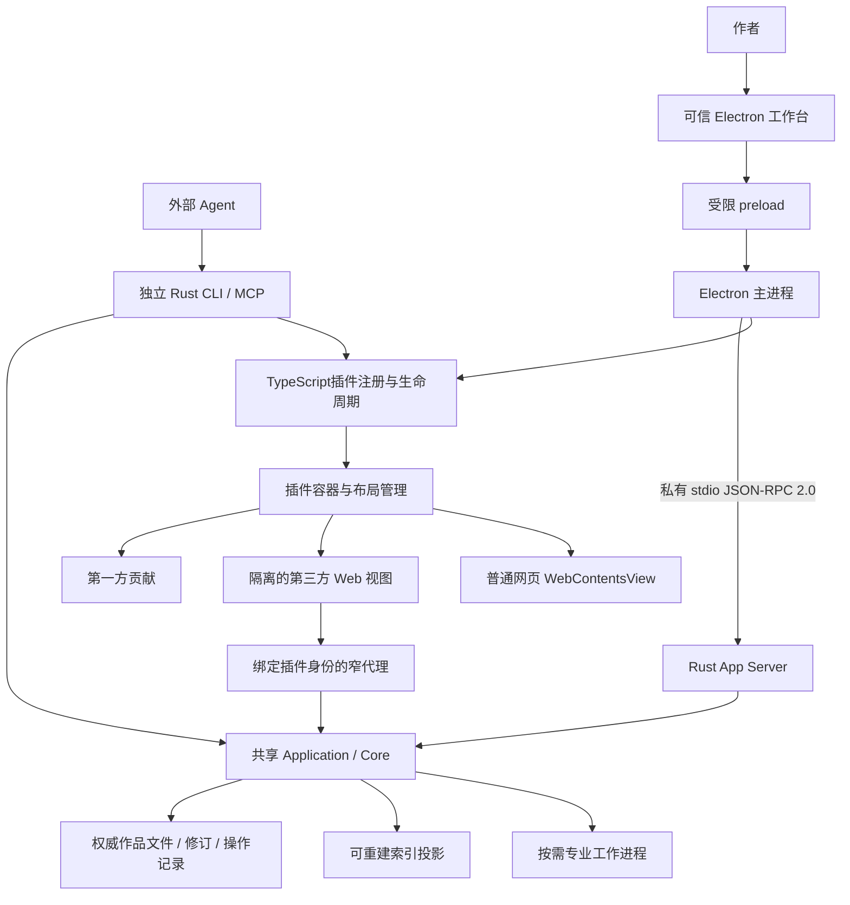
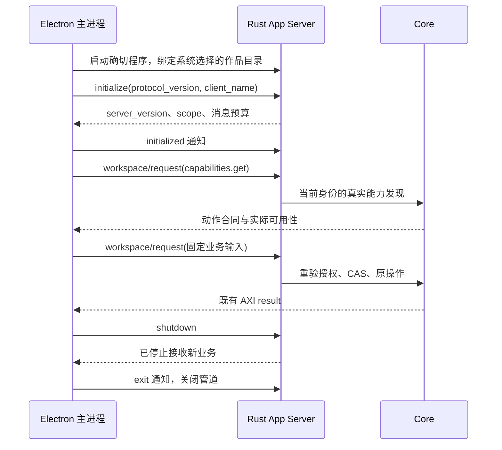
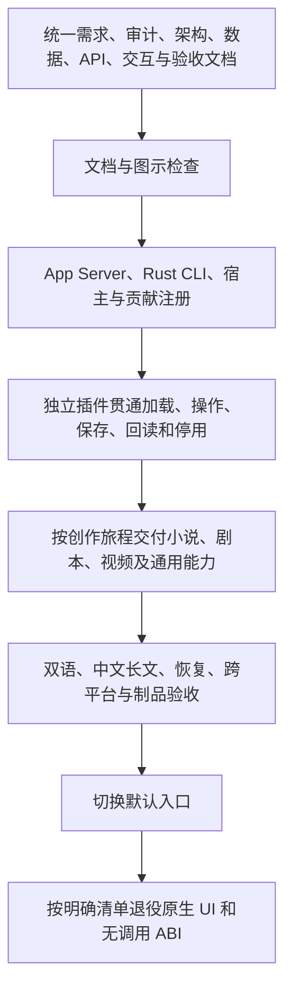

# Electron 与插件优先重构架构

决策日期：2026-11-16。本文拥有桌面重构目标、进程通信、插件宿主边界与原生退役条件；产品、领域和应用动作分别由01、28、30拥有，插件包与生态详细合同由[插件系列](plugin/README.md)拥有。实际进度归38，测试结果归20；本文中的目标接口不代表已发布能力。

## 1. 已采纳的决定

采用Electron＋TypeScript/React工作台、TypeScript插件宿主、Rust App Server、JSON-RPC 2.0私有stdio、独立CLI/MCP和受管Chromium内置浏览器。插件采用DSH风格JavaScript/TypeScript＋React，不使用Rust插件ABI。河图保持创作工作台定位，不引入 Agent Runtime、聊天或自主生成循环。

保留现有 macOS 原生版作为可运行对照和必要回退，只维护兼容、完整性和必要缺陷；新增桌面产品能力优先进入 Electron。两版复用同一 Rust Core 和作品格式，不双写、不另建作品数据库。作者确认的 Mac 工作台是 Electron UI/UX 的还原基准；布局、视觉层级、导航、阅读编辑及审核恢复分别对照，原有机器授权边界保持。

先完成本系列及所有受影响规范的一致性更新和设计检查，再继续开发。采用插件优先的纵向用例：宿主发现一个独立能力包，经授权加载、操作、保存、CLI/MCP 回读，并在停用后仍能读取和导出成果。仅做出 Electron 窗口或复刻一组原生页面，不构成重构完成。

## 2. 重新审视现有实现

现有实现的可复用基础包括作品身份、固定来源、Core 事务、CAS、原键恢复、作者决定和外部 Agent 协作合同。当前插件化缺口包括静态能力目录、固定领域包集合、硬编码 View 路由、缺少第三方 UI 加载器和插件身份、工作面缺少可撤销贡献注册。逐项源码证据与处置见[插件19](plugin/19-现有架构审计与插件优先重构.md)。

这些缺口说明更换桌面壳只是必要基础之一。不能把所有旧页面移成 React 组件后继续在 App 中增加 if/else，也不能把任意 JavaScript 注入作者页面称为插件 SDK。

## 3. 目标职责

| 层 | 拥有的责任 | 边界 |
| --- | --- | --- |
| 最小工作台宿主 | 创作库、当前作品上下文、贡献发现、布局、返回定位、任务/恢复状态和可信决定界面 | 不理解每个插件的全部业务字段，不内置聊天 |
| TypeScript插件宿主 | 包加载、依赖、贡献注册、插槽、事件和清理；按需Node后端运行时 | 不在Rust中实现组件注册和前端交互，不获得通用作者句柄 |
| 第一方创作能力 | 小说、剧本、视频审阅、设定、版本、交付等工作面及领域适配 | 按共同贡献合同注册，不凭第一方身份绕过权限 |
| 第三方插件 | 专业数据类型、动作、渲染器、方法或外部工具适配 | 只访问当前授权的对象、动作和数据投影 |
| Rust Application/Core | 身份、授权、修订、来源、事务、操作恢复、采纳和定稿 | 不依赖 React、Electron、A2UI 或某个插件市场 |
| 外部 Agent | 理解目标、选择方法、规划、生成、获权执行和返工 | CLI/MCP 独立工作，不依赖 GUI 点击 |
| 专业工具进程 | TS插件显式适配Python、Blender等工具，执行确切计算与原任务查询 | 无自主规划循环；进程分离不等于 OS 沙箱 |

“能力插件化”不要求立即把所有领域源码拆为独立 crate。先让第一方工作面通过公共贡献合同交付，用两个独立插件验证边界；仅在所有权、发布或依赖确需独立时拆分实现。

## 4. 系统与进程架构



图中的 Scoped 是插件授权边界，不能直接复用作者 `workspace/request` 通道。普通网页不连接它。Core 在各入口进程复用同一代码，文件锁、CAS 与持久操作协调并发；不要求中央后台常驻。当前入口与权限子集见[插件20](plugin/20-首期可执行合同与开发入口.md)。

### 4.1 运行单元

| 单元 | 启动者 | 权限与生命周期 |
| --- | --- | --- |
| Electron 主进程 | 操作系统／作者 | 窗口、系统选择器、已绑定作品和受管子进程；不执行模型循环 |
| 可信 renderer | 主进程 | 无 Node；preload 仅暴露明确的桌面用例 |
| Rust App Server | 主进程 | 启动时绑定明确作品；私有管道，无监听端口、无通用远程作者接口 |
| 插件 renderer | TS宿主按当前工作面创建 | 固定包摘要、贡献、WorkRef、授权和会话代次；销毁即撤销桥接 |
| 普通网页 renderer | 作者明确打开 | 独立 session，无河图业务 preload，默认拒绝权限、下载和弹窗 |
| CLI／MCP | 调用方／外部宿主 | 基础能力直接用Rust Core；TS插件动作按需启动同一Node插件运行时，均不依赖GUI |

## 5. JSON-RPC 的准确口径

JSON-RPC 标准版本为 **2.0**。本文不定义“JSON-RPC 2.1”。Codex 本地源码提交 `69231e119bfca0b14453515e97d99688ce1c47c9` 的 `codex-rs/app-server-protocol/src/rpc.rs` 明确说明省略 `jsonrpc` 字段，其业务 v1/v2 也不是 JSON-RPC 版本。河图借鉴进程分工、初始化和有类型合同，采用带 `"jsonrpc":"2.0"` 的标准信封，不宣称与 Codex wire 协议兼容。

独立管理桌面协议、逐动作 `contract_revision`、领域 Schema、插件 Host API、A2UI 协议和软件版本。stdio 使用 UTF-8 NDJSON，每行一个完整消息；首期请求和响应各上限8MiB、批量上限32条。大媒体通过受管固定引用打开，只读句柄留在Rust；可信桌面预览按最多512KiB分块传输，不将完整媒体内联进单帧。私有`media/open/read/close`及临时媒体协议遵循[插件20第19节](plugin/20-首期可执行合同与开发入口.md#19-可信媒体预览传输)，不向插件或机器管理连接开放原文件下载。预算变更需随协议版本和正负测试更新。

### 5.1 初始化与关闭



初始化前不执行业务；已关闭连接不重新激活。首期 `workspace/request` 仅给可信主进程，业务通知不执行写入。`initialize` 不接受 `mode/actor/approved` 或任意路径。业务错误留在 AXI result；解析、未知方法、版本和通道错误放在 JSON-RPC error。JSON-RPC id 关联传输，Core operation_key 关联持久业务，两者不可替代。

下例为传输设计样例；合成ID不是可执行作品引用，动作修订仍须能力发现：

```json
{
  "jsonrpc": "2.0",
  "id": "desktop-7",
  "method": "workspace/request",
  "params": {
    "action": "hetu.documents.get",
    "contract_revision": "1",
    "input": {"document_id": "doc_11111111-1111-4111-8111-111111111111"}
  }
}
```

### 5.2 超时与恢复

超时、窗口关闭和子进程退出不证明业务未提交，不自动换键重发。主进程在写请求前保存固定输入、原操作键、基线、作品及窗口身份到本机恢复区；新进程沿原动作和原键查询／重放。过期回调不得更新新 WorkRef 的视图。编辑缓冲与待恢复请求是两种状态，恢复成功不覆盖后续未保存输入。

长操作按现有任务合同接续。新增进度事件、取消与双向请求前先发布相应合同和退出语义；不因选择 JSON-RPC 就假定已有这些能力。

## 6. 插件怎样渲染

| 方式 | 实现方式 | 适用范围 |
| --- | --- | --- |
| 固定组件 | 预编译 Web 组件＋版本化数据绑定 | 中文正文、Fountain、列表、差异、审核和播放器 |
| 独立 Web 视图包 | 预构建 HTML/CSS/JS，隔离 WebContentsView 或经过验收的 sandbox iframe | 关系图、二维画布、导演台、三维和专业编辑 |
| 声明式组合 | A2UI Renderer＋获准组件目录＋绑定动作 | 动态选择、比较、表单和任务工作面 |
| 自由成果 | 固定 Markdown、HTML、图片、媒体及工程引用 | 当前作品的特殊分析、表达与交付 |
| Python／专业工具 | 受管独立执行，返回标准成果与工程 | 绘图、计算、Blender、FFmpeg 等；不是在 renderer 内执行 Python |

A2UI 描述组合，不替代插件代码、专业组件、作品数据或授权。固定组件和增量更新可以节省生成与等待；Token 成本下降后，持久作品、操作合同与反馈接续仍是产品价值。协议不适合的表达继续使用自由成果，不穷举所有 UI。

普通网页、插件视图、自由 HTML 成果和可信作者页使用不同的会话及桥接策略。所有 Web 内容默认 `contextIsolation:true`、`nodeIntegration:false`、`sandbox:true`、`webSecurity:true`；这些设置需要与来源校验、导航、CSP、权限及安装合同共同验证。不能将任意页面和第一方 React 组件一起放入作者全权限执行环境。

## 7. 工作面贡献与新的交互模型

插件标准栈为JavaScript/TypeScript＋React；贡献注册、依赖、插槽、effect和组件state在TS/Web层实现。拖拽、缩放、排序预览和渲染增量不逐次跨Rust；涉及作品读取、固定保存、外部副作用与作者决定时才调用受限SDK。Rust只暴露语言无关的业务合同。借鉴Cordis机制时固定来源、许可与版本，不把DSH的Agent模块一起引入。

宿主提供稳定的区域与有限布局原语：项目上下文、内容导航、主工作面、辅助工作面、检查器、就近反馈、任务状态。插件以稳定贡献ID声明适用对象、视图入口、动作和无障碍替代；注册返回清理句柄。侧栏和命令入口根据当前 WorkRef、套件选择、实际可用性与权限生成，不按插件数量平铺。

作者默认看到阅读、观看、比较与意见。画布、白模、时间线均可按需使用，Agent 用相同动作组织复杂状态；不要求作者先学节点或三维操作。Agent 可以准备布局提案，可信宿主验证贡献ID、范围和资源预算；布局变化不授予作品权限，也不允许生成任意 preload 或主进程脚本。

第一方小说套件先贡献卷章导航、正文阅读／编辑和差异；剧本套件贡献分集／场次和来源对照；视频套件贡献成果目录、播放和区间反馈。共享作者决定面固定成果及差异，插件提供提案和专业预览；插件内的“已批准”字段不能形成作者授权。

10/37中的任务层级和成果语义继续有效。Electron完整还原作者确认的Mac工作台布局、菜单、正文排版和交互，具体尺寸及验收见10和19；贡献模型组织扩展能力，避免把插件与全部高级操作平铺到主导航。

## 8. 数据、数据库与 API

动态贡献描述由TS宿主验证和注册；Rust应用层核验调用方绑定、范围及受管事务。二者不复制领域规则，不建立每个点击都经过TS→Rust→TS的回路。CLI/MCP对插件动作使用同一TS运行时和能力清单，不能另写一套Rust版插件逻辑。

权威目录、事务、修订和来源继续由07／29拥有，插件模型见[插件08](plugin/08-领域模型与数据设计.md)。首期检索采用可重建JSON标题投影，SQLite DDL用于后续规模评估，现行范围归[插件20第25节](plugin/20-首期可执行合同与开发入口.md#25-插件成果检索与派生索引)；Chromium profile、localStorage、React state不能成为作品事实。插件安装与本机偏好位于用户配置区，不把私有凭据、运行授权或可执行安装路径写入作品。

插件数据以 `WorkRef＋plugin_id＋object_type＋object_id` 隔离，保留 Schema、不可变修订及摘要；正文、设定、剧本或媒体的已有Owner不改变。插件通过Owner公开动作修改已有对象；专有对象由受管插件数据用例保存，不能直接写任意路径。读取他人插件对象也需声明依赖并核验本次范围。

插件管理、贡献发现、受限动作调用和对象事务的拟议动作见[插件09](plugin/09-应用API与机器协作合同.md)。GUI、CLI/MCP 与 SDK 复用这些用例，实际未登记的动作返回 unavailable；不能以插件拥有按钮代替机器入口。

CLI 的目标实现采用 Rust 薄入口，直接复用 Core／CollaborationHub；Swift CLI及原生C ABI桥接已退役，公开命令、JSON、退出码、授权和未知恢复继续由Rust入口核验。基础CLI/MCP不依赖Electron、桌面App Server或系统Node；需要TS后端贡献时，按需使用功能制品中随附且已验证的独立Node运行时，不以Electron窗口作为服务。纯视图插件不启动后端，外部Python等仅在明确工具需求下调用。不存在全局当前作品。Electron不链接Core动态库，所有桌面业务进入受限App Server。

## 9. 平台与选型约束

macOS 与 Windows 共用工作台、插件 Web 包及 Rust 协议，分别构建系统制品。macOS 目标14+ arm64，Windows目标11 x64；共用 Chromium不证明字体、输入法、GPU、编解码器、路径锁或系统权限已对齐。Windows 不新增平行 WinUI 产品路线，平台差异由窄适配承担，具体见11／12。

编辑器必须验证中文 IME、撤销／重做、选区、UTF-8 来源定位、大文稿和崩溃恢复，再冻结具体库。不能用普通 textarea 的可运行示例代替专业编辑器验收。Electron／前端／SDK的精确依赖由对应锁文件冻结，打包、签名、许可和更新责任见21，不凭外部工程版本声明河图已兼容。

## 10. 开发与退役顺序



具体工作包及状态只在[38](38-创作工作台重构执行计划.md)维护。开发期间使用隔离作品副本核对新旧入口，共用正式格式但不对真实作者稿件执行未经授权的修改。出现数据迁移时独立预演、备份和确认，不能以重建作品使兼容测试通过。

原生退役须同时具备：全部P0业务及权限用例、独立机器入口、插件完整生命周期、中文编辑、反馈及原操作恢复、标准交付、目标平台安装、性能与无障碍证据；已保存引用与历史决定保持有效。退役删除另外列明调用方、制品和文件，经明确授权执行。保留源码历史不等于继续维护两套完整产品。

## 11. 文档归属与完成检查

| 范围 | 必须反映的决定 |
| --- | --- |
| 01／02／03／04／24 | 产品需求、技术决定、进程、源码布局与 ADR |
| 10／11／12／31／32／37 | 插件优先的工作面、平台适配、中文及双语体验；原生仅作对照 |
| 05～09／15～18／25／28／29 | 保留数据与业务不变量，明确插件Owner、隔离、标准导出和恢复 |
| 13／14／23／27／30 | 标准 JSON-RPC 2.0、作者与插件通道分离、独立 CLI/MCP 与真实能力发现 |
| 19／20／21／38 | 验收门禁、实现证据、构建制品、文档先行及退役工作包 |
| 22／26／33～36／插件系列 | 创作生态分类、用例、渲染与开发者闭环，官网不伪造实现 |

研究快照、CHANGELOG和历史验收不改写为新架构证据；保留其原版本和范围。文件名中保留“原生”仅为链接兼容，其正文明确目标与对照身份，不另维护冲突的主路线。

## 12. 参考来源与适用边界

| 来源 | 采用的内容 | 未采用的推导 |
| --- | --- | --- |
| [JSON-RPC 2.0](https://www.jsonrpc.org/specification) | 请求、响应、通知、ID和错误层次 | 不把业务版本称为JSON-RPC 2.1 |
| [Electron安全建议](https://www.electronjs.org/docs/latest/tutorial/security)、[WebContentsView](https://www.electronjs.org/docs/latest/api/web-contents-view)、[contextBridge](https://www.electronjs.org/docs/latest/api/context-bridge) | 浏览器视图、会话与受限桥接机制 | 不把默认配置或子进程当完整沙箱证明 |
| Codex固定源码提交，见第5节 | App Server、协议与入口分工 | 不复制Agent业务和权限模型 |
| Lime现役源码，证据见[插件17](plugin/17-原生宿主与插件渲染技术方案.md) | Electron＋Rust接线、WebContentsView及布局生命周期 | 不复制聊天／Agent Runtime，不将Lime机制当河图验收 |
| DSH／Pi／A2UI，见[插件02](plugin/02-产品与生态调研.md) | 贡献、生命周期、按需方法与声明式渲染 | 收录数量不等于成熟创作插件数量 |
