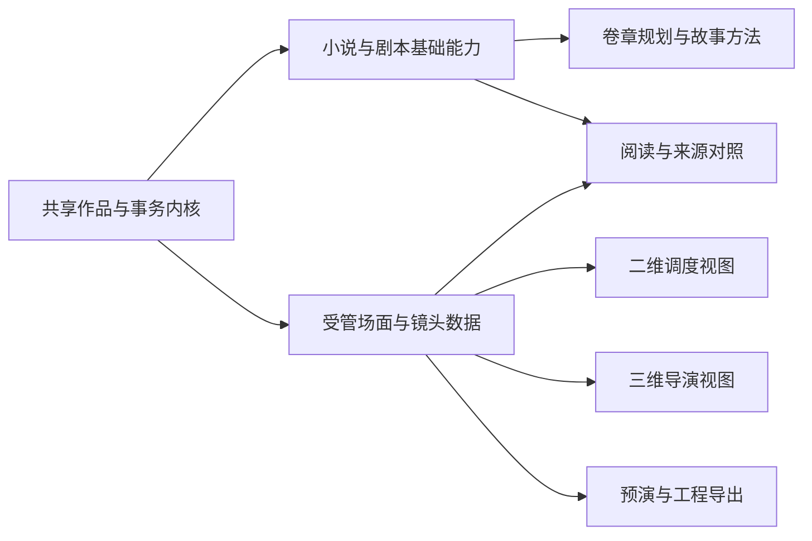

> 本文属于[创作插件体系设计](README.md)，拥有插件分类和组合规则。

# 插件分类与能力地图

## 1. 分类原则

分类用于发现能力、理解价值和管理依赖，不将菜单、题材标签或每个技术模块都变成插件。类型按创作职责划分，媒介、工作阶段、贡献方式及使用人群作为正交标签。

“小说创作工作台”“剧本创作工作台”“导演台”是面向作者的工作环境名称。分发时可以是单包，也可以是套件；内部复用相同专业能力，不因名称不同复制数据和规则。

## 2. 三种交付形态

| 形态 | 定义 | 示例 | 适用条件 |
| --- | --- | --- | --- |
| 能力插件 | 一个可独立安装、变化和验证的能力包 | 时间线、二维调度、Fountain 审阅、格式转换 |
| 创作套件 | 对已有能力的具名组合和推荐布局 | 小说写作、剧本改编、导演预演、悬疑规划 |
| 自由成果 | 某作品中的文档、页面、图表或工程 | 自定义关系说明页、研究图表、一次性比较器 |

套件不拥有第二份作品数据，也不把依赖者的权限合并。自由成果反复使用后，可以明确提炼为模板或插件；保存一个页面不要求先成为插件开发者。

## 3. 创作职责目录

| 分类 ID | 类型 | 能力示例 | 主要使用者 | 典型交付 |
| --- | --- | --- | --- | --- |
| PCAT-01 | 小说工作面 | 中文长文、卷章导航、正文大纲对照、写作进度 | 小说作者 | Markdown 正文、目录和固定修订 |
| PCAT-02 | 剧本工作面 | 分集场次、对白、原著对照、剧本格式 | 编剧、改编者 | Fountain、场次及来源引用 |
| PCAT-03 | 故事结构 | 构思、总纲、节拍、人物弧光、冲突、伏笔回收 | 作者、编剧 | 结构对象和解释文档 |
| PCAT-04 | 世界与设定 | 人物、组织、地点、物品、规则、历法、历史 | 世界构建者 | 专业对象与固定依据 |
| PCAT-05 | 关系与时空 | 人物关系、家族谱、势力图、事件线、行程、地图 | 作者、编剧 | 共享对象的图谱与时间视图 |
| PCAT-06 | 导演调度 | 二维站位、三维布景、朝向、走位、机位、焦距 | 导演、短剧作者 | 场面工程、相机和调度修订 |
| PCAT-07 | 分镜与预演 | 镜头卡、镜头表、animatic、白模、节奏核对 | 导演、分镜师 | 分镜、预演视频、时间映射 |
| PCAT-08 | 人物与美术资产 | 形象、服装、表情、地点、道具、美术参考板 | 美术、创作者 | 候选、图组、固定选用与使用引用 |
| PCAT-09 | 声音与表演 | 朗读、对白试演、配音、音乐、音效、字幕时机 | 编剧、声音创作者 | 实际声音文件及时间关系 |
| PCAT-10 | 剪辑与成片组织 | 片段编排、音画、字幕、转场、代理与工程接续 | 视频创作者 | 剪辑工程、媒体和映射清单 |
| PCAT-11 | 资料研究 | 摘录、文献、采访、考据、来源、素材整理 | 全部创作者 | 可定位资料及引用记录 |
| PCAT-12 | 阅读与审核 | 连贯阅读、对照、版本差异、区域与区间意见 | 作者、审阅者 | 固定成果、意见和决定引用 |
| PCAT-13 | 检查诊断 | 时间冲突、出场、设定矛盾、连续性、交付缺项 | 作者、制作人员 | 证据、覆盖范围和疑点候选 |
| PCAT-14 | 导入与交付 | TXT/Markdown/DOCX/EPUB、Fountain、PDF、媒体工程 | 全部创作者 | 固定输入、损失报告和标准交付 |
| PCAT-15 | 方法与风格 | 题材方法、结构模板、视角、悬疑、喜剧、个人方法 | 方法作者、创作者 | Skills、模板、参考和示例 |
| PCAT-16 | 自由表达 | HTML、Markdown、图表、交互工具、程序输出 | 需要特殊表达者 | 可保存、反馈和导出的成果 |
| PCAT-17 | 工具与服务适配 | Blender、FFmpeg、Remotion、资产库、模型渠道 | 专业创作者 | 固定任务、实际成果与工具回执 |
| PCAT-18 | 个人工作环境 | 布局、主题、键盘、专注、辅助阅读 | 全部创作者 | 个人偏好与可访问替代 |

该表穷举本轮确认的主要职责类别，不声称穷尽所有未来媒介、流派和能力。发布平台运营不在本系列范围。

## 4. 标签与贡献类型

| 维度 | 允许表达的内容 | 不应据此推断 |
| --- | --- | --- |
| 作品适用范围 | novel、drama、video，可多选 | 不自动跨对象读取或创建空上游 |
| 阶段 | 研究、构思、组织、写作、预演、制作、审阅、交付 | 不构成强制流水线 |
| 贡献 | data、actions、views、skills、templates、adapters | 不要求每包全部具备 |
| 表现 | 文档、表格、卡片、关系、时间、地图、二维、三维、媒体 | 不代表不同数据 Owner |
| 使用方式 | Agent 操作、作者审阅、作者手动、专业编辑 | 不自动获得作者决定权 |
| 来源 | 随软件、社区、团队、本地开发 | 不代表已验证或权限更大 |
| 许可与费用 | 包许可、素材许可、购买方式、服务计费 | 不等同于作品权利 |

题材、平台、频道和标签保留独立来源。单纯题材差异优先使用方法、模板与套件，不复制数百套几乎相同的代码和 Skills。

## 5. 默认套件组合

| 套件 | 默认工作面 | 按需加入 | 可省略内容 |
| --- | --- | --- | --- |
| 小说创作 | 卷章、正文、设定、审阅 | 伏笔板、时间线、关系图、研究板 | 导演、剪辑、三维 |
| 剧本创作 | 分集场次、对白、审阅 | 原著对照、节拍板、二维调度、试演 | 小说、复杂三维 |
| 导演预演 | 镜头目录、预演、意见 | 二维站位、三维导演台、声音时机 | 正文写作、真实生成 |
| 视频制作 | 资产、片段、音画和成片审阅 | 外部剪辑适配器、字幕、工程交付 | 小说和剧本前置项目 |
| 悬疑规划 | 小说或剧本基础套件 | 时间线、线索板、揭示与回收方法 | 专门复制一套编辑器 |

默认套件可以随包提供推荐组合，作者或 Agent 准备修改方案后明确选择。切换套件只改变工作面和可用贡献，不移动内容或替换定稿。

## 6. 依赖与归属

依赖声明的是需要的合同和版本。二维与三维视图共用场面 Owner，不能独立保存两套人物站位；相机、时间映射与工程修订属于制作数据，不反写剧本对白。

## 7. 插件化判定

满足独立价值、变化边界和可验证合同后，再判断适合哪种交付形态。一个页面视觉复杂，不足以证明需要新插件；一个无界面的格式适配器也可能值得独立交付。

评审依次核对：服务谁、完成什么任务、拥有什么数据、有哪些实际动作、作者如何看懂结果、如何接续与退出、复用是否能降低总成本。没有明确任务的“万能插件”不进入首批范围。
