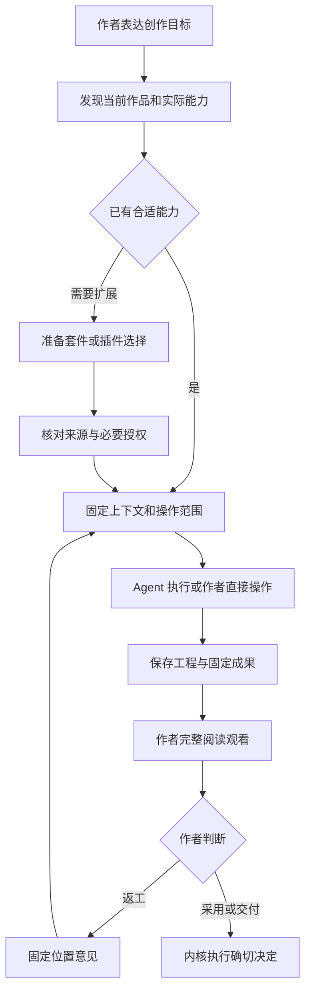

> 本文属于[创作插件体系设计](README.md)，拥有用户故事和用例编号。

# 用户需求故事与用例

## 1. 用户角色与交互原则

作者可以是普通写作者，也可以是愿意手动操作的专业创作者；同一个人在不同任务中会切换角色。外部 Agent 是获权执行者，不是作品决定者。插件开发者、方法提供者与索引维护者不因分发能力获得作品读取权。

每个用例应能回答：用户表达什么目标；机器实际做什么；软件展示什么；作者决定什么；失败后沿什么引用继续。纯手动路径独立可用，不自动触发模型调用。

## 2. 用户故事

| 编号 | 角色与需求 | 可观察收益 | 用例 |
| --- | --- | --- | --- |
| PUS-001 | 作者只想开始写作，按场景选默认套件 | 不必逐个理解专业插件 | PUC-001 |
| PUS-002 | 作者希望安装能力前看懂来源和用途 | 明确引入哪些代码、依赖和费用 | PUC-002 |
| PUS-003 | 作者让 Agent 整理卷纲并比较方案 | 不重复填表，保留取舍空间 | PUC-003 |
| PUS-004 | 编剧希望独立创作并按需对照原著 | 不建空小说，不复制对白 | PUC-004 |
| PUS-005 | 导演希望通过语言调整机位和走位 | 能看到空间结果并继续修改 | PUC-005 |
| PUS-006 | 作者希望关系图、时间线与正文关联 | 多种表达围绕同一对象工作 | PUC-006 |
| PUS-007 | 作者需要一个当前作品专用的交互页面 | 特殊表达无需产品预先穷举 | PUC-007 |
| PUS-008 | 作者希望自己的手动修改不会被覆盖 | Agent 可以继续工作且冲突可处理 | PUC-008 |
| PUS-009 | 审阅者希望意见精确绑定成果位置 | 返工能找到原问题和对应版本 | PUC-009 |
| PUS-010 | 创作者希望预演或生成超时后继续原任务 | 不重复付费或丢失结果 | PUC-010 |
| PUS-011 | 作者希望升级插件时保留旧工程 | 迁移可预览、失败可恢复 | PUC-011 |
| PUS-012 | 作者停用插件后仍能读取和交付作品 | 能换工具且不丢成果 | PUC-012 |
| PUS-013 | 开发者希望通过公开接口交付小能力 | 无需修改内核或私有数据库 | PUC-013 |
| PUS-014 | 方法作者希望发布技能和模板 | 能独立交付且与现有工具组合 | PUC-014 |
| PUS-015 | 作者希望换 Agent 后继续当前作品 | 不依赖旧聊天和全部重述 | PUC-015 |
| PUS-016 | 索引维护者希望公开分发可靠版本 | 收录与验证有可检查的区别 | PUC-016 |

## 3. PUC-001 选择套件与进入工作面

前置：已打开或经现有机器入口建立一个具体作品。作者可以从“我要写小说”这样的目标开始，无需预先选择整套流程。

主流程：Agent 或作者查看适用套件 → 准备明确的贡献选择 → 展示用途、依赖与权限 → 作者作必要选择 → 绑定当前 WorkRef → 打开内容工作面。套件推荐只改变选择，不暗中安装或授权。

结果：作品身份、内容和定稿保持；新增工作面可达，未安装能力有明确状态。异常：依赖不兼容时保留已有界面并指出具体能力，不能退回全库权限。

## 4. PUC-002 发现与安装插件

前置：已知来源或可浏览索引，索引内容不含作品秘密。

主流程：检查包元数据和确切版本 → 计算依赖、许可、代码来源与新增能力 → 展示安装方案 → 在有效安装授权内执行 → 返回已安装和实际激活状态。包标识、摘要与权限变化均需核对。

异常：下载失败不改变现有活动版本；包已安装但未激活时显示原因；安装响应丢失沿原操作查询。安装不等于作品启用，更不等于 Agent 获权。

## 5. PUC-003 卷章规划与故事结构

前置：当前小说及明确可用的正文、设定或构思引用。

主流程：作者提出“把这一卷的中段冲突提前” → Agent 读取所需摘要和片段 → 准备结构候选 → 插件展示卷章、转折与人物线 → 作者比较并提意见 → Agent 沿原任务返工 → 作者明确采用所选结构。

结果：规划引用固定正文基线，结构采用不修改正文定稿。异常：目录变化时标出影响，原候选仍可读；作者不需要重新填写 Agent 已整理的字段。

## 6. PUC-004 独立剧本与来源对照

前置：原创剧本或有明确获权来源的改编任务。

主流程：Agent 准备分集与场次参考稿 → 剧本工作面按行动和对白阅读 → 有来源时显示固定原著对照 → 作者表达改编取舍 → 返工、采纳及独立定稿。

异常：来源撤权时仅保留允许的已固定记录，不跨对象继续读原著；没有小说来源的原创剧本正常可用。剧本插件不能取得另一部作品的管理权。

## 7. PUC-005 导演调度与预演

前置：视频或制作任务，已固定场次或制作简述及人物、场景引用。

主流程：Agent 准备场面工程 → 作者查看二维站位、三维构图和镜头表 → 作者说“第二镜从女主肩后拍男主，站位保持” → Agent 调整指定相机 → 插件计算并生成新预览 → 作者比较、提意见或手动微调。

结果：二维与三维使用同一场面修订；镜头、预览和反馈可定位。异常：预览失败保留工程和旧预览；对白时长检查注明测量或估算依据；白模不能证明最终表演或模型会严格复现。

## 8. PUC-006 同对象多视图

前置：有获权对象与明确数据 Owner。

主流程：作者在表格、关系图、时间线或场面视图间切换 → 通过 Owner 的动作修改属性或关系 → 各视图消费同一提交结果 → 布局和筛选作为个人偏好保存。

异常：某视图无法表现新字段时保留字段并提示；不能把布局坐标误当人物站位，不能按显示名称合并角色。

## 9. PUC-007 自由成果与临时工具

前置：作者表达当前问题，已有内容读取范围。

主流程：Agent 准备 Markdown、交互 HTML、图片或程序输出 → 按固定字节和版本提交 → 宿主选择合适渲染器 → 作者阅读、操作或提意见 → 页面修改经受限桥接形成新成果修订。

异常：脚本、远程资源和本机文件访问不自动允许；页面没有写入合同就作为只读成果。常用成果可以提炼成模板，原成果身份与历史不变。

## 10. PUC-008 手动与 Agent 并发编辑

前置：作者有未保存缓冲，Agent 基于已知修订准备改动。

主流程：Agent 提交基线与局部操作 → 内核检测冲突或成功提交 → 界面保留未保存稿 → 作者查看差异并决定如何合并 → 新请求绑定新基线。

异常：不可静默用最新修订重放旧补丁；同操作键同输入查询可恢复，异输入拒绝。作品偏好变动不制造正文冲突。

## 11. PUC-009 固定位置意见与返工

前置：作者正在查看一个确切成果版本，可查看 Agent 未标记的位置。

主流程：选择文字、图元、图片区域或媒体区间 → 保存明确公开范围的意见 → 返回持久反馈引用 → 通过真实宿主能力请求继续，或复制精简交接 → Agent 回读意见并提交新成果。

异常：旧版坐标不能静默套新版；意见保存、宿主受理和实际返稿分别显示。表达“这张更好”只记录选用意图，不自动等于正式采纳或定稿。

## 12. PUC-010 异步任务与未知结果

前置：固定预演、导出或获批生成计划。

主流程：提交原操作 → 获取任务引用 → 查询阶段和已产生文件 → 校验完成成果 → 作者观看和审核。

异常：连接断开或提供方超时保留 unknown；沿原计划和提供方任务查询，不换键重发；本机进程取消和外部计费取消分别说明。

## 13. PUC-011 升级与数据迁移

前置：明确包版本、摘要及依赖图。

主流程：准备升级 → 检查在途任务与数据兼容 → 暂存验证新代码 → 有迁移时展示影响及固定副本 → 明确执行 → 发布新活动版本与迁移修订 → 回读验证。

异常：代码切换前失败保留旧版本；数据已提交后代码回退也不能假装数据自动回退。旧任务固定原合同，必要时保持只读或交接。

## 14. PUC-012 停用、卸载与交付

前置：明确受影响作品、依赖者和在途操作。

主流程：准备影响说明 → 停止新任务 → 排空或取消可取消工作 → 清理注册和进程 → 保留对象、固定预览和导出 → 按明确选择卸载包代码。

异常：正在外部运行的操作保留恢复记录；重新安装不恢复已撤销授权。项目删除另行核对，不附带于插件卸载。

## 15. PUC-013 开发与安装小插件

开发者基于公开 SDK 声明一个贡献 → 使用示例作品和受限开发环境 → 验证数据、动作、视图和清理 → 明确安装本地包 → 通过实际 GUI 与机器旅程 → 形成版本化交付。开发过程由外部 Agent 辅助也遵守相同入口，不能靠修改内核私有文件补齐功能。

## 16. PUC-014 发布方法与模板

方法作者提供中文方法、示例和来源 → 声明适用任务及依赖动作 → 验证不存在权限扩张或隐式外发 → 打包为轻量能力 → 创作者按所选 Agent 安装需要的部分。没有可执行代码时不引入工作进程；方法不能覆盖宿主与内核规则。

## 17. PUC-015 换 Agent 与离线接续

当前 Agent 保存确切任务、成果和待处理事项 → 新 Agent 经作者精确授权发现当前能力 → 读取固定目录和所需片段 → 沿原操作继续。离线时可阅读编辑已有成果，缺外部能力明确显示；不要求上传全书或恢复旧聊天。

## 18. PUC-016 索引收录与版本验证

维护者从明确公开来源收集包 → 校验元数据与版本 → 在隔离环境执行相应验证 → 发布绑定摘要与宿主版本的结果 → 索引引用确切安装来源。仓库存在、声明兼容、安装成功、运行通过和创作场景通过各有独立证据，索引不能代为授予本机安装权。

## 19. 端到端业务流程

逐需求追踪与验收由[15](15-测试验收与追踪矩阵.md)维护。
