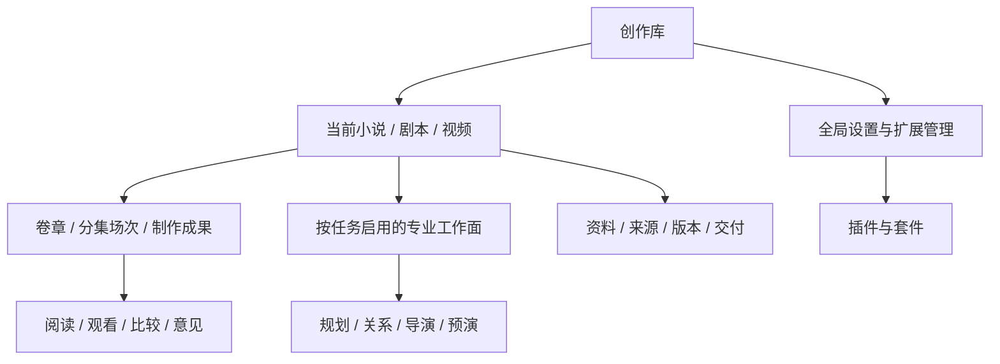

> 本文属于[创作插件体系设计](README.md)，负责作者工作面与交互状态。

# 信息架构与交互设计

## 采用条件

专业入口就近出现，正式内容、完整阅读和意见优先；参数与过程按需展开。 产品定位与分流以[01](../01-产品需求PRD.md#1-产品定义)为准。

## 1. 体验目标

作者首先看到当前作品、可以阅读观看的成果及下一步意图入口。复杂工具有足够操作深度，但不成为每位作者的入门课程。愿意手动操作的人可以展开专业编辑器，选择由 Agent 操作的人也能核对完整结果。

机器操作、作者审阅、专业手动编辑三条路径消费相同对象与修订。界面中的“让 AI 处理”交接到外部 Agent，不在河图中增加聊天面板或生成循环。

## 2. 信息架构

新增工作面不自动增加一个顶层作品。导演台属于当前制作任务；人物关系图属于明确作品的设定或分析范围。作品类型、插件类型和显示布局是三个不同维度。

## 3. 工作面公共结构

工作面、导航和命令由当前WorkRef、套件、已注册贡献和实际权限解析。宿主提供有限区域与可信决定容器，插件声明适用对象及入口；新专业能力不修改主App页面分支。第一方小说/剧本/视频也遵守此合同，旧原生页面仅作任务语义参考，不按像素或逐步人工流程复刻。

| 区域 | 内容 | 交互要求 |
| --- | --- | --- |
| 对象上下文 | 当前作品、内容对象、修订及返回位置 | 持续可见，禁止隐式切换全局当前作品 |
| 任务目录 | 当前卷章、场次、镜头或成果 | 适配工作面，支持收起与键盘定位 |
| 主内容 | 连贯阅读、播放、比较或专业编辑 | 优先可理解结果，不以参数表替代成果 |
| 就近反馈 | 选区、图元、区域或区间意见 | 显示目标版本，私密与公开范围明确 |
| 按需检查器 | 来源、属性、依赖、历史和技术细节 | 渐进展开，不强制阅读内部字段 |
| 外部 Agent 交接 | 当前目标、允许范围和实际能力 | 固定引用；复制回退与真实宿主消息区分 |

## 4. 交互深度

| 层次 | 作者主要任务 | 示例 |
| --- | --- | --- |
| 结果层 | 看懂、比较、表达意图 | 阅读卷规划；播放镜头；指出遮挡 |
| 轻操作层 | 当前成果的直接调整 | 排序、改标题、拖动一个人物、切换镜头 |
| 专业层 | 精确编辑与工程控制 | 相机路径、三维布景、多轨音画、属性批量编辑 |

用户可直接进入专业层；层次表示默认暴露程度，不是角色等级或许可等级。隐藏参数不扩大 Agent 的执行权，展开检查器也不改变作者授权。

## 5. 三类试点工作面

### 5.1 卷章规划

默认由卷章目录与连贯规划内容组成，按需展开转折、人物线和伏笔。自由说明保留 Markdown，能被程序操作的结构引用使用稳定字段。作者可以直接选择一段提出修改，不必维护所有字段。

### 5.2 剧本阅读与来源对照

主视图按分集、场次、行动和对白连续呈现。原著对照是可选模式，来源固定版本且需另获权。镜头制作说明属于下游制作对象，避免修改制作安排时意外改写剧本。

### 5.3 导演与预演

同一场面可显示二维站位、三维构图、镜头表和预演。切换视图保持人物、镜头选择和工程修订；只有视角、缩放、面板布局等偏好可按用户分开保存。作者可以先观看结果，再进入布景操作。

## 6. 扩展管理

插件页展示“已安装、可用套件、发现来源、开发模式”。作品内只显示当前适用且启用的能力；全量插件目录不进入每个工作区侧栏。

安装详情展示用途、作者、来源、版本、摘要、依赖、系统支持、权限、收费和验证范围。普通作者首先看到任务用途；许可证、合同版本和诊断可展开。Agent 准备安装方案后，作者查看确切方案，无需重复输入包名和参数。

安装、启用、作品使用、Agent 可调用性分别显示。插件已安装但依赖缺失时，不使用一个笼统“成功”状态掩盖不可用能力。

## 7. 页面状态矩阵

| 状态 | 作者可见内容 | 可执行操作 | 机器回读 |
| --- | --- | --- | --- |
| 未安装 | 用途、来源、兼容与替代路径 | 准备安装或继续基础工作面 | unavailable 与原因 |
| 已安装未启用 | 保留成果和启用说明 | 明确启用或卸载 | installed / disabled |
| 无数据 | 当前对象的起步目标 | 让 Agent 准备或手动创建 | 空列表与读取成功分别表达 |
| 加载或处理中 | 当前阶段、旧成果、可恢复引用 | 可取消时取消，继续其他工作 | running 与进度 |
| 部分可用 | 可用贡献与缺失依赖 | 使用可用部分或修复 | degraded 与逐项原因 |
| 冲突 | 基线、当前与未保存内容 | 比较、重做或明确合并 | conflict，不自动重放 |
| 结果未知 | 原任务与最后已知状态 | 查询原操作 | unknown，不返回成功默认值 |
| 不兼容 | 原数据、固定预览和导出 | 选择兼容版本或准备迁移 | incompatible 与合同版本 |
| 撤权 | 已允许作者读取的本地成果 | 重新准备授权或退出 | 后续请求拒绝 |
| 成功 | 确切新修订和差异 | 阅读、反馈、采用或交付 | 可验证回执 |

## 8. 空间与可访问性

原生框架负责中文输入法、长文编辑、键盘和系统辅助功能。嵌入式工作面声明焦点进入退出方式、键盘动作和可访问名称。关系图、时间线、三维场景提供对象列表与结构化选择路径。

窄窗口可收起目录和检查器，当前对象、关键状态和反馈入口仍可达。用户布局随个人保存，不写入作品定稿。中英文由稳定文案键提供，显示名称不作为业务 ID。

## 9. 交接与回退

交接包只包含当前目标、固定成果引用、公开意见引用、可执行动作摘要与恢复位置。内容引用不等于授权；新 Agent 仍需精确获权。

宿主不支持消息或 Apps 时，复制同一交接继续；插件无图形界面时通过结构化结果和受管预览审阅；插件缺失时通过基础阅读器及标准成果继续。各回退路径不创建第二套业务记录。
