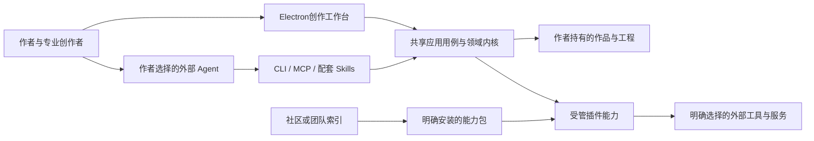
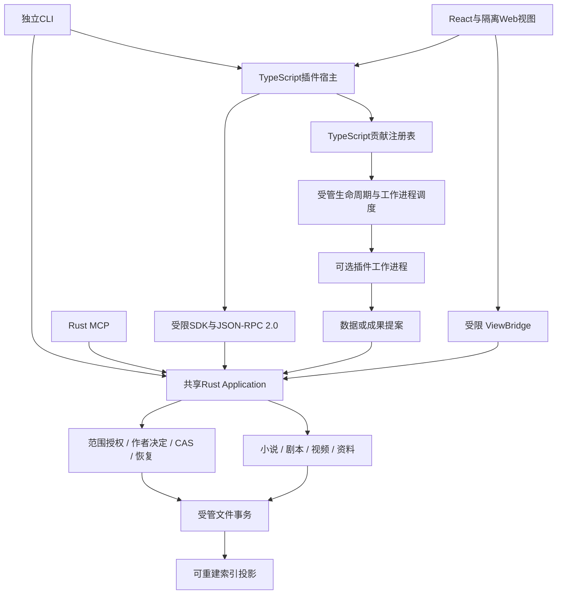
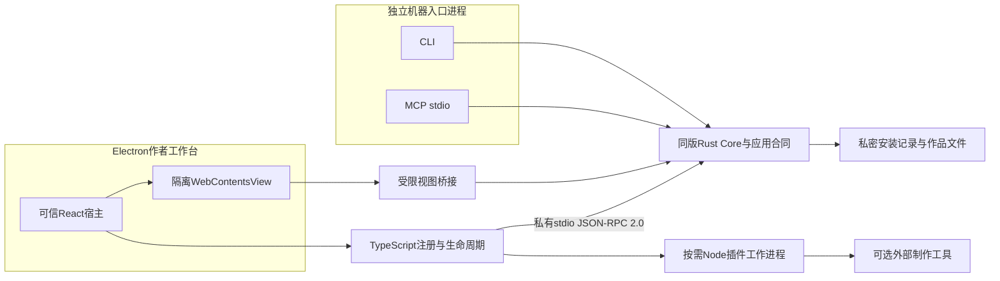

> 本文属于[创作插件体系设计](README.md)，负责拟议架构、技术选择与运行边界。

# 总体架构与技术选型

## 1. 现有基础与新增职责

已采纳Electron＋TypeScript/React工作台、TypeScript插件宿主和Rust Core，见[主39](../39-Electron与插件优先重构架构.md)。原生版保留历史业务与数据证据，专属源码及构建已退役，差距见[19](19-现有架构审计与插件优先重构.md)。插件使用DSH风格JavaScript/TypeScript与React，注册、依赖、插槽及生命周期留在TS，不要求Rust插件或native动态库。

TypeScript宿主的拟议模块为PluginRegistry、PluginSupervisor、ContributionRegistry、ViewBridge和PackageResolver；Rust拥有授权、受管事务和恢复。它们是职责名称，不表示同名源码已经存在。第一方基础能力与外部分发能力使用相同贡献合同；底层授权、修订和作者决定始终由内核执行。

已采纳Cordis承接TS运行时依赖注入与生命周期机制，公共SDK、包格式和作品格式仍由河图拥有。源码当前自有注册基线与迁移、许可、自主维护和DSH兼容等级统一见[26](26-Cordis采用与DSH兼容边界.md)；不要求每个专业插件自行建立框架容器。

河图插件由河图安装和运行。Codex等外部Agent经稳定CLI／MCP动态查询及调用，不需要为每包安装客户端插件或新增工具名。接入包负责基础方法与连接，专业插件负责创作能力，二者不共用安装生命周期。实时能力、核心格式与热插拔时序归[21](21-核心格式与动态能力发现.md)。

原生＋系统WebView仅作为[17](17-原生宿主与插件渲染技术方案.md)的备选研究，不并行建设。新UI按贡献模型重审，不将固定原生页面逐一翻译成React。

下图描述目标职责，实际进度归主20/38。Rust不处理组件注册、拖拽、缩放和局部渲染；跨语言仅承载获权作品读写、事务及明确计算边界。

## 2. 系统上下文图

## 3. 组件架构图

插件工作进程返回提案或成果引用，不能直接推进 Core 的正式指针。ViewBridge 只代理当前视图声明且当前上下文允许的动作，不传递通用作者句柄。

## 4. 运行与进程图

该图表达逻辑组件，共享 Core 可以分别加载于各入口进程；不要求一个常驻中央服务。跨进程一致性由受管文件锁、操作记录与 CAS 保证。进程级注册与本机持久安装状态分开，单个入口退出不删除作品或原操作。

## 5. 模块职责与依赖

| 模块 | 责任 | 禁止承担 |
| --- | --- | --- |
| PackageResolver | 固定来源、版本、依赖和摘要，准备安装方案 | 执行作品内声明的任意脚本 |
| PluginRegistry | 本机已安装包、活动版本、验证结果和安装原操作 | 保存第二份正文或作品权限 |
| ContributionRegistry | 版本化数据、动作、视图和方法描述 | 以名称冲突覆盖内核动作 |
| PluginSupervisor | 启停、超时、清理、工作进程和可用性 | 自主规划、生成循环或暗中重试计费 |
| ViewBridge | 视图会话、对象投影、选择与获权动作 | 任意文件、Shell、全库或作者角色代理 |
| 领域与存储 | 内容 Owner、不变量、修订和恢复 | 依赖某个视图引擎或插件商店 |

纯方法和静态资源包不启动工作进程。已有内置专业功能可先作为受管贡献提供，再按实际独立变化需要拆包，避免为了形式统一大规模搬代码。

## 6. 技术选型矩阵

| 议题 | 建议方案 | 理由与代价 | 备选与准入条件 |
| --- | --- | --- | --- |
| 共享规则 | 继续 Rust Application/Core | 复用授权和事务；增加注册合同测试 | 不另建 JS 业务内核 |
| 长文与系统交互 | Electron 原型验证 Web 编辑器及系统适配；保留现有原生实现作对照 | 统一前端有复用收益；中文输入与现有行为有迁移成本 | 无法满足采用条件时回到原生备选，不宣称直接复用 NSTextView |
| 自定义二维/三维视图 | 静态 Web 资源包进入受控 Chromium 插件容器；原生路线为备选 | 复用 Web 图形生态；桥接、焦点和 GPU 资源需要验证 | 外部专业工程可独立贡献，不强制实现完整 DCC |
| 插件技术栈 | JavaScript/TypeScript＋React，TS宿主负责注册、依赖和清理 | DSH风格；SDK不暴露Rust类型 | 第三方不进入作者全权限进程 |
| 依赖与生命周期 | 已采纳Cordis，由宿主内部适配 | 复用服务组合与资源释放；精确依赖由实施锁文件固定 | 不自动兼容DSH；维护和退出准入见26 |
| 插件后端 | 按需Node插件进程，JSON-RPC 2.0与受限SDK | 桌面与CLI/MCP共用TS运行时，OS权限另验 | Python/Blender是外部工具适配，不是首期插件语言合同 |
| 数据合同 | JSON Schema 2020-12＋版本化描述 | 与现有 Schema 路线一致；需生成和校验工具 | 文档样例不直接成为发布合同 |
| 持久化 | 文件权威＋可重建索引；首期JSON标题投影，SQLite待规模评估 | 支持备份、版本和退出；多文件事务需恢复 | 不增加必装数据库服务 |
| 画布 | 先用适合试点的成熟库做验证 | 避免重造基础图元与选择机制 | Excalidraw 可研究；tldraw 先核验商业许可 |
| 三维 | Three.js 类 Web 引擎原型或 Blender 适配 | 前者便于内嵌，后者专业深度高 | 由场面合同、性能、许可和导出实验决定 |
| 渲染与转换 | 外部明确版本的 FFmpeg、Blender、Remotion 等适配 | 复用成熟工程；安装、资源和许可各自核验 | 不捆绑未经验证的全套工具链 |
| 动态 UI | 优先验证 A2UI 1.0 与插件领域组件目录 | 复用公开协议和原生适配，组合与实现分离 | 先核验 macOS 与领域组件；不以私有 UI 协议或迁移主编辑器为前置 |
| 分发 | 本地包、固定 Git/npm 来源、静态索引 | 先验证供需，无需中央交易后台 | npm 包只作为来源，安装脚本不默认执行 |

Three.js、SQLite、工作进程协议及 A2UI 桥接均为新能力的拟议选择，不是现有依赖声明。落库前核验许可证、具体版本、打包与目标平台；不在文档中虚构版本号。

## 7. 扩展点与状态一致性

贡献采用稳定 ID 和显式依赖，依赖图必须无环。注册返回可撤销句柄；取消注册阻止新调用，在途任务按既定策略排空、取消或保留恢复位置。一个贡献失败只使自己及依赖者不可用。

动作声明包含输入输出、effect、所需权限、范围、限额与恢复语义。视图通过对象固定引用订阅受管变更；通知只说明有新修订，读取仍逐次授权，不能把事件总线当成全库订阅。

## 8. 技术验证顺序

先以无工作进程的卷章规划贡献验证对象、动作与视图；并行使用版本审阅小原型验证 A2UI与Web领域组件的适配，不先造完整私有 UI 协议。再以导演预演验证工作进程、三维、媒体和长任务，随后验证第二位开发者不导入内部源码也能完成小扩展。多进程调度、在线目录和动态工作面范围依据实际需求扩大。

各阶段通过条件见[14](14-首批插件与实施路线.md)，取舍与重审条件见[16](16-架构决策与风险登记.md)。
