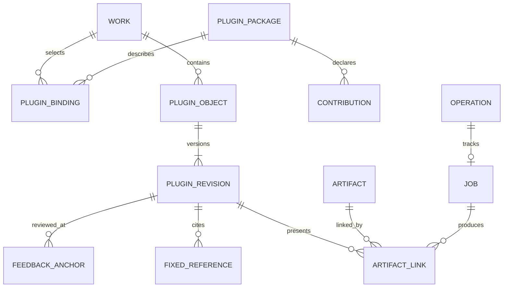
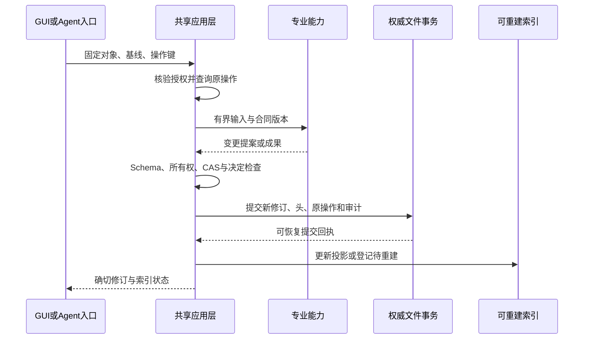

> 本文属于[创作插件体系设计](README.md)，拥有新增扩展数据的语义与数据库设计。

# 领域模型与数据设计

## 1. 既有数据约束

已有 WorkRef、SourceRef、Revision、Task、Review、Resource 与 Video 对象继续遵循[主数据合同](../29-数据字典与Schema设计.md)和 `contracts/`。WorkRef 使用现有 `workspace_id, kind, object_id`，不重新定义顶层作品类型。

核心格式索引及版本规则归[21](21-核心格式与动态能力发现.md#2-最小核心格式)。它区分当前实现的格式与下文拟议扩展模型；运行时能力是安装状态和精确授权的投影，不是另一份插件功能数据库。河图插件安装记录与外部Agent接入包记录属于不同Owner。

作品文件是权威，索引是可重建投影。首期使用[插件20第25节](20-首期可执行合同与开发入口.md#25-插件成果检索与派生索引)的JSON标题元数据缓存；本文SQLite设计用于后续规模评估。安装与授权属于私密本机状态，既不从作品目录恢复权限，也不进入作品 Git 或导出。本文的新目录与字段为拟议合同，不能由 Agent 直接写入当前作品。

## 2. 数据 Owner

| 对象 | Owner | 权威位置 | 是否随作品交付 |
| --- | --- | --- | --- |
| 正文、对白、正式设定及作者决定 | 既有 Core 领域 | 现有受管文件 | 按确切交付范围 |
| PluginInstallation、活动包版本 | 本机扩展管理 | 私密安装记录 | 否 |
| PluginGrant、视图短期会话 | 本机可信授权管理 | 私密授权存储 | 否 |
| PluginBinding | 当前作品中的扩展绑定 | 新受管扩展文件 | 可交付，不代表执行授权 |
| PluginObject、PluginRevision | 声明的专业数据 Owner，经 Core 受管写入 | 新受管不可变修订 | 是 |
| Artifact | 既有资料或制作资产 Owner | 受管原字节与成果引用 | 按选择交付 |
| ViewPreference | 本机用户 | 个人偏好 | 默认否 |
| 操作与长任务记录 | Core 应用操作管理 | 既有恢复及审计体系的扩展 | 交付仅含必要脱敏投影 |
| 插件索引 | Core派生投影；首期JSON，SQLite待规模评估 | 可丢弃缓存 | 否 |

PluginBinding 声明该作品使用或推荐的能力，不让打开他人项目自动安装或运行代码。

## 3. 核心实体与关系图



图中的包和安装记录处于本机管理域；作品引用包的标识与版本要求，不建立跨私密库的数据库外键。反馈、媒体和操作复用既有 Owner，不因 ERD 出现概念而重复建一套正文或媒体表。

## 4. 字段字典

| 类型 | 必需字段 | 约束 |
| --- | --- | --- |
| PluginPackageRef | `plugin_id, version, package_sha256` | 标识稳定，代码版本与确切字节同时固定 |
| PluginBinding | `binding_id, work_ref, plugin_id, required_contract, enabled_contributions` | 不能含秘密、作者批准或自动执行脚本 |
| PluginObject | `object_id, work_ref, owner_plugin_id, object_kind, current_revision, current_sha256` | 组合身份唯一，当前头由 Core 推进 |
| PluginRevision | `object_id, work_ref, owner_plugin_id, revision, schema_version, sha256, content, source_refs, created_at` | 内容不可变；父修订写入同一记录；摘要不包含自身 sha256 字段 |
| FixedReference | `owner_ref, kind, id, revision, sha256` | 引用使用被引用 Owner 的原生合同；不能仅存标题 |
| ArtifactLink | `object_revision_ref, artifact_ref, purpose` | 原字节由资料或视频资产保存一次 |
| ViewPreference | `user_scope, work_ref, view_id, preference_version, value` | 布局坐标和真正空间坐标必须区分 |
| Job | `job_id, operation_key, input_sha256, plugin_ref, state, recovery_ref` | 状态变化有持久回执，外部 unknown 不伪装取消 |

正文继续采用 Markdown/Fountain。插件专业结构用 JSON；GLB、媒体和外部工程是受管附件。程序输出是成果，Python 源码是可能执行的输入，两者不能混为相同信任级别。

## 5. 拟议文件布局

```text
extensions/
  bindings/<binding_id>/<revision>.json
  objects/<plugin_id>/<object_id>/
    head.json
    revisions/<revision>.json
  exports/<export_id>/manifest.json
.hetu/cache/plugin-index.sqlite
```

目录由 Core 根据闭合身份映射生成，不接收任意路径。plugin_id 在实现时转换成安全目录键，不直接把包名或 URI 拼入路径。授权、可执行代码和安装目录不放在上述位置。

ArtifactLink 指向已有受管资产，不要求再复制媒体到 extensions。现有项目不因增加插件被整体搬迁；旧引用按原语义继续解析。

## 6. 数据库设计

完整拟议 SQLite DDL 见 [plugin-index.sql](examples/plugin-index.sql)。该DDL不是首期运行时依赖或已建表证据。首期投影仅含当前获权对象的标题元数据，支持标题子串、类型筛选和固定快照分页；不索引content或正文。全部表都是投影，不能绕过文件修订直接 UPDATE 索引来完成业务。

| 投影表 | 主键维度 | 主要查询 | 重建来源 |
| --- | --- | --- | --- |
| plugin_object_index | 作品身份、插件、对象 | 当前作品中按类型和更新时间查对象 | 对象头及核验后的修订 |
| plugin_revision_index | 同一对象身份与修订 | 固定修订读取、历史比较 | 不可变修订文件 |
| plugin_binding_index | 作品身份、绑定 ID | 当前作品启用的贡献 | 绑定修订 |
| plugin_reference_index | 源对象修订、引用序号 | 来源影响与依赖查看 | 固定 source_refs |
| plugin_artifact_index | 源对象修订、附件序号 | 固定预览与工程定位 | 成果链接 |
| plugin_job_index | 作品身份、任务 ID | 恢复原任务与查询状态 | Core 操作及任务记录 |

复合键始终包含 `workspace_id, work_kind, work_id`，避免同根或跨作品重复 ID 被错误合并。查询在授权后使用明确范围条件；数据库外键和索引不能代替权限检查。

索引中的跨作品目标仅保存引用身份与摘要，不通过 JOIN 自动获取未授权内容。索引不可用时可以安全重建或受限直接读取，不能返回空结果假装没有对象。

## 7. 受管写入与恢复



耗时计算不持有作品锁。首次提交在短锁内重新核对；首期保存与迁移只提交权威记录，读取时比较源head集合摘要判断索引是否过期。索引缺失、损坏或过期时从权威记录核验本次查询，显式重建才原子替换缓存。索引失败不能把已提交业务再执行一次，事务日志与原操作结果沿用现有恢复机制。投影校验和用于发现普通损坏，不是对能同时改写缓存及校验和的本机操作者的认证。

## 8. 修订、迁移与删除

对象引用固定 `revision` 与 `sha256`，跨视图选择可以指向稳定对象但保存意见时必须固定版本。未来 Schema 无法写入时保留原数据并只读，不能删除未知字段再保存。

迁移生成新数据修订和迁移报告，旧修订保留。代码降级和数据恢复分别建模，数据库投影重建不算数据迁移。迁移应用前必须有可恢复快照与明确范围。

停用或卸载删除的是运行贡献和包代码，作品文件、成果及反馈保持。删除对象先检查引用影响，新增归档或删除记录；只有独立的数据清理操作才能移除历史，不能跟随插件卸载自动执行。
