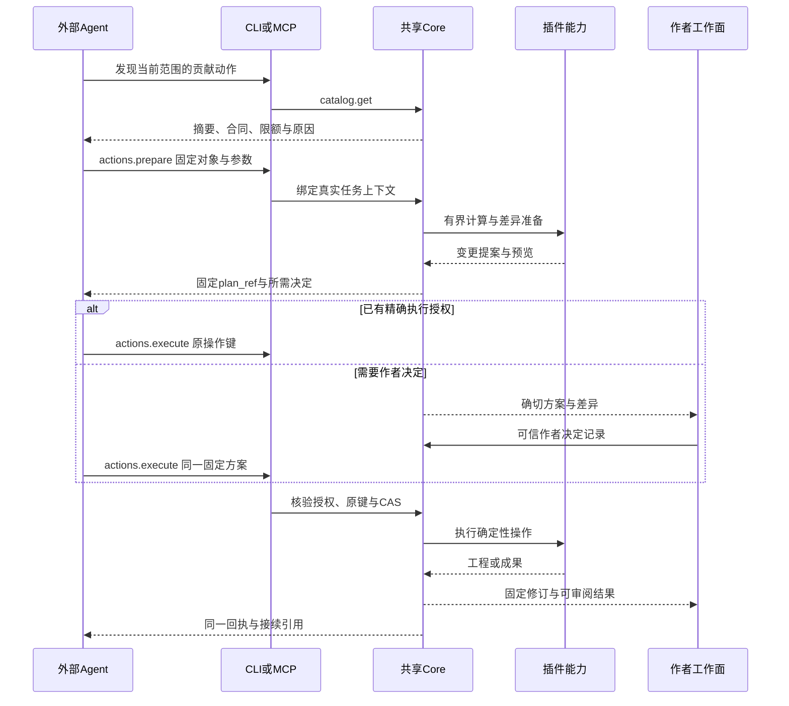

> 本文属于[创作插件体系设计](README.md)，拥有拟议应用动作与传输映射。

# 应用 API 与机器协作合同

## 1. 合同状态和原则

下列目录描述目标合同，`design-1` 为文档示例修订，不是可调用版本。已实现的首期范围以[插件20](20-首期可执行合同与开发入口.md)、`contracts/extensions/actions.json` 和当前能力发现为准；同名动作不表示本文全部字段与生命周期均已发布。新增能力须进入合同、真实 CLI/MCP、Skills 和验收，不得直接把拟议目录发送给当前产品后推定支持。

PAPI-018／019 的首期落点为插件20第24节的 `migrations.prepare/list/get/execute`：准备持久化单对象固定方案，不能称为无写入的 `preview`；作者批准使用私有宿主通道，公共 CLI/MCP 只准备、读取和执行已批准方案。批量迁移与跨插件数据迁移不属于该合同。

成果标题检索的现行合同归插件20第25节：`objects.search`与`index.status`为读取，`index.rebuild`为`cache_write`且只需`objects.read`。后者只替换派生缓存，不提交权威修订、审计或业务操作回执；中断后先查状态，再按需要重建。三项均由独立CLI与MCP按当前授权动态发现。插件manifest仍只支持既有read／managed_write效果，后台只读动作不能借缓存接口写盘。

入口继续消费共享应用用例。Electron经受限preload/主进程及JSON-RPC 2.0接入Rust；CLI/MCP直接复用Core，TS插件经范围SDK调用相同用例。公开结果沿用既有 AXI result，不新建另一套公开交换格式。插件工作进程内部通信见10，不能直接冒充公开入口。

## 2. 调用和身份

组件注册、插槽、拖拽、缩放、布局和局部state由TypeScript宿主处理；作品读写才进入Rust。基础CLI/MCP无Node前提；执行TS插件动作时按需启动随功能制品分发的Node运行时，不要求Electron窗口。

应用请求包含 `action, contract_revision, input`。授权来自可信入口上下文，已有 management_ref、task_ref 和作品范围沿原合同核验。请求不能声明作者角色、整库路径、系统凭据或 `approved=true`。

扩展调用额外固定 `plugin_id, package_sha256, action_id, action_revision`。包版本确定代码，action_revision 确定语义；同名贡献无法覆盖内核动作。开启新贡献不让旧授权自动扩大。

示例见 [action-request.json](examples/action-request.json) 与 [action-result.json](examples/action-result.json)。结果文件只展示应用层 `data` 投影，不冒充完整 AXI 响应。

示例中的 ID、修订、摘要与专业参数均为合成评审数据，不是现有 API 的有效请求。授权由入口上下文核验；结果中的权限提示不构成批准记录。

## 3. 拟议动作目录

| 编号 | 动作后缀，统一前缀 hetu.extensions | 核心输入 | 返回 | effect 与权限 |
| --- | --- | --- | --- | --- |
| PAPI-001 | `catalog.get` | 工作类型、贡献筛选、limit、cursor | 实际可见能力、合同与不可用原因 | 受限发现，不含未获权作品 |
| PAPI-002 | `packages.inspect` | 固定 source_spec、预期摘要可选 | 元数据、依赖、许可、权限、兼容诊断 | 元数据读取；联网目的明确 |
| PAPI-003 | `packages.prepare` | install/enable/disable/upgrade/remove、固定包与期望安装修订 | 固定管理方案、影响与范围 | 本机方案写入，不安装代码 |
| PAPI-004 | `packages.execute` | plan_ref、operation_key | 安装记录、活动版本、逐贡献状态 | 本机安装管理授权 |
| PAPI-005 | `bindings.prepare` | work_ref、贡献选择、绑定基线 | 当前作品的绑定方案 | 作品读取与方案准备 |
| PAPI-006 | `bindings.execute` | plan_ref、operation_key | 新绑定修订与摘要 | 明确作品管理范围 |
| PAPI-007 | `objects.list` | work_ref、plugin_id、kind、limit、cursor | 对象摘要与固定引用 | 当前对象范围读取 |
| PAPI-008 | `objects.get` | 固定 object_ref、字段或范围 | 核验修订及内容投影 | 当前对象范围读取 |
| PAPI-009 | `actions.preview` | 具体贡献动作、固定对象和参数 | 差异、诊断、预计成果 | 纯预览，不保存业务方案 |
| PAPI-010 | `actions.prepare` | 同上及所需明确上下文 | 固定 plan_ref、输入摘要、effect 和影响 | 保存完整提案，不能代批 |
| PAPI-011 | `actions.execute` | plan_ref、operation_key | 新修订或 job_ref、原操作引用 | 获权执行，作者决定另核验 |
| PAPI-012 | `operations.get` | 原 operation_key 或 recovery_ref | 已提交结果、进行中、失败或未知 | 重新核验同一范围 |
| PAPI-013 | `artifacts.submit` | 固定任务、媒体清单或有界 inline_source、摘要 | 固定成果与核验结果 | 受限接收候选，不自动采用 |
| PAPI-014 | `artifacts.get` | artifact_ref、受管预览类型 | 元数据、范围内容或受管预览 | 当前范围读取，不暴露任意路径 |
| PAPI-015 | `feedback.add` | 固定成果、版本锚点、公开意见、operation_key | 持久意见与精确交接引用 | 当前反馈写入，不自动请求生成 |
| PAPI-016 | `jobs.get` | 固定 job_ref | 阶段、真实结果、恢复引用 | 当前任务读取 |
| PAPI-017 | `jobs.cancel` | job_ref、operation_key | 本机及提供方取消的分别状态 | 受限取消，未知副作用不抹除 |
| PAPI-018 | `migrations.preview` | 包版本、对象范围及基线 | 新旧 Schema 差异、损失与恢复方案 | 只读预演，材料有界 |
| PAPI-019 | `migrations.execute` | 固定迁移方案、operation_key | 新数据修订与迁移回执 | 明确迁移授权，不覆盖旧历史 |
| PAPI-020 | `delivery.preview` | 固定成果及格式、交付范围 | 文件清单、依赖和损失报告 | 固定输入，预览不发布文件 |
| PAPI-021 | `delivery.execute` | 固定交付方案、operation_key | 新交付包、摘要和缺项 | 受限目标执行，不自动上传 |
| PAPI-022 | `runtime.status` | 固定插件或贡献 ID | installed、selected、active、兼容和诊断 | 本机元数据，不含作品秘密 |
| PAPI-023 | `skills.resolve` | 所选宿主、包摘要、任务类型 | 精简方法索引与安装状态 | 不自动全量安装或注入方法 |

视图打开、焦点和窗口关闭属于客户端适配动作，不作为机器业务前置。CLI/MCP 可以不打开任何视图而完成 PUC-003、PUC-005 的工程准备和结果回读。

## 4. 贡献动作合同

| 字段 | 语义 |
| --- | --- |
| `action_id, action_revision` | 命名空间内稳定动作与独立语义修订 |
| `input_schema, output_schema` | 闭合控制字段，显式可扩展专业 content |
| `effect` | read、preview、plan_write、draft_write、managed_write、external、author_decision |
| `required_capabilities` | 所需实际能力，不接受调用方扩大 |
| `scope_resolver` | 从显式引用确定对象，不使用全局 currentWork |
| `limits` | 字节、数量、时长和并发边界 |
| `recovery` | 原键恢复、外部查询及取消合同 |
| `view_result` | 结构化结果和受管预览引用，禁止可执行响应冒充指令 |

机器入口只发布当前实际可执行且当前范围允许的动作。摘要、详细 Schema 和完整方法按需发现；河图不能保证外部宿主一定采用动态工具加载，需要提供稳定发现入口及复制回退。

## 5. 幂等、CAS 与批准顺序

授权核验 → 持久原键查询 → 同输入返回原回执／异输入冲突 → 首次调用核验固定方案及 CAS → 执行 → 保存可恢复回执。

输入摘要采用规范化 JSON，包含插件代码摘要、动作合同、对象、基线、参数、素材与费用计划引用；仅排除 operation_key 和传输临时字段。批准绑定确切方案及当前授权，不因列表结果相同或模型自报而成立。

可直接获权维护的协作稿无需逐步重复确认；采纳、定稿、扩权和新的外部副作用仍走对应内核规则。原操作查询也须重新授权，撤权后不泄漏历史回执。

## 6. 主要业务时序

图中作者决定也可经已验收的外部宿主可信桥接完成，不能把回到桌面重复批准写成固定前置。缺桥接时准确说明回退能力。

## 7. 错误与资源边界

| 错误语义 | 调用方行为 |
| --- | --- |
| unavailable / incompatible / dependency_missing | 回读实际状态，选择替代或准备安装，不猜测可用 |
| forbidden / revoked / approval_required | 保留操作与成果，获取确切缺失授权，不扩大至整库 |
| conflict / operation_key_conflict | 查看当前基线或原输入，明确重做，不静默覆盖 |
| invalid_input / schema_unsupported | 修正字段或选择可读版本，不剥离未知字段后写入 |
| budget_exceeded / timeout | 有界缩小或沿原任务查询，不默认新建任务 |
| unknown_external_result | 查询原提供方任务，禁止换键重复提交 |
| integrity_failure | 保留证据并停止依赖该内容，不改摘要掩盖问题 |

初始设计预算为控制消息最多1 MiB、分页最多100项、普通工作进程调用默认30秒超时；长任务返回 job_ref，媒体走有界附件通道。它们是待实测调整的拟议值，发布值由实际能力目录唯一提供；外部服务任务不能被控制通道超时等同取消。

## 8. CLI、MCP 与 Skills

CLI 的命令名和 MCP 工具名由已发布动作及宿主适配生成，不在此虚构可运行命令。对等表示业务效果、授权与恢复相同，不要求所有传输使用相同参数外形。

Skills 描述任务方法、适用条件、能力发现、结果核对和失败接续。它不保存权限、不选择全局作品、不直接写受管目录，也不把新贡献自动加入所有 Agent 的上下文。
