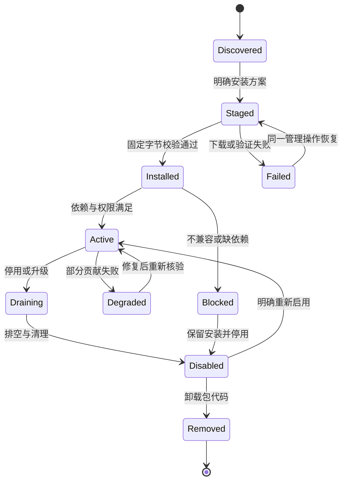
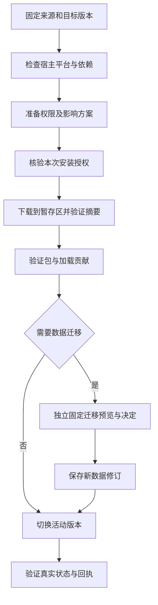

> 本文属于[创作插件体系设计](README.md)，负责包格式、开发合同与生命周期。

# 插件包SDK与生命周期

插件标准栈为JavaScript/TypeScript＋React，借鉴DSH注册、依赖、插槽与effect清理。SDK不导出Rust内部类型、FFI或动态库ABI，不要求插件编译进Core。纯视图在隔离Chromium执行，后端使用受管Node插件进程；同一TS运行时由桌面、CLI/MCP按需调用。Python/Blender等是明确外部工具适配。

## 1. 包格式

```text
plugin-package/
  plugin.json
  schemas/
  actions/
  views/
  skills/
  templates/
  worker/
  licenses/
```

除 `plugin.json` 外各目录按贡献选用。仅方法包不携带运行时；仅视图包可依赖已有数据与动作；复杂能力包可附带受管工作进程。完整拟议清单见 [plugin-manifest.json](examples/plugin-manifest.json)。

## 2. Manifest 字段

| 字段 | 作用 | 校验要求 |
| --- | --- | --- |
| `manifest_version` | 清单格式 | 不认识主版本时拒绝执行 |
| `id, version` | 稳定包身份与版本 | 规范化、同源去重，不按显示名覆盖 |
| `display, description, categories` | 作者理解的用途与分类 | 中英文键，不含运行指令 |
| `host_api` | 所需宿主合同范围 | 安装和运行时分别检查 |
| `platforms` | 已声明的系统与架构范围 | 声明与验证结果分别展示 |
| `dependencies` | 精确贡献依赖和可接受合同 | 无环，解析后锁定版本与摘要 |
| `contributions` | 数据、动作、视图、方法及适配器 | 稳定 ID，资源路径闭合 |
| `permissions` | 最小能力与外发目的声明 | 安装说明不代替作品授权 |
| `runtime` | 静态资源或明确工作进程入口 | 无默认安装脚本和任意 shell 拼接 |
| `license, notices` | 代码及必要依赖许可入口 | 素材、字体与模型服务条款分别记录 |

包摘要来自清单和全部分发文件的固定清单，文件排序与摘要算法在实现合同时冻结。签名和摘要解决来源及完整性问题，不证明代码安全或成果质量。

## 3. SDK 的四组合同

| 合同 | 开发者提供 | 宿主保证 |
| --- | --- | --- |
| 数据贡献 | 类型、Schema、语义、迁移与降级读取说明 | 受管身份、修订、CAS、引用和恢复 |
| 动作贡献 | 参数、结果、effect、限额、恢复和取消 | 授权调度、原键、当前版本与结果封装 |
| 视图贡献 | 入口资源、对象类型、选择锚点与可访问替代 | 有界投影、获权桥接和会话销毁 |
| 方法贡献 | 中文任务说明、模板、引用及依赖动作 | 按宿主与选择分发，不自动全量加载 |

SDK 不向插件提供 Core 私有对象、任意目录句柄、通用 SQL 或可伪造作者身份。开发者对自己的专业字段负责，修改其他 Owner 只能调用其公开动作。

## 4. 贡献注册与撤销

注册顺序为验证清单 → 解析依赖 → 加载描述 → 注册贡献 → 启动必要进程 → 宣布实际可用。每个注册返回一个清理句柄；依赖不可用时贡献为 blocked，不假装成功加载。

视图卸载需清理监听、计时器、GPU 资源、订阅、临时文件和桥接会话。工作进程退出需处理子进程、未完成结果和操作记录。清理成功与外部任务已经取消分别记录。

## 5. 生命周期状态图



安装状态、选择状态与每个贡献的运行状态分别存储，不能只保留一个 enabled 布尔值。restart_required 是某次变更的应用结果，不自动等于失败或已生效。

## 6. 安装与升级流程



代码切换前失败保留旧活动版本。迁移已提交后无法直接用旧代码继续写新数据时，保持只读并准备恢复方案；不承诺跨文件系统、依赖下载、外部服务和数据迁移构成一个原子事务。

初期允许重启后生效，避免以复杂热更新作为试点前置。热更可在明确在途任务、资源释放和数据兼容后增加。历史任务固定原包摘要与动作修订，不能静默切到新语义。

## 7. 依赖及冲突

同一插件 ID 在本机可以缓存多个版本，活动选择按已验证合同解析；作品记录需求不自动决定运行版本。首期不要求在同一作品内同时运行同插件的两个主版本。

可选依赖缺失只关闭相应贡献；必需依赖失败阻断依赖者。名称冲突、依赖环、核心动作覆盖和不兼容 Schema 必须显式拒绝，不能靠安装顺序静默覆盖。

## 8. TypeScript插件运行时与工作进程协议

拟议使用 JSON-RPC 2.0 over stdio，UTF-8、逐条有界消息。stdout 只输出协议，诊断进入受控 stderr 并脱敏。初始化协商插件摘要、宿主 API、动作、限额和协议修订；启动配置由宿主管理，不从作品配置执行命令字符串。

方法最小集合为 initialize、capabilities、invoke、cancel、dispose。invoke 固定 request_id 与动作上下文，返回结构化提案或 job_ref；通知只报告进度和已知状态。超时和断线不自动重发，已完成结果仍通过 Core 原操作查询。

子进程具有的真实 OS 权限须在目标平台验证。JSON-RPC 白名单并不能阻止拥有完整用户权限的恶意二进制直接读文件，安全边界见12。

## 9. 开发、测试和交付

开发流程为选择一个真实任务 → 声明最小贡献 → 用公开示例和模拟数据开发 → 验证包及 Schema → 在受限环境安装 → 通过机器旅程 → 核对界面与清理 → 输出固定包和兼容证据。

开发者工具应报告缺字段、动作 effect、资源越界、未清理贡献、依赖不兼容和缺失标准导出。自动验证通过后仍需对作者是否看懂、成果是否有效作场景检查。

外部 Agent 可以阅读 SDK 和开发 Skills 辅助编写插件；开发权限和作品业务权限分别授予。安装一个开发包不会自动授予当前作者所有作品，也不能把项目文件中的指令当作安装批准。
