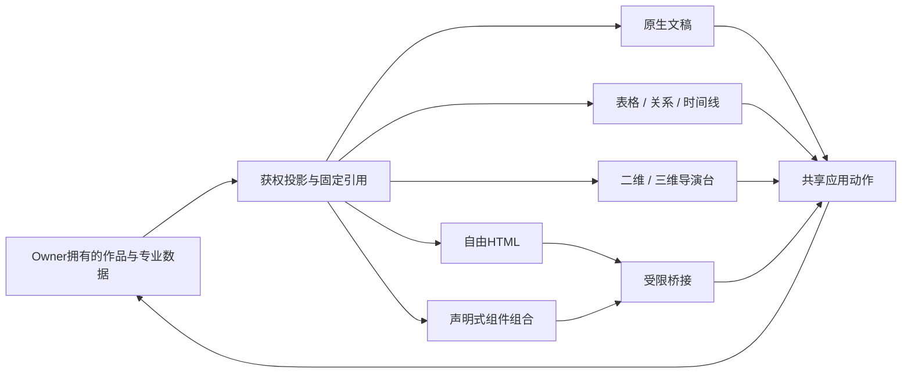
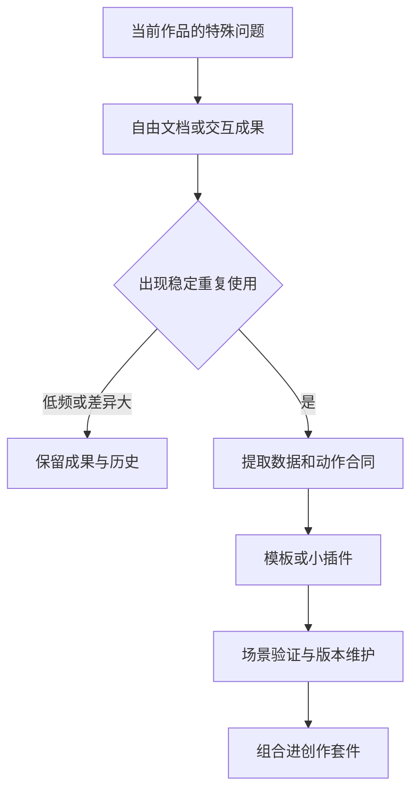

> 本文属于[创作插件体系设计](README.md)，负责表达方式、状态桥接和动态 UI 演进。

# 动态渲染与自由成果设计

桌面采用Electron/Chromium，插件使用TypeScript/JavaScript与React。组件状态和Web交互在TS层直接执行，作品读写才进入Rust Core，分工见[主39](../39-Electron与插件优先重构架构.md)。

## 1. 表达、执行和接口分别建模

Markdown 与 Fountain 主要承载文本，JSON 承载结构，HTML 承载页面及交互，图片和媒体承载感官结果，Python 等程序承担计算、分析和转换。CLI、MCP、API 是操作入口，Skills 是方法分发。它们可以组合，但不属于同一分类维度。

自由组合的基础是对象、成果与动作可以稳定引用。河图不要求作者学习这些格式；作者表达目标，Agent 准备材料，软件展示并保存可理解结果。

推荐 Electron 宿主方案见[18](18-桌面技术选型与迁移评估.md)，保留原生宿主的备选实现见[17](17-原生宿主与插件渲染技术方案.md)。Web 插件需要实际浏览器容器，原生组件需由宿主实现，A2UI 描述负责组合。协议、组件实现与浏览器容器不能互相替代。

## 2. 渲染方式矩阵

| 方式 | 适用问题 | 编辑与操作 | 持久化及回退 |
| --- | --- | --- | --- |
| 基础Web长文 | 小说、剧本、批注、对照 | 中文输入、选区和版本操作 | Markdown/Fountain 与基础阅读 |
| 内置结构视图 | 表格、卡片、目录和属性 | 有类型动作和稳定对象选择 | 结构 JSON 与可读摘要 |
| 关系与时间视图 | 人物、线索、事件和行程 | 操作对象与关系，布局是偏好 | 对象、关系与静态导出 |
| 二维/三维工作面 | 场面、调度、机位和遮挡 | 同一场面动作，多种观察方式 | 工程、固定预览和标准资产 |
| 图片、声音和视频 | 形象、表演、节奏和成片 | 区域/区间意见与明确选用 | 受管原字节和版本锚点 |
| 自由 HTML | 特殊说明、比较器、交互图表 | 受限页面状态与声明动作 | 固定页面包、数据、预览和历史 |
| 程序输出 | 分析、转换、图表和预演渲染 | 明确执行计划及有界工作进程 | 工具版本、输入、结果和恢复 |
| 声明式动态 UI | 当前任务的组件组合 | 宿主允许的组件与动作 | 描述、数据引用和组件目录版本 |

## 3. 数据与视图关系

渲染器可以保存视角、缩放和临时选择，但业务编辑必须提交到 Owner。HTML 里的缓存、浏览器 localStorage、组件 state 和三维引擎 scene graph 均不能单独成为作品事实来源。

## 4. 自由成果的数据合同

一个页面成果包含固定内容包、资源清单、数据引用、状态 Schema、允许动作和可选标准预览。页面资源使用包内相对路径，不默认从 CDN 下载运行代码。页面接收数据与返回事件都按不可信输入处理。

页面简单交互可以只更新成果自身状态；修改人物、正文或镜头则调用对应 Owner 的动作。未声明写入合同的页面按只读处理，不通过注入通用 JavaScript 桥接获得整部作品权限。

用户在页面上的修改保存为新成果修订；作者意见固定当前页面与数据版本。重新生成页面代码不抹掉旧意见，也不把旧图元坐标强行映射到新布局。

## 5. ViewBridge 最小合同

| 操作 | 输入输出 | 约束 |
| --- | --- | --- |
| describe | 当前 view_id、组件或数据合同 | 不返回其他视图与作品内容 |
| read | 固定对象引用、字段投影、分页 | 每次重验会话和授权 |
| subscribe | 当前获权对象集合 | 事件只给版本提示，不能全库订阅 |
| select | 对象、图元或媒体位置与版本 | 选择不是批准，不改变业务内容 |
| prepare / invoke | 声明动作及参数或固定方案 | 走共同应用用例与内核规则 |
| save_state | 当前成果或个人偏好与基线 | 区分作品状态和个人布局 |
| feedback | 固定成果与锚点、意见范围 | 只外发明确公开意见 |
| dispose | 当前视图会话 | 关闭订阅与临时授权，迟到请求拒绝 |

原生审阅界面的作者决定继续走可信作者通道。ViewBridge 不提供通用 confirm_author、run_shell、read_path 或 execute_sql。

## 6. A2UI 适配路线

### 6.1 分层与职责

A2UI 1.0 作为动态组合协议的优先验证对象；先验证已有标准，再判断哪些河图特有语义需要扩展，避免先建设一套完整的私有 UI 协议。此项为设计建议，尚未接入现有客户端。事实与证据见[02](02-产品与生态调研.md#7-a2ui-与动态表达)。

| 层次 | 河图中的责任 | 示例 |
| --- | --- | --- |
| 作品内核 | 身份、修订、授权、事务及作者决定 | 当前小说与固定章节修订 |
| 专业插件 | 数据、动作、实际组件与方法 | 人物关系组件、镜头操作、比较器 |
| 界面协议与适配 | 目录协商、结构和数据描述、增量更新、函数消息 | A2UI surface 与 catalog |
| 外部 Agent | 理解当前任务，准备内容并选择组合 | 将改动、依据、意见入口组织成审阅面 |

插件可以贡献一个完整的专业视口，不要求 Agent 用通用按钮和图形逐个重建三维引擎。场面导航、连续拖动、播放、选区与输入由组件处理；意图变化或创作返工再交给外部 Agent。

### 6.2 交互、保存与恢复

外部 Agent 经 CLI/MCP 提交界面描述与获权引用 → 适配器校验目录和消息 → 宿主渲染 → 普通交互调用已注册函数或共享应用动作 → Core 返回实际结果与修订 → 更新视图。需要理解或生成的操作生成明确任务交接，不在河图启动内部推理循环。

`callAgentFunction` 的名字不能被实现成“每次都调用模型”。只需程序处理的请求直接路由到已注册处理器；需要模型的请求交给外部 Agent。普通数据查询无需作者多轮对话，但涉及采纳、定稿及费用的决定仍核验真实授权与固定结果。

建议保存界面描述、目录及组件版本、固定数据引用与必要预览，使作者能重开、反馈和比较。A2UI 的运行时 `surfaceId` 不代替河图持久 `view_id`；恢复时创建新的运行时 surface，再绑定原成果与合法引用。流式半成品和界面编辑缓冲不自动推进作品正式版本。

页面数据模型只持有当前获权投影。协议的 `sendDataModel` 可以回传整个 surface 数据，适配时按最小范围配置，不因开启同步而默认向外部 Agent 发送整部作品。目录受支持不等于作品获授权，协议校验也不等于业务动作已获准。

组件目录由宿主或明确安装的插件提供。Agent 无权通过界面描述新增执行能力，也不能把一个按钮文案解释为作者批准。缺少目录、组件或兼容版本时明确降级，保留原生阅读、标准预览及工程导出。

### 6.3 创作场景中的使用方式

| 作者目标 | Agent 准备的内容与组合 | 程序持续提供的能力 |
| --- | --- | --- |
| 判断第二卷是否节奏拖沓 | 卷章结构、事件时间线、待比较段落及问题入口 | 查询固定修订、筛选、定位原文、绑定意见 |
| 比较两版人物动机 | 对照文本、固定设定依据、差异和取舍入口 | 并排阅读、稳定锚点、作者选择与版本保存 |
| 核对一场对峙的镜头 | 二维站位、三维视口、镜头表及问题说明 | 相机与空间操作、几何预览、镜头局部覆盖 |

上述组件为拟议领域能力，A2UI 标准不直接提供其创作实现。作者默认阅读与取舍；需要手动调整时保留组件操作，亦可把目标交给 Agent。

### 6.4 验证与采用顺序

在 S0/S1 并行开展一个小型可丢弃原型：固定同一作品投影，比较固定审阅面与 A2UI 组合的“版本对照＋依据＋意见”任务。优先在18的共同 Web 容器中核对目录贡献、确定性函数和增量更新，原生 Renderer 作为备选；不以完成商店、全部专业插件或所有跨端适配为前提。

原型通过后，在相同数据与动作合同上逐步扩大；正式采用仍按 S6 的质量和成本证据决定。HTML、Markdown、图片和工程成果继续承载协议不适合的表达，基础长文及中性工作面保持独立可用。

## 7. 自由成果到复用能力的演进

提炼是明确的新交付，不把作者正文、素材和隐私自动打包进公共插件。重复使用的定义和收益通过实际任务评估，不追求把每个成果都产品化。

## 8. 成本、性能与降级

给作者展示完整结果，给 Agent 返回必要摘要、固定引用与按需内容；这可以减少不必要的全文回传，但不能省略完成任务所需材料。Token 节省、缓存命中、生成质量与作者理解分别测量。

视图虚拟化、缩略图、代理媒体、增量更新和缓存均须保留原字节及版本核验。GPU 或 WebView 不可用时提供对象列表、静态预览和工程导出，不以空白画布冒充成功。

三维预演可核对构图、遮挡与空间关系；真实身份、材质、表演、口型和最终生成仍需独立验证。诊断提示区分几何计算、时间估算和语义候选。
