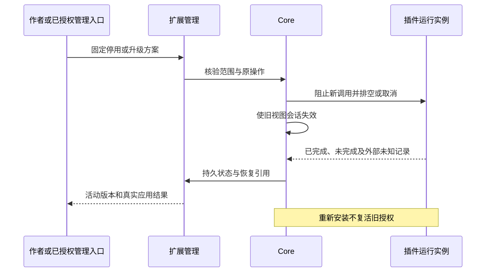

> 本文属于[创作插件体系设计](README.md)，负责扩展新增的信任与兼容边界。

# 安全权限与兼容策略

## 1. 安全目标与边界

本方案沿用[安全与隐私](../18-安全与隐私.md)。目标是让受管入口逐次核验权限和完整性，控制插件可以通过河图执行的动作，并准确说明真实 OS 隔离边界。

拥有同一用户完整文件权限的恶意程序，可能绕过 API 直接读取或改写文件。独立进程、JSON Schema 和工具白名单都不能自动解决此问题。未完成目标平台沙箱验证前，第三方可执行插件只声明为可信代码模式，不宣称已安全隔离。

## 2. 信任矩阵

| 来源 | 可接受的内容 | 不自动接受的权力 |
| --- | --- | --- |
| 插件索引 | 包描述、公开来源及带证据的验证结果 | 安装、执行、作品读取或作者决定 |
| 插件清单 | 贡献、版本、依赖及请求权限 | 自行授予权限、扩大 Core 动作 |
| 项目与工程文件 | 数据、引用和推荐能力 | 启动代码、执行脚本、自动下载依赖 |
| 自由 HTML | 受限显示、选择及声明事件 | 文件系统、Shell、凭据和通用作者代理 |
| 工作进程结果 | 提案、进度、成果与诊断 | 跳过 CAS、批准或直接改正式指针 |
| Skills 与外部 Agent | 方法、获权请求和候选 | 覆盖内核规则或自报批准 |
| 作者可信决定通道 | 绑定具体方案的意图与决定 | 无限制扩大到其他作品、版本或费用 |

## 3. 权限分层

安装管理授权决定本机引入哪些固定代码；作品授权决定可以对哪个 WorkRef 执行什么业务；视图会话限定一次局部交互；模型和外部服务计划进一步固定内容外发、接收方和费用。

四者互不替代。允许安装导演插件，不允许它读取全部小说；允许修改一个镜头，不允许更改剧本对白；打开嵌入页面，不授予正式采纳或定稿权。

已有精确授权内的确定性执行继续完成，不反复要求作者批准同一操作。达到上限、改变范围、换代码摘要或增加外部接收方时重新核验必要授权，不能用降低重复确认的名义跳过内核记录。

## 4. 执行与文件隔离

宿主只从明确安装的受管目录加载固定包，作品目录中的同名文件不能替换代码。依赖获取、代码验证和运行分开；不自动执行 npm lifecycle scripts，不从清单拼接任意 shell 命令。

插件工作进程通过数据或受管附件通道获得材料。输入引用不等于任意本机 file_path；路径规范化、实际文件身份、符号链接和解压路径均核验。导入第三方工程不自动执行内嵌脚本或加载其插件。

针对不可信可执行插件，先完成实际平台沙箱、文件和网络限制、子进程约束及逃逸测试，再开放相应等级。无法隔离时向作者明确说明信任需求，或只允许静态视图与方法包。

## 5. 页面与动态 UI

页面使用包内静态资源和最小 CSP，默认禁止任意远程脚本、顶层导航、本机协议和直接网络外发。远程媒体经受管读取代理，外部链接需明确打开。

桥接绑定 view_id、真实来源、当前对象、插件摘要和短期会话。关闭、撤权、切换作品或升级时失效，迟到响应不应用到新对象。声明式组件同样只能调用预先允许的动作，文本内容不能改变组件能力。

## 6. 费用、凭据和未知结果

凭据继续保存在对应本机私密存储或已授权服务端，不进入作品、插件页面、Agent 回读、普通日志和导出。通道适配不能继承无关 Agent 环境秘密。

文字和图片的可选模型封装沿现有固定计划；视频、声音与外部制作服务由明确适配器记录任务和成果。调用前固定材料、型号模式、数量、接收方和预算。超时保留原任务，取消不承诺退款或未执行。

## 7. 版本矩阵

| 版本维度 | 谁负责 | 不兼容时的处理 |
| --- | --- | --- |
| 宿主 API | Core 与 SDK | 拒绝注册，保留安装与诊断 |
| 包版本和摘要 | 包作者与安装管理 | 明确选择，不静默换代码 |
| 动作合同修订 | 贡献 Owner | 旧任务保持原语义或停止新写入 |
| 数据 Schema | 数据 Owner | 只读、显式迁移，保留原字段和历史 |
| 视图或 A2UI 协议 | 宿主适配器 | 选择兼容渲染或标准回退 |
| 索引格式 | 索引发布者 | 拒绝无效来源，不影响已安装功能 |
| 外部工程与工具 | 适配器和工程清单 | 显示版本、依赖与转换损失 |

## 8. 升级及撤权时序

## 9. 数据权利与退出

包许可、素材许可、生成服务条款和作者作品权利分别记录。开源核心不改变作者内容权利，也不自动要求插件统一许可。

停用、包卸载、项目移除、作品删除和工作区删除是不同操作。任何卸载都保留作品修订、固定预览、意见和交付路径。只有作者明确选择数据清理，才能按引用与保留政策处理历史。
