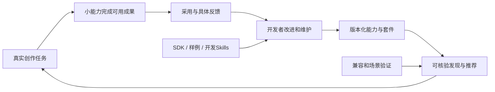

> 本文属于[创作插件体系设计](README.md)，负责生态机制、分发与商业假设。

# 生态分发与商业模式

## 采用条件

分发说明实际任务、费用和依赖；插件购买或安装不成为本地核心写作前提。 产品定位与分流以[01](../01-产品需求PRD.md#1-产品定义)为准。

## 1. 生态定位

河图的生态中心是作者持续持有的作品，以及围绕作品流动的方法、工具、资料、成果和专业工程。长期可以容纳个人创作者、编剧、导演、美术、声音人员和开发者，各自提供专业能力，又能通过固定引用接续。

边界保持在构思、写作、改编、预演、制作、审阅和完整交付。发行、投放及发布后运营不在当前范围。生态广度通过专业能力组合形成，不要求主团队自行实现每个专业软件。

## 2. 生态参与者

| 参与者 | 提供什么 | 得到什么 | 主要阻力 |
| --- | --- | --- | --- |
| 创作者 | 真实任务、反馈、作品采用 | 可用能力、更低总成本和退出自由 | 选择负担、信任和学习成本 |
| 专业方法作者 | Skills、模板、案例和题材资料 | 方法复用、专业影响与可验证商业机会 | 内容同质化、缺工具衔接 |
| 工具开发者 | 数据、动作、视图与适配器 | 稳定 SDK、用户触达和维护机制 | 隐性合同、兼容与支持成本 |
| 素材及服务提供者 | 授权资产、计算和专业工具连接 | 明确需求与可计量服务 | 权利、费用、接口变化 |
| 套件组织者 | 面向人群的能力组合与指南 | 降低用户选择成本的价值 | 依赖变化与质量责任 |
| 索引与验证维护者 | 发现、兼容、验证和问题响应 | 可复用的公共目录与信任证据 | 批量低质供给和持续验证成本 |

生态不以交换作者正文为运行前提。包与索引可公开，作品内容、授权和私密意见继续由作者控制。

## 3. 供需循环

一次循环必须出现真实成果与采用反馈。只有包生成或索引收录的增长，不能证明循环已成立。

## 4. 冷启动路径

先由第一方提供少数可用样例，覆盖文稿、结构与制作两种差异较大的工作；再邀请少量方法作者和开发者基于真实作品任务交付能力；根据重复需求建立套件和推荐。

平台优先降低接口、安装、验证和维护成本。一个方法包或转换器应能独立交付，不要求所有贡献都带复杂 UI。对同质模板、题材变体和自动生成包，优先通过标签与组合去重，不用插件数量包装生态规模。

## 5. 分发架构

初期支持明确安装的本地目录或固定包来源。随后支持静态索引：包含包 ID、版本、摘要、来源、作者、许可、适用范围、依赖、验证引用和撤回状态。包文件继续由明确来源分发，索引不获得执行权。

社区和团队可以维护独立索引。官方推荐表示特定范围的验证与维护承诺，不表示为所有输出或版权担保。无网络或目录不可用时，已安装能力与本地作品仍独立可用。

具体开发、发布、上架与维护步骤见[22开发指南](22-插件开发与调试指南.md)、[23发布指南](23-插件发布与上架指南.md)；GitHub、静态目录和本机安装分工及DSH源码证据由[24](24-插件目录与分发治理.md)维护。本篇不重复定义分发格式。

## 6. 验证与治理

| 状态 | 需要的证据 | 不能推导的结论 |
| --- | --- | --- |
| 来源可核验 | 仓库或包存在、固定版本、许可入口 | 功能可用或代码安全 |
| 包验证通过 | 清单、依赖、资源路径和 Schema 合法 | 在目标宿主安装成功 |
| 安装加载通过 | 绑定系统、宿主版本和摘要的实测 | 能完成创作任务 |
| 场景通过 | 明确作品任务、机器动作、GUI 与交付证据 | 对所有题材和规模均有效 |
| 维护可观察 | 兼容更新、问题响应和历史版本可得 | 永久稳定或未来服务可用 |

索引接收和运行授权分开。严重问题可以撤回推荐、阻止新安装并提示已有用户；不静默删除用户作品。包更新后旧验证不自动继承。撤回时保留原操作、数据和安全导出路径。

用户反馈区分安装、兼容、使用体验、内容质量、版权和服务账单，转交正确 Owner。不要让一次低质量生成把整个插件标为不可安装，也不要让加载成功掩盖内容缺陷。

## 7. 推荐与 Agent 引导

推荐依据当前创作任务、作品类型、已安装能力、系统支持和作者约束。外部 Agent 可以理解需求并提出组合，软件核验实际包与能力；本机关键词匹配只作为搜索，不能冒充创作理解。

推荐先说明解决什么问题、增加什么依赖和费用，再展示技术细节。默认不为每个作品加载全部 Skills 和工具。作者可以拒绝推荐，继续使用已有工作面。

## 8. 商业模式假设

| 模式 | 成立条件 | 应验证的指标 | 作者权益 |
| --- | --- | --- | --- |
| 开源基础能力 | 形成可信作品与互操作基础 | 活跃作品、接续和交付质量 | 基础读取编辑和标准导出独立可用 |
| 专业能力付费 | 产生持续专业价值，支持成本可控 | 真实采用、复用、续用和支持工时 | 停止付费仍能读取导出已有成果 |
| 方法或模板包 | 方法质量可验证且明显降低任务成本 | 实际使用、满意度和退款原因 | 来源与许可明确，不出售虚假效果承诺 |
| 托管计算与服务 | 有可靠服务、可核验结果和费用恢复 | 单任务毛利、失败率和未知结果处理成本 | 费用和外发明确，不重复计费 |
| 团队或跨设备 SaaS | 用户确有共享、权限、审阅或同步需求 | 团队采用、协作价值、留存和运维成本 | 数据导出、退出和本地可用性清楚 |
| 分发交易服务 | 第三方供需、结算和支持足够成熟 | 成交、纠纷、税务和治理成本 | 不把支付目录变成访问作品的唯一入口 |

上述为待验证模型，不构成建设完整交易平台或团队服务端的近期需求。现有可选模型渠道继续按 website/Cloud 与作者自定义渠道合同运行，插件不能另造平行身份、计费或充值事实。

## 9. 生态指标

分别统计包、贡献、版本、作者、安装、成功加载、活跃使用、作品采用与跨版本存活。套件中重复引用的插件只计一次；已有通用工具适配和河图原生能力分别标注。

实际任务数据默认留在本机。用户同意的研究可以记录耗时、错误和必要计数，不默认上传正文、完整 Prompt、媒体或隐私路径。无法获得真实费用计数时标为未知，不以 Token 估算冒充账单。

## 10. 平台与供给者的承诺

宿主提供稳定合同、兼容窗口、变更说明、开发验证、问题归属和退出路径。开发者提供许可、固定版本、权限说明、兼容证据和维护渠道。套件组织者对组合可用性负责，数据 Owner 对事实与迁移负责，索引维护者对收录和验证声明负责。

具备这些责任，插件数量增长才可能转化为可持续创作能力。生态规模目标应在试点数据之后制定。

## 11. 开发者交付标准

借鉴Pi的组合包与Harness的包级文档，河图的最小贡献可以是方法、纯视图、纯计算或完整专业工具，不要求每包都有数据库、界面和后端。运行包使用JS/TS，视图可用React；普通插件无需Rust工具链，也不依赖宿主源码的绝对路径。

每包自己维护功能清单，至少说明用户目标、贡献ID、权限、机器发现方式、读写副作用、限制和最小验证命令。`plugin.json`拥有可执行合同，清单用于人类和Agent导航，避免另造一份参数Schema。宿主只提供发现入口，不替插件登记每个功能。

开发者应能从公开脚手架建立独立目录，完成类型检查、构建、固定包校验、机器安装、实际能力发现与原键回读。验证失败应指向包、贡献或合同，不要求开发者猜宿主内部路由；坏包与缺依赖只影响本包及依赖者。调试日志不得泄漏作品正文或授权秘密。

生态准入分三步取证：独立目录自动验收、未参与宿主开发的人类开发者试用、目标宿主与系统的版本兼容验证。之后才验证公开索引、更新和真实用户采用。来源、包数和下载量不能替代这些结果；具体用例见[15第9节](15-测试验收与追踪矩阵.md#9-pi与deepseek-harness对标用例)。
