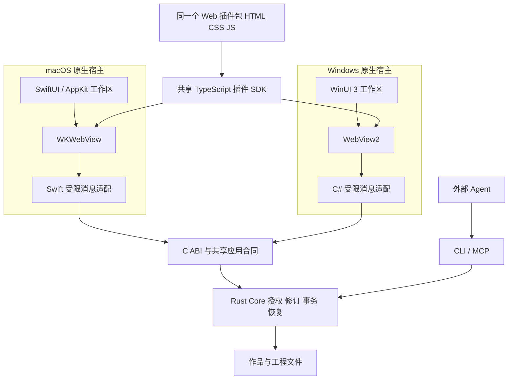
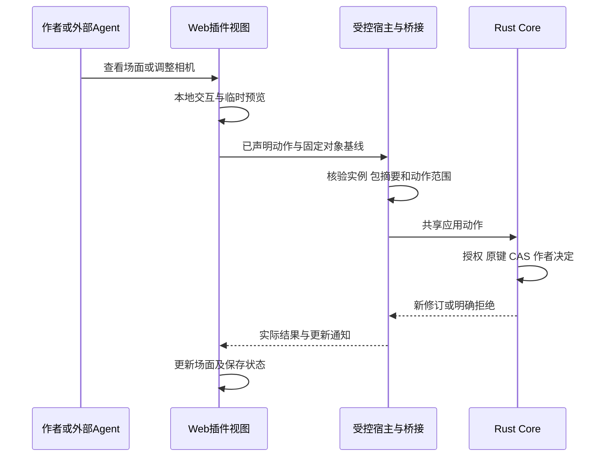

> 本文属于[创作插件体系设计](README.md)，负责原生客户端如何实际加载、渲染和连接插件界面。

# 原生宿主与插件渲染技术方案

## 1. 结论与实施边界

本文定义保留原生客户端时的可行备选架构：macOS 使用 SwiftUI/AppKit＋WKWebView；Windows采用当时评估的WinUI 3＋WebView2；第三方界面主要以 HTML/CSS/JavaScript 静态包交付。作品操作继续进入共享 Rust Core。当前已采纳Electron＋TS插件宿主＋Rust Core，见[主39](../39-Electron与插件优先重构架构.md)及[18](18-桌面技术选型与迁移评估.md)；本文仅保留备选机制和研究，不作为并行开发计划。

这里的插件运行时具有明确分工：浏览器引擎执行插件的前端代码，原生适配器管理工作区和受限通信，Core 执行领域规则。只安装界面包不要求重新编译宿主；新增宿主自身不具备的原生组件仍需要客户端版本交付。

本方案是设计基线。本文源码核对日期为2026-11-16，不表示通用插件宿主已经实现，也不改变既有作品与作者决定合同。

## 2. 当前河图的实际基础与缺口

| 核对位置 | 已存在的实现 | 尚需建立的扩展边界 |
| --- | --- | --- |
| `apps/macos/Sources/HetuMac/HetuMacApp.swift` 的 `detail` | 按 selection 静态选择业务 View | 动态视图描述与 PluginSurfaceHost 路由 |
| `apps/macos/Sources/HetuMac/WorkspaceShell.swift` | 原生导航、目录和内容区域 | 从注册描述生成可选工作区入口 |
| `apps/macos/Sources/HetuMac/LocalTaskViewControls.swift` | `NSViewRepresentable` 内创建 WKWebView；加载本机回环页面；非持久网页存储 | 通用插件视图生命周期、多个工作区实例和状态接续 |
| `apps/macos/Sources/HetuNative/LocalTaskViewSession.swift` | Node 子进程、私有 stdio、固定任务句柄与动作白名单 | 包摘要、插件身份与不同专业动作的受管注册 |
| `apps/task-view/src/local/server.ts`、`host.ts` | 本地服务、任务配对、iframe、官方 MCP Apps 桥接及 CSP | 多插件资源解析、隔离与通用 SDK |
| `bindings/swift/Sources/HetuCore/Workspace.swift` | Swift actor 封装 C ABI；能力发现与请求 | 插件动作进入同一授权与恢复合同 |
| Windows历史设计（主12已转为Electron） | 当时评估WinUI 3、C#／Rust及WebView2 | Windows 工作区宿主、实现与实机证据 |

本轮 `apps/windows/` 未发现已实现源码，不能把 Windows 文档中的技术路线当作已交付功能。当前 Mac 的任务页面也不等于通用第三方插件宿主。

## 3. DeepSeek Harness 与 Lime 怎样实现

### 3.1 DeepSeek Harness

核对官方提交 `39163dd30f703a79079e2d2446545cff3c453738`：

| 证据 | 实现含义 |
| --- | --- |
| [desktop/package.json](https://github.com/deepseek-ai/deepseek-harness/blob/39163dd30f703a79079e2d2446545cff3c453738/apps/desktop/package.json) | 桌面依赖 Electron、React、React DOM；采用 Web 客户端技术栈 |
| [Web Client Slots](https://github.com/deepseek-ai/deepseek-harness/blob/39163dd30f703a79079e2d2446545cff3c453738/docs/subsystems/slots.zh.md) | `ctx.slots.register()` 注册组件；统一 Renderer 将注册树渲染成 React 界面；支持 list、single、keyed、chain、hoc 等组合 |
| [UI 插件说明](https://github.com/deepseek-ai/deepseek-harness/blob/39163dd30f703a79079e2d2446545cff3c453738/packages/preset/agent-preset/skills/dsh-doc/references/ui-plugin.md) | 浏览器模块注册 lazy factory；从宿主模块表共享 React；通过生命周期登记和清理资源 |
| [动态客户端运行时](https://github.com/deepseek-ai/deepseek-harness/blob/39163dd30f703a79079e2d2446545cff3c453738/packages/extensions/cordis-client-runner/src/client/runtime.ts) | 动态包进入模块表与 Loader；加载、激活和卸载均记录实际状态；移除时释放 slot 和样式等贡献 |
| [动态代码求值](https://github.com/deepseek-ai/deepseek-harness/blob/39163dd30f703a79079e2d2446545cff3c453738/packages/extensions/cordis-client-runner/src/client/evaluator.ts) | 部分动态扩展求值浏览器侧 JavaScript，通过 `host.call()` 连接 Host；这条实验扩展路径不能等同于全部插件的隔离保证 |

DSH 的扩展便利建立在共同的 JavaScript／React 客户端运行环境、组件插槽和 Cordis 生命周期上。它没有证明任意 SwiftUI 类型可以在原生应用中随包动态加载。河图可以借鉴注册、依赖和清理机制，但必须实现自己的渲染容器与 Core 权限边界。

### 3.2 本机 Lime 源码

参考仓库为用户提供的`lime`源码目录，证据使用仓库相对路径。本轮只读核对源码，未运行或修改该产品。

| 源码位置 | 已核实机制 |
| --- | --- |
| `package.json` | 现役桌面入口为 Electron；历史 WebView2 字样不能据此判定现役容器 |
| `electron/embeddedBrowserHost.ts` 的 `#ensureEntry` | `new WebContentsView()` 创建网页执行体，`window.contentView.addChildView()` 加入窗口，管理边界、可见性与销毁 |
| `electron/browserTabHost.ts` | 映射 tab／view／window 身份，处理标签挂载、选择与同一网页执行体的操作 |
| `electron/preload.ts` | `contextBridge` 暴露受控命令，使用 IPC 请求主进程 |
| `electron/embeddedBrowserSession.ts` | 普通浏览器使用单独的持久 session partition |
| `src/components/agent/chat/workspace/WorkspacePluginSurface.tsx` | 原生网页视图挂载后读取 MCP App resource，加载 HTML；同步布局尺寸；组件卸载时释放视图租约 |
| `electron/embeddedBrowserHtml.ts` | 校验 `ui://` 来源、HTML 大小和 CSP 域列表，并构造受限 HTML 页面 |

普通网页与插件成果可以复用容器管理能力，但业务权限、存储和外部访问范围需要分别定义。河图首期插件视图不沿用普通网页的登录 Cookie 与持久浏览记录。

### 3.3 可移植的部分

可借鉴的是视图描述、挂载与卸载、实例身份、尺寸及可见性同步、结果回读、受限消息和失效处理。Electron 的 `WebContentsView`、preload 与 `ipcRenderer` 依赖其运行环境，无法直接放入 SwiftUI 客户端运行。

Lime 在 `package.json` 声明 GPL-3.0-only。参考机制与复制代码分别处理；实际复制前核对具体文件许可、分发方式及权利范围，不由同一开发者目录位置推导可直接复用。

## 4. 三类渲染贡献

| 类型 | 安装内容 | 谁实现实际组件 | 能否不升级宿主引入全新界面 |
| --- | --- | --- | --- |
| `native-schema` | 界面描述、数据绑定、目录要求 | 宿主预编译的原生组件，或已支持的 A2UI 原生适配 | 能组合已有组件；全新的原生组件需要客户端交付 |
| `web-bundle` | HTML、CSS、JavaScript、资源及桥接声明 | 插件包；宿主提供 WebView | 可以，在引擎与 SDK 能力范围内 |
| `external-project` | 外部工具工程、适配动作、预览及成果引用 | Blender 等外部专业工具 | 通过独立工程接续，内嵌能力按明确适配验证 |

通用第三方插件首选 `web-bundle`。原生长文、系统交互及可信作者决定由原生工作面提供；A2UI 可作为插件容器内的组合协议，也可使用宿主支持的原生 Renderer。A2UI 描述不会自动变成一个宿主尚未实现的原生组件。

## 5. 跨平台组件架构



两端共享插件包、SDK、应用动作、作品格式和恢复语义；窗口、WebView 生命周期、消息适配、输入法、文件选择及系统权限各自实现。WebKit 与 Chromium 有差异，不能用“同一包”承诺无需平台测试。

### 5.1 平台适配点

| 操作 | macOS | Windows |
| --- | --- | --- |
| 嵌入内容区 | `NSViewRepresentable`／AppKit 容器 | WinUI 3 WebView2 控件 |
| 网页到宿主消息 | `WKScriptMessageHandlerWithReply` 或受控本地宿主桥接 | `WebMessageReceived` 或相同本地宿主桥接 |
| 宿主到网页消息 | `callAsyncJavaScript` 的参数传递或既有桥接通知 | `PostWebMessageAsJson` 或既有桥接通知 |
| 网页存储 | 每个隔离域的 `WKWebsiteDataStore` 策略 | 对应 profile／user-data-folder 策略 |
| 关闭／撤权 | 撤销会话、监听与消息处理器 | 撤销会话、事件处理器与控件资源 |

以上为拟议适配方式。首期优先复用现有本地任务页面的“受控宿主页＋隔离 iframe＋父进程 stdio”链路：插件 SDK 在两端通过相同 `postMessage` 与宿主页通信，只有宿主页连接本地应用通道。直接原生消息桥是需要单独实现和验收的替代传输，首期不同时维护两套等价通道。

### 5.2 渲染引擎能力

SDK 的初始化结果返回实际能力：协议修订、可用组件目录、WebGL 支持、媒体格式、最大资源预算和允许动作。WebGL2、WebGPU、编解码器、字体、剪贴板与下载不能按操作系统名称直接推定。

二维画布使用 SVG／Canvas 或适合任务的库；三维工作面可用 Three.js 与可用的 WebGL 路线做原型。需要外部高成本渲染时交给受管工作进程；不能把 Python 源码当作 WebView 可直接执行的内容。GPU 不可用时保留镜头表、静态预览和工程导出。

## 6. 包怎样加载

以下清单片段是拟议 `views` 贡献，尚不是现有发布 Schema：

```json
{
  "id": "director.stage",
  "renderer": "web-bundle",
  "entry": "views/stage/index.html",
  "bridge_revision": "design-1",
  "object_kinds": ["production.scene"],
  "required_features": ["webgl2"],
  "fallback": "scene-list-and-preview"
}
```

加载顺序为：读取已安装且固定摘要的包 → 校验入口及资源路径 → 解析当前作品启用的贡献 → 原生导航生成入口 → 创建视图实例与精确作用域 → 启动或复用受控本地宿主 → 挂载插件 iframe → SDK 初始化 → 读取获权数据 → 显示实际状态。

资源服务只从固定包清单解析相对路径，拒绝路径穿越及任意本机文件读取。插件脚本预先构建打包，普通作者无需安装 Node/npm 或运行前端构建。现有本地服务依赖的 Node runtime 由产品制品装配；离线阅读与其他原生功能不因它不可用而失效。

第三方页面使用隔离的 iframe、CSP 和有界消息。工作区内容不直接拼成任意脚本。宿主页验证消息的发送窗口与当前实例，原生侧再核对包、视图、作品与生命周期；隐藏字段或 JavaScript 闭包不能单独构成授权边界。

## 7. 插件怎样操作作品

共享 SDK 向插件提供有类型的领域调用，而非任意本机函数。以下示意代码用于说明调用形态，不是当前可运行 API：

```typescript
const session = await hetu.connect();
const scene = await session.objects.read(sceneRef);
stage.render(scene);

stage.onCameraCommit(async (change) => {
  const plan = await session.actions.prepare("director.camera.update", {
    objectRef: sceneRef,
    expectedRevision: scene.revision,
    change,
  });
  return session.actions.execute(plan.planRef, operationKey);
});
```

`connect()` 由宿主返回当前实例的可用范围，不接受插件自报 `actor=author`、作品路径或整库身份。调用形态最终映射[09](09-应用API与机器协作合同.md)的动作；视图、CLI 与 MCP 得到相同业务规则。安装和注册不自动授予作品读取权。

连续拖动在网页内按帧处理，不逐像素调用 Core 或模型。交互结束后提交有基线的变更；Core 检查 CAS、写新修订、返回真实结果，再刷新其他视图。自动保存可做有界合并，但不能省略未保存状态、撤销边界与冲突处理。



采纳、定稿、扩权及费用决定继续由可信作者通道和固定计划核验。插件按钮可请求该流程，不能凭按钮文字或页面自行回传 `approved=true` 完成批准。

## 8. A2UI 放在哪一层

A2UI Renderer 可以运行在 Web 插件容器中；插件贡献的 React／Web 组件进入明确目录，Agent 用描述组合它们。已有 WebView 宿主仍负责加载和隔离，Core 仍负责作品状态。

若采用 A2UI 的 SwiftUI Renderer，则由宿主原生组件注册表完成映射。下载新的描述可以组合已编译组件；下载 React 组件不会自动注册成 SwiftUI 类型。需要任意新增专业交互时，使用 Web 插件视图或受支持的 Web 视口组件。

首个原型应先证明静态 Web 插件的加载、读取、保存和恢复，再在同一容器内比较 A2UI 动态组合。两项可并行探索，但不能用 A2UI 演示代替插件宿主闭环。

## 9. 为什么不直接改成 Electron

| 方案 | 主要收益 | 主要代价 | 当前判断 |
| --- | --- | --- | --- |
| 原生壳＋系统 WebView | 保留现有编辑器与系统体验，共享 Web 插件代码 | WebKit／Chromium 的适配和验收 | 保留原生路线时采用的备选 |
| 整体改为 Electron | 统一 Chromium 与 Web 客户端插件环境，接近 DSH/Lime 路线 | 重做客户端装配、编辑器、发布和资源预算 | 新产品目标下优先验证，采用条件见18 |
| 原生内嵌 CEF | 两端使用可控 Chromium | 二进制、更新、签名、窗口、IME、GPU 与输入适配工作较多 | 系统 WebView 被真实需求阻塞时再评估 |
| 独立 Electron 工具窗口 | 专业工具独立交付与进程边界 | 多窗口接续、安装、状态与交互成本 | 可选外部工具适配；不假设能跨端直接嵌入 SwiftUI |

原生界面可以接纳插件，但需要明确可执行前端的运行环境。SwiftUI 协议、注册表或 `AnyView` 只解决宿主已编译类型的装配，不能单独承载任意第三方 UI 二进制。

## 10. 可以开工的最小纵向切片

| 工作包 | 修改或新增位置，均为拟议 | 完成证据 |
| --- | --- | --- |
| R1 视图注册 | Core 贡献描述、包资源清单及原生动态入口 | 安装一个新 Web 视图包后，不改宿主业务分支即可出现入口 |
| R2 Mac 容器 | 从 `LocalTaskViewControls`／`LocalTaskViewSession` 提取明确宿主边界 | 在原生内容区加载包；切换、关闭和撤权不串实例 |
| R3 共享 Web SDK | 扩展 `apps/task-view` 的受控宿主、iframe 与消息协议 | 包从示例数据切到真实获权投影；非法方法明确拒绝 |
| R4 业务闭环 | Core／CLI／MCP 同一对象和动作 | 一个修改能保存、冲突、回读；无窗口也能完成同一修改 |
| R5 Windows 适配 | WinUI 3 WebView2、原生受限通道与 Rust 桥接 | 同一包及作品在 Windows 实机完成同一旅程 |
| R6 动态组合 | 容器内 A2UI Renderer、领域目录及固定成果 | 组合审阅面可重开；成本与体验有对照证据 |

首个插件使用范围较小的关系或规划视图验证上述链路，再进入三维导演台。布局恢复、未保存保护、焦点、IME、内存和 GPU 释放必须实测；截屏、类型检查或静态 HTML 打开不能作为完整通过。

实施进度继续登记在主[20](../20-实施路线与里程碑.md)和[38](../38-创作工作台重构执行计划.md)，本文定义技术选择与出口，不复制进度事实。
