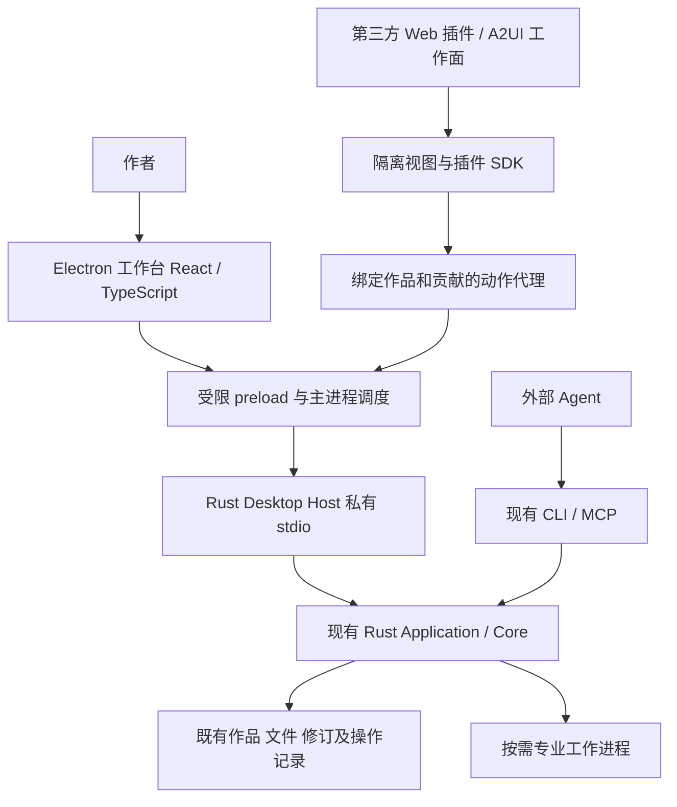

> 本文属于[创作插件体系设计](README.md)，负责插件产品定位下的桌面技术选型、保留范围与迁移验证。

# 桌面技术选型与迁移评估

## 1. 推荐结论与决策状态

已采纳Electron＋TypeScript/React工作台、TypeScript插件宿主和Rust Core，插件采用DSH风格JS/TS/React。主规范见[主39](../39-Electron与插件优先重构架构.md)，现有架构审计见[19](19-现有架构审计与插件优先重构.md)。

Rust 业务内核、机器合同和作品格式继续保留；客户端呈现层需要重新评估。原生＋系统 WebView 技术上可行，但当主要扩展能力由 Web 插件提供时，需要维护两套原生客户端、两种网页引擎和各自的桥接与发布。Electron 将前端与插件运行环境统一到 Chromium，代价是客户端迁移和额外的运行时资源成本。

用户已授权先完善全部文档，再完整开发。原生版保留可运行对照和必要维护，新UI按插件优先重审。默认入口切换和原生退役须经主39门禁；开发授权不等于发布或删除授权。

## 2. 选型前提怎样变化

| 产品前提 | 对客户端的要求 | 更值得评估的路线 |
| --- | --- | --- |
| 核心是稳定、精细的原生文稿编辑，扩展较少 | 原生文本与平台体验优先 | SwiftUI/AppKit＋WinUI |
| 保留原生编辑，少量专业扩展用网页 | 原生功能与 Web 工作面协同 | 原生＋WKWebView/WebView2 |
| 主要专业能力通过插件交付，Agent 动态组织界面 | 共同的组件环境、加载器、布局、SDK 和开发工具 | Electron＋Rust |

河图当前讨论已将第三项提升为核心产品方向。选型应依据这一目标调整，不能因为已存在 SwiftUI 页面就自动维持全部原生路线，也不能只因外部产品采用 Electron 就推导它适合河图。

## 3. 工程代价比较

| 维度 | 两端原生＋系统 WebView | Electron＋Rust |
| --- | --- | --- |
| 桌面外壳 | SwiftUI/AppKit 与 WinUI 两套适配 | 共同 Web 外壳，系统集成分别处理 |
| 第三方界面 | 同一 Web 包，在 WebKit／Chromium 上分别验收 | 同一 Web 包，在随产品固定的 Chromium 上验收 |
| 专业组件共享 | 原生组件需分别实现；Web 组件可共享 | React 或其他 Web 组件可共享 |
| A2UI | 适配多个原生 Renderer，或统一在 Web 容器中使用 | 在共同 Web 环境中使用；仍需领域目录 |
| 当前页面迁移 | 保留大部分 Mac 页面；Windows 需实现 | Mac 页面、状态与交互需要迁移；Windows 复用主要前端 |
| 中文长文 | 现有 NSTextView 实现可继续使用 | 新编辑器必须独立验证 IME、撤销、选区及大文稿 |
| 原生行为 | 系统控件与平台 API 直接接入 | 主进程／原生模块处理平台能力 |
| 资源与制品 | 使用系统网页引擎，仍需实测多视图开销 | 分发 Chromium 和 Node，启动、内存与包体需实测 |
| 插件隔离 | 需要会话、iframe、桥接与进程规则 | 同样需要隔离；Electron 不能自动解决任意插件安全 |
| 升级与维护 | 系统引擎版本差异及两端客户端升级 | 自行固定和更新 Electron，承担浏览器安全更新责任 |

这里比较的是维护边界，不提供未经测量的工期、内存或包体数字。统一 Chromium 降低引擎差异，不能消除字体、GPU、IME、编解码器、文件系统和操作系统差异。

## 4. 推荐目标架构

Electron管理窗口、插件容器与系统交互；Rust Desktop Host是共享Core的桌面入口适配器；插件注册、依赖、布局及生命周期由TS插件宿主管理，界面交互不逐次经Rust。各层复用既有领域合同，不建立第二份领域逻辑或作品库；专业插件不自建Agent引擎。桌面承载所选引擎的会话宿主由[主39第4.3节](../39-Electron与插件优先重构架构.md#43-agent-会话宿主)拥有，CLI/MCP保持独立工作，不依赖Electron窗口存在。

### 4.1 Electron 与 Rust 怎样连接

建议先验证随制品分发的 Rust 子进程与私有 stdio，使用有界 JSON 请求、响应与事件：

1. Electron 主进程启动确切路径与版本的 Rust Desktop Host。
2. 初始化协商应用合同、能力及当前会话。
3. 可信React主界面经受限preload 提交实际业务请求。
4. 主进程依据请求来源选择可信作者通道或受限插件上下文。
5. Desktop Host 调用现有 Application/Core，并返回既有结果与恢复引用。
6. 超时后沿原操作查询；进程退出不等同于业务取消或自动回滚。

选择 stdio 是为了先复用现有 Rust 领域边界并避免依赖 Electron 的原生扩展 ABI。N-API 可在有性能证据时评估；不同时建设两个永久桌面业务入口。传输适配仍需实现生命周期、并发、消息预算和崩溃恢复，不能把“使用 JSON”当作完成。

### 4.2 插件界面怎样运行

插件以预构建 HTML/CSS/JavaScript 与资源交付，第三方界面放入隔离 iframe 或独立 WebContents 容器。宿主选择一种通过验证的初始隔离方式，再按实际资源需求扩展，避免无条件给每个小控件创建浏览器进程。

React 适合作为第一方工作台技术候选；插件公共 SDK 以有类型消息和领域动作为边界，允许使用其他前端框架。可信第一方组件可以进入共同注册表；第三方代码不因需要插槽就直接进入主页面全权限执行环境。

A2UI 提供动态组合描述；画布、关系图、时间线与三维组件由插件实际实现。任意网页、插件成果与可信作者界面分别绑定权限和存储；外部网页不获得应用 preload 或作者调用能力。

## 5. 保留资产与迁移范围

| 资产 | 处理方式 | 需要核验 |
| --- | --- | --- |
| `core/` 的领域和应用用例 | 保留，按新入口所需补适配 | 事务、锁、授权与原操作恢复 |
| `contracts/` 的已发布合同 | 保留语义，新增桌面适配遵守发现 | 不能从新界面暗中扩大权限 |
| 独立 CLI／MCP 与外部 Agent Skills | 继续复用，按实际入口补验证 | Electron 完全退出后的真实旅程 |
| 既有作品、Markdown/Fountain 与受管媒体 | 保持格式和身份 | 新客户端打开同一作品，旧引用和反馈有效 |
| `apps/task-view/` 中可复用 Web 能力 | 按依赖闭包提取组件和桥接经验 | 避免保留两套同义状态与数据 Owner |
| SwiftUI 页面与 `WorkspaceModel` 等客户端状态 | 逐页盘点并迁移对应职责 | Swift 中的流程逻辑不能误认为纯外观直接丢弃 |
| `NativeTextEditor.swift` 的编辑体验 | 建立 Web 编辑器对照原型 | 原生 NSTextView 不能直接变成 Electron 内的跨端控件 |
| Keychain、文件选择、安装和系统行为 | 通过 Electron／Rust 平台边界接入 | 凭据、路径与生命周期逐平台核验 |

最主要的迁移成本是客户端页面、状态、交互与平台装配。保留 Rust Core 能降低领域规则重写成本，不能据此宣称切换桌面壳成本很低。

## 6. 插件授权与恢复

主进程校验发送者的窗口／frame／视图身份，插件实例绑定固定包摘要、当前作品范围与声明动作。禁止将通用 `ipcRenderer.invoke`、Shell、文件系统、数据库或作者句柄暴露给插件。

关闭、撤权、切换作品及包升级使旧会话失效。作者决定在可信界面展示确切成果或差异，通过现有内核规则记录；插件只能请求进入该流程。保持独立插件失败不影响当前正文、未保存稿和无关工作区。

作品状态继续由 Core 保存，网页组件的 state、localStorage 与 Chromium profile 不成为作品权威。工作台布局、当前缩放及临时选择与作品内容分别管理。

## 7. 可推进的验证顺序

文档门禁通过后，按公共贡献合同建立独立开发版；保留原生对照，不以复刻旧页面为目标：

1. Electron 窗口打开现有作品的获权读取投影。
2. 通过 Rust Desktop Host 读取和保存一个协作稿，核对原生客户端与 CLI/MCP 的实际结果一致。
3. 安装一个宿主业务代码中未硬编码的新 Web 视图包，完成加载、操作、保存、关闭和重开。
4. 加入实际中文长文、选区、批注及版本对照，验证编辑器候选。
5. 使用同一前端、插件包和作品在 Windows 完成相同旅程。
6. 在同一组件上加入 A2UI 组合，测量收益与额外成本。

开发时可保留现有产品用于对照，但不将两套完整客户端永久并行维护作为目标。采用后按作者旅程分批切换，直到旧呈现实现退役；具体工作包进入现行实施计划，不能由设计文档自动触发搬迁。

## 8. 采用与拒绝条件

采用证据应同时覆盖：新插件无宿主业务改码可加载、两端共享前端比例有明确清单、真实 Core 写入和冲突恢复、中文输入与撤销、大文稿阅读、媒体与三维、离线、资源预算及签名安装。

如果新编辑器损坏中文写作体验、资源占用超过团队冻结预算、或者新界面仍需频繁改两端原生代码，需先修正原型或保留原生备选路线。不能以“DSH/Lime 也使用 Electron”代替这些证据。

现有原生备选方案与源码证据见[17](17-原生宿主与插件渲染技术方案.md)；公共数据与动作仍由08/09拥有。继续开发前同步全部受影响主规范、插件文档和验收计划，不让设计目标冒充实现基线。
