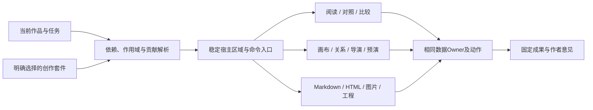

> 本文属于[创作插件体系设计](README.md)，负责现有实现的适配判断和插件优先重构准入。

# 现有架构审计与插件优先重构

审计日期：2026-11-16。结论基于当时工作树中的源码，不代表正式发行制品已覆盖相同范围。插件统一采用JavaScript/TypeScript＋React，注册和交互由TS宿主执行，Rust保持作品事务底座。目标架构由[主39](../39-Electron与插件优先重构架构.md)拥有，实施状态归主38。

## 1. 审计结论

现有版本适合复用为业务与数据底座，尚不能直接支撑开放的创作插件生态。问题同时存在于能力注册、权限、数据扩展、加载与工作面组织；并非单纯因为使用SwiftUI，也不能通过换成Electron自动解决。

原生版源码及专属构建已退役，历史证据保留原版本范围。保留的是已经验证的业务语义，旧页面形态不获得自动继承权。Electron版按宿主＋贡献＋套件＋自由成果设计；把固定路由翻译成React不足以完成插件化。下节原生路径用于解释审计背景，当前源码差距见第8节。

## 2. 源码事实与处置

| 现有事实 | 源码证据 | 对插件化的影响 | 处置 |
| --- | --- | --- | --- |
| Kernel统一调用并检查动作、版本和输入 | `core/src/application/mod.rs` 的 `Kernel::request/execute` | 可复用确定性规则，避免JS重写业务 | 保留；插件路由最终进入相同授权与事务边界 |
| 能力目录编译自固定文件 | 同文件 `catalog()` 及 `contracts/actions.json` | 新动作需重编译宿主，第三方无法独立注册 | TS宿主增加受管贡献目录；核心合同和动态贡献分层发现，Rust核验获权执行 |
| 固定领域包与兼容判断 | 同文件 `PACKAGES/LEGACY_PACKAGES` 与工作区配置检查 | 安装新专业能力不能等同给固定数组加名称 | 旧格式保持可读；插件依赖与绑定采用独立版本化记录 |
| 动作通过固定match分派 | 同文件应用分派 | 领域内置能力可用，但不是任意插件执行合同 | 先包装既有动作；新增贡献经声明、验证和窄调度 |
| 界面由固定选择值分支 | `apps/macos/Sources/HetuMac/HetuMacApp.swift` 的 `detail/select` | 新界面必须修改主App，无法独立加载和撤销 | 新宿主按贡献注册和激活条件生成导航 |
| WorkspaceShell直接认识各工作面 | `apps/macos/Sources/HetuMac/WorkspaceShell.swift` | 布局与业务耦合，难按套件选择和按需显示 | 保留任务层级；重新设计区域、入口与布局合同 |
| WorkspaceModel和各Session承担前端编排 | `apps/macos/Sources/HetuNative/` | 不能把全部Swift逻辑都当外观丢弃 | 按领域规则、宿主状态、插件状态、平台行为重新归属 |
| 仅固定任务网页容器 | `LocalTaskViewControls.swift`、`LocalTaskViewSession.swift`、`apps/task-view/src/local/` | 已有窄桥接经验，缺少通用包身份、加载和作品绑定 | 复用组件与原则；新建受管浏览器/插件容器 |
| CLI/MCP直接复用Core | `apps/cli/`、`apps/mcp/`、`bindings/swift/` | 支持无GUI业务，但新插件动作尚无对等入口 | 目标Rust CLI及MCP共用贡献发现和执行合同 |
| 固定WorkRef、来源修订和事务记录 | Core、`contracts/schemas/work.schema.json`、07／29／30 | 能避免插件复制正文和关联扩权 | 保留Owner；所有新贡献携带确切作用域 |
| Skills按任务和题材分发 | `tools/hetu-skills/`、`integrations/catalog.json` | 可承载插件方法，但不等于运行插件加载器 | 方法贡献复用已有分发，安装及使用状态分开 |

新建的App Server草稿仅适配可信桌面与Core，并未解决表中全部缺口；其测试不构成插件、GUI或平台完成证据。

## 3. 需要保留与重新设计的内容

| 保留的事实和规则 | 需要重新设计的产品与技术结构 |
| --- | --- |
| 作品身份、对象归属、权限、历史引用和受管原字节 | 宿主入口、工作面贡献和套件组织 |
| 修订、CAS、原键恢复、固定成果和作者决定 | renderer、preload、主进程与插件通信 |
| 正文/设定/剧本/媒体的明确Owner | 专业对象的Schema注册、保存、迁移与降级 |
| 外部Agent驱动、机器入口对等和人类审阅 | 对当前任务选择视图、工作面布局与命令入口 |
| 中文编辑、选区来源、撤销和未保存保护要求 | Web编辑器实现及跨平台适配 |
| 标准导出和独立CLI/MCP | 包加载器、SDK、生命周期和分发验证 |

原生界面中的长表单、固定页面分组和逐步人工操作不作为兼容合同。兼容关注旧作品能继续打开、引用仍指原义、作者未失去必要能力。

## 4. 宿主与第一方插件的边界

桌面宿主用Electron/TypeScript；插件运行时用JavaScript/TypeScript，前端优先React。包加载、依赖、插槽、事件及清理由TS负责，Rust不承担UI运行时。后端需要时启动受管Node插件进程；基础机器用例可直接用Rust，动态插件调用同一TS宿主。

宿主拥有全局创作库、精确作品上下文、可信授权/决定、布局容器、错误/恢复和扩展管理。它提供“在什么对象上显示什么贡献”的机制，不维护每种创作工具的专有菜单。

小说、剧本、视频、设定和专业分析等第一方能力通过稳定贡献ID登记视图、动作适配、导航和方法。第一方可使用宿主受信组件，但仍需同样的依赖、版本、范围和卸载合同；第三方代码进入独立隔离环境。共同合同不意味着二者拥有相同执行权限。

Core中既有小说和剧本规则先保留并由贡献调用，不立即将安全规则迁出内核。底层可在真实依赖独立时拆分库；不为“万物插件”重写已经正确的事务与授权，也不要求启动时加载所有插件。

## 5. 工作面与交互怎样改变

旧方式是主App选择某页面，再由页面决定可显示的工具。目标方式是当前WorkRef、套件选择和实际贡献共同确定可用工作面；作者可用阅读、关系、画布、表格、三维或自由成果观察同一对象。

贡献描述“适用什么对象、读什么固定投影、有哪些获权动作、选择和反馈锚点、如何恢复”。宿主提供有限区域，Agent可准备布局与操作方案，作者默认审阅结果；不用大量配置界面替代复杂创作。

同一数据多视图不等于每种视图能修改所有字段。筛选、缩放和布局为用户偏好；专业数据、对象选择、修改与作者决定分别授权和保存。

## 6. 最小闭环与准入

第一个闭环必须包含一个宿主业务源码未列举的新包：由manifest发现视图与动作，按WorkRef加载；通过受限SDK读取并维护其获权草稿，形成受管修订；CLI/MCP读取相同结果；停用、关闭重开和升级后保留历史与标准导出。

仅静态HTML显示、只读投影、主App内置几个React组件或CLI直写任意插件目录，都只算局部技术验证。第一个闭环通过后才能以共同合同迁移小说/剧本能力，避免先造大量不可扩展页面。

插件缺失时至少保留已有正文、媒体、原工程、引用元数据和中性预览；需插件才能编辑的字段明确只读。不因插件卸载自动丢数据或改变定稿。

## 7. 设计验收问题

1. 不修改宿主业务路由，能否接入新的独立包？
2. 第一方能力是否使用相同贡献ID、发现和生命周期合同？
3. 插件获得的是范围会话还是作者通用句柄？切换作品后旧会话是否失效？
4. CLI/MCP能否在Electron完全退出时读取、执行获权动作并恢复？
5. 视图状态、作品权威数据、本机安装和私有授权是否分别保存？
6. 拆掉某专业插件后，作品和历史是否仍可理解、读取与交付？
7. 作者能否只审阅成果和表达意图，也能按需直接编辑？
8. 中文编辑和原操作恢复是否经过真实实现验收，而非仅截图？

任一关键问题没有可验证答案时，优先修正架构，不通过复刻原生页面扩大代码量。需求追踪与证据要求补入15及主19，具体工作包归主38。

## 8. 创作工程与开发者视角复核

结论：当前分层具备继续实施的基础，独立JS/TS包已经有真实入口；尚未满足完整生态准入。测试能反驳不成立的合同，不能证明这是唯一最优架构。采用标准是：新增专业能力是否能独立交付，作者的数据是否持续可读，Agent是否能无窗口操作，以及支持与兼容成本是否下降。

| 归属 | 最小职责 | 划分依据 |
| --- | --- | --- |
| 共享Core | 作品身份、固定修订与来源、授权、CAS、事务、作者决定、原操作恢复 | 任一插件退出后仍必须成立的作品规则 |
| TS插件宿主 | 包校验、依赖、贡献注册、生命周期、隔离桥接和能力投影 | 专业能力可替换，宿主无需认识其业务菜单 |
| 专业插件 | 关系、时间线、导演工具、专业渲染、算法和服务适配 | 可独立选择、升级与停用的创作能力 |
| Skills与外部Agent | 方法、理解、规划、编排与生成 | 无内部Agent循环；执行仍核验真实能力和授权 |

Core中的小说、剧本模块不能仅按文件名判断去留。作品权威规则保持单一Owner；专业算法和投影可逐用例迁出。禁止为插件化复制正文、另造授权Store或让插件直开Core内部数据。

对标固定版本的Pi与DeepSeek Harness，来源和测试映射见[15](15-测试验收与追踪矩阵.md#9-pi与deepseek-harness对标用例)。Pi的轻量扩展和组合分发值得借鉴；其同进程扩展权限不能直接成为河图权限模型。Harness的贡献生命周期、配置组合和包级文档值得借鉴；其Agent编排不属于河图宿主。

当前需要继续收敛的边界：

- `apps/desktop/src/renderer/contributions.tsx` 静态导入第一方工作面，尚未全部接受与独立包相同的安装、停用和发现合同。不能把注册贡献等同独立插件交付。
- `apps/desktop/src/main/main.ts` 和 `core/src/application/mod.rs` 仍集中大量路由。拆分以依赖方向和可测试用例为依据，不用增加空转接口或框架层来降低行数。
- 独立包脚手架、固定包校验、机器操作、故障隔离与插件自有清单纳入本期验证。陌生开发者试用、兼容发布、索引分发和真实供需循环需独立取证，进度统一归主38。

开发者路径以[20第23节](20-首期可执行合同与开发入口.md#23-独立插件开发工具)为入口。宿主地图只导航宿主与插件发现入口；每包拥有自身功能清单、机器声明和限制，避免中央清单成为生态发布瓶颈。
