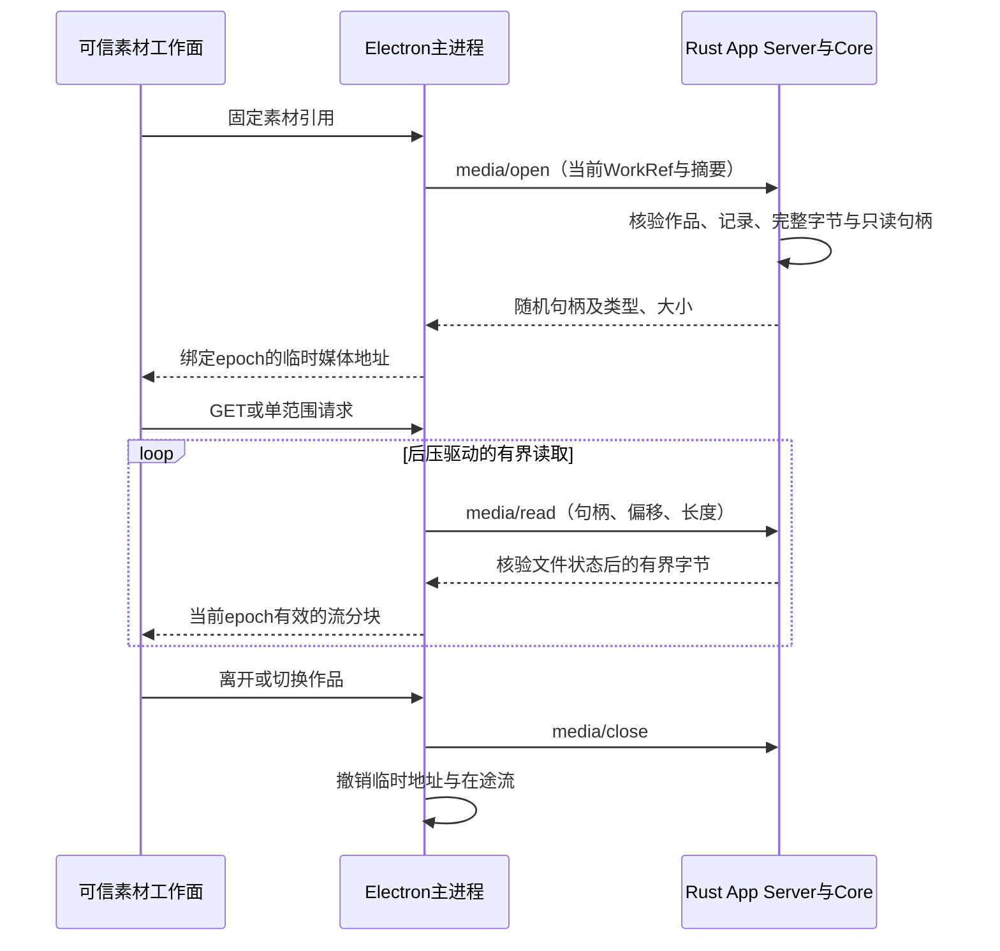

> 本文属于[创作插件体系设计](README.md)，定义首期实现的版本化子集。目标能力及后续工作仍由14和主38追踪。

# 首期可执行合同与开发入口

## 1. 合同冻结

首期 `manifest_version=1`、`host_api=1`，采用离线预构建 JS/TS＋React 包。包清单声明视图、数据 Schema、可选后端动作及精确依赖；无安装脚本。摘要覆盖排序后的全部分发文件及相对路径，拒绝软链接、越界路径、重复贡献与依赖环。运行中按固定包快照读取，禁止校验后再从可变源目录执行。

各插件自行维护功能清单及 `manifest.contributions`，变更功能时同步更新；运行时能力由固定包和当前授权投影。宿主能力地图只维护宿主能力及插件发现入口，不重复登记插件业务功能。

河图插件只安装在河图；外部Agent通过稳定CLI／MCP查询及调用，不需逐包安装Codex插件。核心格式、`plugin_access.capabilities/invoke`与同一连接热插拔合同统一见[21](21-核心格式与动态能力发现.md)。客户端基础Skills接入包的更新独立管理。

TS 管理加载、依赖、插槽、effect 清理和 UI 状态。第一方工作面使用同一注册合同。第三方视图在独立 sandbox WebContentsView 中运行，无 Node，固定来源及会话代次；普通网页没有插件 preload。Node 后端按需在独立进程运行；Node 权限模型仅为纵深限制，不宣称抵御具有本机权限的恶意安装包。

包可以不贡献数据类型。纯视图或纯计算包使用空 `permissions` 和空数据类型列表，仍绑定确切作品、包摘要及可撤销会话；CLI／MCP 只发现其声明的只读计算动作，不发现专业对象读写。计算输入由调用方明确提供，不因绑定作品自动读取正文。此类包不得声明 `managed_write`；声明数据权限时必须有对应类型。包的启用、作品绑定与数据授权分别核验。

## 2. 私有作者通道与插件通道

可信主进程的 `extensions/host` 接受 `authorize`、`inspect`、`revoke`、`read`。只有可信作者入口可发授权或撤权，不能由插件桥接转发。`inspect` 只核验并返回当前绑定的能力投影，不以执行一次对象读取探测无数据权限的会话。授权记录进入独立本机私密目录，绑定工作区真实路径、完整 WorkRef、插件 ID、包摘要、允许的数据类型、Schema 和读写权限。授权随机标识不进入作品或导出。新包摘要需要新授权；撤权后重新授权产生新标识。

可信本机连接使用 `hetu-app-server --stdio --local`，只开放 `extensions/disable` 和协议生命周期，不具有作品读取或作者用例。停用、替换及卸载通过它撤销该包全部作品授权，不以作品目录仍存在为前提；依赖插件同时停用并撤权。作品绑定连接仍使用 `--stdio --workspace`。该私有控制方法不进入插件 SDK、公开数据 CLI 或 MCP 工具。

插件与机器入口使用 `extensions/request`，绑定 grant_id 与 package_sha256。Core 每次重新核验授权；不存在插件通用作者模式。专业JSON数据动作见下表，固定迁移另见第24节；实际发现以动作目录和当前授权为准，不代理正文采纳、定稿、任意文件或系统命令。

| 动作 | 输入 | 行为 |
| --- | --- | --- |
| `hetu.extensions.objects.list` | work_ref、可选 kind、limit、cursor | 当前插件与作品的分页摘要 |
| `hetu.extensions.objects.search` | work_ref、query、可选kind、limit、cursor | 当前获权标题检索与快照分页，见第25节 |
| `hetu.extensions.index.status` | work_ref | 只读返回当前派生索引状态 |
| `hetu.extensions.index.rebuild` | work_ref | 明确重建派生缓存，不写权威修订或业务操作 |
| `hetu.extensions.objects.get` | work_ref、object_id、可选 revision | 固定修订及摘要链核验 |
| `hetu.extensions.objects.save` | work_ref、可选 object_id、kind、title、schema_version、content、expected_revision、expected_sha256、operation_key | Schema、CAS、不可变修订及原键事务 |
| `hetu.extensions.objects.export` | 与get相同，format=json或markdown | 返回标准可读成果，不写任意目标文件 |
| `hetu.extensions.operations.get` | work_ref、operation_key | 同一插件授权范围的原回执 |

新增对象预期修订为0、预期摘要为空；保存已有对象必须提供 ID 与当前修订摘要。对象身份、所有者、类型不能在更新时改变。原操作核验先于 CAS，异输入复用键失败。读取旧修订核验到当前头的摘要链。

## 3. 持久化

对象位于 `extensions/objects/<scope-key>/<object_id>/`，scope-key由完整 WorkRef和plugin_id的规范化JSON摘要生成。`head.json`和`revisions/<revision>.json`复用Core受管文件事务、锁和恢复；操作与审计同时提交。首期标题检索使用第25节的可重建JSON元数据投影，不维护第二份数据库事实；插件08中的SQLite DDL仍为拟议后续实现。

停用、卸载或缺失插件时，可信作者通道仍可按 WorkRef、plugin_id 读取及导出通用 JSON/Markdown；不执行插件代码，不因未知 Schema 丢弃字段。专业编辑需要相应包与授权。

插件 SDK 的 `buffer(value?)` 只读写当前作品、插件和视图的本机恢复记录，限制1MiB，不属于作品修订或通用文件接口。示例保存和 Node 写动作先持久化固定输入及原键；重开后先查询回执，再沿原输入执行。包摘要变化时保留旧记录，不把旧操作静默套到新包。恢复稿顺序写入并在正常退出时等待落盘。

## 4. 本地开发与机器入口

在仓库根目录执行：

```bash
npm ci
cargo build --locked -p hetu-app-server -p hetu-plugin-cli -p hetu-cli -p hetu-mcp
npm run build:desktop
npm run start:desktop
```

Electron 二进制由依赖安装取得；禁用安装脚本的开发环境需显式执行 `node "node_modules/electron/install.js"`。Rust、npm与主工程前置条件见根说明。插件后端需要独立 Node 25+；开发启动使用 npm 的 Node 或 `HETU_PLUGIN_NODE`，打包版使用随制品的 `bin/node`／`bin/node.exe`。Electron 所附 Node 只服务宿主，不能替代后端运行时：其权限模型的网络限制已通过负例核对，初始化会在导入插件代码前拒绝不满足要求的运行时。

`plugins/relationships/dist/` 和 `plugins/timeline/dist/` 为构建得到的独立包，在“创作插件”选择包目录安装；仅打开具体作品后才单独授权。开发环境可用 `HETU_DESKTOP_PROFILE`、`HETU_APP_SERVER`、`HETU_PLUGIN_ACCESS_DIR`、`HETU_PLUGIN_CLI` 指定隔离配置目录与制品。它们是开发进程配置，不写入作品。

`HETU_PLUGIN_STATE_DIR`指定绝对路径的本机安装状态目录；`HETU_PLUGIN_ACCESS_DIR`指定绝对路径的私密插件授权目录，桌面、稳定CLI／MCP及插件CLI共用该设置。配置来自受信启动进程，不是作品或插件请求参数；默认仍使用本机应用数据区。

“让 AI 处理”复制精确 WorkRef、固定作品版本及当前插件连接；作者主动交接后，外部 Agent 才沿该连接调用 `apps/desktop/dist/plugin-runtime.mjs` 的 `capabilities`、`invoke <action> --input -` 或 `--mcp`。纯数据操作也可经 `target/debug/hetu-plugin` 的 `inspect`、`call <action> --input -` 执行，必须提供精确作品目录、grant和包摘要；自定义授权目录另传 `--access-dir`。MCP 使用官方 Server SDK，动态发现声明动作和 Core 数据工具；撤权后不继续发现或执行。

```bash
npm run test:plugins
npm run test:e2e --workspace @hetu/desktop
cargo test -p hetu-core --test extensions -p hetu-app-server --test stdio
```

## 5. 验证与状态

文档门禁已实际渲染84张Mermaid，覆盖架构、流程、时序和ER图；结果位于本机 `output/plugin-doc-qa/transfer/diagram-render-results.json`。源码和运行验证须覆盖独立包发现、只读与越权拒绝、保存、并发冲突、原键重放、撤权、独立机器回读、重开和停用后导出。实际结果在主20/38登记，合同冻结不等于全部能力已交付。

## 6. 作者编辑器合同

Electron 作者编辑器选用 CodeMirror 6 的 `state`、`view`、`commands`，具体版本由 `apps/desktop/package.json` 与根锁文件固定。使用长文虚拟化、中文组合输入、编辑历史、键盘操作及自动换行；默认阅读界面保持独立。该选择不使河图成为代码编辑器，不要求作者接触 JSON 或终端。

输入中的状态只留在 Web 层；本机恢复稿按文档顺序写入，不逐字调用 Rust。保存前固定正文、来源格式、基线修订和原操作键，先落恢复稿再提交 Core；未知结果保留固定输入，恢复后原键回放。组合输入期间不提交正文，切换文档与退出保留未保存稿。代码测试、合成 composition 事件和操作系统真实输入法分别取证，不能相互替代。

正文恢复记录同时容纳当前编辑、原正文基线与固定提交输入，预算为16 MiB，以覆盖 Core 单份正文4,000,000字节的合法输入及必要记录字段；批注恢复仍限制4 MiB。该预算属于本机恢复记录，不放大 Core 正文或 JSON-RPC 的传输限制。

## 7. 第一方候选审阅合同

Electron 复用 `apps/task-view` 的 MCP Apps 候选面板与 Core 任务／反馈合同；作者工作面只负责发现当前 WorkRef 的任务及打开确切 TaskRef。面板位于仅允许脚本的 sandbox iframe，不获得作者 preload 或同源权限；可信父页通过官方 AppBridge 转发固定任务内的读取、偏好和意见动作。正文采纳、定稿、授权与任意应用动作不进入面板桥接。

任务目录、候选批次、内容、图片预览及反馈继续来自 Core。面板发出的写操作先保存原输入与原键，关闭或回执丢失后可沿原操作恢复；意见已保存、提示词已复制、Agent 已接收及新稿已提交分别呈现。没有宿主发送能力时只复制继续提示词，不能把复制视为 Agent 已开始执行。

## 8. 作者采纳与定稿合同

采纳与定稿由独立第一方作者用例执行，不通过候选 iframe 或第三方插件桥接。采纳入口从当前任务的真实文本候选取得固定参考稿，核对目标文档属于当前 WorkRef；Core 生成带摘要的采纳预览，客户端呈现当前正文、结果及原始基线。作者确认后提交同一预览；并发修改由 Core 拒绝，不能改用最新版本静默重试。

局部采纳先固定参考稿与目标正文修订，再由作者在完整对照中选择参考片段和目标片段。浏览器选区转换为 UTF-8 字节范围，引用内容与固定原文逐字核对；主进程保存固定上下文，renderer 不能替换目标引用。局部选择只生成完整正文预览，确认后才提交；片段之外的正文保留。目标或参考稿已变化时要求重新读取，不将旧坐标套用到新版。

定稿针对确切文档修订执行检查，展示检查发现与覆盖范围，再由作者提供定稿理由与人工核对说明。预览、确认、撤回分别调用既有生命周期合同；检查成功不代表已定稿，采纳也不改变既有定稿版本。存在阻断时显示具体原因并允许沿固定对象交接 Agent，不伪造覆盖确认或绕过检查。

作者写操作先将完整输入、作用对象及原键保存到本机私密恢复记录；回执丢失、窗口关闭后先查询原操作，未找到时才重放固定输入。恢复记录只能从对应 WorkRef 的作者用例读取，不向候选页面开放通用操作查询权。

### 8.1 新章节与新分集

无固定正文目标的文本候选可采纳为当前作品的新章节或新分集。默认使用参考稿标题与完整内容，作者可按需调整标题、小说分卷；不要求重填 Agent 已准备的内容。主进程核验任务、参考稿与当前 WorkRef，固定目录版本后生成预览。小说新章节固定 `novel_expected` 与明确的 `volume_id`（null 表示未分卷）；剧本新分集固定 `drama_project_ref={project_id,revision,sha256}`，其小说字段均为 null。

Core 在锁内重新核验候选归属、目录 CAS、完整预览及设定快照。新分集的正文、分集记录、项目目录和采纳来源在同一事务提交，不产生游离剧本。已知作品归属的参考稿不能采纳到其他作品；未归属的历史剧本保留旧读取与原键含义，新的 Electron 旅程必须明确项目。采纳仍不等于定稿。

新目标提交前没有 document_id，恢复记录按完整 WorkRef 与 TaskRef 隔离，记录固定参考稿、目录、预览及原键；TaskRef 字段顺序不改变恢复身份。任务页独立展示恢复入口，不依赖章节已存在或当前候选批次仍相同。结果未知时禁止同任务另一新建采纳，先查原回执，未找到才以原输入重放；目录冲突拒绝整次操作。成功回读包含真实 document_id 与分集归属，作者确认回读后才清除记录。保留的原生作者入口同样为有归属的剧本参考稿补齐项目版本引用，不扩大 Agent 权限。

## 9. 外部 Agent 连接与页面交接

第一方协作工作面复用 `collaboration.workspace_access`、`authorize_workspace` 和 `revoke_management`，按当前 WorkRef 和所选客户端登记独立管理授权。页面交接读取 `handoffs.get` 的固定来源及实际能力，并携带确切管理引用；不把作品目录、页面名称或插件授权当成作者权限。作品管理连接与专业插件连接分别授权。

授权状态每次从 Core 核验。授权结果不明确时先查询状态；撤权后不能复用旧管理引用或复活原任务。开发测试可通过 `HETU_COLLABORATION_DIR` 指定作品外的隔离授权目录，通过 `HETU_CLI` 指定独立 Rust CLI；正式默认目录遵循 Core 的既有约定。复制交接不等于向外部 Agent 发送消息。

## 10. Electron 开发制品装配合同

开发装配由 `@electron/packager` 在当前目标系统执行，产出与原生应用不同身份的独立开发应用。固定 Electron、当前源码构建的 Rust App Server／CLI／MCP／插件 CLI、独立 Node 25+、工作台资源和许可一同装入制品。Node 后端脚本与机器入口需要被独立进程读取，因此开发制品使用普通资源目录，不依赖 Node 理解 Electron 的 ASAR 虚拟文件系统。

装配记录输入摘要、锁文件摘要、目标 OS／架构及全部分发文件摘要；相关源码在构建期间变化时拒绝宣称同版装配。开发版不覆盖原生应用或其用户配置，不包含作者作品或本机授权。macOS 开发签名与 Developer ID／公证分别核验；Windows 必须在具备可构建 Core 的目标系统另取证，不由 macOS 产物推导通过。

## 11. 固定管理方案审阅合同

第一方管理方案工作面通过独立 Rust CLI 和当前客户端的精确 `management_ref` 读取目录及详情，复用 Core 的作品归属校验。不能直接将作者工作区通道返回的全部方案当作当前作品目录。作者查看方案摘要、实际变化、过期及基线状态后，只能确认同一方案摘要和审核修订；批准与执行分别记录。

批准或拒绝使用可信作者用例，本机先持久化完整决定、作用作品、方案摘要与原操作键。回执未知先查询原操作，未找到才重放固定决定；并发审核、过期或作品变化由 Core 拒绝。插件及候选面板不能调用作者决定。执行仍由外部 Agent 以原精确管理授权完成，界面可以复制固定方案的接续请求，不能把复制等同于执行或提升 Agent 身份。

## 12. 创作库登记与新建交接

Electron 创作库在本机配置保存作品位置、工作区身份和最近一次名称投影，不复制正文、设定或授权。打开与刷新由 App Server 重新核对真实 WorkRef；路径被另一工作区占用时拒绝沿旧登记打开，位置不可用时展示明确状态，不以旧投影冒充当前事实。登记读取不扩大外部 Agent 的作品权限。

小说、剧本、视频的新建入口复制对应外部 Agent 的独立 CLI 接续信息，由 Agent 从实际能力发现与建书筹备开始，不要求作者先创建空的上游小说。刷新通过当前客户端的 `collaboration.created_works` 接纳真实受管新作品，并由 Core 验证身份。复制请求、新作品创建、创作库接纳分别记录，不把提示词复制当作作品已创建。

## 13. 作品资料与阅读目录

第一方作品资料读取当前 WorkRef 的真实资料、卷章或分集结构，展示可审阅结果并交接对应管理任务。小说目录遵循 Core 的卷章顺序，剧本目录遵循项目分集顺序；未归入结构的稿件单独保留。目录分页全部回读完成后才用于组织，不把默认第一页当成整部作品，不以标题猜测归属。

资料修订、正文修订和定稿分别展示。作者可以返回阅读与比较；结构和资料调整由 Agent 准备固定管理方案，不要求作者重复录入对话资料。读取错误有明确重试路径，不能把失败呈现为空作品或空设定。

## 14. 关联作品依据审阅

第一方关联工作面通过固定当前 WorkRef 的 `work_links.list/get` 读取关系和确切历史资料。先显示关联列表，再展开所选版本；关联资料版本不等于正文或媒体快照。有新版、读取不可用与需要授权分别表达，历史版本不会因刷新而跳到当前资料。

更新依据、解除与恢复继续由 Agent 准备固定管理方案，再由作者决定。关系读取和导航不传播设定或扩大 Agent 权限；交接携带关系身份和确切关系修订。涉及另一端管理权时继续由 Core 核验两份精确授权，不以 GUI 作者可见性代替机器权限。

## 15. 插件成果的固定领域来源

专业数据通过 `source_refs` 引用同一 WorkRef 的固定正文、作品设定或作品资料。保存时 Core 核验作品归属、真实修订和摘要；正文引用不以标题匹配，设定引用不以修订数字相同推定归属。引用只表示成果依据，不获得来源的读取、修改、采纳或定稿权限。

来源列表有界且不重复。新对象未提供时使用空列表；更新未提供时保持已有引用，显式提供才替换。旧修订与原操作保留原引用；来源推进不自动改写插件成果，读出和通用导出保留确切来源，即使插件已经卸载。通用素材与线索来源按第18节核验，不接受跨作品来源或任意文件路径。

## 16. 图片成果工作面合同

第一方图片工作面从当前 WorkRef 的真实创作任务分页读取封面和插图成果，复用 `hetu.interactions.get` 返回的已核验预览，不读取候选提交的任意路径、不另建图片数据库。分类、视图和角色／地点／正文关联只消费固定 `image_category`、`image_view` 和 `subject_refs`；不靠图片标题匹配人物。角色卡片主图只使用单人形象或正面图，其他视图留在独立图组。

图片按原比例显示，加载错误与空成果分别处理。页面只保留当前任务页的预览，下一页替换当前页，避免无限累计解码图片。选择图片后固定 TaskRef、submission_id、candidate_id 和摘要，完整来源按需展开；刷新不会把已选历史成果静默换成新批次。图片详情可打开共享候选审阅面板，对确切批次表达偏好与反馈；候选接收、偏好、封面选用与正文采纳仍为不同决定。

人物和正文入口可用固定实体或文稿引用筛选相关图片；旧设定的关联保留其修订含义。图片库的读取与审阅不扩大 Agent 权限，不为尚未具备作品归属的通用素材接口放开整根读取。历史图片在当前任务出现新批次后仍按原 submission_id 回读；预览损坏、错作品及撤权须失败关闭。

## 17. 作品资料整理与审阅合同

文字资料以不可变 WorkRef 区分同根创作对象，任务创建自动绑定，历史未归属资料不自动归类。列表、固定读取、实体设定引用、使用位置、任务输入及页面交接分别核验作品权限。二进制素材保留独立实施范围。

第一方资料贡献工作面展示分类、来源、完整正文、历史与使用位置；默认 Agent 整理、作者阅读及决定。采用、归档和可选人工编辑复用 Core 的 CAS／事务，主进程在确认前固定输入并持久化原键，unknown 先查原回执再重放，不能刷新 expected 强行覆盖。恢复记录按作品隔离，独立入口不受归档和筛选影响；人工稿在本机保存，采用／归档不丢弃未保存修改。正常机器流程通过精确管理方案、作者决定及独立任务连接完成，不依赖 GUI 自动化写资料。实现及验收状态由主38登记，不以本合同代替通过证据。

## 18. 通用素材与线索来源

素材与线索2.0记录固定不可变WorkRef，精确连接不能枚举或读取未归属旧记录及同根其他作品。导入、元数据修改、线索保存沿现有固定管理方案执行；不新增可自报作者批准的写入口。线索引用核验同作品正文和素材，作品身份、元数据修订及摘要分别校验。

专业成果的`source_refs`增加`kind=asset|cue`，分别携带`asset_id|cue_id,revision,sha256`及同一`work_ref`。来源核验不复制原媒体，不放开跨作品授权、下载、权利修改或作者决定；历史来源固定，不因新元数据推进而漂移。作品归属与来源合同见[主35第3.2节](../35-资料素材与短剧制作资产.md#32-通用素材与线索的作品归属)。具体实现、实际播放及性能状态归主38，不以元数据或签名校验宣称已播放或完整解码。

## 19. 可信媒体预览传输

第一方素材预览固定`work_ref＋asset_id＋revision＋sha256`，由Core核验作品、真实元数据及完整原字节摘要后打开受管只读句柄。schema1未归属素材不自动获得作品预览权。句柄仅由可信App Server持有，插件、参考网页和renderer均不接收文件系统路径或文件描述符。本机预览不等于允许再分发或内容外发。

| 私有方法 | 输入 | 输出及约束 |
| --- | --- | --- |
| `media/open` | `work_ref,asset_id,revision,sha256` | 随机`token`、固定`asset_ref`、`media_type,size_bytes`；仅作者内核，最多8个句柄 |
| `media/read` | `token,offset,length` | `base64,offset,size_bytes`；每块最多512KiB，每次核对同一文件身份及修改状态，非法范围或变动即拒绝 |
| `media/close` | `token` | 幂等释放；退出及作品切换释放全部句柄 |

这些方法属于私有桌面传输，不能经通用`workspace/request`、插件动态动作或MCP调用；不新增作者决定、领域写入口或公开下载能力。完整媒体不进入NDJSON单帧，少量有界分块由同一stdio协议传递，遵守8MiB单帧限额。普通元数据与固定方案仍通过既有CLI/MCP执行。

Electron主进程将Core句柄绑定当前作品epoch和随机`hetu-media://`地址，只在可信工作台session注册协议。支持GET、HEAD、单个HTTP字节范围、后压和取消，不监听HTTP端口、不加载任意本机路径、不跟随来源URL。插件与普通网页的独立session不注册此协议；工作台CSP只为图片及媒体放行该scheme，脚本、连接和iframe仍受原限制。切换作品、关闭预览和退出撤销地址；旧异步读取在返回前再次核对epoch，不能把旧作品字节提交到新界面。

图片预览另限原文件32MiB、宽高1～8192、总像素6400万，打开时核对尺寸头；小图不套用封面的最小尺寸限制。PNG／JPEG／WebP还需通过Rust静态像素解码，单次分配上限512MiB；GIF及动画的全部帧不据此声明完整核验。图片等比展示，音频和视频使用本机Chromium解码与标准播放控件，默认不自动播放。加载、解码失败和不支持编码分别提供明确提示及重试；不能将文件签名识别、成功传输、尺寸头核对或播放器元数据事件写成完整媒体解码及作者认可。浏览器显示成功不改变素材持久记录的`validation=signature_only`。区间意见、媒体选用和成片确认另有领域合同，不由播放器暗中创建。



## 20. 作品导入与固定交付

导入和交付沿用共享 Core 的固定预览、管理方案、作者决定及原键恢复，不在 Electron 或插件中另建文件转换与打包引擎。新请求携带明确 `work_ref`；旧工作区请求及原操作保持原义，不从当前页面补填历史归属。

| 用例 | 机器合同 | 作者工作面 |
| --- | --- | --- |
| 原稿导入预览 | `documents.preview_import` 固定作品及 `inline_source` 原字节；作品权限不授予任意路径读取 | 展示转换后的完整正文、来源摘要、转换损失及目标 |
| 导入小说章节 | `documents.import` 固定 `work_ref`、`novel_expected`、可选分卷；`import_batch` 固定同作品与目录 CAS | 在管理方案确认确切正文及目录变化，Agent 执行后到原作品阅读 |
| 导入剧本分集 | `documents.import` 固定剧本 `work_ref` 和 `drama_project_ref`；正文、来源快照与分集目录原子提交 | 不要求创建上游小说，不产生未归属的游离剧本 |
| 固定文稿导出 | `documents.preview_export/export` 固定同作品正文修订、格式和 profile | 展示文件清单、格式损失与来源；批准和执行分开 |
| 作品交付包 | `bundles.preview/export` 固定作品自身设定、正文及同作品素材／线索 | 正式交付继续核验定稿及权利；不能用审阅包冒充定稿 |
| 原包核验 | `bundles.verify` 核对持久交付意图中的 `work_ref` 与实际包摘要 | 展示完整性结果，不把摘要一致当作版权或内容认可 |

精确作品授权只发现该对象可执行的导入／交付能力。整书小说导入由外部 Agent 依据作者当前会话的真实指令登记固定 `import_authorization_ref`，Core 只允许固定分卷和下一组批次，正文与游标同事务推进；不要求桌面逐批批准。其他写入仍按各自固定方案和决定合同处理。跨作品正文、设定、素材、线索及不具备可验证归属的历史报告／骨架／比较拒绝进入对象交付。视频制作工程不使用文稿交付合同冒充完整工程包。插件和候选 iframe 不获得作者决定、任意文件读写或通用下载能力。

Electron 的“导入与交付”贡献工作面从精确管理连接读取对应方案，显示人可读的目标、转换内容、固定文件与权利问题；复用同一审核、恢复及接续入口。页面交接携带实际 `import` 或 `delivery` 类型与固定对象，不只复制通用作品提示词。导入记录在正文来源中回读，交付结果显示实际路径、摘要和包核验；执行未知仍沿原方案及原键查询。

## 21. 本机设置与创作方法安装

Electron 的非敏感偏好和外部 Agent 套件选择由独立 Rust 本机服务拥有，和作品数据库、插件状态、密钥存储分离。公开 `hetu.local_settings.get/prepare/get_operation/execute` 继续采用现有合同；CLI 与稳定 MCP 直接调用同一服务，无需桌面窗口，不递归启动同包 CLI。结果遵守公共 AXI Schema，`context.scope_id` 使用 `collaboration`，不冒充任何作品授权。旧原生 UserDefaults 与旧方案保持原义，不静默合并、批准或重放到新宿主。

| 边界 | 确定性规则 |
| --- | --- |
| 固定输入 | 准备时固定完整偏好基线、客户端、摘要、期限；套件另固定目录身份、包版本、全部文件摘要及目标客户端 |
| 作者决定 | 公开 `local_settings.record_decision` 记录当前会话对固定方案的真实选择；可信 App Server 的 `local_settings/host` 提供桌面固定审核与人工设置。公开入口没有通用 decide、任意路径、Shell 或 approved 字段，记录决定不执行安装 |
| 冲突与恢复 | 基线变化拒绝批准／执行；批准不执行。执行结果和偏好在同一事务提交；同一执行键重放返回原结果，不以新键覆盖旧操作 |
| 套件安装 | 只安装明确所选包；Codex 由官方插件命令登记，WorkBuddy 使用其个人 Skills 目录。不得修改账号、凭据或直接重写 Codex 配置；其他客户端先提供选择与接入说明 |
| 安装预检 | 精确查询所选 Codex 市场及来源，检查旧缓存、固定目标与包摘要；只读失败保持 approved，不受无关市场加载错误影响。空目录不证明同名市场不存在，官方 add 仍核验来源冲突 |
| 外部结果未知 | 预检通过、首次写入前记录 executing；之后仅回读官方登记与原固定缓存摘要，不因随包升级而改装新字节。无法确认时保留未知，不换键重复安装，不将文件存在当作当前会话已加载；没有阶段证据的历史 executing 也只读恢复 |
| 界面生效 | 外观及阅读偏好由宿主消费共享快照；修改偏好不移动编辑光标、不替换未保存文稿、不自动批准内容操作。语言设置与完整双语验收分别记录 |

本机服务使用独立私密目录，设置版本、方案及原键回执共用 Core 的锁和可恢复事务。`HETU_LOCAL_SETTINGS_DIR` 仅由可信启动环境选择绝对目录，用于开发与隔离验证，不作为 Agent 请求参数。Skills 资源来自随包 `integrations/catalog.json` 和对应 `integrations/codex/`，安装时核验完整性；包替换后旧固定方案不能安装新字节。安装状态按客户端和套件记录，不能由当前作品授权获得整机文件读取权。

### 21.5 作品首页的AI协作

作品首页复用本机设置Owner和固定方案，不建立第二份套件选择。`local_settings.get/prepare`接受精确`work_ref`，和旧`workspace_id`互斥；旧键保持原义，不自动传播至同根作品。可信作者通道保存明确的客户端／套件选择，采用设置修订CAS及原操作键。公开`local_settings.inspect_suite`仅检测所选客户端与套件的受控位置；任意目录只能由可信文件选择器明确选择后检测，不从机器参数接收路径。检测核验包身份与Skills文件，单独呈现登记、版本及当前会话待验证状态，不把安装回执冒充已加载。

安装按钮准备固定套件版本、摘要、目标客户端与当前WorkRef；作者审核后复制原方案给外部Agent执行。只读检测、分类检索、推荐解析、手动接入说明与打开随包目录不触发安装、授权、正文修改或生成。界面切作品后丢弃旧检测结果与预览，未知安装保留原操作继续回读。

### 21.1 模型渠道设置

可信工作台通过私有 `model_service/host` 复用原生 `ModelService` 的连接、渠道和默认模型设置；与非敏感偏好分开，不向插件、普通网页、CLI或MCP开放作者密钥设置。仅接受 `inspect/connect/poll/disconnect/catalog/custom_save/channel_select/select`，不提供生成或任意网络请求。浏览器连接地址只接受Core返回的河图HTTPS确认页。密码输入保存后清空，不回显密钥，不把其写入日志或恢复区；账号连接未知时先检查已有pending，禁止自动重复创建连接。

可信启动环境可通过绝对路径 `HETU_MODEL_SERVICE_DIR` 隔离模型服务目录，不接收请求参数中的目录。指定 `HETU_DESKTOP_PROFILE` 的开发实例默认使用该配置下的 `model-service/`，避免测试渠道或账号影响正式本机配置。

### 21.2 封面作者通道

可信工作台复用 `hetu.covers.get/list_requests/list_candidates/select/inspect_file`。作者本地文件选择仅在主进程进行，renderer取得预览和不透明选择token，不接受renderer传入任意文件路径。选用固定完整来源、图片摘要、当前封面CAS与展示文字，提交前保存作品绑定及原操作键；未知先查询原 `hetu.operations.get`，未执行才重放相同输入。历史恢复引用已核验资产并生成新封面修订，候选与旧历史均保留。切换作品使旧token失效，第三方插件和参考网页不能调用该通道。

### 21.3 小说人工资料与结构

可信 `desktop:novel` 仅封装当前小说的 `hetu.novels.get/update/save_structure`，不成为通用作者动作入口。人工保存消费打开时的 `expected`，主进程生成原键并先落盘；未知先查询原操作，不通过新键覆盖。Core核验资料Schema、完整卷章CAS及原章节／正文映射；人工重排不能增删章节或改正文。关闭、重开和返回阅读保留正文与未保存缓冲。

### 21.4 设定人工维护

可信 `desktop:canon` 只封装当前作品设定的读取、变更预览、保存、锁定与解锁。保存固定打开时的设定身份、修订、摘要与类型化变更，主进程生成并持久化原操作键；未知先回读，不能换键覆盖。移除先经Core预览核验引用，再由作者确认。锁定后仍可阅读当前及历史版本。编辑保留人物事实、时间范围和来源；取消、关窗与冲突保护未保存输入。插件、参考网页及管理授权不能调用此作者通道。

## 22. 精确作品的文稿版本

作品版本使用既有 `hetu.git.*` 合同的显式 `work_ref` 分支，不把工作区 Git 权限授予单作品连接。小说与剧本文稿分别保存在 `refs/heads/hetu-work/<kind>/<object_id>`；首个提交没有父提交、从空树建立，后续只继承该作品的已核验提交。旧工作区快照及引用保持原义，不推断或迁移归属。

| 环节 | 固定合同 | 约束 |
| --- | --- | --- |
| 状态与差异 | `status/diff` 携带 `work_ref`，只枚举可核验归属的作者文稿元数据及正文修订 | 不枚举同根其他作品、未归属旧剧本、私密审核或任意文件 |
| 准备快照 | `snapshot` 的 prepare 固定作品、作品版本头、所选路径、字节摘要及提交身份；新快照记录1.1.0携带作品，旧1.0.0保持读取 | 未选择变更只显示同作品文稿；不继承工作区 HEAD 的树、提交说明或父历史 |
| 作者批准 | 可信宿主核对固定快照和完整差异后调用 `approve_snapshot` | 批准不执行；插件及公共机器入口无作者批准权 |
| 原键执行 | Agent 使用原 snapshot_id 与原 operation_key 执行 | CAS、批准期限、输入摘要及原执行日志共用既有确定性规则；Agent准备时另固定客户端及授权修订，撤权再授权不复活旧执行权 |
| 历史与读取 | `log/read_version` 只接受该作品引用内、可由固定执行记录核验的提交 | 不读取任意 Git 对象；历史正文不直接 checkout 或覆盖领域记录 |

该合同的首个切片保存作者文稿版本，不声称覆盖设定、素材、视频工程、分支合并或网络同步。工作区级分支、远端、fetch/push/pull 不由精确作品连接发现或执行，防止整仓历史外发。需恢复历史文稿时，由 Agent 将确切历史内容准备为参考稿，作者比较并独立采纳；未保存缓冲不参与快照。

Electron 的批准记录保存在当前宿主私密配置目录的 `git-authorizations/`，与原生宿主及其他桌面配置隔离。主进程通过私有启动参数 `--git-authorizations-dir` 将绝对目录交给绑定作品的 App Server；该参数不进入 RPC、插件、公共 CLI 或 MCP 输入。精确管理授权保存可信目录引用，使原 Agent 在关闭窗口后仍能核验同一批准；更改目录使授权修订推进，不把另一宿主的批准自动迁移过来。

### 22.1 长文分页合同

`diff/snapshot_diff` 可传 `max_bytes`（4～262144），分别以 `before_offset_bytes/after_offset_bytes` 读取两侧；历史 `read_version` 使用同一 `max_bytes` 与 `offset_bytes`。偏移必须位于 UTF-8 边界，返回实际片段起止及下一偏移；完整文件摘要和大小保持不变。分页只限制传输，不改变快照范围或历史内容。未传分页参数的旧调用保留原有1MiB单次预算。

固定快照每页重新核验原版本头和文件摘要；变化即拒绝，不能把不同版本的片段拼成批准依据。桌面批准在主进程逐页读取并核验完整两侧，总文本预算8MiB；超限明确拒绝，由 Agent 准备更小范围，不批准截断差异。历史正文按页追加，固定 commit、path 和摘要，读取历史不覆盖作者稿。

## 23. 独立插件开发工具

随桌面开发制品提供 `dist/plugin-dev.mjs`、同版 `developer-sdk.ts` 与许可证。`create` 仅创建明确指定且不存在的绝对目录，生成独立 TypeScript/React 源码、构建脚本、SDK 副本、清单与许可证；不执行安装脚本、不安装依赖、不授予作品权限。初始包仅提供明确文字输入的统计示例，默认无数据权限。数据型插件按第2节另外声明与获得权限。

```bash
node "apps/desktop/dist/plugin-dev.mjs" create "/tmp/hetu-my-plugin" --id "org.author.counter" --title "文字统计"
cd "/tmp/hetu-my-plugin"
npm install
npm run build
node "/ABSOLUTE_HETU_DEVELOPER_KIT/plugin-dev.mjs" validate "/tmp/hetu-my-plugin/dist"
```

`validate` 读取预构建分发目录，使用宿主相同的 Schema、路径、依赖与完整包摘要算法，输出 JSON 报告；不导入或执行插件代码、不读取作品、不启动 Electron。有效报告证明包满足当前加载合同，不证明安全、创作质量或全部平台兼容。开发者分发 `dist/`，作者明确安装后再绑定作品；源工程与开发依赖不进入运行包。

## 24. 固定插件数据迁移

插件升级不自动修改旧对象。普通 `objects.save` 继续拒绝 Schema 版本变化；旧修订始终可以读取及通用导出。转换逻辑使用插件的 JS/TS，Core 只校验并提交已经固定的转换结果，不执行迁移脚本。

| 动作 | 执行者与固定输入 | 行为 |
| --- | --- | --- |
| `hetu.extensions.migrations.prepare` | 获权插件；对象 ID、旧修订与摘要、目标 Schema 版本、完整新内容、原操作键 | 校验当前包的目标 Schema，保存单对象固定方案，返回旧对象、新内容及方案摘要；不推进对象修订 |
| `hetu.extensions.migrations.get` | 同一插件绑定；迁移 ID | 返回固定方案、方案摘要和当前执行回执 |
| `hetu.extensions.migrations.list` | 同一插件绑定或可信降级读取；limit、cursor | 分页返回当前作品与插件的升级方案摘要，不执行插件代码 |
| 私有 `extensions/host approve_migration` | 可信作者宿主；当前授权 ID、包摘要、迁移 ID及方案摘要 | 展示并批准固定差异，只写入作品外的私密决定；不执行迁移，不向插件或公共 CLI/MCP 开放 |
| `hetu.extensions.migrations.execute` | 原获权插件；迁移 ID、方案摘要、原操作键 | 核验确切批准、当前授权、目标 Schema 和旧对象 CAS，原子生成新修订、审计及原操作回执 |

一次方案只处理一个对象，迁移前的完整对象及迁移后的 content 分别不超过256KiB。不支持在一次升级中静默批量迁移。准备会返回旧内容，须同时具有 `objects.read` 和 `objects.write`；能力发现与执行均读取动作目录的 `required_permissions` 核验。方案固定完整 WorkRef、插件 ID、包摘要、旧对象、目标 Schema 摘要与新内容；来源引用保持原值，迁移不授予领域读写权限。源码重装、跨作品、旧对象变化、Schema 变化、撤权或新授权均不能继承旧批准。结果未知时先用原键 `operations.get` 或迁移 ID 回读；重复执行返回原修订，不再生成一份。

迁移方案及回执由 Core 的受管文件事务保存；批准记录进入本机私密授权目录。插件缺失时仍能导出旧、新修订。代码回退不等于数据回退，旧包不得通过普通保存覆盖新 Schema；需要反向转换时也须准备并批准独立方案。

Electron 的“创作插件 → 查看数据升级”提供完整前后内容审阅；可信主进程使用一次预览 token 绑定所选作品、当前包、授权及固定方案。批准只登记决定，“让 AI 接续此升级”复制当前客户端、精确插件连接及原迁移引用，不要求作者抄写字段。关闭窗口后，独立 `hetu-plugin` 或同版 `plugin-runtime.mjs --mcp` 沿同一授权、迁移 ID、方案摘要与原操作键提交；公共能力中不出现作者批准动作。回执的 `recover_action` 指向 `hetu.extensions.operations.get`，不误指基础作品入口。

## 25. 插件成果检索与派生索引

首期索引只保存获权插件对象的标题、类型、Schema版本、修订、更新时间与摘要，检索范围为标题子串和可选类型；不复制content、正文、来源内容或授权记录，不声明全文检索。中文标题按原文匹配，英文匹配忽略大小写。SQLite服务的引入留待规模实验，本期复用已有安全文件访问与原子替换，不新增数据库依赖。

| 动作 | 输入 | 行为 |
| --- | --- | --- |
| `hetu.extensions.objects.search` | query、可选kind、limit、cursor | 返回当前作品和插件的固定分页摘要；每个返回对象重新核验权威修订与摘要 |
| `hetu.extensions.index.status` | work_ref | 返回投影的missing／invalid／stale／ready状态和当前源快照摘要，不写缓存 |
| `hetu.extensions.index.rebuild` | work_ref | 重新核验当前对象并原子替换派生投影，不推进作品或对象修订、不产生作者决定 |

三项动作需要 `objects.read`，写权限不能替代读取权。索引按完整WorkRef、插件ID和获权类型集合隔离；结果不包含其他类型、插件或作品。缓存不保存grant_id或包路径。`rebuild`的动作效果为`cache_write`，与权威数据写入区分；其输出仅表示当前投影状态，没有需要重放的业务操作。中断后先查询status，需要时重复确定性的重建。后台插件的只读动作不得主动重建；显式的受管动作和独立CLI/MCP可以重建，仍须经过相同授权核验。

投影位于 `.hetu/cache/extension-index/<scope-key>/<types-sha256>.json`，固定源head集合摘要、完整身份、可见类型和投影校验和。对象保存和迁移只提交权威记录；源head变化使投影失效，不能因缓存失效重复业务写入。读取发现投影缺失、损坏或过期时，明确返回索引状态并从权威记录重建本次内存查询，不把缓存失败解释为无成果。链接与不安全路径仍失败关闭。校验和用于发现普通损坏，不认证能同时改写缓存与校验和的本机操作者。

游标使用有界Base64URL JSON，绑定WorkRef、插件、授权标识、包摘要、查询、类型、分页数量、源快照及上一对象ID；它是校验材料，不构成授权。作品内容或授权变化后旧游标拒绝，不把不同时刻的页面拼接。原有`objects.list`的对象ID游标保持原义。

单次源枚举最多10000个对象，已核验当前记录按Core JSON序列化计算的累计大小最多32MiB，持久投影最多8MiB；32MiB是逻辑记录预算，不是磁盘I/O总量或耗时承诺，原字节读取另受Store和修订核验上限约束。超预算明确拒绝，不截断成完整结果。每页最多100项，查询最多120个Unicode字符。重建和检索均不执行插件代码；缺失插件时可信降级入口仍可检索和通用导出，缓存维护不授予任何正文、素材或系统权限。

## 26. 插件成果阅读与接续

“创作插件 → 读取成果”使用独立成果工作面。标题检索与继续翻页调用第25节的公开search合同；显示实际返回条目，不把第一页当成全部成果。查询变化、刷新、作品或插件变化清除旧分页与旧预览，迟到响应不能污染新上下文。加载、空结果、读取失败及快照变化分别呈现；旧游标失效时从第一页重新读取。

作者选择成果后按列表中的确切修订与摘要读取通用Markdown导出，显示所选标题和版本，复制的内容保持完整。旧预览不会在下一项读取失败后继续冒充新成果。停用、卸载及包不可用时仍通过可信降级读取通道搜索和导出，不执行插件代码，不产生业务修订。

“让 AI 处理”只在插件已启用时交接当前插件的精确连接，独立于作品管理授权。成果工作面只保留此交接入口，避免顶栏通用入口忽略当前预览。所选成果经Core固定读取并核验摘要后，交接WorkRef、插件、包摘要、授权及对象修订引用；未选择成果时交接当前插件范围。机器端先inspect／capabilities，按需读取旧修订，原键恢复；正文采纳、定稿和外部副作用不随此入口开放。停用或缺失插件时明确提示先启用或安装兼容插件，保留搜索与导出。

工作面复用宿主阅读排版、Radix颜色与正常按钮，默认不显示缓存内部状态或JSON控制字段。搜索、刷新、分页、预览、复制及AI交接支持键盘操作与窄窗换行。成果导出是通用降级阅读，不替代插件的专业图形视图。

## 27. Harness 对照与生命周期一致性

对照 DeepSeek Harness 固定提交 [`39163dd`](https://github.com/deepseek-ai/deepseek-harness/tree/39163dd30f703a79079e2d2446545cff3c453738)，依据为 `docs/architecture.md`、`docs/cordis-tutorial/01-first-plugin.md`、`packages/extensions/cordis-client-runner/src/client/runtime.ts` 与 `orchestrator.ts`。来源及本地文件摘要见 `docs/research/evidence/deepseek-harness-plugin-review-2026-11-16.json`。

| Harness 机制 | 河图采用的合同 | 边界 |
| --- | --- | --- |
| 配置组合、依赖注入和可撤销注册 | 固定清单、精确依赖、贡献注册及 EffectScope | 不允许第三方替换作者决定或授权规则 |
| Host、Client 分工及动态加载 | 受管 Node 后端、隔离 Chromium 视图与受限桥接 | 不在可信工作台执行第三方 React 代码 |
| 同一插件的加载、撤销串行化 | 宿主依赖图的启用、停用、替换及卸载按请求顺序执行 | 依赖图规模小，使用单一队列，避免交叉依赖死锁 |
| 注册项随所属生命周期释放 | 倒序清理、全部尝试、失败可诊断、重复清理共享同一结果 | 超时后结束进程，不据此声称外部任务已取消 |
| npm／Git 来源及市场索引 | 首期独立预构建包、开发脚手架及同合同校验 | 不把市场条目数当作兼容、安全或可用插件数量 |

生命周期过渡完成前，后续过渡不能观察或修改半注册状态。并发启用依赖者不能重复注册相同贡献；替换、停用及卸载不能被迟到的启用重新激活。清理开始后拒绝新增 effect；后端清理失败返回失败回执，仍执行其余清理，不能静默报告成功。恢复权威写入仍读取 Core 原操作，不重发插件业务动作。

安装快照缺失、损坏或摘要不一致时，宿主跳过该包并返回明确失败原因，无关包继续加载；依赖者保持阻断。机器入口仍可按安装记录中的固定包身份停用或卸载坏包，先撤销原授权，再记录结果，不要求坏包代码能够运行。停用、卸载和加载失败均不删除作品成果。

首期完成度按安装、加载、渲染、受限动作、持久化、机器回读、重开、停用、升级与降级读取逐项验收。插件市场、签名分发、第三方人类开发者试用及目标系统兼容是独立验收项，不能用基础运行链路代替。
