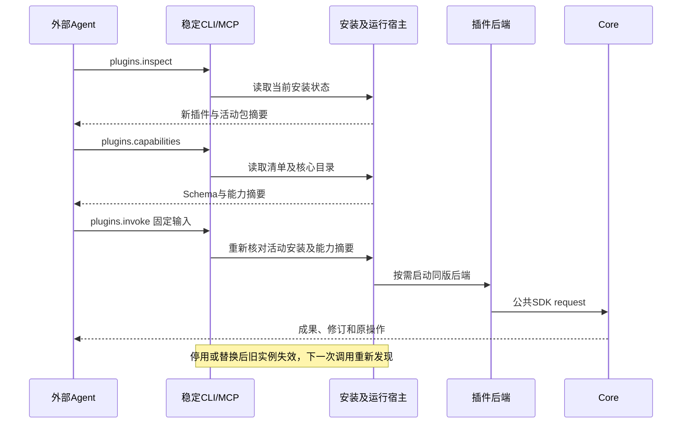

> 本文属于[插件设计](README.md)，拥有公开发现、固定能力引用及热插拔合同。

# 核心格式与动态能力发现

## 1. 系统边界

河图插件由河图安装、启用和运行。Codex等外部Agent使用河图稳定CLI/MCP发现新插件，不逐包安装Codex插件，不增加客户端静态工具。业务用例由Core及插件各自拥有，方法由Skills指导，GUI审阅同一状态。

安装启用后插件可使用宿主公开核心能力，没有独立插件grant或权限白名单。Agent继续使用原作品management_ref，不因插件调用获得作者身份。分层、兼容及核心能力审计见[27](27-开放宿主SDK与核心能力审计.md)。

插件Skill以包内标准方法贡献注册；活动目录、按需全文与Codex本地Skill边界见[28](28-插件Skills注册与发现.md)。动作与方法共用包身份、CLI/MCP及热更新，不逐插件创建客户端工具。

## 2. 最小核心格式

| 格式 | 拥有者 | 语义 |
| --- | --- | --- |
| WorkRef | 核心05／29及work Schema | workspace_id、kind、object_id共同标识作品 |
| 固定引用 | 来源Owner | 对象身份、修订及sha256，历史不跟随新头 |
| PluginManifest | 插件SDK与Schema | 包身份、host_api、贡献、类型及依赖；permissions为可省略的历史字段 |
| PluginObject | Core扩展数据 | WorkRef、owner_plugin_id、kind、Schema版本、content、来源及修订 |
| Action / Result | 动作Owner | 输入Schema、effect、合同修订、结果及恢复引用 |
| 运行上下文 | TypeScript宿主 | 活动包、作品、类型和运行代次；不是独立授权记录 |

格式不包含Cordis Context/Fiber、Electron对象或Rust私有类型。插件content采用自己的Schema；正文与正式目录不复制到插件对象作为第二套可写事实。

## 3. 版本与演进规则

公开动作与作品格式分别版本化。新增动作或可选字段可以增量交付；必填参数、返回含义或原键语义变化使用新动作／修订。旧操作回读、历史修订及通用导出保留。新增开放动作使用`hetu.plugins.capabilities/invoke`，未改变旧`hetu.plugin_access.*`参数含义；旧路径仅供历史连接兼容。

包摘要、能力摘要、数据Schema和宿主API不是同一版本。包变动要求重新发现活动能力，不要求作者重新做插件作品授权。

## 4. 稳定发现与调用

| 目标 | 稳定动作 | 行为 |
| --- | --- | --- |
| 列出本机包与状态 | `hetu.plugins.inspect` | 仅读安装事实和贡献 |
| 校验未安装包 | `hetu.plugins.inspect_package` | 固定完整包摘要，不执行代码 |
| 安装、启停和卸载 | `hetu.plugins.apply` | 记录固定安装选择及原操作 |
| 安装操作回读 | `hetu.plugins.get_operation` | 同一安装原键 |
| 当前插件能力 | `hetu.plugins.capabilities` | WorkRef、management_ref、plugin_id、package_sha256；返回专业动作、扩展数据动作、core_actions及capabilities_sha256 |
| 实际调用 | `hetu.plugins.invoke` | 加上capabilities_sha256、action、arguments；复用相同后端及Core |

MCP名称为对应动作的点号替换下划线形式。插件功能清单归插件，宿主40只维护上述发现入口。发现不执行插件后端，调用才按需启动。Core能力由当前执行身份投影；参数以实时Schema为准，不能依据文档样例猜字段。

## 5. 同一对话中的热插拔

稳定工具名不变，新增插件由下一次查询可见。对话中的旧能力信息不会自动变成有效票据：每次调用核对活动包与能力摘要。停用、依赖失效或包替换阻止旧调用，不删除作品；已提交结果用原Core操作回读，不能重发专业动作碰运气。重新启用读取持久成果，不复活旧视图代次。

## 6. 用例覆盖方法

按安装前后、启停、替换、依赖失败、无窗口、打开与关闭、CAS、同键异输入、结果未知、旧修订、数据迁移和卸载后导出覆盖。核心小说旅程必须证明插件实际调用了宿主目录、正文、大纲与设定，不能只证明独立规划数据保存成功。Windows实机、公开SDK发行及外部开发者试用分别记录，不能用macOS单元测试代替。
