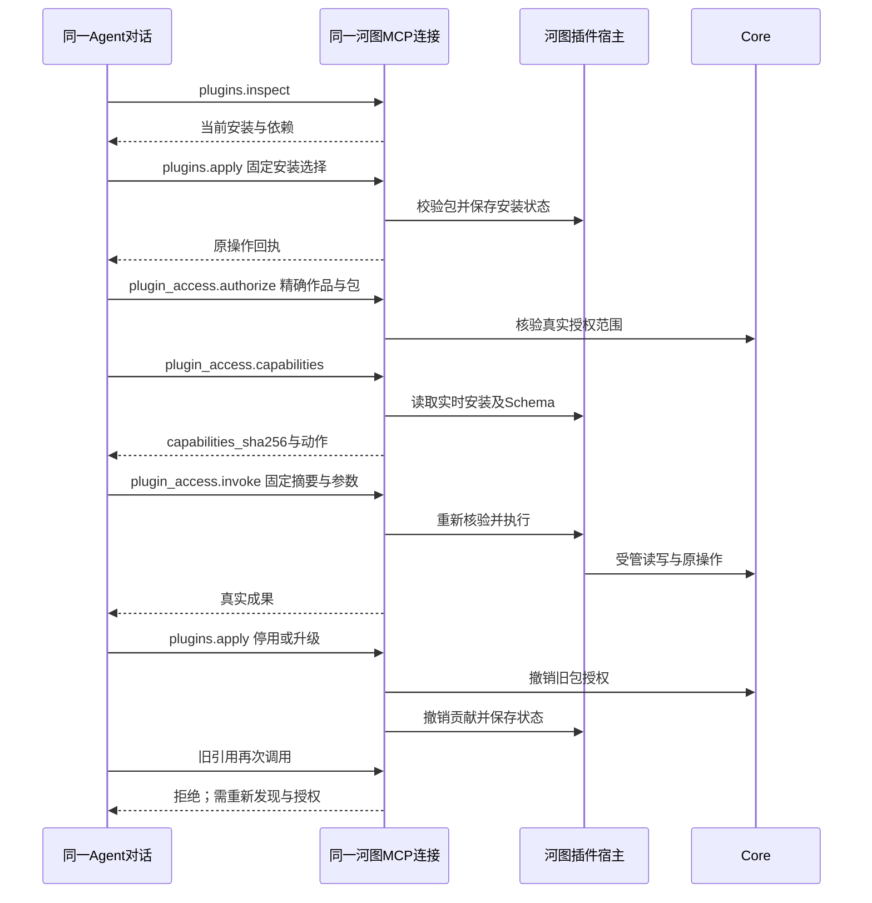

> 本文属于[创作插件体系设计](README.md)，拥有核心格式索引、河图插件动态发现与热插拔用例。实际验收结果归主38及其证据。

# 核心格式与动态能力发现

## 1. 系统边界

河图插件安装在河图，由河图宿主管理包、依赖、贡献与运行。Codex等外部Agent通过河图的稳定CLI／MCP入口发现、调用这些能力。新增河图插件无需在Codex安装同名插件，无需新增MCP连接，也不要求Codex增加工具名。

河图提供给外部Agent的接入包承载基础Skills和机器连接，属于客户端适配。其安装与更新状态独立于河图专业插件；接入包更新不能作为河图插件热插拔的必要步骤或完成证据。

| 对象 | 安装位置与Owner | 功能与变更方式 |
| --- | --- | --- |
| 河图专业插件 | 河图本机安装区，由TS宿主管理 | 专业视图、计算及数据Schema；宿主动态加载与撤销 |
| Codex等客户端接入包 | 对应外部客户端，由该客户端管理 | 基础Skills与河图连接；按客户端自己的加载规则更新 |
| 河图CLI／MCP | 河图软件制品 | 稳定发现、授权及调用协议；不为每个专业插件重编译 |

专业插件可以附带方法说明，接入包也可以指导Agent使用它；这种配合不合并包身份、安装目录、版本或授权。

热插拔指宿主可在运行期间发现安装状态变化，新增贡献可用，旧贡献可撤销。模型主动知道新能力需要在适当时机再次查询；后台安装完成并不自动把信息写入正在生成的模型上下文。

## 2. 最小核心格式

保持少量稳定信封，专业内容由插件自己的Schema定义，不为每种画布或专业对象新增宿主顶层格式。

| 格式 | 唯一合同来源 | 不变量 |
| --- | --- | --- |
| 作品身份与固定引用 | `contracts/schemas/work.schema.json`、主29 | 完整WorkRef；修订及摘要固定，不用标题识别对象 |
| 请求与结果 | `contracts/actions.json`、`contracts/schemas/result.schema.json` | action、contract_revision、input；实际状态、错误与恢复引用 |
| 插件包 | `contracts/schemas/plugin-manifest.schema.json` | 包ID、版本、Host API、依赖、贡献、权限；确切文件另由package_sha256固定 |
| 插件专业修订 | `contracts/schemas/plugin-object.schema.json` | WorkRef、插件Owner、对象ID、Schema版本、修订、前序摘要、content及固定来源 |
| 本机安装状态 | `contracts/schemas/plugin-installation.schema.json` | 私密本机Owner，固定包、启用选择、CAS和原操作；不随作品导出 |
| 当前获权能力 | `contracts/schemas/plugin-capabilities.schema.json` | 当前作品、确切包、动作Schema、类型及权限；capabilities_sha256固定本次合同投影 |
| 插件功能说明 | 各包`CAPABILITIES.md`与`plugin.json` | 人与Agent的导航由插件自有；可执行参数不在宿主地图复制 |

Markdown、Fountain、图片、音视频和GLB保持各自格式，由固定资产／文稿引用关联；不塞进一个通用JSON字符串字段。布局偏好、可丢弃缓存、私密授权和权威作品分别保存。

专业对象权限 `objects.read`／`objects.write` 与当前作品只读 `work.read` 分开授予。后者只开放动作目录中要求该权限的目录及固定来源读取，不授权正文写入，也不要求虚构专业数据类型。安装新包或改变权限后重查 capabilities；宿主功能地图只导航这些公共入口，不复制插件专业动作。

## 3. 版本与演进规则

1. 软件版本、Host API、动作contract_revision、专业schema_version与内容revision分别管理；升级代码不自动迁移内容或扩大权限。
2. 控制字段闭合校验；专业content只按该包声明的Schema扩展。未知Host API、状态格式或动作合同明确拒绝，不能静默忽略。
3. 对象身份与Owner不可变。新内容形成不可变修订，读取固定历史核验摘要链；CAS冲突不覆盖新稿。
4. Schema迁移先固定旧基线、目标Schema与完整新内容，取得确切决定后提交新修订；旧历史保持可读。普通保存不能跨Schema版本。
5. 派生索引可重建，不能成为第二份事实。停用或缺包仍能通用读取与导出已有专业成果。
6. 安装格式缺版本的既有记录按原v1语义读取，下次正常事务写入显式版本；不在发现时偷偷改写记录。其他未知版本失败关闭。

## 4. 稳定发现与调用

| 目标 | CLI动作 | MCP工具 |
| --- | --- | --- |
| 查看河图插件安装、依赖与失败原因 | `hetu.plugins.inspect` | `hetu_plugins_inspect` |
| 检查新包声明与摘要 | `hetu.plugins.inspect_package` | `hetu_plugins_inspect_package` |
| 安装、启用、停用、卸载 | `hetu.plugins.apply` | `hetu_plugins_apply` |
| 回读原安装操作 | `hetu.plugins.get_operation` | `hetu_plugins_get_operation` |
| 对精确作品授权插件 | `hetu.plugin_access.authorize` | `hetu_plugin_access_authorize` |
| 读取本次可调用Schema | `hetu.plugin_access.capabilities` | `hetu_plugin_access_capabilities` |
| 调用插件声明动作或获权数据动作 | `hetu.plugin_access.invoke` | `hetu_plugin_access_invoke` |

后两项保持工具名不变，内容由当前河图安装与授权实时投影。能力发现返回动作Schema而不执行插件后端；调用须携带同一WorkRef、management_ref、grant_id、package_sha256及capabilities_sha256，领域参数置于arguments。包路径和授权私密目录由宿主解析，不允许调用方指定任意路径。

`plugin-capabilities.schema.json`校验专业能力投影；管理连接另附原`management_ref`供接续，仍按既有管理引用合同解释，不属于插件可以自行定义的能力字段。

调用回执的`data.result`保存插件结果或Core领域结果；外层成功只表示本次调度得到回执，不能替代检查内层业务状态、固定成果与作者决定。

调用先核验当前管理授权及插件会话，再核验已安装且活动的固定包、依赖与能力摘要，最后按声明Schema调用。安装不等于作品授权；获权能力不等于作者采纳、定稿或外部费用许可。当前插件效果限read和managed_write；未知外部副作用不通过此通道伪装支持。

机器新建作品的管理引用可继续授权其最初创建的作品，创建回执将该WorkRef固定在本机授权记录；不因此获得同根其他对象的插件权限。旧版新建回执缺少该引用时，沿原创建请求与操作键恢复回执，或使用作者已授予的精确作品引用；不能凭标题猜测范围。

## 5. 同一对话中的热插拔

开始相关任务、安装变更完成、旧能力调用被拒绝，以及用户询问可用工具时重新发现。插件清单不是系统指令；说明文本不具有扩权能力。当前对话已有稳定入口即可继续，宿主不依赖MCP工具列表变更通知，也不伪造外部Agent已经收到后台事件。

停用先撤权，使已启动插件无法再通过Core提交。纯显式输入的在途计算可能完成；不把结束进程等同取消外部副作用。窗口关闭、断线和超时保持原键，先回读已有结果；不能为恢复而重新授权旧包或换键重做。

## 6. 用例覆盖方法

对首期闭合合同按状态、身份、合同变化、并发和故障划分等价类；高风险交叉组合单独覆盖。下表是可审查的有限验收边界，不宣称穷尽任意插件代码和所有操作系统。

| 用例 | 预期 | 主要测试入口 |
| --- | --- | --- |
| HP-01 同一MCP连接先发现，再安装新包 | 工具名不变，新包可发现，无需窗口或Codex插件安装 | `packages/plugin-host/tests/hotplug.test.ts` |
| HP-02 未安装／已安装未授权 | 不可调用作品能力 | 同上 |
| HP-03 授权后按Schema调用 | 同包、作品与能力摘要一致，返回真实计算结果 | 同上 |
| HP-04 未声明动作／错误参数／旧能力摘要 | 明确拒绝，不执行后端 | 同上 |
| HP-05 同名不同作品／另一授权 | 拒绝串作品；不扩大范围 | 同上及`core/tests/extensions.rs` |
| HP-06 停用后旧调用 | 旧grant拒绝，安装元数据仍可查 | 热插拔测试 |
| HP-07 重新启用 | 旧grant不复活，明确新授权后可用 | 热插拔测试 |
| HP-08 升级同ID新摘要 | 旧包／能力引用拒绝；重新发现及授权读取新Schema | 热插拔测试 |
| HP-09 卸载与重新安装 | 成果不删，旧授权不复活 | 热插拔、成果与扩展测试 |
| HP-10 依赖缺失、版本不匹配与环 | 本包阻断，无半注册贡献 | `packages/plugin-host/tests/host.test.ts` |
| HP-11 包缺失、损坏、越界或被替换 | 隔离坏包，无关包可用；坏包仍可撤权卸载 | `installations.test.ts`、`host.test.ts` |
| HP-12 GUI与机器并发管理 | 共用Owner与CAS，旧基线拒绝 | 安装状态测试、`apps/desktop/tests/machine-plugins.spec.ts` |
| HP-13 丢回执、重启、同键异输入 | 原键原结果；异输入冲突 | 安装、headless与Core扩展测试 |
| HP-14 清理失败与迟到注册 | 其他清理继续，旧贡献不复活 | 宿主生命周期测试 |
| HP-15 Schema迁移与旧历史 | 决定不执行，原键迁移，新旧修订分别核验 | `migrations.test.ts`、CLI会话测试 |
| HP-16 未知格式／Host API与闭合控制字段 | 校验失败，发现不改写原文件 | 格式、开发工具与Core测试 |
| HP-17 空数据权限计算 | 仅显式输入，不发现正文或专业数据动作 | headless与热插拔测试 |
| HP-18 父管理授权撤销或重授 | 旧插件会话拒绝；宿主仍能清理停用 | `apps/cli/tests/conversation.rs` |

同一连接验证不等于所有外部客户端通过。macOS、Windows和Linux安装制品、陌生开发者试用及公开索引交付分别取证，不能从共享源码推导完成。
