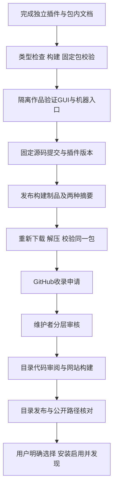

> 本文属于[创作插件体系设计](README.md)，定义开发者从固定版本到收录、维护和退出的交付流程。分发系统设计见[24](24-插件目录与分发治理.md)。

# 插件发布与上架指南

## 1. 当前可执行路径与实施边界

当前公开开发入口是独立JS/TS包、本地构建校验和宿主公共机器安装。可信插件安装启用后复用宿主公开SDK，不增加逐插件作品授权；外部Agent的作品连接与作者决定独立管理。官网展示精选插件并链接固定源码、运行包、功能清单及指南，收录申请使用`.github/ISSUE_TEMPLATE/plugin-listing.yml`，由GitHub Issue／代码审阅协作。

目录上架不自动触发软件下载或安装。远端索引订阅、GitHub Release自动下载校验、npm直装、发布者签名和自动更新不属于现行安装合同；这些需按24和主38实施取证，不在官网伪造可点击的安装按钮。本指南定义交付标准，并不声称陌生第三方上架已完成验收。

## 2. 发布前交付清单

| 项目 | 要求 |
| --- | --- |
| 身份 | 稳定反向域名ID、精确SemVer、发布者和维护渠道 |
| 包合同 | 当前manifest_version、Host API、精确依赖、视图／数据／动作和权限 |
| 源码 | 公开仓库URL、确切提交、可复现构建步骤；闭源交付另评审来源与许可 |
| 运行包 | 完整预构建目录、分发文件清单，无安装脚本、源码秘密或作者数据 |
| 摘要 | 下载文件SHA-256及解压包的宿主校验摘要分别记录 |
| 文档 | 使用示例、`CAPABILITIES.md`、许可、费用／联网说明、退出与导出 |
| 验证 | Host API、宿主版本、OS／架构、固定包摘要和实际通过／失败范围 |
| 数据升级 | Schema变化、前后差异、授权、备份需求及兼容边界；禁止静默迁移 |

同一ID＋版本不得更换字节。Git标签可移动、Release附件可替换，所以固定源码提交仍需绑定制品和包摘要。仓库私有凭据不得放在下载URL中。

## 3. 开发者发布流程



源码提交、推送、Tag／Release、提交申请及目录发布都属于相应角色的明确动作。Agent代做时遵循当前会话授权，不因读到本指南而自行发布。本文不执行上述外部动作。

GitHub Release用于托管可核验制品时，开发者提供构建后的归档，不只上传源码ZIP。下载文件摘要验证传输字节；解压后由河图包校验计算的摘要固定运行内容，两者不能互换。选择归档格式时核对目标系统解压兼容和路径限制；当前河图安装器接收包目录，解压与下载仍由受信调用方完成。

## 4. 提交收录申请

使用[插件收录表单](https://github.com/limecloud/hetu/issues/new?template=plugin-listing.yml)。首次和更新均提交确切版本，沿已有申请保留问题与修订记录。所需字段来自本节清单，不要求上传真实作者资料。

申请至少回答：为谁解决什么问题、与已有插件有何差异、如何安装验证、要读写哪些专业数据、是否联网及收费、停止使用时如何保留成果。标签表示用途，不能把同能力的题材变体重复计为独立能力。

第一方运行事实来自包manifest；外部固定发行条目由`apps/website/src/data/plugin-listings.json`维护，作者场景由`apps/website/src/lib/plugins.ts`组织。外部条目记录发布者、固定源码提交、发行渠道、运行包地址、下载与包摘要、最低宿主及验收证据。构建时校验来源与摘要格式，不执行外部插件代码；维护者须实际下载核对，不能把任意Issue文本直接变成可运行目录项。

## 5. 审核、上架与回执

| 阶段 | 责任与退出条件 |
| --- | --- |
| 来源核对 | 发布者身份、许可、提交、版本、摘要与链接对应 |
| 静态校验 | 不执行包代码；检查清单、文件、Schema、依赖与权限 |
| 运行验证 | 在隔离环境对确切摘要执行安装、调用、启停和卸载 |
| 创作场景 | 按声明使用场景，核对真实成果、作者审阅和可接续性 |
| 内容审阅 | 目录文案、双语、真实演示图、费用与隐私说明，不虚构认证 |
| 发布 | 网站构建与链接门禁通过，按授权发布后核对公开路径 |

审核结论绑定包版本、摘要及实际宿主／系统范围。“来源可核验”“包校验”“安装运行”“场景验证”分别表达，不合并为一个模糊的安全认证。证据缺失就保留缺口，不能以Star、下载或目录收录数量补齐。

目录维护者在河图仓库根目录执行本地门禁：

```bash
npm run build --workspace @hetu/website
npm run test --workspace @hetu/website -- tests/plugins.spec.ts tests/docs.spec.ts
```

网站发布按[官网发布规范](../33-宣传网站与部署.md)及[网站说明](../../apps/website/README.md)操作，根入口为`npm run deploy:website`，目标为Cloudflare Pages的`hetu-website`。先使公开源码、功能清单和GitHub表单链接可达，再发布引用它们的站点；如仓库改动尚未递交，只记录本地完成。生产发布需要对应授权，之后核对中英详情、指南、表单入口及资产摘要，不能以上传成功代替线上验收。

## 6. 更新与撤回

新版本沿发布流程提交变更说明、宿主能力使用变化及验证。不静默替换已安装包；用户确认更新选择后核验确切包与兼容范围，旧包连接失效。数据迁移与程序升级分开，旧数据和原操作语义保持；安装启用不替代外部Agent连接、正文采纳、定稿或费用决定。

紧急撤回先说明受影响ID、版本、原因和替代／导出路径，撤下新推荐与新安装来源。不能把撤回目录变成静默删除用户包或作品；需要本机阻断恶意版本时，应另定义经核验的撤销合同及用户可见恢复路径。

维护结束时提供最终版本、格式说明、兼容范围和接管渠道。更换发布者或仓库位置须核验所有权，不因同名或同图标承接旧信任。旧版程序只能在Schema兼容时回退，不能以旧Schema丢弃新字段。

## 7. 本轮可验证交付

网站作者流程见[使用插件](../../apps/website/src/content/guides/zh-CN/plugins.md)，开发者公开入口见[发布指南](../../apps/website/src/content/guides/zh-CN/plugin-publishing.md)。包开发用例由22与15定义，目录治理与远程能力准入由24定义；实施证据统一登记主38，不在三处重复进度。
