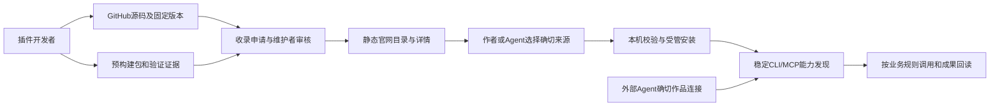
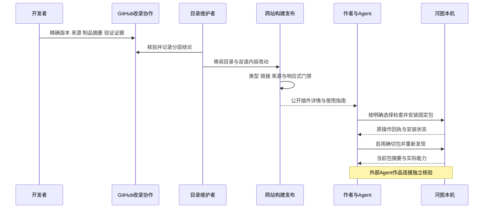

> 本文属于[创作插件体系设计](README.md)，负责目录、源码与制品来源、本机安装之间的分工。生态定位与商业假设仍归[13](13-生态分发与商业模式.md)。

# 插件目录与分发治理

## 1. 决策

采用“GitHub协作审核＋静态精选目录＋本机受管安装”。不自建源码托管或npm仓库，不让网站成为本机授权代理。官网从真实第一方包清单及外部固定发行条目投影元数据，按作者任务提供列表与详情；开发者通过GitHub表单申请收录，目录改动走代码审阅。

| 职责 | 当前Owner | 不承担的职责 |
| --- | --- | --- |
| 源码、Issue、版本说明与审核协作 | GitHub仓库及开发者 | 作者作品权限、自动安全保证 |
| 包身份、Schema、权限和功能清单 | 插件manifest与CAPABILITIES | 宿主核心事实的第二份副本 |
| 发现、分类、作者场景与来源链接 | 官网插件中心 | 执行包代码、本机状态读取 |
| 安装状态、固定包、启停、依赖及原操作 | 本机TS插件管理器及共享机器入口 | 全局当前作品、替作者采纳 |
| 专业数据、修订与事务 | Rust Core | 任意插件代码运行、市场推荐 |
| 理解目标、推荐和调用 | 外部Agent | 自报批准、自动获知未发现工具 |

GitHub是当前协作载体，不是产品永久依赖。已安装包与本地作品不以GitHub或官网在线为条件；后续可以增加受信来源，保持同一安装与事务内核。可信插件启用后使用公开宿主SDK，不另建逐插件作品授权；外部Agent作品连接与正文、定稿、费用决定独立处理。

## 2. DeepSeek Harness的事实与借鉴

采集日期：2026-11-16；官方源码固定提交：`39163dd30f703a79079e2d2446545cff3c453738`。证据为官方用户指南、生成器、索引校验器与包管理源码；本次未运行DSH安装任务。来源摘要登记于`research-sources.json`。

| 官方机制 | 源码／文档 | 河图取舍 |
| --- | --- | --- |
| 插件是包，组合包声明贡献 | 官方README、plugin-manager | 借鉴独立包；不引入Agent Runtime |
| 自定义索引是静态JSON，可托管在Pages或对象存储 | `docs/user/guide/plugin-market.zh.md` | 采用静态目录起步，远端索引订阅另验收 |
| DSH不内置索引源，实验性组合包开启发现页 | 同上 | 不把某个社区目录当作官方必选服务 |
| 安装来源为npm精确版本或Git确切提交及子目录 | 同上、`plugin-manager/src/install-spec.ts` | 借鉴固定来源；当前河图仅安装预构建本地包 |
| 推荐兼容的最高稳定版，安装时再次检查兼容 | 用户指南、`plugin-manager/src/versions.ts` | 目录兼容声明与实际包核验分开；不宣称河图已有远程自动更新 |
| 生成器只读包文件、不安装不执行；支持缓存 | `apps/plugin-market-generator/README.zh.md`及源码 | 目录构建不能执行陌生包；后续来源抓取独立受限 |
| 用`dsh-plugin` GitHub topic帮助发现 | 官方README | 分类与检索降低参与成本；数量不代替验证 |

官方用户指南还明确索引为第三方声明，格式通过不代表声明真实。`dsh.so`是独立社区目录，收录数、可下载数、运行通过数和创作采用数分开看。大量供给可以来自低成本JS包、现有npm/Git分发、自动索引与模板复用；本次证据不能量化这些机制各自对增长的贡献，更不能用目录数字证明质量。

## 3. 分层架构

官网链接固定源码、运行包、功能清单和指南，不提供远程安装调用。安装器不接收网页传来的作者身份。官网与收录申请不持有作者正文或作品授权。

## 4. 数据合同与扩展准入

第一方事实源是各包`plugin.json`；外部已核验发行条目保存在`apps/website/src/data/plugin-listings.json`，`src/lib/plugins.ts`组织作者问题与说明。外部条目的manifest摘要字段与固定发行包对应，专业功能清单链接插件仓库确切提交，不复制到宿主清单。条目可用`capabilities_path`指定仓库内清单路径，默认`CAPABILITIES.md`；路径不得越界。独立产品官网通过HTTPS的`homepage`链接，专业目录仍由插件维护。网站构建校验身份、双语、固定提交、HTTPS来源及双摘要格式；不另造数据库或registry API。构建校验不代替实际下载核验。

当前外部条目记录以下发行信息；这是静态文件合同，不是远程安装API：

| 数据 | 要求 |
| --- | --- |
| identity | plugin_id、发布者、精确version、Host API |
| source | https仓库、不可变commit、子目录、许可和维护入口 |
| distribution | 发行渠道、固定制品URL、archive_sha256、package_sha256及size_bytes |
| compatibility | 宿主与系统范围、精确依赖及验证环境 |
| access | manifest兼容声明；数据／Schema、联网与费用说明链接包内文档 |
| evidence | 来源／包校验／运行／场景分别绑定版本与摘要 |
| lifecycle | 当前发行渠道；撤回、维护结束与替代／导出说明随目录审阅更新 |

目录编辑版本与插件版本、包摘要、作品修订相互独立。索引描述更正不能替换程序字节；同一ID＋版本出现不同摘要即拒绝。来源迁移须证明发布者延续，不能按名称自动合并。

## 5. 首期目录发布时序

没有额外目录数据库或长运行审核服务。Issue承载申请与沟通，仓库承载审阅后的目录来源，静态站点承载公开呈现，本机存储承载实际安装与固定包。未来出现规模需求再拆服务，避免过早制造多套状态。

## 6. 治理与维护

收录规则公开且按同一证据要求应用于第一方和第三方。推荐只对明确验证范围负责，不暗示内容输出质量、素材权利或外部服务永久可用。付费扩展沿既有身份和商业合同准入，不借目录建设另建支付账本。

更新逐版本审查，能力使用或Schema变化要求重新核验，旧证据不继承。撤回推荐不删除用户作品；本机停用、旧连接失效、成果读取及导出保持明确语义。程序回退与数据回退分开，未知写操作先沿原键回读。

## 7. 目录验收与后续工作

首期验收覆盖双语列表和详情、分类与搜索交集、无结果重置、关闭脚本可读、来源及权限准确、复制请求、语言切换、SEO、375px与桌面布局。验证只证明官网交付，不证明公开第三方分发或Windows插件运行。

后续工作按实际需求依次取证：陌生开发者独立试用、自动下载与受限解压、订阅索引、更新与撤回、发布者签名。每一步先冻结合同、补机器入口与异常用例，再开放UI；不能用占位按钮或“已上架”文案代替实现。外部固定发行与实际公开路径的进度、证据在主38维护。
