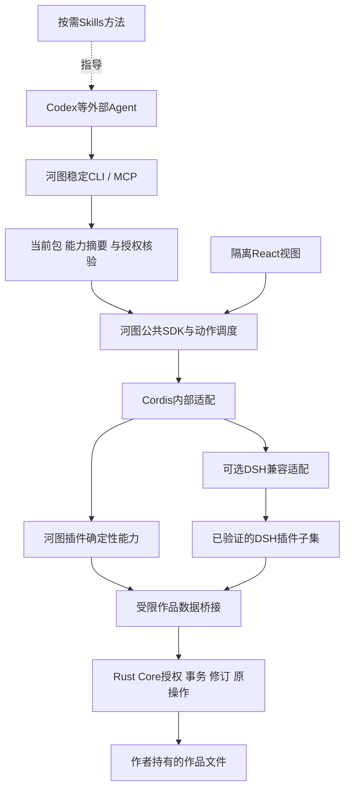

> 本文属于[创作插件体系设计](README.md)，拥有Cordis的采用方式、可替换边界和DSH兼容准入。机器合同仍归[20](20-首期可执行合同与开发入口.md)与[21](21-核心格式与动态能力发现.md)，实施状态归[主38](../38-创作工作台重构执行计划.md)。

# Cordis采用与DSH兼容边界

## 1. 决定与适用范围

2026-11-16作者确认采用Cordis，作为河图TypeScript插件运行时的依赖注入、服务组合与生命周期基础。河图继续拥有公共SDK、包格式、机器入口、权限、作品格式和作者决定；不引入DSH Agent循环、会话管理或模型调用服务。

这是已采纳的技术决定，不是运行时完成迁移或兼容DSH插件的声明。决策时源码仍使用`packages/plugin-host/src/registry.ts`的自有注册与EffectScope，以及独立Node worker；它们构成迁移前行为基线。现有安装状态和包合同不因采用框架立即变更。

首个业务试点为[小说规划插件](https://github.com/wordflowlab/hetu-novel-planner)。其需求、专业数据、动作和进度由该仓库`docs/`与`CAPABILITIES.md`维护；宿主只拥有公共合同、接入导航和通用验收。

## 2. 为什么采用，以及为什么保留自己的合同

插件共存需要解决依赖就绪、服务作用域、注册撤销、失败传播和异步清理。采用已有框架可复用这些机制；是否降低维护成本仍须用独立插件与故障用例证明。仅为了“使用Cordis”增加第二层无职责容器不符合本决定。

| 层次 | Owner | 固定边界 |
| --- | --- | --- |
| 包与能力合同 | 河图SDK及`contracts/` | plugin_id、Host API、贡献、Schema、effect、固定包和能力摘要 |
| 框架机制 | Cordis，经宿主内部适配 | 服务依赖、作用域、事件、激活与释放 |
| 作品与作者决定 | Rust Core | WorkRef、授权、来源、CAS、事务、原操作、采纳和定稿 |
| 专业能力 | 各插件 | 领域模型、确定性算法、视图及功能说明 |
| 创作理解与生成 | 外部Agent | 通过河图CLI/MCP执行，Skills提供方法 |
| DSH兼容 | 独立兼容适配层 | 仅开放已验证的服务子集，不承诺全量兼容 |

普通河图插件依赖河图SDK，不要求直接导入Cordis内部类型或DSH模块。作品JSON、操作记录和导出不持久化Context、Fiber、服务实例或框架内部标识。替换框架可能需要重写宿主适配，但不应要求重建作者作品。

## 3. 依赖自主性与来源选择

已核对上游Cordis及DSH内置副本的MIT许可证：可使用、修改和分发，须保留版权及许可；商标、其他依赖及素材权利仍分别核验。已取得版本可独立维护，维护人力和安全更新不会因此免费。

DSH的`vendor/README.md`明确记录源码纳入、固定上游提交、重新命名为`@deepseek-ai/*`及本地差异。它使用的`@deepseek-ai/cordis`不是未经修改的上游包。两者版本号不能直接视为兼容证明。

实施首选上游`cordis`的固定版本，通过原型后把精确版本、包完整性和全部传递依赖写入锁文件。调研时npm显示上游`4.0.0-rc.13`、DSH分支`4.1.0`；这只是来源快照，不表示已安装或冻结发行依赖。若DSH兼容必须依赖分支特有语义，先记录差异与代价，再决定采用特定分支或适配，不同时隐式加载两个Context实现。

暂不建立河图Fork。正常跟踪上游、显式升级；出现阻断修复、停更或不可接受变更时，再以固定源码接管。保留许可证、来源提交、构建输入、制品与差异记录，使退出路径可审查。锁文件、源码副本和可离线构建分别验证，不能互相替代。

## 4. 目标架构

Cordis 集成位于宿主 EffectScope 内部，PluginHost 继续拥有包依赖图、安装与启停状态；贡献使用单一有序 disposer 保留逆序异步清理及错误传播。Cordis不提供安全沙箱，不使插件自动获得文件、网络、子进程、其他作品或作者权限。第三方代码继续在隔离视图或受管工作进程运行；现有Node限制、CSP及逐请求Core授权保持。

## 5. 服务与生命周期集成

1. 发现仅读固定清单；不执行Cordis插件代码来获取能力Schema。
2. 校验包、权限和精确依赖后，在正确运行边界创建作用域并激活贡献。
3. 注册的动作、视图和监听随所属作用域释放；依赖未就绪为blocked，异常为失败，不能仅因Fiber存在报告active。
4. 停用先阻止新调用并撤权，再等待在途处理与清理。异步释放完成前不加载替代贡献；超时结束工作进程，未知写结果仍沿Core原键查询。
5. 桌面与独立CLI/MCP使用同一集成实现。窗口关闭不删除作品，不改变无窗口机器能力。

当前`PluginHost`的包依赖与安装状态继续由宿主拥有，Cordis仅承接作用域内机制。不得永久维护两套互相可修改的依赖图、active状态或清理队列；实施时明确配置输入、运行状态投影和安装事实的唯一Owner，覆盖失败回滚及并发启停。

## 6. DSH兼容等级

| 等级 | 范围 | 必须验证 | 当前承诺 |
| --- | --- | --- | --- |
| C0 | 河图原生插件 | 现行包、受限SDK、CLI/MCP及降级读取 | 保持现行合同，Cordis迁移需回归 |
| C1 | 仅用Cordis公共机制的模块 | 具体版本、导入路径、依赖及释放语义 | 候选，不宣称即插即用 |
| C2 | DSH纯计算工具 | tools注册、参数、结果、取消及错误适配 | 先做代表性原型 |
| C3 | 文件、网络及外部工具 | 权限、范围、预算、恢复及外部副作用 | 缺少授权合同则拒绝 |
| C4 | DSH客户端UI | client入口、React依赖、插槽、远程调用及销毁 | 独立评估，不以React相同推导兼容 |
| C5 | 依赖Agent循环、会话及模型的扩展 | 与河图产品定位的关系 | 不纳入本次范围 |

兼容记录绑定DSH提交、插件版本和摘要、调用服务、平台、成功及拒绝用例。包可解析、apply可执行、工具已发现和真实业务成功分别取证。未知服务明确不支持，不返回伪成功或静默改写语义。兼容插件仍经河图稳定机器入口供Codex调用，无需为每包安装Codex插件。

## 7. 实施与退出门禁

| 阶段 | 交付与门禁 |
| --- | --- |
| 依赖冻结 | 选择精确来源、许可及锁文件；核验打包、受限Node和Chromium边界 |
| 公共适配 | 将生命周期机制接入既有合同，原包无需改数据；无窗口与桌面回归 |
| 业务试点 | 小说规划按独立仓库完整首版规格，完成机器链路、专业工作面、宿主接续及异常恢复；纵切不等于全部首版 |
| 兼容原型 | 纯计算工具、受限文件工具、UI各一例，允许明确拒绝不支持服务；实际达到的等级分别登记 |
| 维护验证 | 升级失败不破坏旧作品；停用、卸载、包缺失仍通用读取；原操作不换键 |

框架升级不能修改作品Schema或权限含义。保持旧制品读取与导出的退出路径；不要求预先并行建设第二个运行时，也不承诺替换框架零成本。

## 8. 证据与限制

2026-11-16读取的来源与字节摘要见[来源证据](../research/evidence/cordis-adoption-2026-11-16.json)。主要依据：上游[MIT许可](https://github.com/cordiverse/cordis/blob/c9fe179ce5ac484620a387a1697409cb007d4178/LICENSE)、DSH固定提交的[vendor说明](https://github.com/deepseek-ai/deepseek-harness/blob/39163dd30f703a79079e2d2446545cff3c453738/vendor/README.md)、[工具合同](https://github.com/deepseek-ai/deepseek-harness/blob/39163dd30f703a79079e2d2446545cff3c453738/docs/cookbook/adding-a-tool.zh.md)及[客户端模块](https://github.com/deepseek-ai/deepseek-harness/blob/39163dd30f703a79079e2d2446545cff3c453738/docs/subsystems/client-modules.zh.md)。

宿主以锁文件固定 `cordis@4.0.0-rc.13`，内部生命周期与独立小说规划包分别运行验证。公共合同增加独立 work.read、固定来源检查及受信宿主服务；运行记录与未验证平台只在主38维护。此变更不证明 DSH 插件兼容，也不把文档检查或图示渲染当作运行验收。
