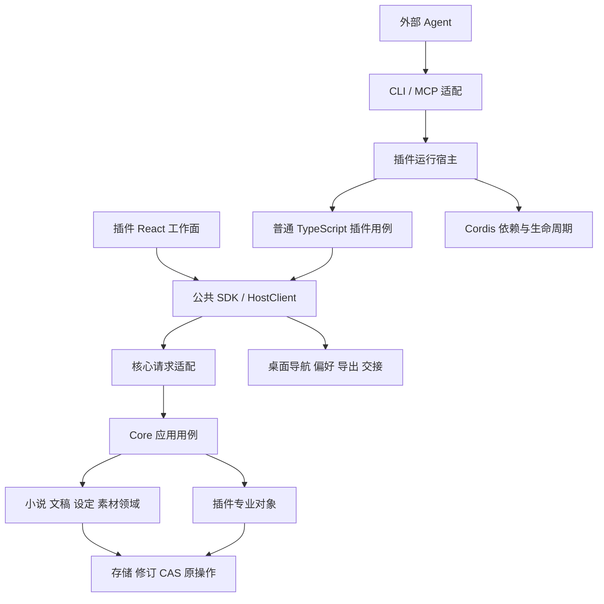
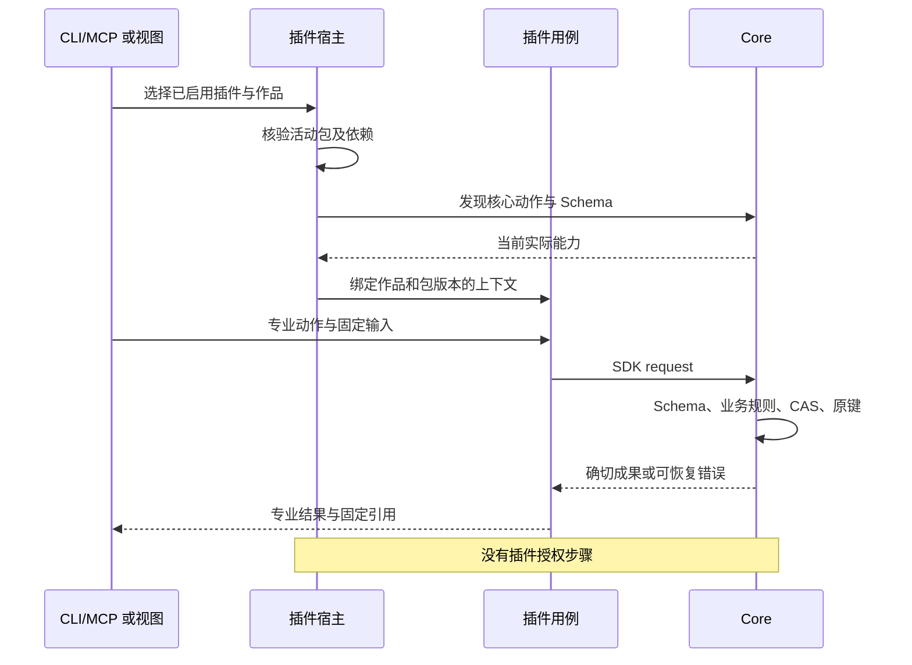
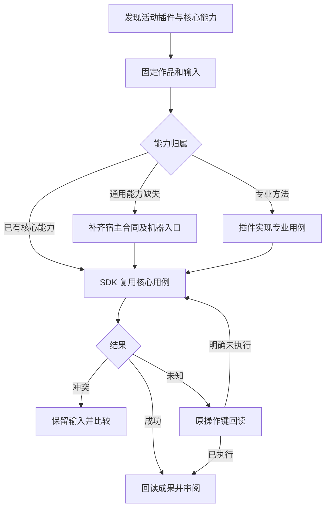
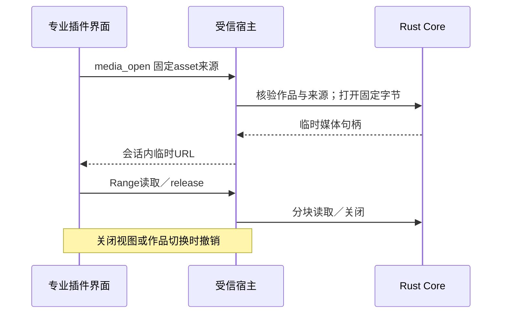

> 本文属于[插件设计](README.md)，拥有开放宿主服务、分层和核心能力审计口径。

# 开放宿主 SDK 与核心能力审计

## 固定媒体字节的公共读取

C／D批次的声音核验、角色卡交换及书稿插图需要实际文件字节。媒体元数据不能证明PCM帧完整、归档可解析或插图可编译。公共数据合同增加 `hetu.extensions.sources.read_blob`：仅接受当前作品的固定asset来源、字节偏移及有界长度，返回Base64、分块摘要、完整文件摘要和下一偏移；不接受任意文件路径，不提供整库访问。Core逐次核验作品、固定修订、资产摘要和受管文件，插件负责格式解析与专业检查。

CLI/MCP经既有稳定插件入口发现并调用，GUI继续使用宿主媒体服务。跨作品来源、错误摘要、缺失资产、非法范围和撤权均失败关闭。重组文件后须核对完整摘要；每块始终携带同一个固定来源。实施状态与证据归主20，本节不代替已发布证明。

派生文件保存复用已有 `save_artifact` 服务，增加PDF、EPUB、PCM WAV、HTML和XLIFF格式；核验扩展名、预算、固定成果、完整字节摘要与格式签名后，由作者选择目标文件并原子写入。它不登记素材、不采纳正文、不认可声音或自动发布；专业完整性由插件负责，媒体播放仍只使用宿主固定素材服务。CLI/MCP直接回读同一固定二进制分块，无GUI前置。

## 1. 产品决定

无额外插件的默认基础产品由[主39](../39-Electron与插件优先重构架构.md#无额外插件的基础产品)定义。正式结构、正文、设定、固定素材、基础分集媒体与区间意见由共享Core持有；随包基础工作面默认可用。插件可扩展专业数据和制作方法，不能以安装插件作为打开、编辑和审核基本作品的前置条件。第一方身份、随包分发、是否可选及事实归属分别判断。

安装并启用插件后即可使用宿主公开核心能力，不申请独立插件作品授权，不维护逐动作权限白名单。作品引用确定操作对象，包摘要确定代码版本，类型声明确定数据格式；它们不是授权票据。

作品身份、正式卷章、正文、大纲、设定、素材、版本与事务只有宿主一个事实 Owner。规划、伏笔、节奏分析及专业渲染由插件组合核心服务。如果插件被迫重建小说系统，应先补齐宿主公共能力。

专业成果接续通过公开只读对象合同：消费插件保存确切Owner、对象、修订和摘要，在当前WorkRef核验后使用。`ProjectStore.basis`提供同作品固定读取；显式Owner必须指定修订，不改变写入Owner，不合并专业Schema或作品授权。研究、人物、分析等领域结构由插件维护，宿主只提供通用固定引用能力。

包检查每次重新读取并核验资源、清单及包摘要。相同进程中，对完全相同Schema文本的成功编译检查复用结果，缓存最多128项；非法Schema不缓存，内容变化重新检查。该缓存只减少重复编译，不缓存安装启停、包字节、授权、业务输入校验或执行结果。

开放接口继续执行业务规则：Schema、来源、CAS、原操作键、锁定、定稿及费用计划不因插件化而失效。外部 Agent 的作品连接保持其执行身份；河图插件与 Codex 插件的安装及生命周期分别管理。

## 2. 调研与标准

2026-11-17 读取一手资料。以下是可借鉴的公开机制，不存在可直接照搬的小说宿主行业标准。

| 来源 | 核实机制 | 河图采用与差异 |
| --- | --- | --- |
| [DeepSeek Harness 架构](https://github.com/deepseek-ai/deepseek-harness/blob/39163dd30f703a79079e2d2446545cff3c453738/docs/architecture.md) | Cordis 服务、贡献、配置组合、生命周期；Web 与无窗口入口 | 复用核心服务、作用域清理及相同业务入口；不引入 Agent 循环。DSH 动态 Client 仍有自身批准机制，不能声称其没有授权 |
| [Pi extensions](https://github.com/badlogic/pi-mono/blob/main/packages/coding-agent/docs/extensions.md) | ExtensionAPI、工具、事件及界面；扩展具有进程 OS 权限 | 统一开发入口与生命周期；河图保留视图和后端隔离，不复制其权限模型 |
| [Obsidian API](https://github.com/obsidianmd/obsidian-api/blob/master/obsidian.d.ts) | App、Vault、Workspace、MetadataCache、注册资源释放 | 内容、工作面及缓存服务分工；河图保留正式卷章和正文修订 |
| [VS Code capabilities](https://code.visualstudio.com/api/extension-capabilities/overview) | Common、Workbench、Language 等扩展能力分类 | 领域数据与界面服务分开；不复制创作工程尚不需要的扩展点 |

来源摘要与失败记录见[调研记录](research/open-host-sdk-sources.json)。标准以可发现、可组合、可恢复、数据唯一归属及开发者可独立接入评价，工具数量不能证明完备。

## 3. 分层架构

| 层 | 拥有的职责 | 依赖方向 |
| --- | --- | --- |
| 公共 SDK | 语言无关数据、能力发现、请求与结果合同 | 不导入 Electron、Cordis、Rust 内部类型 |
| 运行宿主 | 安装状态、活动包、依赖、进程、视图及资源释放 | 依赖 SDK，通过适配调用 Core |
| Core 应用用例 | 领域动作、来源、业务决定、事务与恢复 | 不依赖插件 UI 或 Cordis |
| 领域与存储 | 小说及专业对象的不变量、修订和持久化 | 不依赖入口与运行宿主 |

核心动作由 Core 目录发现，`request(action, input)` 不复制一份插件白名单。桌面导航属于界面服务，不承担数据读写。正常业务在无窗口环境仍可执行。

## 4. 调用时序

## 5. 业务与恢复流程

## 6. 小说核心能力审计

| 目标与插件反推需求 | 核心动作 | 处理 |
| --- | --- | --- |
| 识别及维护小说资料 | `works.get`、`novels.get/update` | 复用既有事实 |
| 目录、固定正文来源、实际字数 | `novels.snapshot` | 将插件内目录统计提升为核心服务；目标字数与实际字数分开 |
| 正式分卷及章节 | `documents.create`、`novels.save_structure` | 复用现有事务；规划节点不自动成为正式章节 |
| 阅读、编辑及正文历史 | `documents.get/save/history` | 复用核心；插件不另存正式正文 |
| 正式章节改名 | `documents.rename` | 补齐当前修订 CAS；改名不改正文内容 |
| 整书、卷、章正式大纲 | `outlines.get/save` | 核心持有正式大纲，插件持有规划细节 |
| 人物、势力、地点、世界、规则、事件 | `blueprints.get/preview_change/save` | 固定正典来源，规划卡不成为第二套正典 |
| 物品、图片及资料 | `assets.*`、`resources.*`、`resource_usages.*` | 使用现行素材模型，不为标签臆造正典类型 |
| 版本、检查、交付及恢复 | `git.*`、`validation.*`、`documents.*`、`operations.get` | 复用现有用例，保持作者决定语义 |
| 任务候选及真实决定依据 | `creative_tasks.get` | 作品管理连接和插件按固定任务引用读取；Core 从任务快照、目标及历史归属规则核验当前 WorkRef，同根其他作品及无法确认归属的任务拒绝读取 |
| 规划结构、剧情、关系及伏笔 | 插件专业对象与动作 | 由插件维护自己的功能清单 |

完备性以这些创作旅程能否经实际接口跑通判断，不承诺穷尽所有小说写作方法。既有能力未暴露和领域能力缺失分别修复，不能用跳转按钮掩盖缺少业务 API。

## 7. 兼容与演进规则

1. 公共合同独立于宿主内部模块。插件不得导入宿主源码或 Cordis 内部服务。
2. 新增可选字段和新动作采用增量发布。改变必填字段、结果含义或原操作语义时使用新合同修订或新动作，保留旧操作回读。
3. 类型声明保留未知版本的通用读取与导出；数据迁移固定旧、新内容与 CAS，不以包升级重写作品。
4. Core 能力及插件能力分别发现。核心清单不复制插件的专业功能。
5. 新能力同时更新 Schema、入口、SDK、用例、文档及验收；通过独立插件验证开发体验，不能仅以宿主内部调用证明可用。

实际进度归主20/38及插件08。设计图不代替运行证据。

## 专业工作面的文件与媒体服务

`ProjectStore`为公开SDK纯TypeScript适配器，统一受管对象读取、固定基线、来源追加、原操作回读与单次CAS保存。专业Schema、不变量和推进方法仍归各插件。

GUI通过`host.media_open`／`host.media_release`预览当前作品固定asset来源；宿主核验来源、签发临时媒体地址，隔离会话仅允许本会话已签发的地址，关闭或切换作品立即失效，不暴露文件路径。机器业务继续使用核心素材与固定来源动作，预览服务不产生采纳或认可。

`host.export_file`支持固定清单分段及固定对象UTF-8偏移分块两种只读返回。后者包含`project_ref`、`offset`、`next_offset`、`total_bytes`、`content_sha256`、`media_type`；所有块固定同一对象与总字节数，连续偏移并核验摘要后才原子替换作者选择的目标。固定对象可导出`text/markdown`、`application/json`和`text/html`；HTML按原字节保存，不在宿主执行，离线内容与转义由插件负责。视图提交`action,input,suggested_name`，不把任意内容或路径交给窄服务。

`host.save_artifact`为通用二进制文件服务，核验当前作品固定对象及有限字节后，仅向作者在保存对话框选择的目标原子写入PNG、GLB、ZIP、WebM、MP4、WAV、PDF、EPUB、HTML或XLIFF。它不执行三维或媒体专业逻辑，不写Core业务状态，不开放任意路径读写。格式、预算及取消恢复合同归[插件20](20-首期可执行合同与开发入口.md)；专业插件负责派生与渲染，同一工作流可由CLI/MCP固定计划和独立脚本完成。

### 作品类型适用范围

插件清单的 `work_kinds` 可声明 `novel`、`drama`、`video` 中的一个或多个类型；省略表示兼容全部。它只描述专业工作面适用范围，不扩大或替代外部 Agent 的作品授权。宿主按当前作品过滤入口，打开前再次核验；能力发现返回相同声明，专业后端继续核验自身领域。新增脚手架显式给出类型范围，空数组、重复及未知类型被 Schema 拒绝。

能力发现与派发的进程管道须使用流式UTF-8解码，跨分块的汉字和其他多字节字符必须保持；不能逐块Buffer转字符串后拼接，以免Schema与能力摘要变化。大清单与小清单使用同一合同。

## 动态调用的结果预算

大结果通过 `hetu.plugins.invoke` 的可选 `view` 读取，SDK专业动作本身的参数和结果保持。只有受信宿主已核验的read声明可以进入该入口，不能把generic invoke整体标成只读。分页固定完整结果SHA，每次核验活动包、能力和原作品授权。受管写入的有界摘要只引向原操作查询，不重新执行专业动作；插件返回的自报effect不能改变宿主判断。

原请求输入超过恢复说明预算时，宿主提供 `base_input` 与 `input_patch`，由调用方沿自己已有输入合成只读请求。包不需要实现缓存动作或接收新的专业参数；Core不接受仅凭输入SHA取回正文。调用方必须核对原输入与结果两个摘要，并保留全部作品、权限、包和能力绑定，规则见宿主13。
