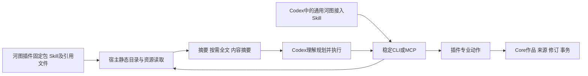
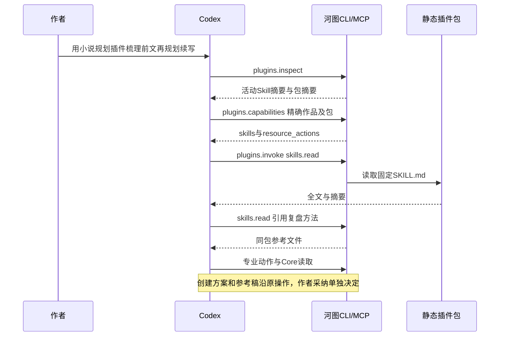

> 本文属于[插件设计](README.md)，拥有插件方法注册、Agent发现及客户端Skill边界。领域动作和作品权限分别归原Owner。

# 插件Skills注册与发现

## 1. 问题与决定

动作Schema告诉Agent“能调用什么”，Skill解释“何时使用、先读什么、怎样完成并接续”。只有UI和动作，不能保证Agent理解已有小说应先复盘再规划；只有包内Markdown但没有发现入口，Agent也无法知道应该读取它。

采用**插件自带标准Skill＋宿主静态目录＋稳定CLI/MCP按需读取＋通用河图接入Skill引导**。不为每个河图插件创建Codex插件、MCP连接或客户端工具名。宿主负责注册、版本和读取，方法内容归插件。河图始终是创作应用，不成为Agent运行时。

## 2. 调研依据

采集日期：2026-11-17。公开原文和摘要见[证据索引](../research/evidence/plugin-skills-discovery-2026-11-17.json)。以下是来源事实，采用合同以本篇后文为准。

| 项目 | 可核实机制 | 对河图的启示 |
| --- | --- | --- |
| [Codex Skills](https://developers.openai.com/codex/skills/) | `SKILL.md`带name／description，先发现摘要再按需读正文；支持项目／用户目录及软链接；自动检测变化，未出现时重启 | 标准文件便于移植，但不会自动扫描河图任意包目录；本地注册、当前会话可见与实际使用分别取证 |
| [Codex插件打包](https://developers.openai.com/codex/plugins/build/) | Agent插件可携带skills；公开目录、团队市场和本地来源有各自分发流程 | 这是另一种包，不把河图plugin.json冒充Codex清单；正式分发可用现有河图接入套件，不逐业务插件重复连接 |
| [pi packages](https://github.com/badlogic/pi-mono/blob/1f6f319bb28992a40b99c147fffb23b65a23129d/packages/coding-agent/docs/packages.md)及[skills](https://github.com/badlogic/pi-mono/blob/1f6f319bb28992a40b99c147fffb23b65a23129d/packages/coding-agent/docs/skills.md) | 同包贡献extensions／skills／prompts／themes，资源按包根解析；先摘要后全文，活动会话可`/reload` | 同包方法随版本分发，生命周期统一；只按需加载相关资源 |
| [DSH skill-badge](https://github.com/deepseek-ai/deepseek-harness/blob/0a53fb55bea101816fa226bb964ae2bed71c343b/packages/skill/skill-badge/src/index.ts) | `ctx.skills.registerProvider`贡献Skill；Provider分离list与get；有固定资源基目录 | 方法注册与加载可以独立于插件执行逻辑，启停跟随包 |
| [DSH filesystem provider](https://github.com/deepseek-ai/deepseek-harness/blob/0a53fb55bea101816fa226bb964ae2bed71c343b/packages/skill/skill-filesystem/README.md) | 扫描明确根目录、监听变化并使目录失效；有来源、优先级及重名规则 | 热更新需要具体失效规则；无需把整个DSH Agent和Provider框架搬入河图 |

DSH与pi掌握自己的Agent上下文注入；河图不能据此承诺控制Codex系统提示或强制自动选中Skill。这里的动态发现通过现有工具返回数据，属于Agent按需读取的方法，区别于Codex客户端原生Skill选择器。

## 3. 包与宿主合同

`PluginManifest.contributions.skills`为可选数组；不携带Skill的旧包保持可用。每项包含稳定`id`、标准`name`、简短`description`及包内`entry`。机器定义以manifest Schema及SDK为源。

```json
{
  "skills": [{
    "id": "novel-planner",
    "name": "hetu-novel-planner",
    "description": "复盘已有小说，推进后续总纲、卷章与正文迭代。",
    "entry": "skills/hetu-novel-planner/SKILL.md"
  }]
}
```

此片段位于`contributions`内。Skill目录可以携带`references/`、`scripts/`及必要资源。代码读取不执行脚本；调用脚本仍需外部Agent判断本次范围。发现摘要和frontmatter由插件一起维护，标准Skill由开发门禁验证；宿主不重新解释创作方法。

| 入口 | 结果与约束 |
| --- | --- |
| `hetu.plugins.inspect_package` | 未安装包的Skill摘要；只读校验，不执行后端 |
| `hetu.plugins.inspect` | 活动插件的Skill摘要、plugin_id、package_sha256及入口内容摘要；停用／移除／依赖失效退出活动目录 |
| `hetu.plugins.capabilities` | 返回`skills`、`resource_actions`与原有专业／核心动作；能力摘要包含方法目录 |
| `hetu.plugins.invoke`，`action="skills.read"` | 宿主保留的只读资源动作，参数为`skill_id`及可选`resource`；仅读固定包内方法，不启动插件后端 |

资源初次省略`resource`读取SKILL.md；后续相对Skill目录读取，如`references/progression.md`。返回包摘要、Skill身份、资源名、内容及内容sha256。每份资源最多64 KiB、UTF-8文本，拒绝绝对路径、父目录、软链接、越界及二进制；较长方法拆成引用文件，不截断为完整文档。

同插件内id／name不可重复；跨插件的同名Skill以`plugin_id＋skill_id＋package_sha256`寻址，不按名字静默覆盖。`skills.read`为宿主保留动作，插件不能重定义。作用域仍是本次精确作品及客户端管理引用；Skill不授予正文采纳、定稿、文件或外发权限。

## 4. 分层与时序





发现与读取留在TS包管理层；无需为静态方法增加Rust存储、Cordis运行对象或数据库表。包内Skill与UI／动作共享同一包摘要，升级要求重查。旧任务保存的固定方法摘录和出处仍保留，不随插件最新方法改变。

## 5. Codex原生安装与热更新边界

默认只安装一个河图接入套件；其接入Skill引导上述动态目录。已有Codex会话只要有稳定河图CLI/MCP和此发现规则，就可读取新河图插件方法，不要求重新枚举客户端静态工具。

若作者希望在Codex原生Skill列表看到独立名称，可以明确选择将标准Skill安装到Codex支持的用户或项目目录。客户端原生分发属于另一条安装记录，须核对所有者、目标与文件，不能由河图插件启用时静默写入，亦不能把Codex插件清单与河图清单合并。当前未实现插件Skill的自动客户端安装／卸载器。

Codex文档说明自动检测Skill变化，未出现时重启；这里不能保证当前具体版本／会话已经可见。`包内已声明`、`河图已发现`、`Codex本地已安装`、`当前会话已加载`、`业务使用成功`分别记录。无需原生安装时，工具按需读取即足够完成方法加载。

停用后下次发现不再列出方法，旧包调用失败；已经进入Codex上下文的文字无法从历史中撤回。方法要求执行前重查活动包与能力，实际动作仍由宿主核验。升级不覆盖旧发行字节，不复活旧操作，也不自动替换固定写作任务的输入。

## 6. 验收与维护

必须覆盖：无Skill旧包、标准Skill及引用、重复id／name、跨包同名、资源缺失／超限／非法UTF-8、越界、发现不执行后端、安装前已有MCP连接、安装后动态发现、停用失效、同连接重启用、升级后旧包拒绝、卸载保留作品、未安装客户端Skill的动态读取、Codex原生安装单独取证。业务方法再由插件测试，宿主清单不复制专业流程。

| 自动化入口 | 验证责任 |
| --- | --- |
| `packages/plugin-host/tests/skills.test.ts` | 静态资源、Schema必填／命名／重复／数量、UTF-8与NUL、64KiB预算、相对路径、软链接、跨包同名、生命周期与固定字节副本 |
| `packages/plugin-host/tests/dispatch.test.ts` | 专业／静态资源／数据／Core路由、严格私有输入、包及能力变化后的旧摘要拒绝、业务失败和unknown原样传播且不重试 |
| `packages/plugin-host/tests/skill-hotplug.test.ts` | 同一真实MCP连接启停升级卸载、CLI/MCP同内容同摘要、无需插件后端和新增客户端工具 |
| `packages/plugin-host/tests/headless.test.ts`、`hotplug.test.ts` | 开放SDK与历史合同的真实Core业务、原键、作品隔离及安装状态变更 |

按根`package.json`的`npm run test:plugins`构建并运行宿主全量回归；执行环境须符合工程`engines`，不以不受支持的Node版本失败推定产品业务失败。单元层不启动后端的断言不能替代真实进程测试。

源码、构建产物、已安装应用与当前会话可见性分别验证。实施证据归主20／38，小说规划专业证据归其08；本篇不是安装版或作者业务完成声明。

## 7. Skills、CLI和MCP的能力对等

同一应用用例经插件后端及Core执行，CLI和MCP承担传输适配；Skill不在客户端重实现保存、CAS或恢复。GUI调用相同动作，负责阅读、比较、反馈和作者决定。无需让每个插件自建CLI二进制或独立MCP服务。

| 能力 | CLI动作 | MCP入口 | 对等要求 |
| --- | --- | --- | --- |
| 本机插件及Skill目录 | `hetu.plugins.inspect` | `hetu_plugins_inspect` | 同一安装状态，不执行后端 |
| 校验待安装包 | `hetu.plugins.inspect_package` | `hetu_plugins_inspect_package` | 同包、同完整摘要、同方法摘要 |
| 安装／启停／卸载 | `hetu.plugins.apply` | `hetu_plugins_apply` | 同固定选择、状态CAS与原键 |
| 安装原操作 | `hetu.plugins.get_operation` | `hetu_plugins_get_operation` | 查询原结果，不换键重新安装 |
| 作品中的实际能力 | `hetu.plugins.capabilities` | `hetu_plugins_capabilities` | 相同WorkRef、management_ref、包与能力摘要 |
| Skill及引用文件 | `hetu.plugins.invoke`＋`skills.read` | `hetu_plugins_invoke`＋同一action | 同内容及sha256，仅读声明包内文本 |
| 专业规划动作 | `hetu.plugins.invoke`＋专业action | `hetu_plugins_invoke`＋同一action | 同Schema、效果、固定输入、分页、CAS及Result |
| 专业原操作与历史 | `invoke`＋已发现的`hetu.extensions.operations.get`／对象动作 | 同一`invoke` | 未知先查询；旧修订、待接入成果可找回 |
| 正文任务与反馈 | 宿主公开领域动作 | 对应已发现MCP工具或固定管理方案 | 不复制到插件；参考稿、采纳、定稿分别处理 |

每项功能的完成条件为：发现得到参数Schema→读固定输入→执行→读固定成果→相同请求或原键可恢复→CLI与MCP相互回读。写动作还必须有CAS冲突、同键异输入与回执丢失的处理；长篇读取要有真实分页终止；停用或换包后旧引用要失败。

方法通过不代替动作通过，CLI通过不代替MCP通过；无窗口测试不代替作者审阅。宿主地图只维护这些统一入口，插件自己的CAPABILITIES登记其专业功能与用例、对应动作及实际证据。没有机器入口的按钮、没有操作合同的Skill，均不能算功能闭合。

稳定入口的每次调用由一个私有运行进程读取实际核心能力、核对能力摘要、选择静态资源／专业动作／核心动作并执行，避免为同一次调用先启动发现进程、再启动相同执行进程。该调整不缓存作品或权限，包、活动状态及核心身份仍按本次请求核验；30／35／45秒的既有超时保护不因测试失败而放宽。
