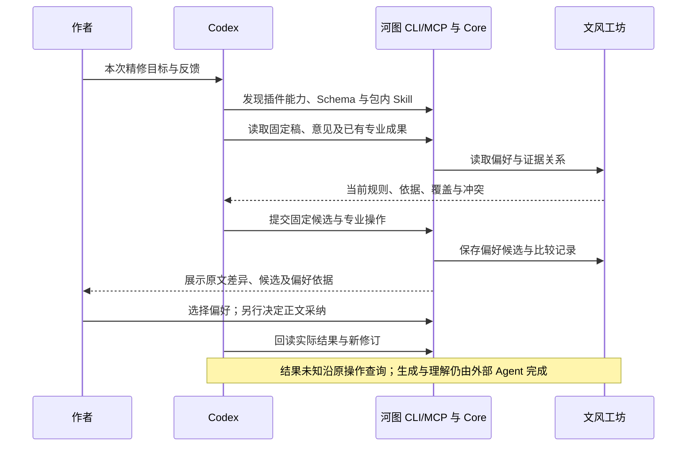
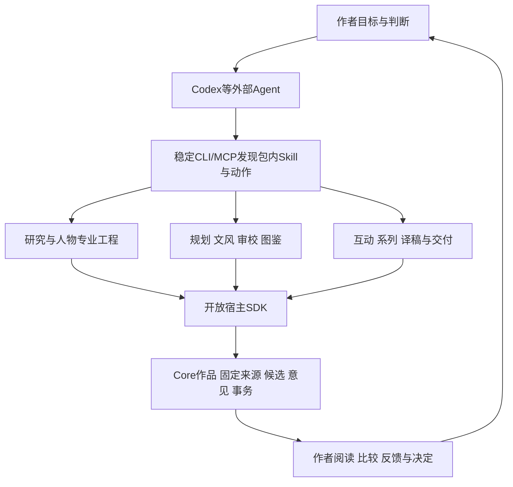

> 本文属于[创作插件体系设计](README.md)，负责小说插件的外部参考、能力取舍及分批复刻建议。

# 小说插件生态调研与复刻路线

研究日期：2026-11-17。研究范围与选型依据保留本次采集事实；首批实现与发行状态见宿主实施记录及各插件08文档。

## 1. 研究结论

小说插件生态应覆盖研究、构思、人物与世界、结构、写作、审阅、可视化、互动改编和交付。文风工坊、小说审校、小说规划和小说图鉴只是首批基础，不能代表生态范围，也不能据此宣称完整复刻参考项目。

扩展按两个方向推进：补足四个已发布插件的专业深度，同时建设具有独立数据、操作和交付价值的新插件。当前整理出27项能力域和9个新增专业包候选；这些是产品分流与设计范围，具体列表见第8节，尚未实现的部分不进入已安装功能清单。

按作者任务组合上游能力，避免为每个相似工作台另建正文库、设定库和模型连接。题材方法用Skill或模板交付；人物侧写、研究工程、互动分支、译稿对齐等需要持续维护专业状态的任务，再采用独立插件。

这些插件共同服务持续创作：已导入原稿或已有规划 → 准备本次目标 → 形成候选 → 作者阅读与反馈 → 局部返工 → 选用后继续下一章。单次生成的页面不是完整插件，必须能沿作品修订、意见和原操作接续。

## 2. 检索范围与证据

入口为[DSH 社区插件市场](https://www.dsh.so/zh/artifacts/)。初次搜索“小说”，现场筛选为 `L5`，显示34条命中，只读取第一页32条。该样本没有覆盖第二页、其他等级或英文名称，不能作为完整路线的依据。DSH 社区市场独立于 DeepSeek 官方项目。

初次研究取得32个仓库元数据、18份固定提交的 README，并对 Openwrite、DSH-Creator、Novel Craft、sailoumili/novel-writer 作定向源码或方法文件核对；重点项目另读取固定版本许可证。原始证据保持其采集范围。

完整条目、分类、固定提交、文件摘要和证据层次见[研究记录](research/novel-ecosystem-2026-11-17.json)。README 功能说明、源码已检查和河图实际运行分别记录；许可证检查也不等于已完成全部依赖及素材审计。

### 2.1 扩大检索与逐项分流

2026-11-17重新取得同一站点的完整公开索引，包含30,545条市场记录，SHA-256及检索规则见[扩展研究记录](research/novel-ecosystem-expansion-2026-11-17.json)。取消等级筛选与分页截断，使用“小说／网文／写作／世界观／世界书／角色卡／大纲／伏笔／审稿／审校／文风／故事／拆书／考据／编剧／剧本”及 `novel`、`fiction`、`galgame`、`lorebook`、`worldbuilding` 检索。

| 样本口径 | 本次快照结果 | 能说明什么 |
| --- | --- | --- |
| “小说”单关键词，全等级 | 63条：L3 9条、L4 20条、L5 34条 | 原L5首页样本明显不完整 |
| 直接词“小说／网文／novel／fiction”去重命中 | 110个仓库 | 仍有阅读器、主题和子串误命中，不能称为110个创作插件 |
| 全部检索词去重命中 | 248个仓库 | 需要逐项判断；不是248个可复刻小说插件 |
| 固定仓库元数据 | 248份 | 保留提交、默认分支、描述、许可及市场链接 |
| 固定源码research base | 36个，其中本次新增25个 | 已逐个克隆；只取源码，不执行上游安装、构建、测试或模型调用 |

完整候选按18类逐项列于[阅读索引](research/novel-candidates-2026-11-17.md)。每条均有研究去向、建议Owner及证据层次；74条非小说优先项单独说明，不删除研究线索，也不将它们计为小说生态供给。原L5第二页遗漏的 `visangela/dsh-novel-assistant` 和 `darlingsakurua/dsh-novels` 已补取源码；后者实际是阅读器，名称不能证明它提供创作能力。

定向源码检查新增覆盖设定规则、中文风格测量、英文文本诊断、偏好编译、长文本抽取恢复及人物出场统计。未安装上游插件、未运行其测试、未比较生成质量。市场验证等级、上游测试数量、下载量及性能主张不能替代河图验收。

### 2.2 参考版本与方法边界

- `lingfengQAQ/webnovel-writer` 默认分支保留Claude Code v6；DSH实现位于 `v8`。本次另外固定读取 `0792a887d046db3537a4d52f2283592d31dbb2eb` 的v8文档，不用默认分支代替DSH版证据。
- Pagekin当前主产品为独立本地应用，其DSH适配另有维护边界。对照作者旅程与产品结构时保留这一差异，不把所有市场收录项目视为同一种插件。
- `umairrrkhan/dsh-novel-quality-analyzer` 的源码使用英文句子切分和词项统计，中文输入不评分。借鉴指标解释及样本不足处理，不能直接把其英文阈值用于中文小说。
- `canonkeeper` 和 `dsh-story` 展示了有来源的状态事件与确定性规则思路。抽取漏项会影响规则召回；“规则通过”不证明整书事实齐全，重生、倒叙、假死和误导叙述也不能按统一硬门禁裁决。
- `canghai666x/dsh-web-novel-research` 文档包含转载站检索策略。河图只采用来源分层、目录辨识和证据核对方法，不采纳以免费转载替代作品权利的前提。

## 3. 重点参考与河图归属

下表功能为固定版本文档声明；“源码核对”只覆盖研究记录列出的文件。

| 上游参考 | 值得借鉴的能力 | 河图采用方式 | 证据与限制 |
| --- | --- | --- | --- |
| [Novel Craft](https://github.com/shiyan688/dsh-novel-craft/tree/8a52268b3d521e11fd78a3117c03c1f5a771a2cf) | 段落反馈、偏好提炼、规律与证据分离、不同叙事方向、按批注微调、写作包预算 | 新建文风工坊，复用宿主反馈、候选和选区返工 | MIT；已核对批注处理、写作包及方法文件；模型调用适配需要重做 |
| [Openwrite](https://github.com/LiPu-jpg/Openwrite/tree/3635a1e5ca5ab9398e8adb7c3a91526826184a30) | 六域审稿、固定审稿框架、检查覆盖和原文依据 | 小说审校的分析框架 | Apache-2.0 主许可；已核对框架、工具文档与第三方声明；子项目许可分别处理 |
| [DSH-Creator](https://github.com/KurohaneKaoruko/DSH-Creator/tree/e9a8e121a2ce9cd5e8d2721a31ab5ba7c1a399f3) | 写前资料组装、本地规则检查、全书体检、方法套件 | 审校的确定性规则与方法，复用宿主资料入口 | MIT；已读规则及工具源码；文风规则须改为可选择建议 |
| [长篇中文小说工作台](https://github.com/micellince/dsh-long-novel-workbench/tree/fae33646ad17565b64792e94be411f1d3fcf7e95) | 连续阅读、作者与 AI 问题合流、问题到修改稿、原文已变提示 | 增强宿主阅读和意见接续，专业问题分类归审校插件 | MIT；README 核对；不照搬其自有数据库、内置对话或“整书一次读完”的强制策略 |
| [拍板 Novel Beat](https://github.com/DrizzleGig/dsh-novel-beat/tree/577d0995f9f47ba6b6a1398300089e7d42cb055a) | 剧情走向比较、选择代价、人物知情状态、承诺接续 | 增强现有小说规划插件 | MIT；README 核对；不另建正典，不强制作者逐段批准 |
| [小说工坊／时间长河](https://github.com/XiaoOu2024/dsh-novel-generator/tree/8e45f22ce6e5ebf5f6ce98efce8c8a2a199c82c8) | 故事时间、章节跨度、世界状态快照 | 规划的时间线候选与图鉴的历史投影 | GitHub 识别 MIT；README 核对；模型推断不直接成为正式事实，未知时长不填假值 |
| [Novel Atlas](https://github.com/lilinshuei/novel-atlas/tree/2a6cd304c9ce4a7db00bb31e4a2ec08571f0efd3) | 人物关系、地图、成长、感情、器物及剧情多视图，离线 HTML | 新建小说图鉴，同一作品数据的专业投影 | MIT；README 核对；统计抽取只是草稿，不能保证地理或实体归属正确 |
| [一页式小说工坊](https://github.com/ShanJun-pro-max/dsh-novel-workbench/tree/1c728bbca362c99dd379c26894008b56d4122460) | 剧情总结索引、别称、上下文选材、按类型复用偏好 | 文风工坊与宿主任务上下文的补充参考 | GitHub 识别 MIT；README 核对；跨作品复用由作者选择，不自动混入其他作品 |
| [Galgame Generator](https://github.com/baisama-cloud/dsh-galgame-generator/tree/276974e36a89dbaf07d9a7d4208d980088741160) | 叙事分支、变量条件、结局、素材与可播放 HTML | 独立互动叙事插件 | MIT；README 核对；属于新的专业工程，不塞入线性小说规划 |
| [novel-writer](https://github.com/sailoumili/novel-writer/tree/bd0082106998a4737d3428bed334cacde46accd9)／[Novel Solo](https://github.com/Tkingxiao/dsh-novel-solo/tree/5e10e69535eb2d8bf953b4e79b9131bc0885a90f) | 世界、剧情、人物、写作与复核的方法分工；小模型上下文精简 | 按任务组织插件 Skill 与发现摘要 | GitHub 识别 MIT；前者核对预设、后者核对 README；不引入河图内置多 Agent 调度 |

同名项目按仓库身份区分。例如 `watersxya/dsh-novel-forge` 为 AGPL-3.0，`EastChilde/dsh-novel-forge` 的 GitHub 元数据识别为 MIT，不能混用许可结论。砚田 `ZzimaR/dsh-yanfield` 的实际 LICENSE 为 PolyForm Noncommercial 1.0.0；不能因为代码公开或市场收录，就当作宽松开源源码直接引入。

阅读摸鱼、书源下载、Pixiv 采集和通用 Agent 增强不列入本轮创作插件优先项。相关产品仍保留在研究记录中，避免下次检索重复研究。

## 4. 能力边界与技术适配

### 4.1 宿主、插件、Skill 与视图

| 层 | 持有或负责 | 本轮取舍 |
| --- | --- | --- |
| 宿主 Core | 作品身份、固定正文与设定、来源、修订、候选、意见、作者采纳和事务恢复 | 复用已有用例；缺公共入口时先补宿主，不让插件直写内部文件 |
| 专业插件 | 偏好规则、证据组织、审校规则及分析报告、图鉴布局或互动叙事工程 | 专业数据引用固定来源；拥有自己的 Schema、功能清单及测试 |
| 包内 Skill | 选择方法、读取依据、比较候选、续写与返工编排 | 供外部 Agent 按需发现读取，不配置河图内部 Agent |
| 视图 | 选段比较、证据跳转、问题清单、图谱和时间线 | TypeScript／React 复用宿主 SDK；作者可直接阅读和反馈，机器业务不依赖页面 |

河图现有小说规划清单已经覆盖整书／卷章、规划卡、伏笔、关系、固定快照、比较、进度及正式大纲接续，专业事实由该插件维护。本轮剧情走向、规划时间线应先评估在原插件中增强。图鉴若独立发布，消费规划与正式设定的公开固定数据，不复制它们的维护入口。

宿主机器导航以[40](../40-机器能力地图与Review清单.md)为准，包括 `hetu.documents.validate`、`hetu.validation.run`、`hetu.reviews.validate` 和 `hetu.task_context.search`。这些入口承担已定义的检查或检索用例，不表示已经具备六域语义审稿、作者偏好学习或任意全书检索；执行仍须发现安装版能力与当前范围。

### 4.2 上游适配方式

采用现有 TypeScript 插件宿主、公开 SDK 和受管 Node 运行时，专业界面使用 React；组合与生命周期复用现有 Cordis 层，详见[26](26-Cordis采用与DSH兼容边界.md)和[27](27-开放宿主SDK与核心能力审计.md)。本轮没有引入新的运行时或 Rust 插件格式。

可研究复用纯计算函数、数据投影和方法；DSH 的 `ctx.llm`、会话控制、工具注册、私有正文路径和 UI 插槽需要按河图合同改写。使用同类技术栈不代表 DSH 插件可原包安装到河图。

插件通过稳定 CLI/MCP 的动态能力发现与调用接入。包内 Skill 的注册、同一 Codex 会话发现和停用行为按[28](28-插件Skills注册与发现.md)验收，不为每个河图插件另建 Codex 插件或 MCP 服务。

### 4.3 不直接采纳的设计

- **固定文风硬门禁**：Creator 源码把整章破折号超过一次、省略号超过两次、出现分号等列为硬违规。河图可提供作者选定的规则集和建议，不据此阻止正常保存，不将标点统计宣称为可靠的 AI 来源判定。
- **将推测写成事实**：张力、注意力、角色归属和地理抽取分别标明计算值、Agent 判断及作者确认；未读、未检查、依据不足明确显示，不能记为通过。
- **无差别全书输入或极端压缩**：按任务保留必要依据并报告覆盖。跨章审稿必须获得足够原文；写作包可以压缩偏好与前情，但不能把字符预算当作真实 Token 费用，也不能保证固定比例的节省。
- **把上游调度器搬入宿主**：保留 Codex 等外部 Agent 的理解与生成；河图插件组织专业成果和确定性操作。模型服务、作者决定与费用合同继续由宿主执行。

## 5. 分批推进建议

以下是首批路线的来源记录，不是完整生态目录。增量路线按第8节推进；每批完整验收后再进入下一批，不以多个空包代替专业能力。

| 顺序 | 发布单元 | 首次完整闭环 | 主要参考 |
| --- | --- | --- | --- |
| 1 | 文风工坊 `hetu-prose-studio` | 比较候选 → 作者反馈 → 证据与偏好 → 下轮选区精修 → 作者决定 | Novel Craft、一页式工坊、长篇工作台 |
| 2 | 小说审校 `hetu-novel-review` | 固定范围 → 规则及六域检查 → 有依据的问题 → 修改稿 → 复核与接续 | Openwrite、Creator、长篇工作台 |
| 3 | 现有 `hetu-novel-planner` 升级 | 复盘既有剧情 → 比较新走向与代价 → 时间线候选 → 卷章接续 | Novel Beat、时间长河 |
| 4 | 小说图鉴 `hetu-novel-atlas` | 固定资料 → 多视图联动 → 回到来源 → 更新投影 → 离线交付 | Novel Atlas |
| 5 | 互动叙事 `hetu-interactive-fiction` | 固定故事与素材 → 分支条件 → 可达性检查 → 播放测试 → 工程交付 | Galgame Generator |

小说图鉴的关系网、地图、成长曲线按作品需要启用，不预设男性向、修仙或恋爱类型。互动叙事与线性小说规划分别持有专业结构，通过来源关联。

## 6. 第一批：文风工坊的可实施范围

### 6.1 作者用例

作者说：“这一段太直白，保留动作，让情绪藏在对白里；以后这个人物也这样写。”Codex 读取当前固定稿和已有偏好，准备不同处理方向与局部候选。作者可以只表达喜欢或不喜欢，也可以说明原因；Agent 提炼偏好候选，作者选择沿用范围，再用于下一轮。作者不必手工填写完整规则表。

已有稿可以直接进入反馈与精修；没有反馈或偏好时可以先创作，不把校准变成写作前置。叙事方向数量按目标与预算决定，不机械生成十份完整章稿。

### 6.2 数据与行为

- 偏好区分作者直接声明与 Agent 推导，保留来源意见、固定成果及选区；作者可编辑、停用或删除规则。匹配不出的证据显示依据不足，不伪造映射。
- 规则和原文证据分层。下一轮默认提供已选规则及本次必要资料，完整依据按需读取；“证据不重复注入”不等于“所有创作都不需要正文”。
- 比较候选记录叙事差异及其代价；选段拼接先形成候选并检查过渡，不能把机械拼接视为已定稿。
- 精修固定目标选区和基线。未选区域保持原字节；确需扩大改动范围时重新准备明确候选。不能用段落归一化后的相同，冒充整份原文逐字未改。
- 正文、反馈和采纳复用宿主；插件只保存偏好、证据关系、比较组织及本次专业工作记录。规划与正式设定分别引用其 Owner 的固定修订。
- 默认作用于当前作品；复用到另一部作品或类型模板时明确选择目标和规则，不自动串书。
- 提供有版本与来源的 Markdown／JSON 专业导出。工作状态、冲突与原操作回读由公共入口完整暴露。

正式开发前，在插件仓库定义数据 Schema、专业动作、Skill、完整用例及功能清单；核对宿主公开服务能否支撑上述范围。缺口归实际 Owner，不在此研究文档虚构已发布 API。

### 6.3 机器与作者协作

### 6.4 发布验收出口

| 场景 | 必须取得的证据 |
| --- | --- |
| 首次使用、没有偏好 | 可直接精修；没有虚构的默认作者口味 |
| 喜欢与不喜欢的真实反馈 | 偏好可反查固定意见与来源；作者删除或停用后新任务不再默认带入 |
| 相互冲突的偏好、跨作品复用 | 显示适用范围和冲突；其他作品不被隐式读取或修改 |
| 不存在的来源、缺少阅读范围 | 拒绝无效引用或显示未完成；不生成假证据、假通过 |
| 只改一段、原文包含中文与特殊空白 | 目标外字节摘要一致；候选保留完整差异 |
| 原文已改、偏好同时被编辑 | 固定引用／CAS 冲突，不覆盖作者新稿，保留当前候选 |
| 写作包超预算 | 展示选材与裁剪；必要依据不足时提示补读，不静默丢失约束 |
| 保存响应丢失 | 原操作回读确认结果，不换键重复写入 |
| 同一 Codex 会话安装、停用与重开 | 稳定入口能重新发现并读取 Skill；停用后不再提供新调用，历史及导出保留 |
| 全程不打开 GUI 的小说迭代 | CLI/MCP 跑通读取、候选、反馈、偏好、返工及接续；作者采纳按实际宿主决定合同另验 |
| 作者可视化 Review | 实际工作面呈现来源、差异、规则与完整异常状态；Mac 和 Windows 分别取得运行证据 |

上表是产品验收要求。已执行的用例与实际限制以插件08及宿主20为准；初次研究没有执行上游运行验收。单元测试验证专业规则和引用，集成测试验证宿主数据归属、冲突及恢复，Codex会话验收验证能力发现和完整旅程；任一层通过不能替代其余层。

## 7. 开发、上架与维护

开发与调试遵守[22](22-插件开发与调试指南.md)，固定版本和制品发布遵守[23](23-插件发布与上架指南.md)，目录收录遵守[24](24-插件目录与分发治理.md)。研究条目不自动进入官网插件中心。

复用代码、方法或素材时逐项保留来源及许可证，改编说明随插件分发。宽松许可项目优先评估工程复用；GPL／AGPL、自定义或无法识别的许可另行核对适用文件和分发义务，功能启发与源码引入分别决定。

本文件只维护外部参考、取舍与顺序。正式能力由插件各自的功能清单、合同与验收记录维护；宿主[40](../40-机器能力地图与Review清单.md)只维护核心能力和插件发现入口。主实施进度仍归[20](../20-实施路线与里程碑.md)，不在研究文档复制发布状态。

### 7.1 首批正式方案

选中的重点上游已逐个克隆到独立research base并固定提交，具体覆盖以研究记录为准，不表示所有候选都已克隆或完成适配。河图实现按作者任务重新组织，宿主持有正文、来源、任务与作者决定，专业插件维护自己的领域数据，不复制上游内置Agent或自有正文库。

| 项目 | 方案与领域 | 版本 |
| --- | --- | --- |
| [文风工坊](https://github.com/wordflowlab/hetu-prose-studio/tree/v0.1.0/docs) | 有据偏好、方向比较、固定选区微调与上下文 | v0.1.0 |
| [小说审校](https://github.com/wordflowlab/hetu-novel-review/tree/v0.1.0/docs) | 六域覆盖、问题证据、意见处理及新候选复核 | v0.1.0 |
| [小说规划](https://github.com/wordflowlab/hetu-novel-planner/tree/v0.2.0/docs) | 保留整书卷章，增加方向代价、双时间及人物知情状态 | v0.2.0 |
| [小说图鉴](https://github.com/wordflowlab/hetu-novel-atlas/tree/v0.1.0/docs) | 同源人物/势力、关系、地点列表、事件及属性投影；地图、成长曲线和感情线仍需深化 | v0.1.0 |

四项目经稳定CLI/MCP接续同一小说，方法由包内Skill动态提供。宿主只补齐work_kinds范围与固定HTML文件出口，不新增专业正文、审稿或图鉴内核。具体证据和平台限制归各插件08及宿主20，互动叙事沿下述独立Owner维护。

## 8. 小说生态的完整任务目录

### 8.1 能力域、作者用例与归属

以下编号是研究与实施分流标识，不是已发布动作。一个插件可以承担多个能力域；上游同类工作台也可拆为多个河图能力。具体动作、Schema、功能清单和实施状态由插件自己维护。

| 标识 | 能力域与作者需求 | 交付归属 | 参考及关键取舍 |
| --- | --- | --- | --- |
| NE-01 | 灵感与素材池：“把零散想法整理成可继续的选题” | 研究台候选 | BigSeed、笔记类；素材来源与构思分开 |
| NE-02 | 题材与读者研究：“比较同题材作品和公开市场观察” | 研究台候选 | rank-scan；记录采集时间和平台口径，排行不等于质量 |
| NE-03 | 拆书与结构比较：“说明这段如何铺垫和兑现” | 故事分析候选 | Pagekin、oh-story；参考作品与自己的正文分开 |
| NE-04 | 考据与依据：“核对时代、职业和制度，不编出处” | 研究台候选 | maoying、research类；来源内容走宿主资料，插件持研究问题与结论 |
| NE-05 | 世界规则与体系：“让力量、货币、地理和历法能检验” | 规划＋审校升级 | canonkeeper、story账本；正式设定归Core，专业约束可有例外 |
| NE-06 | 人物访谈与侧写：“这个人的欲望、恐惧和底线是什么” | 人物工坊候选 | lifecard、character-profiler；侧写判断不是正式人物事实 |
| NE-07 | 人物弧光与对白试演：“这次变化有铺垫吗，语气是否一致” | 人物工坊候选 | character-profiler、角色卡工坊；试演由外部Agent进行 |
| NE-08 | 角色卡与世界书交换：“导入已有卡片，保留字段及损失说明” | 世界书互通候选 | LorebookMD、cc-studio；V2/V3、JSON/PNG/CHARX分别核对 |
| NE-09 | 整书、卷章与既有稿复盘：“先读过去，再规划未来” | 小说规划深化 | 已有规划Owner；未读章节不记为已复盘 |
| NE-10 | 节拍、走向与伏笔：“比较不同代价并跟踪兑现” | 小说规划深化 | Novel Beat、story；已选方向与已发生剧情分开 |
| NE-11 | 时序、视角与知情：“谁在这一刻知道这件事” | 规划＋审校深化 | 时间长河、canonkeeper；故事顺序、叙事顺序与日历不是同一字段 |
| NE-12 | 写前备料与会话接续：“换对话也能继续第80章” | 规划／文风＋公共来源 | novel-solo、jizuo-memory、Scriptor v8；有界选材与未读披露 |
| NE-13 | 方向比较与选段组合：“保留A的动作和B的对白” | 文风工坊升级 | Novel Craft；拼接先形成候选并复核衔接 |
| NE-14 | 从修订学习与风格画像：“记住我为什么这样改” | 文风工坊升级 | Liltloom、style-memory、Stylome；显式选样，不监控Codex全部聊天 |
| NE-15 | 中文校对与重复测量：“哪些句段重复，词项是否统一” | 小说审校升级 | proofread、quality-analyzer、siweina；中文与英文口径分别验证 |
| NE-16 | 状态一致性：“钱、物品、伤势、位置是否前后矛盾” | 小说审校升级 | canonkeeper、story；固定事件、单位、时间和例外依据 |
| NE-17 | 读者体验、节奏与情绪：“哪里失焦，哪里只有重复推进” | 故事分析候选＋审校 | long-novel-workbench、Stylome；分析结果可形成审校问题，度量不代替品味 |
| NE-18 | 连贯阅读与意见：“从疑点跳回上下文，改完再看” | 宿主阅读＋专业叠加 | long-novel-workbench、readwrite-hub；不复制正文、意见和版本库 |
| NE-19 | 世界地图与行程：“看地点和人物如何在空间移动” | 小说图鉴升级 | Novel Atlas；未知距离保持未知，示意图不当真实地图 |
| NE-20 | 成长、关系与器物流转：“按章节看变化和来由” | 小说图鉴升级 | Novel Atlas；支持定性变化，不强制虚构数值评分 |
| NE-21 | 长篇抽取、别名与增量更新：“改一章，只复查受影响部分” | 图鉴／分析＋宿主固定来源 | cong7781/novel、jizuo-memory；覆盖、歧义、依赖及旧来源保留 |
| NE-22 | 互动叙事：“把这一段改成有变量和结局的分支” | 互动叙事候选 | galgame-generator；分支可达、条件类型、结局覆盖 |
| NE-23 | 试玩与回放：“重走这条路线，并整理成续写素材” | 互动叙事候选 | galbook、narrative-engine；存档固定工程修订，反写仍为宿主候选 |
| NE-24 | 短篇集、番外与系列：“同一人物在不同作品中有不同经历” | 系列组织候选 | serial-story-writer；固定关联，不合并作品权限和正典 |
| NE-25 | 文学翻译与术语：“对照源文、译稿和意见逐段返工” | 译稿工坊候选 | translation-assistant；源文、译文及对齐版本独立 |
| NE-26 | 朗读与有声校稿：“听出拗口或对白相似的地方” | 朗读审阅候选 | novel-forge听书主张＋宿主媒体合同；实际声音、文本映射和费用分别取证 |
| NE-27 | 书稿编译与专业交付：“按固定版本生成EPUB/PDF/HTML工程” | 书稿交付候选＋宿主 | 图鉴离线HTML、书稿工具；格式转换、损失报告与发布运营分开 |

NE-26／27是从持续阅读与交付任务推导的扩展候选，尚未完成专用上游运行评估。题材套件、悬疑方法、恋爱结构、历史考据等横跨上述能力域，不单凭题材另建相同数据结构的插件。

### 8.2 候选发布单元

下表定义专业包边界与首次完整旅程。创作研究台、人物工坊和故事分析已有本地v0.1.0工程，方案与验收分别由各包docs维护；其他名称继续用于候选讨论。本地工程、Git发行与插件中心收录分别核验，具体实施进度归宿主20。

批次B文档由创作研究台（`hetu-story-research`）、人物工坊（`hetu-character-lab`）与故事分析（`hetu-story-analysis`）各自仓库的 `docs/README.md` 维护。专业动作与包内Skill由各包的功能清单导航，宿主不复制专业动作表。

C／D各包已使用独立仓库及docs维护专业合同。是否已发布、实际版本与验收范围以各包08、固定Release及宿主20为准；其余候选按专业状态边界立项，不批量创建空仓库。

| 候选包 | 专业状态与成果 | 覆盖能力 | 首次完整旅程 |
| --- | --- | --- | --- |
| `hetu-story-research` 创作研究台 | 研究问题、来源观察、摘录关系及有据结论 | NE-01／02／04 | 提问→固定来源→比较与冲突→研究结论→供规划引用 |
| `hetu-character-lab` 人物工坊 | 侧写、动机假设、访谈、对白试演与弧光分析 | NE-06／07 | 固定人物→访谈候选→原文核对→发展方案→续写任务 |
| `hetu-story-analysis` 故事分析 | 拆解、场景信号、读者视角分析及范围覆盖 | NE-03／17／21 | 固定阅读范围→分块分析→有据汇总→审校问题→新稿复核 |
| `hetu-lorebook-bridge` 世界书互通 | 格式映射、导入候选与损失报告 | NE-08 | 固定原文件→解析→字段与来源映射→宿主独立方案→往返核对 |
| `hetu-interactive-fiction` 互动叙事 | 分支图、类型化变量、素材映射、存档和路线回放 | NE-22／23 | 固定故事→分支工程→检查→试玩→离线交付及续写候选 |
| `hetu-series-organizer` 系列组织 | 系列目录、作品间固定关系及角色出演映射 | NE-24 | 各作品分别获权→固定关联→番外规划→只更新目标作品 |
| `hetu-story-translation` 译稿工坊 | 源译对齐、术语、风格约束、问题与候选 | NE-25 | 固定源文→对齐译稿→意见→局部返工→双语交付 |
| `hetu-readthrough` 朗读审阅 | 朗读计划、实际声音、文本时间映射与听读意见 | NE-26 | 固定稿→外部工具朗读→听读意见→对应选区候选 |
| `hetu-book-export` 书稿交付 | 版式模板、编译配置、损失说明及可再生成工程 | NE-27 | 固定目录与正文→编译→全量渲染检查→固定文件交付 |

包数量不是成功指标。若人物工坊首批需求只需已有设定的几个投影，先作为规划或图鉴能力；若研究台与故事分析共享任务而没有独立状态边界，可先组合发布。独立包以专业数据归属、独立使用和维护成本为依据。

### 8.3 首轮发布时的深度审计

本节保留2026-11-17首轮发布时的审计基线，后续深化以各包08及本节末的固定交付引用为准。审计文件摘要见扩展研究记录。下表是具体范围判断，不抹去既有安装、恢复及联动测试，也不把它们外推为上游全功能复刻。

| 已有插件 | 已有基础 | 本次确认的深化项 | 维护Owner |
| --- | --- | --- | --- |
| 文风工坊 | 有据偏好、方向比较、选区外字节保持、有界上下文 | 默认上下文收集全部active规则；人物／文体作用域匹配、冲突处理、修订学习和跨作品模板需补齐 | 插件`docs/10-专业深度与升级验收.md` |
| 小说审校 | 六域记录、问题证据、覆盖、新来源复核 | 本地规则仅配置词项和可选标点；中文重复、词典校对和状态规则尚无完整执行器 | 插件`docs/10-专业深度与升级验收.md` |
| 小说图鉴 | 人物／关系网、事件时间线、属性及离线导出 | 地点为列表；成长为属性及事件；地图、时间序列、独立感情线、阅读联动及增量覆盖需要实现 | 插件`docs/10-专业深度与升级验收.md` |
| 小说规划 | 整书卷章、伏笔关系、走向代价、人物知情和续写接续 | 故事时间当前是字符串；需要明确时间语义、影响分析和新原文下的复核，不能按文本排序宣称历法正确 | 插件14中的升级验收范围 |

### 8.4 推进顺序与宿主缺口规则

| 批次 | 交付目标 | 出口 |
| --- | --- | --- |
| 批次A：四插件深化 | 图鉴真实多视图、审校可解释本地规则、文风作用域与学习、规划时序语义 | 逐项专业用例、旧修订回归、真实机器旅程和可视化证据 |
| 批次B：研究与人物 | 创作研究台、人物工坊、故事分析；先验证专业状态边界 | 同一本小说从依据到分析、规划、候选和复核的接续 |
| 批次C：互通与互动 | 世界书标准交换、互动工程、试玩与回放 | 来源往返、分支与存档、离线成果及同一Codex会话热插拔 |
| 批次D：系列与交付 | 系列组织、译稿、朗读和书稿交付 | 多作品隔离、固定对齐、可播放媒体及可再生成交付 |

每个单元先在所属插件的`docs/`定义PRD、领域、数据、API、Skill、用例和验收，再修改代码。验收记录应说明专业功能深度，不能只给动作数量或安装成功。

宿主公共能力先核对[机器地图](../40-机器能力地图与Review清单.md)和安装版实际发现。本轮提出以下验证任务，尚不据此宣称宿主缺少全部能力，更不先扩张Core：固定长文分段读取与范围覆盖、插件间固定对象接续、相同实体在不同作品中的隔离、PNG／归档素材接入、声音与正文区间映射、多文件交付和原操作恢复。只有公开入口不能满足具体用例时才补宿主；专业抽取、规则、曲线、布局和方法继续放插件。

## 9. 扩展路线的用户用例与验收设计

以下用例是扩展能力的验收要求。初次研究没有执行新增业务；后续批次B及C／D的实际范围、结果及限制见各包08与宿主20，不据局部通过推定全部用例完成。已有四插件测试保留其原范围。每个插件在自己的用例文档承接编号，不将计划写入宿主已实现清单。

| 用例 | 目标与输入 | 必须验证的结果 |
| --- | --- | --- |
| NEX-01 研究接续 | 新想法及两份相互冲突的参考 | 观察、引文、推断与作者选择分开；按固定来源进入规划 |
| NEX-02 拆书与自己的原稿隔离 | 参考作品和当前小说各一份 | 拆解记录固定阅读范围，不将参考正文导入自己的正式章节 |
| NEX-03 人物发展 | 固定人物、前后两场及作者目标 | 区分有铺垫变化和疑似OOC，出场统计只作测量 |
| NEX-04 世界书往返 | V2／V3 JSON、PNG及CHARX样本 | 已知字段可往返，未知扩展有损失报告；不执行卡内脚本或自动启用预设 |
| NEX-05 修改学习与冲突 | 同一人物在不同场景的相反反馈 | 原文及意见可定位，作用域和冲突可审阅，不默认套到全部人物 |
| NEX-06 跨作品复用 | 选择一个风格模板及确切目标作品 | 只导入所选规则，保留出处；不读取未授权的原作品正文 |
| NEX-07 中文与英文测量 | 中文、英文、混合、短文本及刻意反复 | 口径和版本明确，样本不足不评分，重复出现不直接认定为错误 |
| NEX-08 状态规则与例外 | 倒叙、同名、借出器物、假死、复生及货币单位 | 能解释确定矛盾；时间、身份或抽取不足时返回无法判断 |
| NEX-09 地图与轨迹 | 已知和未知坐标、定性境界、关系变化与器物流转 | 不造距离或数值，图表与表格及来源能相互定位 |
| NEX-10 长篇部分完成 | 分章长稿，中途失败后改一章 | 完成范围可回读；保留旧分析，明确受影响依赖，不把未读记为通过 |
| NEX-11 分支与结局 | 有不可达结局、矛盾条件及合法循环的工程 | 区分错误、警告和有意循环；逐路线可复现，循环执行有界 |
| NEX-12 存档与逆向创作 | 两个试玩存档及一次工程升级 | 存档固定旧工程，不静默套用新版；反向写作只形成宿主候选 |
| NEX-13 系列与番外 | 同名人物的两个独立作品 | 按WorkRef及固定关联判断，不合并授权或传播正式设定 |
| NEX-14 文学翻译 | 多段对齐、术语修订及源文更新 | 一对多、多对一和未对齐明确；旧意见不默套新译文 |
| NEX-15 听读意见 | 一份固定稿和实际声音文件 | 可播放且时间映射真实，回到确切原文；费用和声音权利另行核验 |
| NEX-16 书稿交付 | 卷章、图像、脚注及不可表示格式 | 渲染核对全部输出，给出损失说明及固定摘要，不将正文缺失当成功 |
| NEX-17 热插拔与恢复 | 同一Codex连接安装、升级、停用和卸载 | 重新发现包内Skill及动作；旧修订、未完成输入和原操作可回读 |
| NEX-18 跨插件创作 | 研究→人物→规划→候选→审校→图鉴 | 每次交接固定成果，旧引用不漂移，正文采纳与定稿独立决定 |

路线的完成证据包含单元、性质与反例测试、公开CLI/MCP集成、当前对话发现、正式包安装及作者工作面。生成质量还需要真实作品与作者判断，不能由合成样本或自动测试数量替代。

初次研究与文档完整性检查见[校验回执](research/novel-expansion-validation-2026-11-17.json)：候选去重与全部分流、固定克隆提交与干净工作树、已读文件摘要及四插件文档链接均已核对。该回执不包含47项专业深化与18项跨插件新增用例的业务结果；后续按插件记录逐项验收，不把文档检查计为业务通过。

## 四插件深化的维护边界

规划、审校、图鉴和文风继续使用独立JS／TS包与公开宿主SDK。专业结构采用可选`depth.version=1`，旧对象与修订保持；旧客户端裁掉depth后覆盖被拒绝。跨插件只传递同一WorkRef下的Owner、对象、修订和摘要，通过公开Core核验固定依据，不互相导入私有模块。偏序算法、规则执行、曲线布局与上下文选择由插件负责，Core继续负责作品、来源、候选、意见及确定性事务。

| 专业Owner | 领域设计与精确能力 |
| --- | --- |
| [小说规划](https://github.com/wordflowlab/hetu-novel-planner/tree/main/docs) | 14维护时间、分支、知情与影响；功能清单及包内Skill导航具体动作 |
| [小说审校](https://github.com/wordflowlab/hetu-novel-review/tree/main/docs) | 10维护重复、词表与状态执行器、缺失前提及新候选复核 |
| [小说图鉴](https://github.com/wordflowlab/hetu-novel-atlas/tree/main/docs) | 10维护空间、行程、成长、单向关系、器物流转与覆盖 |
| [文风工坊](https://github.com/wordflowlab/hetu-prose-studio/tree/main/docs) | 10维护精确作用域、冲突、学习样本、模板映射与固定片段组合 |

各包08与不可变发行回执维护实际完成范围，宿主19定义联合验收，20保存本轮交付证据。宿主功能清单只保留动态发现入口；不复制专业动作表，也不要求每包注册独立Codex插件。

## C／D专业文档Owner

世界书互通、互动叙事、系列组织、译稿工坊、朗读审阅和书稿交付分别由WordFlowLab的独立仓库维护，宿主只导航公共底座与范围，不复制专业动作或进度。

- [世界书互通](https://github.com/wordflowlab/hetu-lorebook-bridge/tree/main/docs)：专业数据、Skill、用例及08验收。
- [互动叙事](https://github.com/wordflowlab/hetu-interactive-fiction/tree/main/docs)：专业数据、Skill、用例及08验收。
- [系列组织](https://github.com/wordflowlab/hetu-series-organizer/tree/main/docs)：专业数据、Skill、用例及08验收。
- [译稿工坊](https://github.com/wordflowlab/hetu-story-translation/tree/main/docs)：专业数据、Skill、用例及08验收。
- [朗读审阅](https://github.com/wordflowlab/hetu-readthrough/tree/main/docs)：专业数据、Skill、用例及08验收。
- [书稿交付](https://github.com/wordflowlab/hetu-book-export/tree/main/docs)：专业数据、Skill、用例及08验收。

## 改编、试读与媒介扩展

改编理由、真实试读反馈、漫画页格及录音时间线具有独立专业状态，由以下插件维护；宿主继续负责作品、来源、修订、候选、意见和作者决定。研究采用固定Git提交及文件摘要，不把DSH市场数量当作河图可用插件数量，也不直接运行上游调度器。

| 专业Owner | 领域及交付 | 维护入口 |
| --- | --- | --- |
| 改编工程 | 原著覆盖、目标结构、删并拆增、例外及影响预览 | [hetu-adaptation-studio](https://github.com/wordflowlab/hetu-adaptation-studio/tree/main/docs) |
| 试读工作台 | 固定试读包、读者类型、原始反馈及独立处理决定 | [hetu-reader-review](https://github.com/wordflowlab/hetu-reader-review/tree/main/docs) |
| 漫画创作 | 页格、阅读顺序、气泡、实际固定图像和离线漫画 | [hetu-comic-studio](https://github.com/wordflowlab/hetu-comic-studio/tree/main/docs) |
| 有声剧制作 | 角色台词、实际录音、时间线、听审意见及确定性混音 | [hetu-audio-drama](https://github.com/wordflowlab/hetu-audio-drama/tree/main/docs) |

独立改编目标使用自己的management_ref，不合并原著授权；记录目标引用不表示读过目标。试读反馈保留原话和声明覆盖，不伪造真人研究。漫画示意与实际图像分开，声音数值检查与表演判断分开。局部意见固定原稿或原时间线，版本变化后明确复核。

联合旅程以原著阅读→独立目标候选→试读反馈→同任务返工→漫画与有声剧工程→下一章为验收范围；正式运行、发行及本机证据归宿主20及各包08，设计不冒充完成。专业大结果使用固定分块及摘要回执，不要求Agent重读全部宿主合同，也不为本批新增Codex插件或MCP服务。

## 世界、悬疑、美术与字幕专业Owner

本批先阅读固定Git研究基线再形成专业文档。DSH参考其JS／TS包、组合界面及生态分发，虚构历法参考Calendarium，字幕参考subtitle.js与Subtitle Edit，视觉组织参考Storyboarder与PromptDirector；许可证和已读文件摘要由各包`docs/research/sources.json`保存，不把自定义许可证视为MIT。SaaS研究区分可访问页面与403结果，不用市场数量推断河图可用能力。

| 专业Owner | 负责的领域 | 与宿主或其他插件的边界 |
| --- | --- | --- |
| [世界构建](https://github.com/wordflowlab/hetu-world-studio/tree/main/docs) | 虚构历法、制度前提、整数资源、显式修改影响 | 正典归宿主，事件偏序归规划，地图及行程投影归图鉴 |
| [悬疑推演](https://github.com/wordflowlab/hetu-mystery-lab/tree/main/docs) | 作者真相、原始证词、线索可靠度、假说与揭示阶段 | 读者投影为方法视角，不是独立权限；相容不等于唯一解 |
| [美术设定台](https://github.com/wordflowlab/hetu-art-direction/tree/main/docs) | 实际参考板、裁切、色板、造型方案及图像区域意见 | 宿主管素材与实体身份；专业偏好不执行素材正式选用 |
| [字幕工坊](https://github.com/wordflowlab/hetu-subtitle-studio/tree/main/docs) | 原件、双语多对多、时间检查、固定意见及字幕交付 | 识别、翻译、配音及烧录由外部工具执行，不伪造逐字时间 |

四包通过公开SDK及同一WorkRef的固定Owner／对象／修订／摘要交接，不导入对方私有代码。联合验收从固定正文及设定出发，经世界约束、悬疑阶段、宿主候选、美术参考及实际对白字幕，接续下一章，并覆盖独立剧本与视频；`peer-lock.json`只固定测试依赖，不成为专业运行时安装依赖。

宿主只补充通用派生文件服务的SRT／VTT／ASS验证及保存，不把字幕解析或专业库放入Core。真实专业功能清单、Schema、Skills和用例均归各包维护；宿主40只导航动态发现。实际完成度以各包08及宿主20的固定证据为准。

## 绘本与剧本杀专业Owner

绘本参考固定克隆的Bloom页面与元素分层；剧本杀对照whodunit的按角色构造信息投影，以及公开创作方法中角色本、主持本与物料的区分。各包记录提交、重点文件摘要和许可边界；未识别许可与CC BY-NC-SA提示词不复制进Apache插件。SaaS页面403和实际取得的页面分别记载。

| 专业Owner | 负责的领域 | 边界 |
| --- | --- | --- |
| [绘本工坊](https://github.com/wordflowlab/hetu-picturebook/tree/main/docs) | 页序、跨页、翻页意图、毫米图文框、局部意见、HTML和嵌字PDF | 固定图片归宿主，RGB检查不替代印厂认证；不同于漫画的分格与气泡 |
| [剧本杀工坊](https://github.com/wordflowlab/hetu-murder-mystery/tree/main/docs) | 主持资料、角色秘密、分幕接收者、固定试玩及连续事件复盘 | 不是线上游戏与玩家权限系统，模拟不等于真人；不同于悬疑的命题推导 |

两包通过公开SDK复用作品、来源、修订、CAS、原键和候选，不新增Core作品类型、数据库、独立Agent或Codex插件。首版试玩与作者结构共同封装于一个专业对象，但生命周期分离；固定作者快照逐字段回读核验，整本保存不能改写试玩历史。专业API、Schema、方法与完整用例归各包维护，宿主只导航动态发现和交付证据。

## 制片筹备专业Owner

[制片筹备台](https://github.com/wordflowlab/hetu-production-planner/tree/main/docs)负责固定场次拆解、部门需求及使用关系、准备依赖、单通道批次、声明估算、改稿影响与专业交接。它不替代剧本规划、美术设计、三维调度或视听制作，不新增Core类型与数据库。专业Schema、方法和用例归插件；宿主保存作品身份、固定来源与受管事务。

研究基线逐个克隆Trelby与Fountain，许可及实际读取范围归插件docs/research。联合接续通过同作品固定依据，缺少能力先补具体Owner合同，不降低宿主来源核验。批次不是演员排摄表，未知估算不补零，准备状态不代表付费或成片认可。

## 歌词创作专业Owner

[歌词工坊](https://github.com/wordflowlab/hetu-lyric-studio/tree/main/docs)维护段落与逐句歌词、重复段落出场、明确读音与韵尾、备选、固定录音、LRC原件和听审返工。计数不是音节，声明韵尾不等于听觉认可，实际音频与原歌词版本分别固定。

研究逐个克隆Suno Smart Lyrics Editor与LRC File Parser，提交、已读文件、许可和SaaS公开读取范围归插件。它不是作曲生成器、通用字幕系统或混音器；有声剧拥有录音时间线与混音，视听插件拥有视频工程，宿主只管理通用作品事实与事务。专业Schema、方法、用例及完成度均由插件自行维护。

## 诗词、纪实与传记专业Owner

本批以诗篇形式、文章主张和人物生平三个独立专业状态立项。原始资料、作品、正文、来源及确定性事务仍归宿主，不为非核心专业能力新增Core作品类型或数据库。

| 专业Owner | 领域与成果 | 边界 |
| --- | --- | --- |
| [诗词工坊](https://github.com/wordflowlab/hetu-poetry-studio/tree/main/docs) | 诗篇、分节、明确字位读音、声明规则、用典、备选与诗集阅读本 | 自由诗不强制格律，现代与传统体系分开；不复制无许可证或GPL字表 |
| [纪实写作](https://github.com/wordflowlab/hetu-nonfiction-studio/tree/main/docs) | 文章段落、主张锚点、采访原话、支持／反证及固定核实记录 | 不是事实认证或采访联络服务；研究台维护研究过程，本包维护文章核实 |
| [传记工坊](https://github.com/wordflowlab/hetu-biography-studio/tree/main/docs) | 人物身份、生平事件、日期范围、身份辨析、叙述章节与复核 | 同名不自动合并，未知纪年不猜换算，不复制宿主正式人物正典 |

研究分别固定Chinese Poetry Prosody／Prosodic、Citation.js／Hypothesis、GEDCOM／EDTF源码；读取范围、许可、SaaS状态与产品取舍归各包docs/research。三包通过同作品固定Owner、对象、修订和摘要接续，再准备宿主下一稿候选；专业Schema、动作、Skill及完成状态由各包维护。组合与实际正式制品证据归宿主19／20和各包08，不将设计当业务通过。

## 散文与文学评论专业Owner

| 专业Owner | 负责的领域 | 与已有能力的边界 |
| --- | --- | --- |
| [散文工坊](https://github.com/wordflowlab/hetu-essay-studio/tree/main/docs) | 原始观察、意象、片段、独立出场、不同编排、备选及依据复核 | 文风工坊拥有偏好与精修；纪实拥有事实核实；本包不强制情节纲要 |
| [文学评论](https://github.com/wordflowlab/hetu-criticism-studio/tree/main/docs) | 固定原作引文、解释理由、竞争读法、论证关系及评论文章锚点 | 故事分析诊断叙事；本包创作独立评论，不把引文准确视为解释正确 |

两包先分别克隆研究基线。散文参考Manuskript文本单元与Quoll Writer场景组织；文学评论参考Recogito目标／批注与W3C选择器。GPL源码仅只读研究，标准选择器不冒充河图格式往返兼容。SaaS公开页面访问与实际业务体验分开取证，固定提交、许可及已读范围归各包docs/research。

专业聚合、Schema、功能清单和包内Skill由各包维护，复用宿主固定来源、事务及作者决定，不新建数据库、Core作品类型或客户端MCP服务。默认机器旅程包括原作回读、备选、局部返工、过期依据复核及下一稿候选；首版实现与发行状态归各包08及宿主20。
