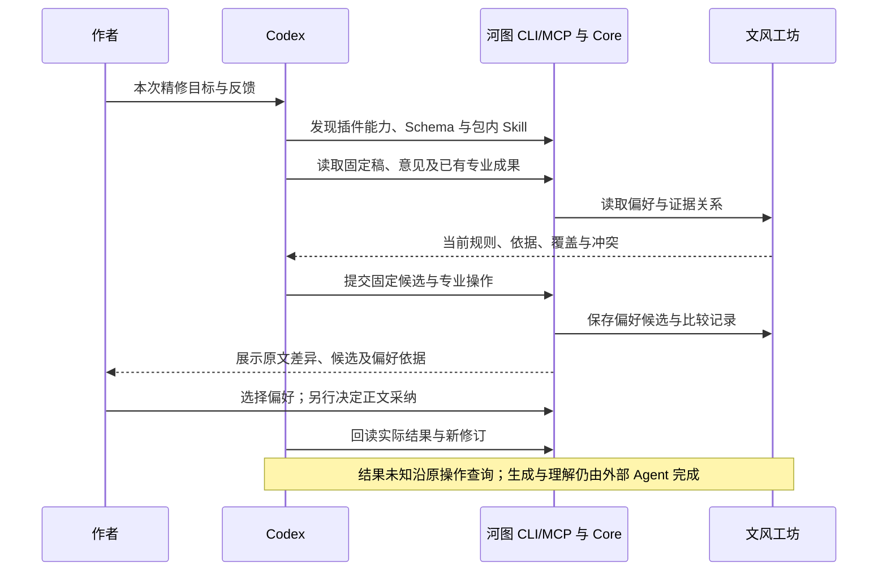

> 本文属于[创作插件体系设计](README.md)，负责小说插件的外部参考、能力取舍及分批复刻建议。

# 小说插件生态调研与复刻路线

研究日期：2026-11-17。研究范围与选型依据保留本次采集事实；首批实现与发行状态见宿主实施记录及各插件08文档。

## 1. 研究结论

建议先建设文风工坊和小说审校，增强现有小说规划，再扩展小说图鉴与互动叙事。按作者任务组合上游能力，避免为每个相似工作台另建正文库、设定库和模型连接。

这些插件共同服务持续创作：已导入原稿或已有规划 → 准备本次目标 → 形成候选 → 作者阅读与反馈 → 局部返工 → 选用后继续下一章。单次生成的页面不是完整插件，必须能沿作品修订、意见和原操作接续。

## 2. 检索范围与证据

入口为[DSH 社区插件市场](https://www.dsh.so/zh/artifacts/)，搜索“小说”，现场筛选为 `L5`。页面显示34条命中，本轮读取第一页32条；第二页及其他验证等级未纳入，不声称穷举市场。DSH 社区市场独立于 DeepSeek 官方项目。

本轮取得32个仓库元数据、18份固定提交的 README，并对 Openwrite、DSH-Creator、Novel Craft、sailoumili/novel-writer 作定向源码或方法文件核对；重点项目另读取固定版本许可证。未安装上游插件、未运行其测试、未比较生成质量。市场验证等级、上游测试数量及性能主张不能替代河图验收。

完整条目、分类、固定提交、文件摘要和证据层次见[研究记录](research/novel-ecosystem-2026-11-17.json)。README 功能说明、源码已检查和河图实际运行分别记录；许可证检查也不等于已完成全部依赖及素材审计。

## 3. 重点参考与河图归属

下表功能为固定版本文档声明；“源码核对”只覆盖研究记录列出的文件。

| 上游参考 | 值得借鉴的能力 | 河图采用方式 | 证据与限制 |
| --- | --- | --- | --- |
| [Novel Craft](https://github.com/shiyan688/dsh-novel-craft/tree/8a52268b3d521e11fd78a3117c03c1f5a771a2cf) | 段落反馈、偏好提炼、规律与证据分离、不同叙事方向、按批注微调、写作包预算 | 新建文风工坊，复用宿主反馈、候选和选区返工 | MIT；已核对批注处理、写作包及方法文件；模型调用适配需要重做 |
| [Openwrite](https://github.com/LiPu-jpg/Openwrite/tree/3635a1e5ca5ab9398e8adb7c3a91526826184a30) | 六域审稿、固定审稿框架、检查覆盖和原文依据 | 小说审校的分析框架 | Apache-2.0 主许可；已核对框架、工具文档与第三方声明；子项目许可分别处理 |
| [DSH-Creator](https://github.com/KurohaneKaoruko/DSH-Creator/tree/e9a8e121a2ce9cd5e8d2721a31ab5ba7c1a399f3) | 写前资料组装、本地规则检查、全书体检、方法套件 | 审校的确定性规则与方法，复用宿主资料入口 | MIT；已读规则及工具源码；文风规则须改为可选择建议 |
| [长篇中文小说工作台](https://github.com/micellince/dsh-long-novel-workbench/tree/fae33646ad17565b64792e94be411f1d3fcf7e95) | 连续阅读、作者与 AI 问题合流、问题到修改稿、原文已变提示 | 增强宿主阅读和意见接续，专业问题分类归审校插件 | MIT；README 核对；不照搬其自有数据库、内置对话或“整书一次读完”的强制策略 |
| [拍板 Novel Beat](https://github.com/DrizzleGig/dsh-novel-beat/tree/577d0995f9f47ba6b6a1398300089e7d42cb055a) | 剧情走向比较、选择代价、人物知情状态、承诺接续 | 增强现有小说规划插件 | MIT；README 核对；不另建正典，不强制作者逐段批准 |
| [小说工坊／时间长河](https://github.com/XiaoOu2024/dsh-novel-generator/tree/8e45f22ce6e5ebf5f6ce98efce8c8a2a199c82c8) | 故事时间、章节跨度、世界状态快照 | 规划的时间线候选与图鉴的历史投影 | GitHub 识别 MIT；README 核对；模型推断不直接成为正式事实，未知时长不填假值 |
| [Novel Atlas](https://github.com/lilinshuei/novel-atlas/tree/2a6cd304c9ce4a7db00bb31e4a2ec08571f0efd3) | 人物关系、地图、成长、感情、器物及剧情多视图，离线 HTML | 新建小说图鉴，同一作品数据的专业投影 | MIT；README 核对；统计抽取只是草稿，不能保证地理或实体归属正确 |
| [一页式小说工坊](https://github.com/ShanJun-pro-max/dsh-novel-workbench/tree/1c728bbca362c99dd379c26894008b56d4122460) | 剧情总结索引、别称、上下文选材、按类型复用偏好 | 文风工坊与宿主任务上下文的补充参考 | GitHub 识别 MIT；README 核对；跨作品复用由作者选择，不自动混入其他作品 |
| [Galgame Generator](https://github.com/baisama-cloud/dsh-galgame-generator/tree/276974e36a89dbaf07d9a7d4208d980088741160) | 叙事分支、变量条件、结局、素材与可播放 HTML | 独立互动叙事插件 | MIT；README 核对；属于新的专业工程，不塞入线性小说规划 |
| [novel-writer](https://github.com/sailoumili/novel-writer/tree/bd0082106998a4737d3428bed334cacde46accd9)／[Novel Solo](https://github.com/Tkingxiao/dsh-novel-solo/tree/5e10e69535eb2d8bf953b4e79b9131bc0885a90f) | 世界、剧情、人物、写作与复核的方法分工；小模型上下文精简 | 按任务组织插件 Skill 与发现摘要 | GitHub 识别 MIT；前者核对预设、后者核对 README；不引入河图内置多 Agent 调度 |

同名项目按仓库身份区分。例如 `watersxya/dsh-novel-forge` 为 AGPL-3.0，`EastChilde/dsh-novel-forge` 的 GitHub 元数据识别为 MIT，不能混用许可结论。砚田 `ZzimaR/dsh-yanfield` 的实际 LICENSE 为 PolyForm Noncommercial 1.0.0；不能因为代码公开或市场收录，就当作宽松开源源码直接引入。

阅读摸鱼、书源下载、Pixiv 采集和通用 Agent 增强不列入本轮创作插件优先项。相关产品仍保留在研究记录中，避免下次检索重复研究。

## 4. 能力边界与技术适配

### 4.1 宿主、插件、Skill 与视图

| 层 | 持有或负责 | 本轮取舍 |
| --- | --- | --- |
| 宿主 Core | 作品身份、固定正文与设定、来源、修订、候选、意见、作者采纳和事务恢复 | 复用已有用例；缺公共入口时先补宿主，不让插件直写内部文件 |
| 专业插件 | 偏好规则、证据组织、审校规则及分析报告、图鉴布局或互动叙事工程 | 专业数据引用固定来源；拥有自己的 Schema、功能清单及测试 |
| 包内 Skill | 选择方法、读取依据、比较候选、续写与返工编排 | 供外部 Agent 按需发现读取，不配置河图内部 Agent |
| 视图 | 选段比较、证据跳转、问题清单、图谱和时间线 | TypeScript／React 复用宿主 SDK；作者可直接阅读和反馈，机器业务不依赖页面 |

河图现有小说规划清单已经覆盖整书／卷章、规划卡、伏笔、关系、固定快照、比较、进度及正式大纲接续，专业事实由该插件维护。本轮剧情走向、规划时间线应先评估在原插件中增强。图鉴若独立发布，消费规划与正式设定的公开固定数据，不复制它们的维护入口。

宿主机器导航以[40](../40-机器能力地图与Review清单.md)为准，包括 `hetu.documents.validate`、`hetu.validation.run`、`hetu.reviews.validate` 和 `hetu.task_context.search`。这些入口承担已定义的检查或检索用例，不表示已经具备六域语义审稿、作者偏好学习或任意全书检索；执行仍须发现安装版能力与当前范围。

### 4.2 上游适配方式

采用现有 TypeScript 插件宿主、公开 SDK 和受管 Node 运行时，专业界面使用 React；组合与生命周期复用现有 Cordis 层，详见[26](26-Cordis采用与DSH兼容边界.md)和[27](27-开放宿主SDK与核心能力审计.md)。本轮没有引入新的运行时或 Rust 插件格式。

可研究复用纯计算函数、数据投影和方法；DSH 的 `ctx.llm`、会话控制、工具注册、私有正文路径和 UI 插槽需要按河图合同改写。使用同类技术栈不代表 DSH 插件可原包安装到河图。

插件通过稳定 CLI/MCP 的动态能力发现与调用接入。包内 Skill 的注册、同一 Codex 会话发现和停用行为按[28](28-插件Skills注册与发现.md)验收，不为每个河图插件另建 Codex 插件或 MCP 服务。

### 4.3 不直接采纳的设计

- **固定文风硬门禁**：Creator 源码把整章破折号超过一次、省略号超过两次、出现分号等列为硬违规。河图可提供作者选定的规则集和建议，不据此阻止正常保存，不将标点统计宣称为可靠的 AI 来源判定。
- **将推测写成事实**：张力、注意力、角色归属和地理抽取分别标明计算值、Agent 判断及作者确认；未读、未检查、依据不足明确显示，不能记为通过。
- **无差别全书输入或极端压缩**：按任务保留必要依据并报告覆盖。跨章审稿必须获得足够原文；写作包可以压缩偏好与前情，但不能把字符预算当作真实 Token 费用，也不能保证固定比例的节省。
- **把上游调度器搬入宿主**：保留 Codex 等外部 Agent 的理解与生成；河图插件组织专业成果和确定性操作。模型服务、作者决定与费用合同继续由宿主执行。

## 5. 分批推进建议

以下为候选发布单元及暂定仓库名，不是工期或完成承诺。每批完整验收后再进入下一批。

| 顺序 | 发布单元 | 首次完整闭环 | 主要参考 |
| --- | --- | --- | --- |
| 1 | 文风工坊 `hetu-prose-studio` | 比较候选 → 作者反馈 → 证据与偏好 → 下轮选区精修 → 作者决定 | Novel Craft、一页式工坊、长篇工作台 |
| 2 | 小说审校 `hetu-novel-review` | 固定范围 → 规则及六域检查 → 有依据的问题 → 修改稿 → 复核与接续 | Openwrite、Creator、长篇工作台 |
| 3 | 现有 `hetu-novel-planner` 升级 | 复盘既有剧情 → 比较新走向与代价 → 时间线候选 → 卷章接续 | Novel Beat、时间长河 |
| 4 | 小说图鉴 `hetu-novel-atlas` | 固定资料 → 多视图联动 → 回到来源 → 更新投影 → 离线交付 | Novel Atlas |
| 5 | 互动叙事 `hetu-interactive-fiction` | 固定故事与素材 → 分支条件 → 可达性检查 → 播放测试 → 工程交付 | Galgame Generator |

小说图鉴的关系网、地图、成长曲线按作品需要启用，不预设男性向、修仙或恋爱类型。互动叙事与线性小说规划分别持有专业结构，通过来源关联。

## 6. 第一批：文风工坊的可实施范围

### 6.1 作者用例

作者说：“这一段太直白，保留动作，让情绪藏在对白里；以后这个人物也这样写。”Codex 读取当前固定稿和已有偏好，准备不同处理方向与局部候选。作者可以只表达喜欢或不喜欢，也可以说明原因；Agent 提炼偏好候选，作者选择沿用范围，再用于下一轮。作者不必手工填写完整规则表。

已有稿可以直接进入反馈与精修；没有反馈或偏好时可以先创作，不把校准变成写作前置。叙事方向数量按目标与预算决定，不机械生成十份完整章稿。

### 6.2 数据与行为

- 偏好区分作者直接声明与 Agent 推导，保留来源意见、固定成果及选区；作者可编辑、停用或删除规则。匹配不出的证据显示依据不足，不伪造映射。
- 规则和原文证据分层。下一轮默认提供已选规则及本次必要资料，完整依据按需读取；“证据不重复注入”不等于“所有创作都不需要正文”。
- 比较候选记录叙事差异及其代价；选段拼接先形成候选并检查过渡，不能把机械拼接视为已定稿。
- 精修固定目标选区和基线。未选区域保持原字节；确需扩大改动范围时重新准备明确候选。不能用段落归一化后的相同，冒充整份原文逐字未改。
- 正文、反馈和采纳复用宿主；插件只保存偏好、证据关系、比较组织及本次专业工作记录。规划与正式设定分别引用其 Owner 的固定修订。
- 默认作用于当前作品；复用到另一部作品或类型模板时明确选择目标和规则，不自动串书。
- 提供有版本与来源的 Markdown／JSON 专业导出。工作状态、冲突与原操作回读由公共入口完整暴露。

正式开发前，在插件仓库定义数据 Schema、专业动作、Skill、完整用例及功能清单；核对宿主公开服务能否支撑上述范围。缺口归实际 Owner，不在此研究文档虚构已发布 API。

### 6.3 机器与作者协作

### 6.4 发布验收出口

| 场景 | 必须取得的证据 |
| --- | --- |
| 首次使用、没有偏好 | 可直接精修；没有虚构的默认作者口味 |
| 喜欢与不喜欢的真实反馈 | 偏好可反查固定意见与来源；作者删除或停用后新任务不再默认带入 |
| 相互冲突的偏好、跨作品复用 | 显示适用范围和冲突；其他作品不被隐式读取或修改 |
| 不存在的来源、缺少阅读范围 | 拒绝无效引用或显示未完成；不生成假证据、假通过 |
| 只改一段、原文包含中文与特殊空白 | 目标外字节摘要一致；候选保留完整差异 |
| 原文已改、偏好同时被编辑 | 固定引用／CAS 冲突，不覆盖作者新稿，保留当前候选 |
| 写作包超预算 | 展示选材与裁剪；必要依据不足时提示补读，不静默丢失约束 |
| 保存响应丢失 | 原操作回读确认结果，不换键重复写入 |
| 同一 Codex 会话安装、停用与重开 | 稳定入口能重新发现并读取 Skill；停用后不再提供新调用，历史及导出保留 |
| 全程不打开 GUI 的小说迭代 | CLI/MCP 跑通读取、候选、反馈、偏好、返工及接续；作者采纳按实际宿主决定合同另验 |
| 作者可视化 Review | 实际工作面呈现来源、差异、规则与完整异常状态；Mac 和 Windows 分别取得运行证据 |

上表是开发验收要求，本轮未执行。单元测试验证专业规则和引用，集成测试验证宿主数据归属、冲突及恢复，Codex 会话验收验证能力发现和完整旅程；任一层通过不能替代其余层。

## 7. 开发、上架与维护

开发与调试遵守[22](22-插件开发与调试指南.md)，固定版本和制品发布遵守[23](23-插件发布与上架指南.md)，目录收录遵守[24](24-插件目录与分发治理.md)。研究条目不自动进入官网插件中心。

复用代码、方法或素材时逐项保留来源及许可证，改编说明随插件分发。宽松许可项目优先评估工程复用；GPL／AGPL、自定义或无法识别的许可另行核对适用文件和分发义务，功能启发与源码引入分别决定。

本文件只维护外部参考、取舍与顺序。正式能力由插件各自的功能清单、合同与验收记录维护；宿主[40](../40-机器能力地图与Review清单.md)只维护核心能力和插件发现入口。主实施进度仍归[20](../20-实施路线与里程碑.md)，不在研究文档复制发布状态。

## 首批正式方案

上游仓库已逐个克隆到独立research base并固定提交。河图实现按作者任务重新组织，宿主持有正文、来源、任务与作者决定，专业插件维护自己的领域数据，不复制上游内置Agent或自有正文库。

| 项目 | 方案与领域 | 版本 |
| --- | --- | --- |
| [文风工坊](https://github.com/wordflowlab/hetu-prose-studio/tree/v0.1.0/docs) | 有据偏好、方向比较、固定选区微调与上下文 | v0.1.0 |
| [小说审校](https://github.com/wordflowlab/hetu-novel-review/tree/v0.1.0/docs) | 六域覆盖、问题证据、意见处理及新候选复核 | v0.1.0 |
| [小说规划](https://github.com/wordflowlab/hetu-novel-planner/tree/v0.2.0/docs) | 保留整书卷章，增加方向代价、双时间及人物知情状态 | v0.2.0 |
| [小说图鉴](https://github.com/wordflowlab/hetu-novel-atlas/tree/v0.1.0/docs) | 同源人物/势力、关系、地点、时间、成长与器物投影 | v0.1.0 |

四项目经稳定CLI/MCP接续同一小说，方法由包内Skill动态提供。宿主只补齐work_kinds范围与固定HTML文件出口，不新增专业正文、审稿或图鉴内核。具体证据和平台限制归各插件08及宿主20，互动叙事仍属下一批。
